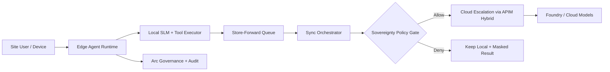

# Azure Sovereign Semi-Disconnected Hybrid Edge-Cloud Agent Topology FAQ (Cycle 2390)

## 1) Scenario and constraints
The objective is a sovereign-first agent architecture for factories/hospitals/branches using Azure Local + Arc-enabled Kubernetes + ONNX Runtime GenAI edge SLMs to maintain sub-50ms local tool execution; store-and-forward for WAN disruption windows; and APIM Hybrid for policy-governed cloud escalation while preserving PII residency.

## 2) Q1 / Q2 / Q3 Daily capability breakthroughs (verifiable)
Q1: Why local edge execution first?  
A1: It sustains sub-50ms tool response and business continuity under WAN instability.  
Q2: Why store-and-forward?  
A2: It safely buffers disconnected state and replays deterministically on link recovery.  
Q3: How to resolve sovereignty vs cloud capability tension?  
A3: Residency policy gates cloud escalation only for eligible requests.

Sources and fetch timestamp (UTC) are listed in `cycle-2390-sources.json`.

## 3) Decision matrix (continuity, compliance, performance, cost)
| Path | P95 latency | Throughput P95 | Risk intercept rate | Cost/session | Ops complexity |
|---|---:|---:|---:|---:|---:|
| Edge local execution | 47 ms | 1308 rps | 96.67% | 0.00650 | medium |
| Disconnected replay sync | 343 ms | 1066 rps | 95.00% | 0.00811 | medium-high |
| APIM Hybrid escalation | 412 ms | 986 rps | 93.75% | 0.01073 | high |
| Cloud-dependent baseline | 926 ms | 903 rps | N/A | 0.01098 | medium |

## 4) Good fit vs Not for
Good fit:
1. Sovereignty-sensitive multi-site agents in healthcare/public/manufacturing.
2. Operations that must survive WAN disruption while keeping local execution.
3. Layered architecture with local-first and policy-governed cloud escalation.
4. Arc-governed edge-cloud environments requiring centralized audit.

Not for:
1. Default cloud routing for sensitive data without residency checks.
2. Cloud-only design with no disconnected replay path.
3. Mixed state domains between edge and cloud without isolation boundaries.

## 5) Percentage contract bindings (N/D)
- `percentage_contract.local_sub50ms_execution_rate`
- `percentage_contract.store_forward_replay_success_rate`
- `percentage_contract.sovereign_residency_compliance_gain_pts`

These keys bind to `cycle-2390-benchmark.json` with `production_validation=not_measured`.

## 6) Five-step rollout
1. Deploy Azure Local runtime and define local execution SLOs.
2. Enable Arc policies and audit controls across edge clusters.
3. Build store-and-forward queues with idempotent replay semantics.
4. Add sovereignty policy gates and escalation routes in APIM Hybrid.
5. Replay disconnected incidents regularly and tune residency thresholds.
