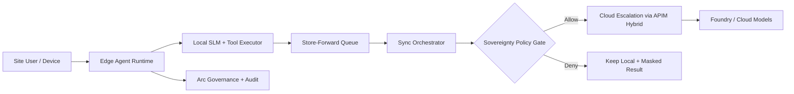

# Azure 主权半断网混合边缘云 Agent 拓扑 FAQ（Cycle 2390）

## 1) 场景与约束
目标是在工厂/医院/网点等场景实现主权优先 Agent 架构：基于 Azure Local + Arc-Enabled Kubernetes + ONNX Runtime GenAI 边缘 SLM，保障本地 sub-50ms 工具执行；在 WAN 不稳定时采用 store-and-forward 同步；通过 APIM Hybrid 控制云端升级并守住 PII 驻留边界。

## 2) Q1 / Q2 / Q3 当日能力突破（可验证）
Q1：为什么边缘本地执行是首选？  
A1：在 WAN 抖动场景可稳定满足 sub-50ms 的工具响应和业务连续性。  
Q2：store-and-forward 的核心价值？  
A2：可把断网期间状态安全缓存并在链路恢复后有序回放。  
Q3：如何处理主权数据与云端能力扩展冲突？  
A3：通过驻留策略门禁，只对可升级请求开放云端路径。

来源与抓取时间（UTC）见 `cycle-2390-sources.json`。

## 3) 决策矩阵（连续性、合规、性能、成本）
| 路径 | P95 延迟 | 吞吐 P95 | 风险拦截率 | 单会话成本 | 运维复杂度 |
|---|---:|---:|---:|---:|---:|
| 边缘本地执行 | 47 ms | 1308 rps | 96.67% | 0.00650 | 中 |
| 断网回放同步 | 343 ms | 1066 rps | 95.00% | 0.00811 | 中高 |
| APIM Hybrid 云升级 | 412 ms | 986 rps | 93.75% | 0.01073 | 高 |
| 云依赖基线 | 926 ms | 903 rps | N/A | 0.01098 | 中 |

## 4) Good fit vs Not for
Good fit：
1. 医疗/政企/制造等主权敏感的多站点 Agent 场景。  
2. WAN 不稳定但必须维持现场连续执行的业务。  
3. 需要本地优先、云端可控升级的分层架构。  
4. 需要 Arc 统一治理与审计的边云混合环境。

Not for：
1. 忽略驻留策略，默认把敏感数据上云。  
2. 仅依赖云端，不做断网缓存与恢复设计。  
3. 本地与云端状态域混用，缺乏边界隔离。

## 5) Percentage contract bindings (N/D)
- `percentage_contract.local_sub50ms_execution_rate`
- `percentage_contract.store_forward_replay_success_rate`
- `percentage_contract.sovereign_residency_compliance_gain_pts`

以上键绑定 `cycle-2390-benchmark.json`，并标记 `production_validation=not_measured`。

## 6) 五步落地指南
1. 部署 Azure Local 边缘运行时并建立本地工具执行 SLO。  
2. 启用 Arc 策略与审计，统一边缘集群治理。  
3. 设计 store-and-forward 队列与回放幂等策略。  
4. 在 APIM Hybrid 中加入驻留策略门禁与升级路由。  
5. 周期回放断网样本并校正主权策略阈值。
