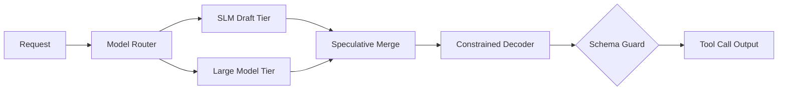

# Azure Speculative Decoding + Constrained Tool-Schema Router Cascade FAQ (Cycle 2386)

## 1) Scenario and constraints
The objective is low-latency and zero-malformed output for tool-calling agents by combining Foundry router draft-tiering, AKS vLLM EAGLE-3 speculative decoding, XGrammar/llguidance constrained decoding, and route-level token FinOps.

## 2) Q1 / Q2 / Q3 Daily capability breakthroughs (verifiable)
Q1: What is the core gain from speculative decoding?  
A1: Lower TTFT/TPOT and faster high-concurrency responsiveness.  
Q2: Why enforce constrained decoding?  
A2: To keep JSON/schema tool output stable and executable.  
Q3: How does router cascade control cost?  
A3: Route-level token attribution steers expensive traffic to suitable tiers.

Source links and fetch timestamp (UTC) are listed in `cycle-2386-sources.json`.

## 3) Decision matrix (latency, correctness, cost)
| Path | P95 step latency | TTFT/TPOT gain | Malformed-output risk | Cost/call | Ops complexity |
|---|---:|---:|---:|---:|---:|
| Foundry draft router | 236 ms | high | low | 0.00235 | medium |
| AKS vLLM EAGLE-3 | 228 ms | high | medium-low | 0.00211 | medium-high |
| Constrained decode lane | 281 ms | medium | very low | 0.00252 | medium |
| Schema guard lane | 281 ms | medium-high | very low | 0.00238 | medium-high |

## 4) Good fit vs Not for
Good fit:
1. Tool-calling agents requiring strict JSON/schema correctness.
2. High-throughput copilots requiring TTFT/TPOT gains.
3. Multi-tenant SaaS requiring route-level token FinOps attribution.
4. Regulated workloads requiring hard malformed-call blocking and audit trails.

Not for:
1. Disabled constrained decoding with strict tool-format requirements.
2. Speculative paths without confidence-gated fallback thresholds.
3. Single-model forcing without route-level cost visibility.

## 5) Percentage contract bindings (N/D)
- `percentage_contract.zero_malformed_toolcall_rate`
- `percentage_contract.speculative_latency_gain_sla_rate`
- `percentage_contract.token_finops_savings_gain_pts`

These keys bind to `cycle-2386-benchmark.json` with `production_validation=not_measured`.

## 6) Five-step rollout
1. Define router tiers and confidence fallback policy.
2. Enable JSON/schema constrained decoding by default.
3. Add hard malformed-output interception and audit reporting.
4. Integrate route-level token cost attribution.
5. Review TTFT/TPOT, format correctness, and cost-per-call weekly.
