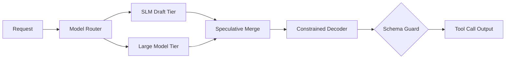

# Azure 推测解码与约束工具 Schema 路由级联 FAQ（Cycle 2386）

## 1) 场景与约束
目标是为 Tool-Calling Agent 实现低延迟且零畸形输出：结合 Foundry Router 的小模型草稿分层与 AKS vLLM EAGLE-3 推测解码，同时引入 XGrammar/llguidance 约束解码与路由级 token FinOps。

## 2) Q1 / Q2 / Q3 当日能力突破（可验证）
Q1：推测解码的收益核心是什么？  
A1：降低 TTFT/TPOT，提升高并发响应速度。  
Q2：为什么必须约束解码？  
A2：确保工具调用 JSON/Schema 结构稳定且可执行。  
Q3：Router Cascade 怎么控成本？  
A3：通过路由级 token 计费归因，把高成本流量导向更合适层级。

来源与抓取时间（UTC）写入 `cycle-2386-sources.json`。

## 3) 决策矩阵（延迟、正确率、成本）
| 路径 | P95 步骤延迟 | TTFT/TPOT 改善 | 畸形输出风险 | 每次调用成本 | 运维复杂度 |
|---|---:|---:|---:|---:|---:|
| Foundry Draft Router | 236 ms | 高 | 低 | 0.00235 | 中 |
| AKS vLLM EAGLE-3 | 228 ms | 高 | 中低 | 0.00211 | 中高 |
| 约束解码通道 | 281 ms | 中 | 极低 | 0.00252 | 中 |
| Schema Guard 通道 | 281 ms | 中高 | 极低 | 0.00238 | 中高 |

## 4) Good fit vs Not for
Good fit：
1. Tool-Calling Agent：需严格 JSON/Schema 正确率。  
2. 高并发 Copilot：需显著 TTFT/TPOT 降低。  
3. 多租户 SaaS：需路由级 token FinOps 归因。  
4. 金融合规：需硬拦截畸形工具调用并留审计链。

Not for：
1. 关闭约束解码却要求严格工具格式。  
2. 推测路径无置信回退门槛。  
3. 无路由级成本监控的统一强制大模型策略。

## 5) Percentage contract bindings (N/D)
- `percentage_contract.zero_malformed_toolcall_rate`
- `percentage_contract.speculative_latency_gain_sla_rate`
- `percentage_contract.token_finops_savings_gain_pts`

以上键绑定 `cycle-2386-benchmark.json`，并标注 `production_validation=not_measured`。

## 6) 五步落地指南
1. 定义 router tier 与置信阈值回退规则。  
2. 默认启用 JSON/Schema 约束解码。  
3. 建立畸形输出硬拦截与审计上报。  
4. 接入路由级 token 计费归因。  
5. 周度复盘 TTFT/TPOT、格式正确率与单位成本。
