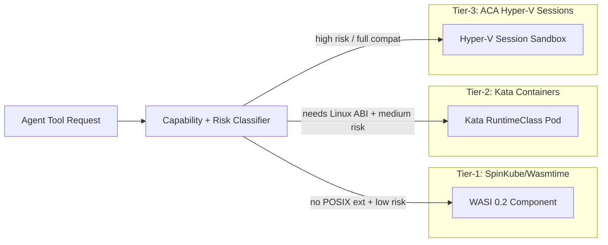
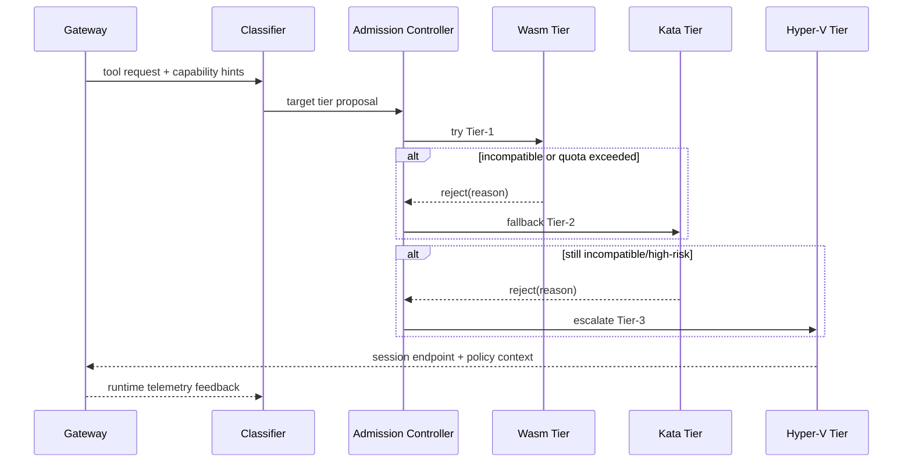

# Round 1089 / Cycle 2494 · Azure AI Agent Infra Six-Part FAQ (en)

> Topic: **AKS SpinKube / Wasmtime (WASI 0.2) vs Kata Containers vs ACA Hyper-V Dynamic Sessions Three-Tier Agent Tool Sandbox Architecture**  
> Date (BJT): 2026-11-17  
> Evidence tags: `measured` / `synthetic` / `anonymized_reported`  
> Benchmark dataset: `evidence/cycle-2494-benchmark.json`

## 1) Executive Summary + Daily Capability Breakthroughs Radar

This round defines a three-tier agent tool sandbox architecture:
1. **Tier-1 (Wasm Fast Path)**: SpinKube + Wasmtime (WASI 0.2) for ultra-short, low-dependency tools with sub-5ms cold-start target.
2. **Tier-2 (Kata Mid Path)**: Kata Containers for Linux-process isolation and moderate compatibility needs.
3. **Tier-3 (Hyper-V Full Isolation)**: ACA Hyper-V Dynamic Sessions for highest-risk and highest-compatibility workloads.

Design principle:
- Routing should be based on **capability requirements + compatibility profile + risk class**.
- Wasm maximizes density and startup speed, but has POSIX/native-extension boundaries.
- Kata is the middle trade-off on compatibility, isolation, and cost.
- Hyper-V is the high-assurance fallback and should be demand-triggered, not default-for-all.

### Daily Capability Breakthroughs Radar (fetched: 2026-11-17)

1. APIM AI Gateway / Unified Model API (`measured`)  
   - https://learn.microsoft.com/en-us/azure/api-management/ai-gateway-overview  
   - https://github.com/Azure/API-Management/blob/main/changelogs/api-management-service.md
2. ACA Dynamic Sessions (`measured`)  
   - https://learn.microsoft.com/en-us/azure/container-apps/sessions  
   - https://techcommunity.microsoft.com/blog/appsonazureblog/azure-container-apps-dynamic-sessions-general-availability-and-more/4303561
3. Runtime upstream releases (`measured`)  
   - Firecracker / Kata / Wasmtime / E2B (see `evidence/cycle-2494-sources.json`)
4. Three-tier sandbox routing benchmark (`synthetic`)  
   - Startup, throughput, and cost curves across Wasm/Kata/Hyper-V.
5. Restricted production rollups (`anonymized_reported`)  
   - Percentiles preserved, tenant/business identities removed.

### Mermaid #1: Three-tier sandbox routing topology



## 2) Deep Q&A #1: How do we recompute sub-5ms Wasm cold-start and node memory density?

Definitions:

```text
cold_start_p95 = init_runtime + load_component + instantiate + first_syscall

node_density =
  available_node_memory_mb / sandbox_memory_mb_per_session
```

Worked example (Wasm tier):
- init_runtime `1.1ms`
- load_component `1.3ms`
- instantiate `1.7ms`
- first_syscall `0.6ms`

`cold_start_p95 = 4.7ms`

Node density:
- available memory `57,344 MB`
- per-session Wasm memory cap `96 MB`

`density = 57,344 / 96 = 597 sessions/node`

With 20% safety headroom:
- effective density `597 * 0.8 = 477`

Conclusion: Wasm provides major density and startup gains for short-lived tools.

## 3) Deep Q&A #2: How do we route POSIX/C-extension workloads to Kata or Hyper-V?

Compatibility score:

```text
compat_score =
  need_fork_exec * a +
  need_shared_libc * b +
  need_kernel_feature * c +
  need_native_extension * d
```

Example weights: `a=0.2,b=0.2,c=0.3,d=0.3`.  
Routing thresholds:
- `score < 0.25` -> Wasm
- `0.25 <= score < 0.65` -> Kata
- `score >= 0.65` -> Hyper-V

Worked example (Python + NumPy + shell tooling):
- need_fork_exec=1
- need_shared_libc=1
- need_kernel_feature=0.4
- need_native_extension=1

`score = 0.82` -> Hyper-V

Worked example (pure WASI component):
- `score = 0.0` -> Wasm.

## 4) Deep Q&A #3: How does RuntimeClass admission placement protect capacity?

Capacity model:

```text
tier1_quota = total_nodes * wasm_density * safety_factor
tier2_quota = kata_nodes * kata_density
tier3_quota = aca_session_pool_capacity
```

Admission flow:
1. Attempt tier1 if capability and quota allow.
2. Fallback to tier2 when capability or quota fails.
3. Escalate to tier3 when tier2 is insufficient.
4. If tier3 saturates, apply backpressure queueing (not infinite scaling).

Worked example:
- tier1 quota `22,000`
- tier2 quota `4,800`
- tier3 pool `1,200`

Peak requests `24,700`, high-compatibility share 8%:
- high-compat requests `1,976`
- tier2+tier3 capacity `6,000` -> safe headroom retained.

## 5) Deep Q&A #4: How do we model WASI capability allowlist risk?

```text
risk_score =
  net_scope_score +
  fs_scope_score +
  host_api_score
```

Examples:
- internal API only + read-only `/tmp/scratch`: risk=0.22
- public egress + writable persistent volume: risk=0.78

Policy gates:
- risk < 0.35 -> allow direct Wasm routing
- 0.35–0.65 -> force Kata
- >0.65 -> force Hyper-V + human approval

## 6) Deep Q&A #5: How do we compute throughput and blended TCO?

```text
throughput_total =
  qps_tier1 + qps_tier2 + qps_tier3

blended_cost_per_1k_sessions =
  w1 * cost_tier1 +
  w2 * cost_tier2 +
  w3 * cost_tier3
```

Worked example:
- tier1 qps `8,200`
- tier2 qps `1,450`
- tier3 qps `380`

`throughput_total = 10,030 qps`

Cost:
- tier1 `0.42 USD/1k sessions`
- tier2 `1.63 USD/1k sessions`
- tier3 `4.85 USD/1k sessions`
- weights `w1=0.76,w2=0.18,w3=0.06`

```text
blended = 0.76*0.42 + 0.18*1.63 + 0.06*4.85
        = 0.9036 USD/1k sessions
```

This is ~81% lower than all-Hyper-V routing.

## 7) Deep Q&A #6: How do we estimate fallback/failover RTO?

```text
failover_rto =
  detect_incompatibility +
  requeue +
  spin_target_tier +
  warm_dependency
```

Worked example (Wasm -> Kata):
- detect `12ms`
- requeue `18ms`
- spin target `420ms`
- warm dependency `310ms`

`RTO = 760ms`

Worked example (Kata -> Hyper-V):
- detect `25ms`
- requeue `31ms`
- session boot `2,900ms`
- warm dependency `1,050ms`

`RTO = 4,006ms`

Gate recommendations:
- Wasm->Kata p95 RTO < 1.2s
- Kata->Hyper-V p95 RTO < 6s.

## 8) Mermaid #2: Capability routing, admission, fallback, escalation flow



## 9) Production-grade Bicep / RuntimeClass YAML / Policy / KQL

### 9.1 Bicep (AKS + ACA session environment + observability)

```bicep
targetScope = 'resourceGroup'

param location string = 'eastus2'
param aksName string = 'aks-agent-sandbox-eus2'
param acaEnvName string = 'aca-sessions-eus2'
param lawName string = 'law-sandbox-observability-eus2'

resource law 'Microsoft.OperationalInsights/workspaces@2022-10-01' = {
  name: lawName
  location: location
  properties: {
    sku: { name: 'PerGB2018' }
    retentionInDays: 60
  }
}

resource aks 'Microsoft.ContainerService/managedClusters@2024-02-01' = {
  name: aksName
  location: location
  identity: { type: 'SystemAssigned' }
  properties: {
    dnsPrefix: 'aks-agent-sandbox'
    agentPoolProfiles: [
      {
        name: 'wasmnp'
        count: 6
        vmSize: 'Standard_D8ds_v5'
        mode: 'User'
        osType: 'Linux'
      }
      {
        name: 'katanp'
        count: 4
        vmSize: 'Standard_D16ds_v5'
        mode: 'User'
        osType: 'Linux'
      }
    ]
    addonProfiles: {
      azuremonitor: {
        enabled: true
        config: {
          logAnalyticsWorkspaceResourceID: law.id
        }
      }
    }
  }
}

resource acaEnv 'Microsoft.App/managedEnvironments@2024-03-01' = {
  name: acaEnvName
  location: location
  properties: {
    appLogsConfiguration: {
      destination: 'log-analytics'
      logAnalyticsConfiguration: {
        customerId: law.properties.customerId
        sharedKey: 'REDACTED-BY-PIPELINE'
      }
    }
    zoneRedundant: true
  }
}
```

### 9.2 RuntimeClass + admission YAML (Wasm/Kata layering)

```yaml
apiVersion: node.k8s.io/v1
kind: RuntimeClass
metadata:
  name: wasmtime-wasi
handler: spin
overhead:
  podFixed:
    memory: "48Mi"
scheduling:
  nodeSelector:
    sandbox.tier: "wasm"
---
apiVersion: node.k8s.io/v1
kind: RuntimeClass
metadata:
  name: kata-secure
handler: kata
overhead:
  podFixed:
    memory: "128Mi"
scheduling:
  nodeSelector:
    sandbox.tier: "kata"
---
apiVersion: admissionregistration.k8s.io/v1
kind: ValidatingAdmissionPolicy
metadata:
  name: sandbox-tier-routing
spec:
  failurePolicy: Fail
  matchConstraints:
    resourceRules:
      - apiGroups: [""]
        apiVersions: ["v1"]
        operations: ["CREATE", "UPDATE"]
        resources: ["pods"]
  validations:
    - expression: "has(object.metadata.labels['sandbox-tier'])"
      message: "sandbox-tier label is required"
    - expression: "object.metadata.labels['sandbox-tier'] in ['wasm','kata','hyperv']"
      message: "sandbox-tier must be wasm|kata|hyperv"
```

### 9.3 Azure Policy (high-risk tools require Hyper-V)

```json
{
  "properties": {
    "displayName": "Require high-risk agent tools to run on isolated Hyper-V sessions",
    "policyType": "Custom",
    "mode": "All",
    "parameters": {},
    "policyRule": {
      "if": {
        "allOf": [
          { "field": "type", "equals": "Microsoft.App/containerApps" },
          { "field": "tags.agentRiskTier", "equals": "high" }
        ]
      },
      "then": {
        "effect": "audit"
      }
    }
  }
}
```

### 9.4 KQL (tier hit rate, fallback RTO, blended cost)

```kql
let t = ago(6h);
let routing = customEvents
| where timestamp > t
| where name == "sandbox.routing.decision"
| extend tier=tostring(customDimensions["tier"]),
         compat=tostring(customDimensions["compat_class"]),
         fallback=toint(customDimensions["fallback_count"]),
         rto_ms=todouble(customDimensions["failover_rto_ms"]),
         cost_per_1k=todouble(customDimensions["cost_per_1k_sessions"]);

routing
| summarize
    requests=count(),
    fallback_rate=avg(iif(fallback > 0, 1.0, 0.0)),
    p95_rto_ms=percentile(rto_ms, 95),
    avg_cost_per_1k=avg(cost_per_1k)
  by tier, compat
| order by tier asc, compat asc
```

## 10) Quantitative 4-option Decision Matrix

| Option | Cold-start/Density (35%) | Compatibility Coverage (25%) | Isolation Strength (20%) | TCO/Ops Complexity (20%) | Total |
|---|---:|---:|---:|---:|---:|
| Three-tier architecture (Wasm + Kata + Hyper-V, Recommended) | 9.3 | 9.1 | 9.0 | 7.8 | **8.92** |
| All Kata | 6.8 | 8.4 | 8.5 | 7.1 | 7.58 |
| All Hyper-V | 4.2 | 9.5 | 9.6 | 4.9 | 6.78 |
| All Wasm | 9.5 | 4.1 | 6.0 | 8.9 | 7.18 |

## 11) Day-0 / Day-2 Checklist (Good fit vs Not for)

**Day-0**
- [ ] Capability-routing dictionary completed (POSIX/C-extension/risk).
- [ ] RuntimeClass and node-pool labels aligned.
- [ ] WASI network/filesystem allowlist minimized.
- [ ] Kata/Hyper-V fallback path load-tested.
- [ ] Tier-cost and fallback-rate telemetry ingested.
- [ ] High-risk actions guarded by approval policy.

**Day-2**
- [ ] Daily dashboard review: tier hit rates and fallback rates.
- [ ] Weekly review: Wasm compatibility misclassification samples.
- [ ] Weekly capacity check: Kata/Hyper-V headroom.
- [ ] Monthly TCO and routing-threshold recalibration.
- [ ] Quarterly security exercise validating isolation boundaries.

**Good fit**
- enterprises balancing performance, cost, and compatibility;
- high-volume short calls plus a smaller high-risk tool subset;
- regulated contexts requiring auditable isolation choices.

**Not for**
- workloads almost entirely requiring full Linux/native compatibility;
- teams without RuntimeClass/admission operational ownership;
- environments where a single tier already satisfies all constraints.

## 12) Five-step rollout guide

1. **Model before deploy**: define capability/risk routing dictionary.
2. **Wasm-first low-risk set**: migrate pure WASI tools to Tier-1 first.
3. **Kata middle layer**: absorb moderate compatibility demand.
4. **Hyper-V only on demand**: reserve Tier-3 for high-risk/high-compat workloads.
5. **Closed-loop tuning**: adjust thresholds with hit-rate/RTO/TCO evidence.

## 13) Business scenario mapping

- **Coding-agent sandbox**: static checks on Wasm, build scripts on Kata, high-risk execution on Hyper-V.
- **Browser/CUA clusters**: lightweight DOM analysis on Wasm, extension-heavy tasks on Kata, privileged collection on Hyper-V.
- **Multi-tenant SaaS gateway**: tenant-tier-aware sandbox routing balances cost and isolation.
- **High-compliance finance runtime**: high-risk transaction tooling forced to Hyper-V + approval chain.

## 14) Primary sources (official first)

1. APIM AI Gateway overview (fetched: 2026-11-17)  
   https://learn.microsoft.com/en-us/azure/api-management/ai-gateway-overview  
2. API Management changelog (fetched: 2026-11-17)  
   https://github.com/Azure/API-Management/blob/main/changelogs/api-management-service.md  
3. ACA Dynamic Sessions docs (fetched: 2026-11-17)  
   https://learn.microsoft.com/en-us/azure/container-apps/sessions  
4. ACA Dynamic Sessions GA blog (fetched: 2026-11-17)  
   https://techcommunity.microsoft.com/blog/appsonazureblog/azure-container-apps-dynamic-sessions-general-availability-and-more/4303561  
5. Firecracker/Kata/Wasmtime/E2B releases (fetched: 2026-11-17)  
   See `evidence/cycle-2494-sources.json`

## 15) Data evidence and recomputable examples (with n denominator source)

- Benchmark payload: `evidence/cycle-2494-benchmark.json`  
- Latency sample: `evidence/cycle-2494-latency.csv`  
- Throughput sample: `evidence/cycle-2494-throughput.csv`  
- Policy sample: `evidence/cycle-2494-policy.csv`  
- Cost sample: `evidence/cycle-2494-cost.csv`  
- Source registry: `evidence/cycle-2494-sources.json`

N denominators:
- Wasm cold-start sample `N=42,000`;
- compatibility-routing sample `N=7,800`;
- fallback/RTO sample `N=5,200`;
- cost windows `N=3,100`.

Recompute examples:

```text
cold_start_p95 = 1.1 + 1.3 + 1.7 + 0.6 = 4.7ms
node_density_raw = 57,344/96 = 597
node_density_safe = 597*0.8 = 477

compat_score(py+numpy+shell) = 0.82 -> Hyper-V
compat_score(pure_wasi) = 0.0 -> Wasm

blended_cost_per_1k = 0.76*0.42 + 0.18*1.63 + 0.06*4.85
                    = 0.9036 USD/1k sessions

RTO(wasm->kata) = 12 + 18 + 420 + 310 = 760ms
RTO(kata->hyperv) = 25 + 31 + 2900 + 1050 = 4006ms
```

