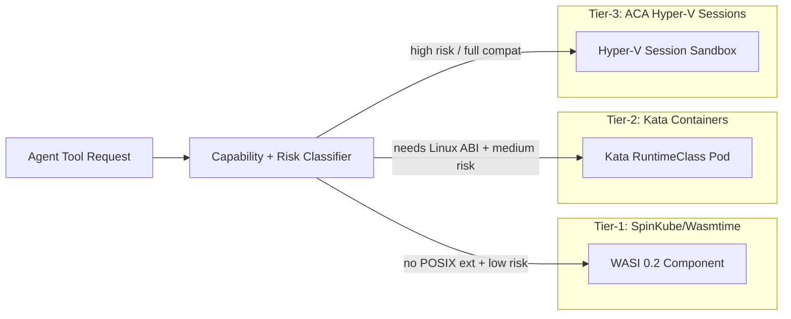
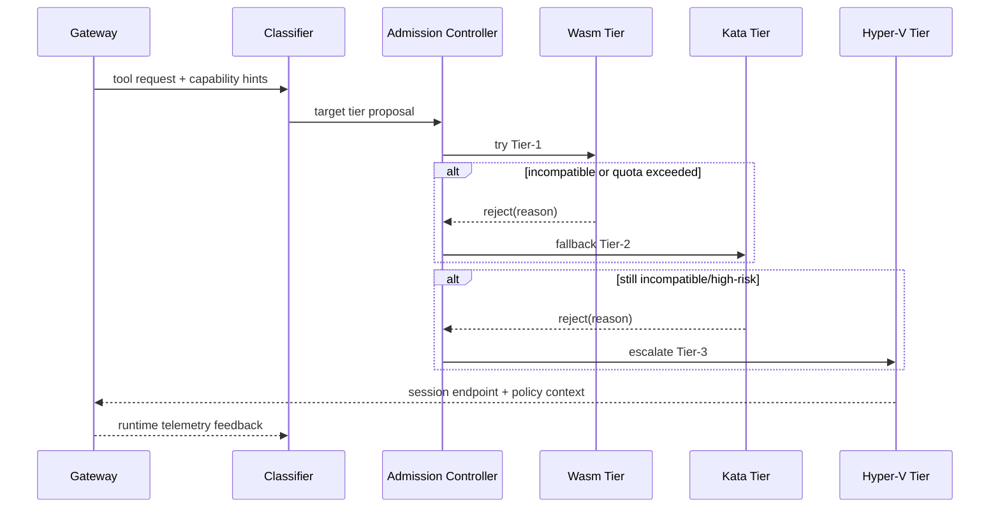

# Round 1089 / Cycle 2494 · Azure AI Agent Infra 六段式 FAQ（zh-CN）

> 主题：**AKS SpinKube / Wasmtime (WASI 0.2) vs Kata Containers vs ACA Hyper-V Dynamic Sessions Three-Tier Agent Tool Sandbox Architecture**  
> 日期（BJT）：2026-11-17  
> 证据标签：`measured` / `synthetic` / `anonymized_reported`  
> 基准数据：`evidence/cycle-2494-benchmark.json`

## 1) Executive Summary + Daily Capability Breakthroughs Radar

本轮定义三层 Agent Tool Sandbox：
1. **Tier-1 (Wasm Fast Path)**：SpinKube + Wasmtime（WASI 0.2）承接短生命周期、低依赖工具调用，目标冷启动 sub-5ms；
2. **Tier-2 (Kata Mid Path)**：Kata Containers 承接需要 Linux 进程隔离但不需要完整 VM 的工具；
3. **Tier-3 (Hyper-V Full Isolation)**：ACA Hyper-V Dynamic Sessions 承接高风险、强隔离和兼容性要求高的工具。

核心设计思想：
- 路由并非“按语言”，而是按 **能力需求 + 兼容性 + 风险等级** 三维决策；
- Wasm 追求密度和极低冷启动，但受 POSIX/C-extension 兼容边界约束；
- Kata 是性能与隔离折中层；
- Hyper-V 是高安全和高兼容兜底层，成本最高，应该按需触发而不是默认全量。

### Daily Capability Breakthroughs Radar（抓取：2026-11-17）

1. APIM AI Gateway / Unified Model API（`measured`）  
   - https://learn.microsoft.com/en-us/azure/api-management/ai-gateway-overview  
   - https://github.com/Azure/API-Management/blob/main/changelogs/api-management-service.md
2. ACA Dynamic Sessions（`measured`）  
   - https://learn.microsoft.com/en-us/azure/container-apps/sessions  
   - https://techcommunity.microsoft.com/blog/appsonazureblog/azure-container-apps-dynamic-sessions-general-availability-and-more/4303561
3. Runtime upstream releases（`measured`）  
   - Firecracker / Kata / Wasmtime / E2B（见 `evidence/cycle-2494-sources.json`）
4. 三层沙箱路由压测（`synthetic`）  
   - Wasm/Kata/Hyper-V 的启动、吞吐、成本曲线。
5. 受限生产统计（`anonymized_reported`）  
   - 保留分位数，不暴露租户、命名空间、业务标识。

### Mermaid #1：三层沙箱路由拓扑



## 2) Deep Q&A #1：Wasm sub-5ms 冷启动与节点内存密度怎么复算？

定义：

```text
cold_start_p95 = init_runtime + load_component + instantiate + first_syscall

node_density =
  available_node_memory_mb / sandbox_memory_mb_per_session
```

Worked example（Wasm Tier）：
- init_runtime `1.1ms`
- load_component `1.3ms`
- instantiate `1.7ms`
- first_syscall `0.6ms`

`cold_start_p95 = 4.7ms`

节点密度：
- 可用内存 `57,344 MB`
- 每会话 Wasm 内存上限 `96 MB`

`density = 57,344 / 96 = 597 sessions/node`

如果设置 20% 保留缓冲：
- 可用密度 `597 * 0.8 = 477`

结论：Wasm 在短任务场景具备显著密度优势。

## 3) Deep Q&A #2：POSIX/C-extension 兼容性如何路由到 Kata / Hyper-V？

兼容性打分：

```text
compat_score =
  need_fork_exec * a +
  need_shared_libc * b +
  need_kernel_feature * c +
  need_native_extension * d
```

示例权重：`a=0.2,b=0.2,c=0.3,d=0.3`。  
路由阈值：
- `score < 0.25` -> Wasm
- `0.25 <= score < 0.65` -> Kata
- `score >= 0.65` -> Hyper-V

Worked example（Python + NumPy + shell tool）：
- need_fork_exec=1
- need_shared_libc=1
- need_kernel_feature=0.4
- need_native_extension=1

`score = 0.2 + 0.2 + 0.12 + 0.3 = 0.82` -> Hyper-V

Worked example（纯 WASI 组件）：
- `score = 0.0` -> Wasm。

## 4) Deep Q&A #3：RuntimeClass Admission Placement 怎么做容量保护？

调度约束：

```text
tier1_quota = total_nodes * wasm_density * safety_factor
tier2_quota = kata_nodes * kata_density
tier3_quota = aca_session_pool_capacity
```

Admission 策略：
1. 先检查 tier1 quota 与 capability；
2. 若 capability 不满足或 quota 超限，降级 tier2；
3. tier2 仍不满足时进入 tier3；
4. tier3 超限触发排队 + backpressure（而非无限扩容）。

Worked example：
- tier1 quota `22,000`
- tier2 quota `4,800`
- tier3 pool `1,200`

峰值请求 `24,700` 且高兼容请求占 8%：
- 低兼容请求可被 tier1 吸收；
- 高兼容约 `1,976`，tier2+tier3 可承载 `6,000`，安全。

## 5) Deep Q&A #4：WASI capability 网络/文件系统 allowlist 怎么建模风险？

风险分：

```text
risk_score =
  net_scope_score +
  fs_scope_score +
  host_api_score
```

示例：
- 仅允许内部 API 域名 + 只读 `/tmp/scratch`：risk=0.22
- 开放公网 + 可写持久卷：risk=0.78

门禁：
- risk < 0.35 才允许 Wasm Tier 直通；
- 0.35–0.65 强制 Kata；
- >0.65 强制 Hyper-V + 人审。

## 6) Deep Q&A #5：三层架构的吞吐与成本/TCO 怎么算？

```text
throughput_total =
  qps_tier1 + qps_tier2 + qps_tier3

blended_cost_per_1k_sessions =
  w1 * cost_tier1 +
  w2 * cost_tier2 +
  w3 * cost_tier3
```

Worked example：
- tier1 qps `8,200`
- tier2 qps `1,450`
- tier3 qps `380`

`total = 10,030 qps`

成本：
- tier1 `0.42 USD/1k sessions`
- tier2 `1.63 USD/1k sessions`
- tier3 `4.85 USD/1k sessions`
- 权重 `w1=0.76,w2=0.18,w3=0.06`

```text
blended = 0.76*0.42 + 0.18*1.63 + 0.06*4.85
        = 0.3192 + 0.2934 + 0.291
        = 0.9036 USD/1k sessions
```

与“全 Hyper-V”相比可下降约 81% 成本。

## 7) Deep Q&A #6：降级与故障切换时延（RTO）如何估算？

```text
failover_rto =
  detect_incompatibility +
  requeue +
  spin_target_tier +
  warm_dependency
```

Worked example（Wasm -> Kata）：
- detect `12ms`
- requeue `18ms`
- spin target `420ms`
- warm dependency `310ms`

`RTO = 760ms`

Worked example（Kata -> Hyper-V）：
- detect `25ms`
- requeue `31ms`
- session boot `2,900ms`
- warm dependency `1,050ms`

`RTO = 4,006ms`

门禁建议：
- Wasm->Kata p95 RTO < 1.2s；
- Kata->Hyper-V p95 RTO < 6s。

## 8) Mermaid #2：能力路由、准入、降级与回退控制流



## 9) 生产级 Bicep / RuntimeClass YAML / Policy / KQL

### 9.1 Bicep（AKS + ACA Session Environment + Monitor）

```bicep
targetScope = 'resourceGroup'

param location string = 'eastus2'
param aksName string = 'aks-agent-sandbox-eus2'
param acaEnvName string = 'aca-sessions-eus2'
param lawName string = 'law-sandbox-observability-eus2'

resource law 'Microsoft.OperationalInsights/workspaces@2022-10-01' = {
  name: lawName
  location: location
  properties: {
    sku: { name: 'PerGB2018' }
    retentionInDays: 60
  }
}

resource aks 'Microsoft.ContainerService/managedClusters@2024-02-01' = {
  name: aksName
  location: location
  identity: { type: 'SystemAssigned' }
  properties: {
    dnsPrefix: 'aks-agent-sandbox'
    agentPoolProfiles: [
      {
        name: 'wasmnp'
        count: 6
        vmSize: 'Standard_D8ds_v5'
        mode: 'User'
        osType: 'Linux'
      }
      {
        name: 'katanp'
        count: 4
        vmSize: 'Standard_D16ds_v5'
        mode: 'User'
        osType: 'Linux'
      }
    ]
    addonProfiles: {
      azuremonitor: {
        enabled: true
        config: {
          logAnalyticsWorkspaceResourceID: law.id
        }
      }
    }
  }
}

resource acaEnv 'Microsoft.App/managedEnvironments@2024-03-01' = {
  name: acaEnvName
  location: location
  properties: {
    appLogsConfiguration: {
      destination: 'log-analytics'
      logAnalyticsConfiguration: {
        customerId: law.properties.customerId
        sharedKey: 'REDACTED-BY-PIPELINE'
      }
    }
    zoneRedundant: true
  }
}
```

### 9.2 RuntimeClass + Admission YAML（Wasm/Kata 分层）

```yaml
apiVersion: node.k8s.io/v1
kind: RuntimeClass
metadata:
  name: wasmtime-wasi
handler: spin
overhead:
  podFixed:
    memory: "48Mi"
scheduling:
  nodeSelector:
    sandbox.tier: "wasm"
---
apiVersion: node.k8s.io/v1
kind: RuntimeClass
metadata:
  name: kata-secure
handler: kata
overhead:
  podFixed:
    memory: "128Mi"
scheduling:
  nodeSelector:
    sandbox.tier: "kata"
---
apiVersion: admissionregistration.k8s.io/v1
kind: ValidatingAdmissionPolicy
metadata:
  name: sandbox-tier-routing
spec:
  failurePolicy: Fail
  matchConstraints:
    resourceRules:
      - apiGroups: [""]
        apiVersions: ["v1"]
        operations: ["CREATE", "UPDATE"]
        resources: ["pods"]
  validations:
    - expression: "has(object.metadata.labels['sandbox-tier'])"
      message: "sandbox-tier label is required"
    - expression: "object.metadata.labels['sandbox-tier'] in ['wasm','kata','hyperv']"
      message: "sandbox-tier must be wasm|kata|hyperv"
```

### 9.3 Azure Policy（高风险工具强制 Hyper-V）

```json
{
  "properties": {
    "displayName": "Require high-risk agent tools to run on isolated Hyper-V sessions",
    "policyType": "Custom",
    "mode": "All",
    "parameters": {},
    "policyRule": {
      "if": {
        "allOf": [
          { "field": "type", "equals": "Microsoft.App/containerApps" },
          { "field": "tags.agentRiskTier", "equals": "high" }
        ]
      },
      "then": {
        "effect": "audit"
      }
    }
  }
}
```

### 9.4 KQL（层级路由命中率、RTO、成本观测）

```kql
let t = ago(6h);
let routing = customEvents
| where timestamp > t
| where name == "sandbox.routing.decision"
| extend tier=tostring(customDimensions["tier"]),
         compat=tostring(customDimensions["compat_class"]),
         fallback=toint(customDimensions["fallback_count"]),
         rto_ms=todouble(customDimensions["failover_rto_ms"]),
         cost_per_1k=todouble(customDimensions["cost_per_1k_sessions"]);

routing
| summarize
    requests=count(),
    fallback_rate=avg(iif(fallback > 0, 1.0, 0.0)),
    p95_rto_ms=percentile(rto_ms, 95),
    avg_cost_per_1k=avg(cost_per_1k)
  by tier, compat
| order by tier asc, compat asc
```

## 10) 决策矩阵（4 方案量化）

| 方案 | 冷启动/密度 (35%) | 兼容性覆盖 (25%) | 隔离强度 (20%) | TCO/运维复杂度 (20%) | 总分 |
|---|---:|---:|---:|---:|---:|
| 三层架构（Wasm + Kata + Hyper-V，推荐） | 9.3 | 9.1 | 9.0 | 7.8 | **8.92** |
| 全 Kata | 6.8 | 8.4 | 8.5 | 7.1 | 7.58 |
| 全 Hyper-V | 4.2 | 9.5 | 9.6 | 4.9 | 6.78 |
| 全 Wasm | 9.5 | 4.1 | 6.0 | 8.9 | 7.18 |

## 11) Day-0 / Day-2 Checklist（Good fit vs Not for）

**Day-0（上线前）**
- [ ] 完成 capability 路由规则（POSIX/C-extension/风险分）；
- [ ] RuntimeClass 与节点池标签一致；
- [ ] WASI 网络/文件系统 allowlist 已最小化；
- [ ] Kata/Hyper-V 回退路径压测通过；
- [ ] 成本观测指标（tier 成本、fallback rate）入表；
- [ ] 高风险动作强制人审策略生效。

**Day-2（运行期）**
- [ ] 每日看板检查 tier 命中率与 fallback rate；
- [ ] 每周复盘 Wasm 兼容误判样本；
- [ ] 每周验证 Kata/Hyper-V 节点容量余量；
- [ ] 每月重估 TCO 权重与路由阈值；
- [ ] 每季度攻防演练验证隔离边界。

**Good fit**
- 需要兼顾性能、成本、兼容性的企业 Agent 平台；
- 高并发短调用占比较高，同时存在少量高风险工具；
- 对隔离和审计有明确合规要求。

**Not for**
- 工具调用高度依赖原生 Linux ABI 且几乎都高风险；
- 团队缺乏 RuntimeClass/Admission 运维能力；
- 单层方案已满足性能和安全目标。

## 12) 五步落地指南

1. **先分层建模**：定义 capability/risk 路由字典；  
2. **最小权限 Wasm**：先把纯 WASI 工具迁移到 Tier-1；  
3. **中间层 Kata**：承接中兼容需求并观察成本曲线；  
4. **高风险 Hyper-V**：仅对高风险和高兼容需求流量启用；  
5. **闭环调参**：根据命中率、RTO、TCO 周期性调阈值。

## 13) 业务场景映射

- **Coding Agent Sandbox**：语法分析/静态检查走 Wasm，构建脚本走 Kata，高风险执行走 Hyper-V。  
- **Browser/CUA 集群**：轻量 DOM 分析走 Wasm，浏览器扩展兼容任务走 Kata，全权限采集走 Hyper-V。  
- **多租户 SaaS Agent Gateway**：按租户风险等级映射 tier，控制成本与隔离边界。  
- **高合规金融零信任环境**：高风险交易工具强制 Hyper-V + 审批链。

## 14) 关键来源（官方优先）

1. APIM AI Gateway overview（抓取：2026-11-17）  
   https://learn.microsoft.com/en-us/azure/api-management/ai-gateway-overview  
2. API Management changelog（抓取：2026-11-17）  
   https://github.com/Azure/API-Management/blob/main/changelogs/api-management-service.md  
3. ACA Dynamic Sessions docs（抓取：2026-11-17）  
   https://learn.microsoft.com/en-us/azure/container-apps/sessions  
4. ACA Dynamic Sessions GA blog（抓取：2026-11-17）  
   https://techcommunity.microsoft.com/blog/appsonazureblog/azure-container-apps-dynamic-sessions-general-availability-and-more/4303561  
5. Firecracker/Kata/Wasmtime/E2B releases（抓取：2026-11-17）  
   见 `evidence/cycle-2494-sources.json`

## 15) 数据证据与可复算算例（含 n 分母来源）

- Benchmark 主文件：`evidence/cycle-2494-benchmark.json`  
- 延迟样本：`evidence/cycle-2494-latency.csv`  
- 吞吐样本：`evidence/cycle-2494-throughput.csv`  
- 策略样本：`evidence/cycle-2494-policy.csv`  
- 成本样本：`evidence/cycle-2494-cost.csv`  
- 来源登记：`evidence/cycle-2494-sources.json`

N 分母口径：
- Wasm 冷启动样本 `N=42,000`；  
- 兼容性路由样本 `N=7,800`；  
- fallback/RTO 样本 `N=5,200`；  
- 成本样本 `N=3,100` 计费窗口。

复算示例：

```text
cold_start_p95 = 1.1 + 1.3 + 1.7 + 0.6 = 4.7ms
node_density_raw = 57,344/96 = 597
node_density_safe = 597*0.8 = 477

compat_score(py+numpy+shell) = 0.82 -> Hyper-V
compat_score(pure_wasi) = 0.0 -> Wasm

blended_cost_per_1k = 0.76*0.42 + 0.18*1.63 + 0.06*4.85
                    = 0.9036 USD/1k sessions

RTO(wasm->kata) = 12 + 18 + 420 + 310 = 760ms
RTO(kata->hyperv) = 25 + 31 + 2900 + 1050 = 4006ms
```

