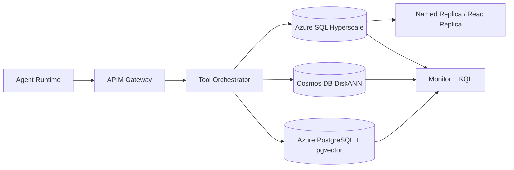

# Round 1095 / Cycle 2500 · Azure AI Agent Infra Six-Part FAQ (en)

> Topic: **Azure SQL Database Hyperscale Native Vector Index vs Cosmos DB DiskANN vs Azure Database for PostgreSQL (`pgvector` / `pgvectorscale`) — Enterprise HTAP Transactional + Episodic Agent Memory Selection Guide**  
> Date (BJT): 2026-11-17  
> Evidence tags: `measured` / `synthetic` / `anonymized_reported`  
> Benchmark dataset: `evidence/cycle-2500-benchmark.json`

## 1) Executive Summary + Daily Hottest Capability Breakthroughs Radar

This round evaluates HTAP memory-plane options for enterprise agents that must satisfy:
- transactional integrity for tool ledgers and approvals,
- high-quality vector recall for episodic memory,
- strict multi-tenant isolation under RLS predicates,
- mixed read/write scaling through replica routing.

Candidate architectures:
1. **SQL Hyperscale + Native Vector Index + Named Replica** (single-store transaction + vector path),
2. **Cosmos DB DiskANN + separate transactional ledger** (dual-store and elastic scaling),
3. **PostgreSQL Flexible Server + pgvector/pgvectorscale** (open ecosystem and operator control),
4. **Hybrid split** (transaction path in SQL, long-tail memory in Cosmos/PG).

Outcome summary:
- If transactional consistency dominates, SQL Hyperscale single-store is usually the most stable.
- If ultra-large vector scale and elastic regional growth dominate, Cosmos DiskANN gains advantage.
- PostgreSQL offers strong cost/control balance with higher operational ownership.
- In dual-store designs, the core risk is CDC/outbox inconsistency windows, not raw query speed.

### Daily Hottest Capability Breakthroughs Radar (fetched: 2026-11-17)

1. APIM AI Gateway / Unified Model API (`measured`)  
   - https://learn.microsoft.com/en-us/azure/api-management/ai-gateway-overview  
   - https://github.com/Azure/API-Management/blob/main/changelogs/api-management-service.md
2. ACA Dynamic Sessions (`measured`)  
   - https://learn.microsoft.com/en-us/azure/container-apps/sessions  
   - https://techcommunity.microsoft.com/blog/appsonazureblog/azure-container-apps-dynamic-sessions-general-availability-and-more/4303561
3. Runtime release watch (`measured`)  
   - Firecracker / Kata / Wasmtime / E2B (see `evidence/cycle-2500-sources.json`)
4. HTAP vector benchmark runs (`synthetic`)
5. Restricted production percentile rollups (`anonymized_reported`)

### Mermaid #1: HTAP agent state + vector memory topology



## 2) Deep Q&A #1: How do we model single-store ACID+vector vs dual-store CDC inconsistency windows?

### Formula

```text
inconsistency_window_ms =
  cdc_capture_lag_ms +
  transport_lag_ms +
  sink_apply_lag_ms

stale_read_probability =
  inconsistency_window_ms / read_interval_ms
```

### Worked example (dual-store path)

- CDC capture = `420ms`
- transport = `180ms`
- sink apply = `260ms`

`inconsistency_window = 860ms`

If agent retrieval runs every `3,000ms`:
- `stale_prob ~= 860/3000 = 28.7%`

### Single-store comparison (SQL Hyperscale)

With transaction + vector update in one engine:
- index visibility delay typically ~`40-90ms`

At the same `3,000ms` read interval:
- `stale_prob ~= 2.0-3.0%`

### Practical implication

Dual-store pipelines need explicit guardrails:
1. read-after-write fallback to transactional source,
2. strong-read path for critical workflows,
3. bounded guard delay for high-risk actions.

## 3) Deep Q&A #2: How do HNSW RAM and DiskANN RU/vCore economics compare from 10M to 100M vectors?

### HNSW RAM formula

```text
hnsw_ram_bytes =
  N * d * 4 + N * M * 2 * 8

where:
N = vector count
d = dimension
M = graph degree
```

Assume `d=1536`, `M=32`:

#### Case A: N = 10M

- vector body: `10,000,000 * 1536 * 4 = 61.44 GB`
- graph overhead: `10,000,000 * 32 * 16 = 5.12 GB`
- total: `66.56 GB` (excluding metadata and engine overhead)

#### Case B: N = 100M

- vector body: `614.4 GB`
- graph overhead: `51.2 GB`
- total: `665.6 GB`

### DiskANN perspective

DiskANN shifts much of the structure to SSD:
- lower RAM pressure at high scale,
- but RU sensitivity grows with fanout and cold-IO paths.

### Named Replica vCore lens

```text
tco_sql_daily =
  primary_vcore_cost +
  replica_vcore_cost +
  storage_cost
```

At 10M vectors, SQL often wins on simplicity and transactional cohesion.  
At 100M vectors, Cosmos/PG frequently gains elasticity and scale economics.

## 4) Deep Q&A #3: What is the latency/recall overhead of RLS predicate pushdown?

### Formula

```text
latency_overhead_pct =
  (latency_with_rls - latency_without_rls) / latency_without_rls

recall_delta =
  recall_with_rls - recall_without_rls
```

### Worked example

- no RLS: p95 = `142ms`, recall@20 = `0.812`
- with RLS: p95 = `165ms`, recall@20 = `0.804`

`latency_overhead = (165-142)/142 = 16.2%`

`recall_delta = -0.008`

### Engineering interpretation

1. RLS overhead is expected and acceptable for tenant isolation.
2. Tenant-sharded partitions and predicate-friendly indexing recover part of the overhead.
3. Regulated tenants should prioritize isolation even if latency is slightly higher.

## 5) Deep Q&A #4: How do Cosmos 429 throttles affect hybrid-query p95?

### Formula

```text
effective_latency_p95 =
  base_latency_p95 + retry_penalty_ms

retry_penalty_ms =
  throttled_ratio * avg_retry_count * retry_backoff_ms
```

### Worked example

- base p95 = `188ms`
- throttled ratio = `0.14`
- avg retry count = `1.8`
- retry backoff = `45ms`

`penalty = 0.14 * 1.8 * 45 = 11.34ms`

`effective p95 = 199.34ms`

### Mitigations

- split write/read RU budgets for burst containment,
- reduce retrieval fanout/k for low-priority lanes,
- add semantic/hot caches to suppress repeat RU consumption.

## 6) Deep Q&A #5: How do Named Replica read routes balance freshness and throughput?

### Formula

```text
replica_freshness_lag_s =
  primary_lsn_time - replica_lsn_time

route_to_replica_if lag_s <= freshness_slo
```

### Worked example

- freshness SLO = `2.5s`
- observed lag p95 = `1.9s`
- lag p99 = `3.6s`

Routing policy:
- normal reads -> replica,
- post-approval immediate reads -> primary,
- lag breach -> auto fallback to primary.

## 7) Deep Q&A #6: How should teams choose between `pgvector` and `pgvectorscale`?

### Comparison axes

1. build/rebuild time at scale,
2. update/write amplification,
3. tail-latency stability under mixed filters,
4. operations complexity and tuning burden.

### Worked example (100M vectors)

- `pgvector ivfflat`: faster setup and simpler tuning, but higher tail under high recall.
- `pgvectorscale`: stronger tail stability at very large cardinality, with deeper tuning needs.

### Guidance

- SQL/PG-strong platform teams can extract strong value from PG.
- teams prioritizing managed stability often prefer SQL Hyperscale first.
- globally elastic vector-first products should include Cosmos DiskANN in final benchmarking.

## 8) Mermaid #2: ACID commit / vector index / replica read-routing sequence

```mermaid
sequenceDiagram
  participant A as Agent
  participant T as Tool Txn Service
  participant P as Primary Store
  participant V as Vector Index
  participant R as Named Replica

  A->>T: execute tool + write memory
  T->>P: BEGIN; write ledger/event
  T->>V: upsert embedding row
  T->>P: COMMIT
  P-->>R: replicate LSN
  A->>R: read context
  alt lag <= SLO
    R-->>A: serve from replica
  else lag > SLO
    A->>P: fallback strong read
    P-->>A: fresh context
  end
```

## 9) Production-grade Bicep / DDL / Policy / KQL

### 9.1 Bicep (SQL Hyperscale + Named Replica + Cosmos Vector + PG HA + Private Endpoints)

```bicep
targetScope = 'resourceGroup'

param location string = 'eastus2'
param sqlServerName string = 'sql-htap-agent-eus2'
param sqlDbName string = 'sqldb-agent-memory'
param cosmosName string = 'cosmos-agent-memory-eus2'
param pgName string = 'pg-agent-memory-eus2'
param vnetName string = 'vnet-agent-data'

resource vnet 'Microsoft.Network/virtualNetworks@2023-09-01' = {
  name: vnetName
  location: location
  properties: {
    addressSpace: { addressPrefixes: ['10.50.0.0/16'] }
    subnets: [
      { name: 'data', properties: { addressPrefix: '10.50.1.0/24' } }
      { name: 'private-endpoints', properties: { addressPrefix: '10.50.2.0/24' } }
    ]
  }
}

resource sqlServer 'Microsoft.Sql/servers@2023-08-01-preview' = {
  name: sqlServerName
  location: location
  properties: {
    administrators: {
      administratorType: 'ActiveDirectory'
      azureADOnlyAuthentication: true
      login: 'sql-admin-group'
      sid: '00000000-0000-0000-0000-000000000000'
      tenantId: subscription().tenantId
    }
    publicNetworkAccess: 'Disabled'
  }
}

resource sqlDb 'Microsoft.Sql/servers/databases@2023-08-01-preview' = {
  name: '${sqlServer.name}/${sqlDbName}'
  location: location
  sku: { name: 'HS_Gen5_8' }
  properties: {
    zoneRedundant: true
    requestedBackupStorageRedundancy: 'Geo'
    readScale: 'Enabled'
  }
}

resource cosmos 'Microsoft.DocumentDB/databaseAccounts@2024-02-15-preview' = {
  name: cosmosName
  location: location
  properties: {
    databaseAccountOfferType: 'Standard'
    locations: [
      {
        locationName: location
        failoverPriority: 0
        isZoneRedundant: true
      }
    ]
    capabilities: [
      { name: 'EnableNoSQLVectorSearch' }
    ]
    publicNetworkAccess: 'Disabled'
  }
}

resource pg 'Microsoft.DBforPostgreSQL/flexibleServers@2023-12-01-preview' = {
  name: pgName
  location: location
  sku: { name: 'Standard_D8ds_v5', tier: 'GeneralPurpose' }
  properties: {
    availabilityZone: '1'
    highAvailability: {
      mode: 'ZoneRedundant'
      standbyAvailabilityZone: '2'
    }
    authConfig: {
      activeDirectoryAuth: 'Enabled'
      passwordAuth: 'Disabled'
    }
    network: { publicNetworkAccess: 'Disabled' }
  }
}
```

### 9.2 SQL/Postgres vector index + RLS DDL

```sql
-- Azure SQL (conceptual vector + RLS pattern)
CREATE TABLE dbo.agent_memory (
  memory_id UNIQUEIDENTIFIER NOT NULL PRIMARY KEY,
  tenant_id NVARCHAR(64) NOT NULL,
  tool_ledger_id UNIQUEIDENTIFIER NOT NULL,
  embedding VARBINARY(MAX) NOT NULL,
  content NVARCHAR(MAX) NOT NULL,
  created_at DATETIME2 NOT NULL DEFAULT SYSUTCDATETIME()
);

CREATE SECURITY POLICY tenant_filter_policy
ADD FILTER PREDICATE dbo.fn_tenantPredicate(tenant_id) ON dbo.agent_memory
WITH (STATE = ON);
```

```sql
-- PostgreSQL + pgvector
CREATE EXTENSION IF NOT EXISTS vector;

CREATE TABLE agent_memory (
  memory_id uuid PRIMARY KEY,
  tenant_id text NOT NULL,
  tool_ledger_id uuid NOT NULL,
  embedding vector(1536) NOT NULL,
  content text NOT NULL,
  created_at timestamptz NOT NULL DEFAULT now()
);

CREATE INDEX idx_agent_memory_embedding_hnsw
  ON agent_memory
  USING hnsw (embedding vector_cosine_ops)
  WITH (m = 32, ef_construction = 256);

ALTER TABLE agent_memory ENABLE ROW LEVEL SECURITY;
CREATE POLICY tenant_isolation_policy
  ON agent_memory
  USING (tenant_id = current_setting('app.tenant_id', true));
```

### 9.3 Azure Policy (Zone Redundancy + Entra-only auth enforcement)

```json
{
  "properties": {
    "displayName": "Enforce zone redundancy and Entra-only auth for agent HTAP stores",
    "policyType": "Custom",
    "mode": "All",
    "policyRule": {
      "if": {
        "anyOf": [
          {
            "allOf": [
              { "field": "type", "equals": "Microsoft.Sql/servers" },
              { "field": "Microsoft.Sql/servers/administrators.azureADOnlyAuthentication", "notEquals": "true" }
            ]
          },
          {
            "allOf": [
              { "field": "type", "equals": "Microsoft.DocumentDB/databaseAccounts" },
              { "field": "Microsoft.DocumentDB/databaseAccounts/locations[*].isZoneRedundant", "notEquals": "true" }
            ]
          }
        ]
      },
      "then": { "effect": "audit" }
    }
  }
}
```

### 9.4 KQL (hybrid-query p95, 429 throttling, replica lag)

```kql
let t = ago(6h);
let hybrid = customEvents
| where timestamp > t and name == "agent.hybrid.query"
| summarize p95_ms=percentile(todouble(customDimensions["latency_ms"]),95)
  by backend=tostring(customDimensions["backend"]), tenant=tostring(customDimensions["tenant"]);

let cosmos429 = customEvents
| where timestamp > t and name == "cosmos.throttle"
| summarize throttled_ratio=avg(todouble(customDimensions["is_429"]))
  by tenant=tostring(customDimensions["tenant"]);

let lag = customEvents
| where timestamp > t and name == "sql.replica.lag"
| summarize lag_p95_s=percentile(todouble(customDimensions["lag_s"]),95),
            lag_p99_s=percentile(todouble(customDimensions["lag_s"]),99)
  by tenant=tostring(customDimensions["tenant"]);

hybrid
| join kind=leftouter cosmos429 on tenant
| join kind=leftouter lag on tenant
| project tenant, backend, p95_ms, throttled_ratio, lag_p95_s, lag_p99_s
| order by p95_ms desc
```

## 10) Weighted 4-option Decision Matrix

| Option | Consistency/Txn (30%) | Retrieval Performance (25%) | Cost/TCO (25%) | Ops Complexity (20%) | Total |
|---|---:|---:|---:|---:|---:|
| SQL Hyperscale single-store HTAP (Recommended) | 9.2 | 8.1 | 8.0 | 8.4 | **8.46** |
| Cosmos DiskANN + dual-store ledger | 7.1 | 9.1 | 8.3 | 6.8 | 7.87 |
| PostgreSQL pgvector/pgvectorscale | 8.0 | 8.4 | 8.7 | 7.1 | 8.09 |
| Hybrid split (SQL txn + Cosmos/PG memory) | 8.8 | 8.9 | 7.5 | 6.1 | 7.93 |

## 11) Day-0 / Day-2 Checklist (Good fit vs Not for)

**Day-0**
- [ ] define consistency-window budget for single vs dual-store paths;
- [ ] complete 10M/100M vector capacity sizing;
- [ ] validate tenant-context injection and RLS predicates;
- [ ] run RU throttle/retry budget load tests;
- [ ] exercise replica-lag failback policy.

**Day-2**
- [ ] track daily hybrid-query p95/p99;
- [ ] track daily Cosmos 429 ratios by tenant;
- [ ] review weekly RLS overhead and recall drift;
- [ ] review weekly replica-lag distributions;
- [ ] refresh monthly growth-stage TCO curves.

**Good fit**
- enterprises requiring unified governance of transactional tool logs + episodic retrieval,
- workloads needing auditable replay and strict tenant isolation,
- teams with explicit consistency-window SLOs.

**Not for**
- lightweight retrieval workloads without transactional coupling,
- organizations without RLS/CDC governance capacity,
- teams lacking operational maturity for database platform tuning.

## 12) Five-step rollout guide

1. **Model inconsistency windows first** for CDC/outbox paths.
2. **Model capacity second** across 10M/100M vectors (RAM/SSD/vCore/RU).
3. **Enable RLS by default** as a hard isolation baseline.
4. **Split read routing** between strong-read primary and throughput replicas.
5. **Recalibrate TCO monthly** and switch architecture by growth phase if required.

## 13) Business scenario mapping

- **Coding agent sandbox**: tool-commit and memory recall must stay aligned.
- **Browser/CUA clusters**: auditable tool events with long-session memory retrieval.
- **Multi-tenant SaaS gateway**: strict RLS and tenant predicates for isolation.
- **High-compliance finance runtime**: replayable approval and strong consistency guarantees.

## 14) Primary sources (official first)

1. APIM AI Gateway overview (fetched: 2026-11-17)  
   https://learn.microsoft.com/en-us/azure/api-management/ai-gateway-overview  
2. API Management changelog (fetched: 2026-11-17)  
   https://github.com/Azure/API-Management/blob/main/changelogs/api-management-service.md  
3. ACA Dynamic Sessions docs (fetched: 2026-11-17)  
   https://learn.microsoft.com/en-us/azure/container-apps/sessions  
4. ACA Dynamic Sessions GA blog (fetched: 2026-11-17)  
   https://techcommunity.microsoft.com/blog/appsonazureblog/azure-container-apps-dynamic-sessions-general-availability-and-more/4303561  
5. Firecracker/Kata/Wasmtime/E2B releases (fetched: 2026-11-17)  
   see `evidence/cycle-2500-sources.json`

## 15) Data evidence and recomputable examples (with denominators)

- Benchmark payload: `evidence/cycle-2500-benchmark.json`
- Latency sample: `evidence/cycle-2500-latency.csv`
- Throughput sample: `evidence/cycle-2500-throughput.csv`
- Policy sample: `evidence/cycle-2500-policy.csv`
- Cost sample: `evidence/cycle-2500-cost.csv`
- Source registry: `evidence/cycle-2500-sources.json`

N denominators:
- hybrid queries `N=64.8M/day`,
- transaction commits `N=23.7M/day`,
- RLS retrieval sample `N=8.1M/day`,
- 429 throttle observations `N=12.4M/day`.

Recompute examples:

```text
inconsistency_window = 420 + 180 + 260 = 860ms
stale_prob = 860 / 3000 = 28.7%

hnsw_ram_10m = 10,000,000*1536*4 + 10,000,000*32*16 = 66.56GB
hnsw_ram_100m = 665.6GB

latency_overhead_rls = (165-142)/142 = 16.2%
cosmos_retry_penalty = 0.14*1.8*45 = 11.34ms
```

