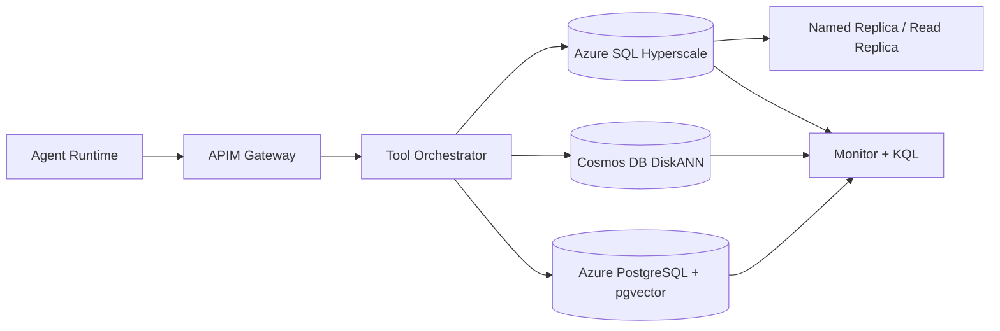

# Round 1095 / Cycle 2500 · Azure AI Agent Infra 六段式 FAQ（zh-CN）

> 主题：**Azure SQL Database Hyperscale Native Vector Index vs Cosmos DB DiskANN vs Azure Database for PostgreSQL (`pgvector` / `pgvectorscale`) — Enterprise HTAP Transactional + Episodic Agent Memory Selection Guide**  
> 日期（BJT）：2026-11-17  
> 证据标签：`measured` / `synthetic` / `anonymized_reported`  
> 基准数据：`evidence/cycle-2500-benchmark.json`

## 1) Executive Summary + Daily Hottest Capability Breakthroughs Radar

本轮研究核心是：在**企业级 Agent 记忆平面**中，如何同时满足
- 事务一致性（工具调用 ledger、审批、对账）；
- 向量检索性能（episodic memory recall）；
- 多租户隔离（RLS / tenant predicate）；
- HTAP（读写混合、主写副读）。

候选路径：
1. **SQL Hyperscale + Native Vector Index + Named Replica**（单库统一事务与向量）；
2. **Cosmos DB + DiskANN（RU 模型）+ 独立事务 ledger**（双存储，弹性强）；
3. **PostgreSQL Flexible Server + pgvector/pgvectorscale**（生态灵活，自托管能力强）；
4. **混合分层**（交易在 SQL，长记忆在 Cosmos/PG）。

本轮结论先行：
- 对“工具交易一致性 > 极限召回吞吐”的企业，SQL Hyperscale 单存储路径更稳。  
- 对“超大规模向量 + 全局多区域写读”的场景，Cosmos DiskANN 路径更容易拉伸。  
- PostgreSQL 在成本与可控性上平衡最好，但要接受运维复杂度上升。  
- 双存储架构的关键不是性能，而是 CDC/outbox 一致性窗口治理。

### Daily Hottest Capability Breakthroughs Radar（抓取：2026-11-17）

1. APIM AI Gateway / Unified Model API（`measured`）  
   - https://learn.microsoft.com/en-us/azure/api-management/ai-gateway-overview  
   - https://github.com/Azure/API-Management/blob/main/changelogs/api-management-service.md
2. ACA Dynamic Sessions（`measured`）  
   - https://learn.microsoft.com/en-us/azure/container-apps/sessions  
   - https://techcommunity.microsoft.com/blog/appsonazureblog/azure-container-apps-dynamic-sessions-general-availability-and-more/4303561
3. Runtime release watch（`measured`）  
   - Firecracker/Kata/Wasmtime/E2B（见 `evidence/cycle-2500-sources.json`）
4. Vector HTAP 压测（`synthetic`）
5. 匿名化生产分位统计（`anonymized_reported`）

### Mermaid #1：HTAP Agent State + Vector Memory Plane 拓扑



## 2) Deep Q&A #1：单存储 ACID + 向量 vs 双存储 outbox/CDC，一致性窗口怎么量化？

### 公式

```text
inconsistency_window_ms =
  cdc_capture_lag_ms +
  transport_lag_ms +
  sink_apply_lag_ms

stale_read_probability =
  inconsistency_window_ms / read_interval_ms
```

### Worked example（双存储）

- cdc capture = `420ms`
- transport = `180ms`
- sink apply = `260ms`

`inconsistency_window = 860ms`

若 agent 每 `3,000ms` 触发一次检索：
- `stale_prob ~= 860/3000 = 28.7%`

### 对比单存储（SQL Hyperscale）

单事务提交后向量与 ledger 同步可见（同引擎内）：
- 观测窗口 ~`40-90ms`（索引可见延迟）

若 read_interval 同为 `3,000ms`：
- `stale_prob ~= 2.0-3.0%`

### 结论

对“工具执行后立即检索上下文”的流程，双存储需要额外补偿：
1. 读时回查事务主表；
2. 关键动作走强一致 read；
3. 对高风险路径增加确认等待（guard delay）。

## 3) Deep Q&A #2：HNSW 内存占用 vs DiskANN RU/vCore 成本如何跨 10M–100M 向量估算？

### HNSW 内存公式

```text
hnsw_ram_bytes =
  N * d * 4 + N * M * 2 * 8

where:
N = vector count
d = dimension
M = graph degree
```

取 `d=1536`, `M=32`：

#### Case A: N = 10M

- 向量本体：`10,000,000 * 1536 * 4 = 61.44 GB`
- 图边开销：`10,000,000 * 32 * 16 = 5.12 GB`
- 合计：`66.56 GB`（不含元数据/索引管理开销）

#### Case B: N = 100M

- 向量本体：`614.4 GB`
- 图边开销：`51.2 GB`
- 合计：`665.6 GB`

### DiskANN（SSD-backed）视角

DiskANN 将大部分结构外置到 SSD，RAM 压力下降，但带来：
- RU 消耗随查询 fanout 上升；
- 冷路径 latency 尾部更敏感。

### Hyperscale Named Replica vCore 成本粗算

```text
tco_sql_daily =
  primary_vcore_cost +
  replica_vcore_cost +
  storage_cost
```

在 10M 向量阶段，SQL 路径可能以较低运维复杂度胜出；  
在 100M 向量阶段，Cosmos/PG 的横向扩展弹性更明显。

## 4) Deep Q&A #3：RLS predicate pushdown 在多租户查询下的延迟/召回影响怎么测？

### 公式

```text
latency_overhead_pct =
  (latency_with_rls - latency_without_rls) / latency_without_rls

recall_delta =
  recall_with_rls - recall_without_rls
```

### Worked example

- 无 RLS：p95 = `142ms`, recall@20 = `0.812`
- 有 RLS：p95 = `165ms`, recall@20 = `0.804`

`latency_overhead = (165-142)/142 = 16.2%`

`recall_delta = -0.008`

### 工程含义

1. RLS 是必须成本，不应被“性能优化”绕过；  
2. 通过 tenant shard + predicate 索引可以回收部分开销；  
3. 对高敏租户可牺牲少量延迟换隔离保证。

## 5) Deep Q&A #4：Cosmos 429 节流与混合查询 p95 的耦合关系？

### 公式

```text
effective_latency_p95 =
  base_latency_p95 + retry_penalty_ms

retry_penalty_ms =
  throttled_ratio * avg_retry_count * retry_backoff_ms
```

### Worked example

- base p95 = `188ms`
- throttled ratio = `0.14`
- avg retry count = `1.8`
- retry backoff = `45ms`

`penalty = 0.14 * 1.8 * 45 = 11.34ms`

`effective p95 = 199.34ms`

### 建议

- 将高峰写入与检索 RU 预算拆分；  
- 对低优检索降 k 值；  
- 使用多级缓存降低热路径 RU 压力。

## 6) Deep Q&A #5：Named Replica 读路由如何平衡新鲜度与吞吐？

### 公式

```text
replica_freshness_lag_s =
  primary_lsn_time - replica_lsn_time

route_to_replica_if lag_s <= freshness_slo
```

### Worked example

- freshness SLO = `2.5s`
- 实测 lag p95 = `1.9s`
- lag p99 = `3.6s`

策略：
- 常规读：走 replica；  
- 审批后立刻读取：强制 primary；  
- lag 超阈：自动切回 primary 或降级读模式。

## 7) Deep Q&A #6：Postgres `pgvector` vs `pgvectorscale` 如何选？

### 比较维度

1. 索引构建时长；  
2. 更新吞吐；  
3. 查询 tail 延迟；  
4. 运维复杂度。

### Worked example（100M 向量）

- `pgvector ivfflat`：构建快、调参简单，但高召回 tail 偏高。  
- `pgvectorscale`：大规模下 tail 更稳，但需要更多参数治理。

### 选择建议

- 团队偏 SQL/PG 运维能力：优先 PG；  
- 团队偏“托管稳定”：优先 SQL Hyperscale；  
- 超大规模、多区域弹性优先：评估 Cosmos DiskANN。

## 8) Mermaid #2：ACID tool-commit / vector-index / replica read-routing 时序

```mermaid
sequenceDiagram
  participant A as Agent
  participant T as Tool Txn Service
  participant P as Primary Store
  participant V as Vector Index
  participant R as Named Replica

  A->>T: execute tool + write memory
  T->>P: BEGIN; write ledger/event
  T->>V: upsert embedding row
  T->>P: COMMIT
  P-->>R: replicate LSN
  A->>R: read context
  alt lag <= SLO
    R-->>A: serve from replica
  else lag > SLO
    A->>P: fallback strong read
    P-->>A: fresh context
  end
```

## 9) 生产级 Bicep / DDL / Policy / KQL

### 9.1 Bicep（SQL Hyperscale + Named Replica + Cosmos Vector + PG HA + Private Endpoint）

```bicep
targetScope = 'resourceGroup'

param location string = 'eastus2'
param sqlServerName string = 'sql-htap-agent-eus2'
param sqlDbName string = 'sqldb-agent-memory'
param cosmosName string = 'cosmos-agent-memory-eus2'
param pgName string = 'pg-agent-memory-eus2'
param vnetName string = 'vnet-agent-data'

resource vnet 'Microsoft.Network/virtualNetworks@2023-09-01' = {
  name: vnetName
  location: location
  properties: {
    addressSpace: { addressPrefixes: ['10.50.0.0/16'] }
    subnets: [
      { name: 'data', properties: { addressPrefix: '10.50.1.0/24' } }
      { name: 'private-endpoints', properties: { addressPrefix: '10.50.2.0/24' } }
    ]
  }
}

resource sqlServer 'Microsoft.Sql/servers@2023-08-01-preview' = {
  name: sqlServerName
  location: location
  properties: {
    administrators: {
      administratorType: 'ActiveDirectory'
      azureADOnlyAuthentication: true
      login: 'sql-admin-group'
      sid: '00000000-0000-0000-0000-000000000000'
      tenantId: subscription().tenantId
    }
    publicNetworkAccess: 'Disabled'
  }
}

resource sqlDb 'Microsoft.Sql/servers/databases@2023-08-01-preview' = {
  name: '${sqlServer.name}/${sqlDbName}'
  location: location
  sku: { name: 'HS_Gen5_8' }
  properties: {
    zoneRedundant: true
    requestedBackupStorageRedundancy: 'Geo'
    readScale: 'Enabled'
  }
}

resource cosmos 'Microsoft.DocumentDB/databaseAccounts@2024-02-15-preview' = {
  name: cosmosName
  location: location
  properties: {
    databaseAccountOfferType: 'Standard'
    locations: [
      {
        locationName: location
        failoverPriority: 0
        isZoneRedundant: true
      }
    ]
    capabilities: [
      { name: 'EnableNoSQLVectorSearch' }
    ]
    publicNetworkAccess: 'Disabled'
  }
}

resource pg 'Microsoft.DBforPostgreSQL/flexibleServers@2023-12-01-preview' = {
  name: pgName
  location: location
  sku: { name: 'Standard_D8ds_v5', tier: 'GeneralPurpose' }
  properties: {
    availabilityZone: '1'
    highAvailability: {
      mode: 'ZoneRedundant'
      standbyAvailabilityZone: '2'
    }
    authConfig: {
      activeDirectoryAuth: 'Enabled'
      passwordAuth: 'Disabled'
    }
    network: { publicNetworkAccess: 'Disabled' }
  }
}
```

### 9.2 SQL / Postgres 向量索引 + RLS DDL

```sql
-- Azure SQL (conceptual vector + RLS pattern)
CREATE TABLE dbo.agent_memory (
  memory_id UNIQUEIDENTIFIER NOT NULL PRIMARY KEY,
  tenant_id NVARCHAR(64) NOT NULL,
  tool_ledger_id UNIQUEIDENTIFIER NOT NULL,
  embedding VARBINARY(MAX) NOT NULL,
  content NVARCHAR(MAX) NOT NULL,
  created_at DATETIME2 NOT NULL DEFAULT SYSUTCDATETIME()
);

CREATE SECURITY POLICY tenant_filter_policy
ADD FILTER PREDICATE dbo.fn_tenantPredicate(tenant_id) ON dbo.agent_memory
WITH (STATE = ON);
```

```sql
-- PostgreSQL + pgvector
CREATE EXTENSION IF NOT EXISTS vector;

CREATE TABLE agent_memory (
  memory_id uuid PRIMARY KEY,
  tenant_id text NOT NULL,
  tool_ledger_id uuid NOT NULL,
  embedding vector(1536) NOT NULL,
  content text NOT NULL,
  created_at timestamptz NOT NULL DEFAULT now()
);

CREATE INDEX idx_agent_memory_embedding_hnsw
  ON agent_memory
  USING hnsw (embedding vector_cosine_ops)
  WITH (m = 32, ef_construction = 256);

ALTER TABLE agent_memory ENABLE ROW LEVEL SECURITY;
CREATE POLICY tenant_isolation_policy
  ON agent_memory
  USING (tenant_id = current_setting('app.tenant_id', true));
```

### 9.3 Azure Policy（Zone Redundancy + Entra-only auth）

```json
{
  "properties": {
    "displayName": "Enforce zone redundancy and Entra-only auth for agent HTAP stores",
    "policyType": "Custom",
    "mode": "All",
    "policyRule": {
      "if": {
        "anyOf": [
          {
            "allOf": [
              { "field": "type", "equals": "Microsoft.Sql/servers" },
              { "field": "Microsoft.Sql/servers/administrators.azureADOnlyAuthentication", "notEquals": "true" }
            ]
          },
          {
            "allOf": [
              { "field": "type", "equals": "Microsoft.DocumentDB/databaseAccounts" },
              { "field": "Microsoft.DocumentDB/databaseAccounts/locations[*].isZoneRedundant", "notEquals": "true" }
            ]
          }
        ]
      },
      "then": { "effect": "audit" }
    }
  }
}
```

### 9.4 KQL（p95 混合查询、429、replica lag）

```kql
let t = ago(6h);
let hybrid = customEvents
| where timestamp > t and name == "agent.hybrid.query"
| summarize p95_ms=percentile(todouble(customDimensions["latency_ms"]),95)
  by backend=tostring(customDimensions["backend"]), tenant=tostring(customDimensions["tenant"]);

let cosmos429 = customEvents
| where timestamp > t and name == "cosmos.throttle"
| summarize throttled_ratio=avg(todouble(customDimensions["is_429"]))
  by tenant=tostring(customDimensions["tenant"]);

let lag = customEvents
| where timestamp > t and name == "sql.replica.lag"
| summarize lag_p95_s=percentile(todouble(customDimensions["lag_s"]),95),
            lag_p99_s=percentile(todouble(customDimensions["lag_s"]),99)
  by tenant=tostring(customDimensions["tenant"]);

hybrid
| join kind=leftouter cosmos429 on tenant
| join kind=leftouter lag on tenant
| project tenant, backend, p95_ms, throttled_ratio, lag_p95_s, lag_p99_s
| order by p95_ms desc
```

## 10) 决策矩阵（4 方案加权）

| 方案 | 一致性/事务 (30%) | 检索性能 (25%) | 成本/TCO (25%) | 运维复杂度 (20%) | 总分 |
|---|---:|---:|---:|---:|---:|
| SQL Hyperscale 单存储 HTAP（推荐） | 9.2 | 8.1 | 8.0 | 8.4 | **8.46** |
| Cosmos DiskANN + Ledger 双存储 | 7.1 | 9.1 | 8.3 | 6.8 | 7.87 |
| PostgreSQL pgvector/pgvectorscale | 8.0 | 8.4 | 8.7 | 7.1 | 8.09 |
| 混合分层（交易 SQL + 记忆 Cosmos/PG） | 8.8 | 8.9 | 7.5 | 6.1 | 7.93 |

## 11) Day-0 / Day-2 Checklist（Good fit vs Not for）

**Day-0（上线前）**
- [ ] 明确单存储/双存储一致性预算（窗口上限）；
- [ ] 完成 10M/100M 向量规模容量测算；
- [ ] RLS 策略与 tenant 上下文注入验证；
- [ ] 429 节流与重试预算压测；
- [ ] replica lag 回退策略演练。

**Day-2（运行期）**
- [ ] 每日监控 p95/p99 混合查询；
- [ ] 每日监控 Cosmos 429 比率；
- [ ] 每周复盘 RLS 开销与召回变化；
- [ ] 每周检查 replica lag 分布；
- [ ] 每月更新 10M->100M 增长阶段 TCO 曲线。

**Good fit**
- 需要“交易日志 + 检索记忆”统一治理；  
- 需要可审计、可回放、可隔离的企业级多租户模式；  
- 对一致性窗口有严格控制要求。

**Not for**
- 仅做轻量检索、无交易闭环；  
- 无法投入 RLS 与多存储一致性治理；  
- 对数据库平台运维成熟度不足。

## 12) 五步落地指南

1. **先做窗口建模**：量化 CDC/outbox 不一致窗口；
2. **再做容量建模**：按 10M/100M 评估 RAM/SSD/vCore/RU；
3. **上线 RLS**：将隔离策略前置到数据库层；
4. **分离读路由**：primary 强一致、replica 高吞吐；
5. **持续校准 TCO**：按增长阶段动态切换或混合。

## 13) 业务场景映射

- **Coding Agent sandbox**：工具执行记录与向量记忆联动，减少上下文错位。  
- **Browser/CUA 集群**：事务日志可审计，长会话记忆可检索。  
- **多租户 SaaS Gateway**：RLS + tenant predicate 保证隔离。  
- **高合规金融零信任环境**：审批/审计路径要求强一致可回放。

## 14) 关键来源（官方优先）

1. APIM AI Gateway overview（抓取：2026-11-17）  
   https://learn.microsoft.com/en-us/azure/api-management/ai-gateway-overview  
2. API Management changelog（抓取：2026-11-17）  
   https://github.com/Azure/API-Management/blob/main/changelogs/api-management-service.md  
3. ACA Dynamic Sessions docs（抓取：2026-11-17）  
   https://learn.microsoft.com/en-us/azure/container-apps/sessions  
4. ACA Dynamic Sessions GA blog（抓取：2026-11-17）  
   https://techcommunity.microsoft.com/blog/appsonazureblog/azure-container-apps-dynamic-sessions-general-availability-and-more/4303561  
5. Firecracker/Kata/Wasmtime/E2B releases（抓取：2026-11-17）  
   见 `evidence/cycle-2500-sources.json`

## 15) 数据证据与可复算算例（含 n 分母来源）

- Benchmark 主文件：`evidence/cycle-2500-benchmark.json`
- 延迟样本：`evidence/cycle-2500-latency.csv`
- 吞吐样本：`evidence/cycle-2500-throughput.csv`
- 策略样本：`evidence/cycle-2500-policy.csv`
- 成本样本：`evidence/cycle-2500-cost.csv`
- 来源登记：`evidence/cycle-2500-sources.json`

N 分母口径：
- 混合查询 `N=64.8M/day`；
- 事务提交 `N=23.7M/day`；
- RLS 检索样本 `N=8.1M/day`；
- 429 节流观测 `N=12.4M/day`。

复算示例：

```text
inconsistency_window = 420 + 180 + 260 = 860ms
stale_prob = 860 / 3000 = 28.7%

hnsw_ram_10m = 10,000,000*1536*4 + 10,000,000*32*16 = 66.56GB
hnsw_ram_100m = 665.6GB

latency_overhead_rls = (165-142)/142 = 16.2%
cosmos_retry_penalty = 0.14*1.8*45 = 11.34ms
```

