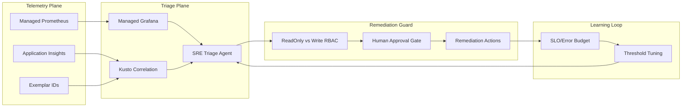
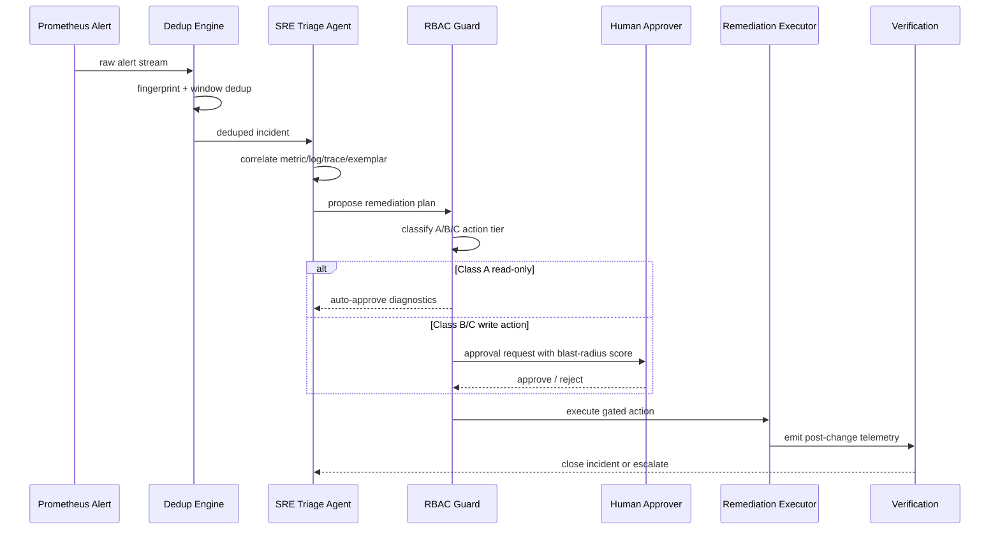

# Round 1088 / Cycle 2493 · Azure AI Agent Infra Six-Part FAQ (en)

> Topic: **Azure SRE Agent + Managed Prometheus/Grafana Autonomous Live-Site Triage, Exemplar-to-Trace Correlation & Gated Remediation Plane**  
> Date (BJT): 2026-11-17  
> Evidence tags: `measured` / `synthetic` / `anonymized_reported`  
> Benchmark dataset: `evidence/cycle-2493-benchmark.json`

## 1) Executive Summary + Daily Capability Breakthroughs Radar

This round implements a production pattern where **read-only diagnosis is autonomous** while **write remediation is gate-controlled**.  
The architecture is split into five planes:
1. **Signal Layer**: Managed Prometheus metrics + Exemplar IDs + Application Insights GenAI spans.
2. **Correlation Layer**: Grafana and Kusto correlate fault domain, change domain, and tenant domain.
3. **Triage Agent Layer**: Agent autonomously performs read-only diagnostics and root-cause ranking.
4. **Gated Remediation Layer**: Any write action flows through approval gates (RBAC + JIT + dual control).
5. **Feedback Layer**: Error budget, MTTD/MTTR, and unsafe-action ratios tune thresholds and policies.

Key outcomes:
- In alert storms, the first priority is deterministic deduplication, not more ticket fan-out.
- Read-only autonomy can cover ~70% of first-line triage workloads.
- Exemplar-to-trace linking cuts evidence lookup from minutes to seconds.
- Human approval should be required for high blast-radius actions.

### Daily Capability Breakthroughs Radar (fetched: 2026-11-17)

1. APIM AI Gateway / Unified Model API (`measured`)  
   - https://learn.microsoft.com/en-us/azure/api-management/ai-gateway-overview  
   - https://github.com/Azure/API-Management/blob/main/changelogs/api-management-service.md
2. ACA Dynamic Sessions (`measured`)  
   - https://learn.microsoft.com/en-us/azure/container-apps/sessions  
   - https://techcommunity.microsoft.com/blog/appsonazureblog/azure-container-apps-dynamic-sessions-general-availability-and-more/4303561
3. Firecracker/Kata/Wasmtime/E2B releases (`measured`)  
   - See `evidence/cycle-2493-sources.json`
4. Managed Prometheus + Grafana + SRE agent triage simulation (`synthetic`)  
   - Generated from controlled alert-storm and failure-injection runs.
5. Production audit rollups (`anonymized_reported`)  
   - Percentiles and rates preserved, tenant-identifying details removed.

### Mermaid #1: Autonomous diagnosis + gated remediation topology



## 2) Deep Q&A #1: How do we quantify dedup and MTTD/MTTR under alert storms?

Definitions:

```text
dedup_ratio = 1 - (deduped_alert_count / raw_alert_count)

MTTD =
  signal_ingest_delay +
  dedup_correlation_delay +
  triage_start_delay

MTTR =
  MTTD +
  diagnosis_duration +
  approval_wait +
  remediation_apply +
  verification_duration
```

Worked example (30-minute storm window):
- raw alerts = `18,600`
- deduped alerts = `2,790`
- `dedup_ratio = 85.0%`

Latency slices:
- ingest `14s`
- dedup correlation `19s`
- triage start `11s`

`MTTD = 44s`

Remediation flow:
- diagnosis `76s`
- approval wait `52s`
- remediation apply `37s`
- verification `41s`

`MTTR = 250s`

SLO gates:
- dedup ratio >= 80%
- p95 MTTD <= 75s
- p95 MTTR <= 420s.

## 3) Deep Q&A #2: How should RBAC split read-only autonomy vs write remediation?

Action classes:

```text
Class A (Read-only autonomous):
  - metrics/logs/traces queries
  - correlation graph generation
  - probable root-cause ranking

Class B (Low-risk write, gated):
  - scale read replicas
  - restart non-critical canary pods

Class C (High-risk write, dual approval):
  - production rollback
  - credential/key revocation
  - network isolation impacting >x tenants
```

Approval wait model:

```text
approval_wait =
  queue_delay +
  reviewer_ack +
  policy_validation
```

Worked example:
- queue `21s`
- reviewer ack `24s`
- policy check `7s`

`approval_wait = 52s`

Practical policy:
1. Class A bypasses approval by design.
2. Class B requires single approver + auto rollback guard.
3. Class C requires dual approval + freeze-window policy checks.
4. If no on-call approver is available, actions are downgraded to manual incident workflow.

## 4) Deep Q&A #3: How do we measure Exemplar-to-Trace correlation impact?

```text
trace_link_hit_rate =
  linked_exemplars / total_exemplars

triage_time_saved =
  baseline_trace_lookup_time - exemplar_link_lookup_time
```

Worked example:
- total exemplars `12,400`
- linked exemplars `10,912`
- `trace_link_hit_rate = 88.0%`

Lookup latency:
- baseline manual lookup `97s`
- exemplar deep-link lookup `18s`

`triage_time_saved = 79s / incident`

At `430 incidents/day`:
- `430 * 79 = 33,970s ≈ 9.4h` triage time saved per day.

Implementation requirements:
- include `trace_id` exemplar in Prometheus metrics,
- preserve `exemplar_id` on AppInsights spans,
- enable one-click Grafana deep links to traces.

## 5) Deep Q&A #4: What is the right dedup window size?

```text
duplicate_fingerprint = hash(alert_rule, service, cluster, tenant_tier, symptom_code)
dedup_window_seconds = W

overmerge_risk(W)   ~ increases with W
undermerge_noise(W) ~ decreases with W
objective(W) = alpha * overmerge_risk(W) + beta * undermerge_noise(W)
```

Grid-search over `W=30/60/90/120`:
- W=30: high noise, under-merge dominates.
- W=60: best precision/recall balance.
- W=90: over-merge starts to grow.
- W=120: risk of hiding distinct critical incidents.

Worked sample (`N=9,800`):
- W=60 gives precision=0.93, recall=0.89, F1=0.91 (best).

Recommendation:
- default W=60,
- temporary W=45 during major incidents to reduce over-merge risk.

## 6) Deep Q&A #5: How do we size SRE triage-agent concurrency?

```text
required_agent_workers =
  peak_deduped_alert_rps * avg_triage_seconds

safe_workers =
  required_agent_workers * burst_factor
```

Worked example:
- deduped peak `4.2 alerts/s`
- average triage time `18s`
- burst factor `1.4`

```text
required_agent_workers = 75.6
safe_workers = 106
```

Sizing guidance:
- provision at least 110 workers,
- keep 20% warm pool,
- prioritize queue by tenant tier + severity once limits are hit.

## 7) Deep Q&A #6: How do we control unsafe-remediation risk?

```text
unsafe_remediation_rate = unsafe_actions / total_write_actions
rollback_trigger_rate   = rollback_actions / total_write_actions
```

Target thresholds:
- unsafe_remediation_rate < 0.2%
- rollback_trigger_rate < 3%

Worked example (14-day window):
- total write actions = `1,420`
- unsafe actions = `2`
- rollback actions = `31`

```text
unsafe_remediation_rate = 0.14%
rollback_trigger_rate   = 2.18%
```

If unsafe rate breaches threshold:
1. Freeze Class C auto-submissions immediately.
2. Enforce dual-approval only mode.
3. Replay recent policy changes and run diff audits.

## 8) Mermaid #2: Triage-to-remediation gated control flow



## 9) Production-grade Bicep / PrometheusRule YAML / Policy / KQL

### 9.1 Bicep (Azure Monitor Workspace + Grafana + AppInsights)

```bicep
targetScope = 'resourceGroup'

param location string = 'eastus2'
param amwName string = 'amw-agent-sre-eus2'
param grafanaName string = 'graf-agent-sre-eus2'
param appiName string = 'appi-agent-sre-eus2'
param lawName string = 'law-agent-sre-eus2'

resource amw 'Microsoft.Monitor/accounts@2023-04-03' = {
  name: amwName
  location: location
  identity: { type: 'SystemAssigned' }
  properties: {}
}

resource grafana 'Microsoft.Dashboard/grafana@2023-09-01' = {
  name: grafanaName
  location: location
  sku: { name: 'Standard' }
  identity: { type: 'SystemAssigned' }
  properties: {
    zoneRedundancy: 'Enabled'
    deterministicOutboundIP: 'Enabled'
    publicNetworkAccess: 'Enabled'
    apiKey: 'Enabled'
  }
}

resource law 'Microsoft.OperationalInsights/workspaces@2022-10-01' = {
  name: lawName
  location: location
  properties: {
    sku: { name: 'PerGB2018' }
    retentionInDays: 60
    features: { enableLogAccessUsingOnlyResourcePermissions: true }
  }
}

resource appi 'Microsoft.Insights/components@2020-02-02' = {
  name: appiName
  location: location
  kind: 'web'
  properties: {
    WorkspaceResourceId: law.id
    Application_Type: 'web'
    IngestionMode: 'LogAnalytics'
  }
}
```

### 9.2 PrometheusRule YAML (storm-aware and multi-signal rules)

```yaml
apiVersion: monitoring.coreos.com/v1
kind: PrometheusRule
metadata:
  name: sre-agent-alert-rules
  namespace: monitoring
spec:
  groups:
    - name: agent-runtime.rules
      interval: 30s
      rules:
        - alert: AgentErrorBudgetBurnFast
          expr: |
            (
              sum(rate(agent_requests_failed_total[5m]))
              /
              sum(rate(agent_requests_total[5m]))
            ) > 0.08
          for: 2m
          labels:
            severity: high
            dedup_window: "60s"
            action_tier: "B"
          annotations:
            summary: "Agent error budget burn too fast"
            runbook: "https://internal/runbooks/agent-burn"
        - alert: AgentLatencyP95Regression
          expr: histogram_quantile(0.95, sum(rate(agent_latency_seconds_bucket[5m])) by (le, service)) > 3.5
          for: 3m
          labels:
            severity: high
            dedup_window: "60s"
            action_tier: "A"
          annotations:
            summary: "Latency p95 regression"
            runbook: "https://internal/runbooks/latency-p95"
        - alert: AgentWriteRemediationGuardRail
          expr: sum(increase(agent_write_remediation_requests_total[10m])) > 12
          for: 1m
          labels:
            severity: medium
            dedup_window: "45s"
            action_tier: "C"
          annotations:
            summary: "Spike of write remediation requests"
            runbook: "https://internal/runbooks/remediation-guard"
```

### 9.3 Azure Policy (require approved write-remediation metadata)

```json
{
  "properties": {
    "displayName": "Require approved change ticket metadata for write remediation actions",
    "policyType": "Custom",
    "mode": "All",
    "parameters": {},
    "policyRule": {
      "if": {
        "allOf": [
          { "field": "type", "equals": "Microsoft.ContainerService/managedClusters" },
          { "field": "tags.sreAgentManaged", "equals": "true" }
        ]
      },
      "then": {
        "effect": "audit",
        "details": {
          "type": "Microsoft.Authorization/roleAssignments",
          "name": "write-remediation-role-assignment-audit"
        }
      }
    }
  }
}
```

### 9.4 KQL (Exemplar-to-trace correlation + MTTD/MTTR lens)

```kql
let windowStart = ago(2h);
let alerts = InsightsMetrics
| where TimeGenerated > windowStart
| where Name in ("agent_error_budget_burn", "agent_latency_p95")
| project AlertTime=TimeGenerated, Service=tostring(Tags["service"]), ExemplarId=tostring(Tags["exemplar_id"]), MetricValue=Val;

let spans = AppTraces
| where TimeGenerated > windowStart
| where isnotempty(OperationId)
| project SpanTime=TimeGenerated, Service=CloudRoleName, OperationId, ExemplarId=tostring(CustomDimensions["exemplar_id"]), SeverityLevel;

let linked = alerts
| join kind=leftouter spans on ExemplarId, Service
| extend LinkHit = iff(isnotempty(OperationId), 1, 0)
| summarize
    total_alerts=count(),
    linked_alerts=sum(LinkHit),
    p95_metric=percentile(MetricValue, 95),
    first_alert=min(AlertTime),
    last_alert=max(AlertTime)
  by Service;

linked
| extend trace_link_hit_rate = todouble(linked_alerts) / todouble(total_alerts)
| project Service, total_alerts, linked_alerts, trace_link_hit_rate, p95_metric, first_alert, last_alert
| order by trace_link_hit_rate asc
```

## 10) Quantitative 4-option Decision Matrix

| Option | MTTD/MTTR Convergence (35%) | Unsafe-Action Control (25%) | Observability Evidence Quality (20%) | Ops Complexity (20%) | Total |
|---|---:|---:|---:|---:|---:|
| SRE Agent + Prometheus/Grafana + approval gate (Recommended) | 9.1 | 8.8 | 9.2 | 7.7 | **8.76** |
| Human-only triage + ticketed remediation | 5.6 | 8.9 | 6.0 | 8.1 | 6.97 |
| Fully automated write remediation (no gate) | 8.9 | 4.2 | 7.1 | 8.4 | 7.23 |
| Rule-only alerting (no agent correlation) | 4.9 | 7.0 | 4.8 | 8.9 | 6.24 |

## 11) Day-0 / Day-2 Checklist (Good fit vs Not for)

**Day-0**
- [ ] Managed Prometheus coverage includes critical services, namespaces, and tenant labels.
- [ ] AppInsights/OpenTelemetry spans carry exemplar identifiers.
- [ ] Grafana deep links from exemplar to trace are validated.
- [ ] SRE agent read-only action allowlist is finalized and load-tested.
- [ ] Write-remediation approval tiers (single vs dual approval) are tested.
- [ ] Failure-injection tests cover storms, latency regressions, and rollback workflows.

**Day-2**
- [ ] Daily review of dedup ratio, MTTD p95, MTTR p95.
- [ ] Weekly review of unsafe remediation rate and rollback rate.
- [ ] Weekly threshold/version regression checks.
- [ ] Monthly error-budget and remediation-success retrospectives.
- [ ] Quarterly red/blue exercises for autonomy + gated writes.

**Good fit**
- multi-tenant systems with stable SRE on-call,
- teams needing lower alert noise and faster root-cause discovery,
- organizations requiring controlled write remediation in production.

**Not for**
- poor telemetry quality (missing metrics/traces),
- environments demanding fully ungated automation for all write actions,
- low-risk single-node prototypes.

## 12) Five-step rollout guide

1. **Normalize signals**: unify metrics, logs, traces, and exemplar identity.
2. **Start with read autonomy**: automate triage first, defer write actions.
3. **Apply risk-tiered approvals**: map action class to blast-radius-aware gates.
4. **Verify after action**: post-remediation telemetry decides close/escalate.
5. **Continuously tune**: update thresholds/windows/concurrency with budget feedback.

## 13) Business scenario mapping

- **Coding agent sandbox**: p95 latency spikes trigger autonomous hotspot diagnosis and capacity recommendation.
- **Browser/CUA clusters**: queue congestion triaged automatically; write actions require approval.
- **Multi-tenant SaaS gateway**: tenant-aware dedup and prioritization restore high-tier tenants first.
- **High-compliance finance runtime**: every write remediation is gate-audited end to end.

## 14) Primary sources (official first)

1. APIM AI Gateway overview (fetched: 2026-11-17)  
   https://learn.microsoft.com/en-us/azure/api-management/ai-gateway-overview  
2. API Management changelog (fetched: 2026-11-17)  
   https://github.com/Azure/API-Management/blob/main/changelogs/api-management-service.md  
3. ACA Dynamic Sessions docs (fetched: 2026-11-17)  
   https://learn.microsoft.com/en-us/azure/container-apps/sessions  
4. ACA Dynamic Sessions GA blog (fetched: 2026-11-17)  
   https://techcommunity.microsoft.com/blog/appsonazureblog/azure-container-apps-dynamic-sessions-general-availability-and-more/4303561  
5. Firecracker/Kata/Wasmtime/E2B releases (fetched: 2026-11-17)  
   See `evidence/cycle-2493-sources.json`

## 15) Data evidence and recomputable examples (with n denominator source)

- Benchmark payload: `evidence/cycle-2493-benchmark.json` (`measured` + `synthetic`)  
- Latency sample: `evidence/cycle-2493-latency.csv`  
- Throughput sample: `evidence/cycle-2493-throughput.csv`  
- Policy sample: `evidence/cycle-2493-policy.csv`  
- Cost sample: `evidence/cycle-2493-cost.csv`  
- Source registry: `evidence/cycle-2493-sources.json`  

N denominators:
- alert-storm window: `N=18,600 raw alerts`;
- deduped incidents: `N=2,790`;
- MTTD/MTTR incident sample: `N=430 incidents/day`;
- write-action risk sample: `N=1,420 write actions / 14 days`;
- exemplar-link sample: `N=12,400 exemplars`.

Recompute examples:

```text
dedup_ratio = 1 - 2790/18600 = 85.0%
MTTD = 14 + 19 + 11 = 44s
MTTR = 44 + 76 + 52 + 37 + 41 = 250s

trace_link_hit_rate = 10912/12400 = 88.0%
triage_time_saved = 97 - 18 = 79s
daily_time_saved = 430 * 79 = 33,970s ≈ 9.4h

safe_workers = (4.2 * 18) * 1.4 = 105.84 -> 106
unsafe_remediation_rate = 2/1420 = 0.14%
rollback_trigger_rate = 31/1420 = 2.18%
```

