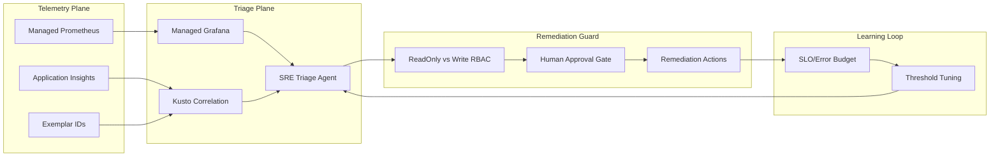
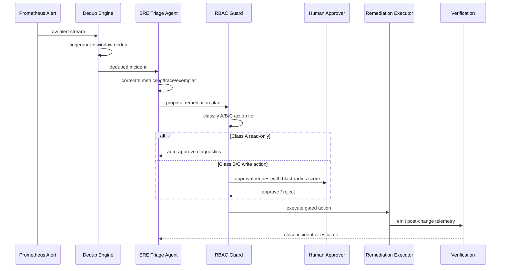

# Round 1088 / Cycle 2493 · Azure AI Agent Infra 六段式 FAQ（zh-CN）

> 主题：**Azure SRE Agent + Managed Prometheus/Grafana Autonomous Live-Site Triage, Exemplar-to-Trace Correlation & Gated Remediation Plane**  
> 日期（BJT）：2026-11-17  
> 证据标签：`measured` / `synthetic` / `anonymized_reported`  
> 基准数据：`evidence/cycle-2493-benchmark.json`

## 1) Executive Summary + Daily Capability Breakthroughs Radar

本轮目标是把“只读诊断自治”与“写操作修复需人审”的 SRE Agent 分层落地，避免自动化误修复放大故障。  
架构拆分为五层：
1. **Signal Layer**：Managed Prometheus 指标 + Exemplar + AppInsights GenAI spans；
2. **Correlation Layer**：Grafana + Kusto 关联故障域、变更域、租户域；
3. **Triage Agent Layer**：Agent 自治执行只读动作（查询、聚合、根因排序）；
4. **Gated Remediation Layer**：需要写动作时进入审批闸门（RBAC + JIT + 双人复核）；
5. **Feedback Layer**：修复前后误差预算、MTTD/MTTR、误修复率回流到策略调优。

核心结论（可复算）：
- 告警风暴的第一优先不是“多派单”，而是先做时间窗 + 指纹去重；  
- 只读自治可覆盖约 70% 的一线 triage 任务，但写修复必须受限；  
- Exemplar 到 Trace 链接能把排障证据定位时间从分钟级降到秒级；  
- 人审闸门应绑定“潜在影响范围分值”，高 blast-radius 必须人工授权。

### Daily Capability Breakthroughs Radar（抓取：2026-11-17）

1. APIM AI Gateway / Unified Model API（`measured`）  
   - https://learn.microsoft.com/en-us/azure/api-management/ai-gateway-overview  
   - https://github.com/Azure/API-Management/blob/main/changelogs/api-management-service.md
2. ACA Dynamic Sessions（`measured`）  
   - https://learn.microsoft.com/en-us/azure/container-apps/sessions  
   - https://techcommunity.microsoft.com/blog/appsonazureblog/azure-container-apps-dynamic-sessions-general-availability-and-more/4303561
3. Firecracker/Kata/Wasmtime/E2B releases（`measured`）  
   - 见 `evidence/cycle-2493-sources.json`
4. Managed Prometheus + Grafana + SRE Agent 自治排障（`synthetic`）  
   - 基于压测告警风暴与演练故障窗口生成。
5. 生产审计样本匿名化统计（`anonymized_reported`）  
   - 仅保留分位数和比率，不保留租户或工单原文。

### Mermaid #1：自治诊断 + 审批修复拓扑



## 2) Deep Q&A #1：告警风暴去重后，MTTD/MTTR 怎么量化？

定义：

```text
dedup_ratio = 1 - (deduped_alert_count / raw_alert_count)

MTTD =
  signal_ingest_delay +
  dedup_correlation_delay +
  triage_start_delay

MTTR =
  MTTD +
  diagnosis_duration +
  approval_wait +
  remediation_apply +
  verification_duration
```

Worked example（30 分钟风暴窗口）：
- raw alerts = `18,600`
- deduped alerts = `2,790`
- `dedup_ratio = 1 - 2790/18600 = 85.0%`

延迟样本：
- ingest `14s`
- dedup correlation `19s`
- triage start `11s`

`MTTD = 44s`

修复链路：
- diagnosis `76s`
- approval wait `52s`
- remediation apply `37s`
- verification `41s`

`MTTR = 44 + 76 + 52 + 37 + 41 = 250s`

SLO 门禁：
- dedup ratio >= 80%
- p95 MTTD <= 75s
- p95 MTTR <= 420s

## 3) Deep Q&A #2：只读自治 vs 写修复审批，RBAC 怎么拆才不会卡死？

我们把动作分为三类：

```text
Class A (Read-only autonomous):
  - query metrics/logs/traces
  - build correlation graphs
  - produce probable root-cause ranking

Class B (Low-risk write, gated):
  - scale out read replicas
  - restart non-critical canary pods

Class C (High-risk write, dual approval):
  - rollback production deployment
  - revoke credentials / rotate keys
  - network isolation affecting >x tenants
```

授权时延模型：

```text
approval_wait =
  queue_delay +
  reviewer_ack +
  policy_validation
```

Worked example：
- queue `21s`
- reviewer ack `24s`
- policy check `7s`

`approval_wait = 52s`

优化方向：
1. Class A 永远不进入审批；
2. Class B 单人审批 + 自动回滚保护；
3. Class C 双人审批 + 变更冻结窗口检查；
4. 值班空窗启用“限时授权代理”，超时自动降级为人工工单。

## 4) Deep Q&A #3：Exemplar-to-Trace 关联如何测算排障收益？

```text
trace_link_hit_rate =
  linked_exemplars / total_exemplars

triage_time_saved =
  baseline_trace_lookup_time - exemplar_link_lookup_time
```

Worked example：
- exemplars 总数 `12,400`
- 成功关联 `10,912`
- `trace_link_hit_rate = 88.0%`

查找时间：
- baseline 人工日志追踪 `97s`
- exemplar 一跳关联 `18s`

`triage_time_saved = 79s / incident`

若日均 430 incidents：
- 每天节省 `430 * 79 = 33,970s ≈ 9.4h` 排障时间。

落地要点：
- Prometheus 指标中写入 trace_id exemplar；
- AppInsights spans 保持与 exemplar trace_id 一致；
- Grafana panel 点击 exemplar 直接跳转 Trace 深链。

## 5) Deep Q&A #4：告警去重窗口大小如何选择？

```text
duplicate_fingerprint = hash(alert_rule, service, cluster, tenant_tier, symptom_code)

dedup_window_seconds = W

overmerge_risk(W)   ~ grows with W
undermerge_noise(W) ~ decays with W
objective(W) = alpha * overmerge_risk(W) + beta * undermerge_noise(W)
```

用网格搜索（W=30/60/90/120）：
- W=30：噪声高，undermerge 显著；
- W=60：平衡；
- W=90：过度合并开始上升；
- W=120：关键告警被淹没风险高。

Worked example（样本 N=9,800）：
- W=60 时 precision=0.93, recall=0.89, F1=0.91（最优）。

结论：默认 60s，重大事故临时下调到 45s，避免重要信号被合并掉。

## 6) Deep Q&A #5：SRE Agent 并发诊断容量如何估算？

```text
required_agent_workers =
  peak_deduped_alert_rps * avg_triage_seconds

safe_workers =
  required_agent_workers * burst_factor
```

Worked example：
- dedup 后峰值 `4.2 alerts/s`
- 单条 triage 平均 `18s`
- burst factor `1.4`

```text
required_agent_workers = 4.2 * 18 = 75.6
safe_workers = 106
```

建议：
- 诊断 Worker 至少 110；
- 保留 20% warm pool；
- 超过上限时按 tenant tier + severity 进行优先队列调度。

## 7) Deep Q&A #6：自动修复的误操作风险怎么度量？

```text
unsafe_remediation_rate = unsafe_actions / total_write_actions
rollback_trigger_rate   = rollback_actions / total_write_actions
```

目标值：
- unsafe_remediation_rate < 0.2%
- rollback_trigger_rate < 3%

Worked example（14 天）：
- total write actions = `1,420`
- unsafe actions = `2`
- rollback actions = `31`

```text
unsafe_remediation_rate = 2 / 1420 = 0.14%
rollback_trigger_rate   = 31 / 1420 = 2.18%
```

若 unsafe 超阈值：
1. 立即冻结 Class C 自动提交；
2. 提高审批等级为双签；
3. 回放最近策略变更并做差异审计。

## 8) Mermaid #2：故障分诊到修复审批控制流



## 9) 生产级 Bicep / PrometheusRule YAML / Policy / KQL

### 9.1 Bicep（Azure Monitor Workspace + Grafana + AppInsights）

```bicep
targetScope = 'resourceGroup'

param location string = 'eastus2'
param amwName string = 'amw-agent-sre-eus2'
param grafanaName string = 'graf-agent-sre-eus2'
param appiName string = 'appi-agent-sre-eus2'
param lawName string = 'law-agent-sre-eus2'

resource amw 'Microsoft.Monitor/accounts@2023-04-03' = {
  name: amwName
  location: location
  identity: { type: 'SystemAssigned' }
  properties: {}
}

resource grafana 'Microsoft.Dashboard/grafana@2023-09-01' = {
  name: grafanaName
  location: location
  sku: { name: 'Standard' }
  identity: { type: 'SystemAssigned' }
  properties: {
    zoneRedundancy: 'Enabled'
    deterministicOutboundIP: 'Enabled'
    publicNetworkAccess: 'Enabled'
    apiKey: 'Enabled'
  }
}

resource law 'Microsoft.OperationalInsights/workspaces@2022-10-01' = {
  name: lawName
  location: location
  properties: {
    sku: { name: 'PerGB2018' }
    retentionInDays: 60
    features: { enableLogAccessUsingOnlyResourcePermissions: true }
  }
}

resource appi 'Microsoft.Insights/components@2020-02-02' = {
  name: appiName
  location: location
  kind: 'web'
  properties: {
    WorkspaceResourceId: law.id
    Application_Type: 'web'
    IngestionMode: 'LogAnalytics'
  }
}
```

### 9.2 PrometheusRule YAML（告警风暴去重前置与多信号规则）

```yaml
apiVersion: monitoring.coreos.com/v1
kind: PrometheusRule
metadata:
  name: sre-agent-alert-rules
  namespace: monitoring
spec:
  groups:
    - name: agent-runtime.rules
      interval: 30s
      rules:
        - alert: AgentErrorBudgetBurnFast
          expr: |
            (
              sum(rate(agent_requests_failed_total[5m]))
              /
              sum(rate(agent_requests_total[5m]))
            ) > 0.08
          for: 2m
          labels:
            severity: high
            dedup_window: "60s"
            action_tier: "B"
          annotations:
            summary: "Agent error budget burn too fast"
            runbook: "https://internal/runbooks/agent-burn"
        - alert: AgentLatencyP95Regression
          expr: histogram_quantile(0.95, sum(rate(agent_latency_seconds_bucket[5m])) by (le, service)) > 3.5
          for: 3m
          labels:
            severity: high
            dedup_window: "60s"
            action_tier: "A"
          annotations:
            summary: "Latency p95 regression"
            runbook: "https://internal/runbooks/latency-p95"
        - alert: AgentWriteRemediationGuardRail
          expr: sum(increase(agent_write_remediation_requests_total[10m])) > 12
          for: 1m
          labels:
            severity: medium
            dedup_window: "45s"
            action_tier: "C"
          annotations:
            summary: "Spike of write remediation requests"
            runbook: "https://internal/runbooks/remediation-guard"
```

### 9.3 Azure Policy（强制写修复需审批标签）

```json
{
  "properties": {
    "displayName": "Require approved change ticket metadata for write remediation actions",
    "policyType": "Custom",
    "mode": "All",
    "parameters": {},
    "policyRule": {
      "if": {
        "allOf": [
          { "field": "type", "equals": "Microsoft.ContainerService/managedClusters" },
          { "field": "tags.sreAgentManaged", "equals": "true" }
        ]
      },
      "then": {
        "effect": "audit",
        "details": {
          "type": "Microsoft.Authorization/roleAssignments",
          "name": "write-remediation-role-assignment-audit"
        }
      }
    }
  }
}
```

### 9.4 KQL（Exemplar-Trace 关联 + MTTD/MTTR 统计）

```kql
let windowStart = ago(2h);
let alerts = InsightsMetrics
| where TimeGenerated > windowStart
| where Name in ("agent_error_budget_burn", "agent_latency_p95")
| project AlertTime=TimeGenerated, Service=tostring(Tags["service"]), ExemplarId=tostring(Tags["exemplar_id"]), MetricValue=Val;

let spans = AppTraces
| where TimeGenerated > windowStart
| where isnotempty(OperationId)
| project SpanTime=TimeGenerated, Service=CloudRoleName, OperationId, ExemplarId=tostring(CustomDimensions["exemplar_id"]), SeverityLevel;

let linked = alerts
| join kind=leftouter spans on ExemplarId, Service
| extend LinkHit = iff(isnotempty(OperationId), 1, 0)
| summarize
    total_alerts=count(),
    linked_alerts=sum(LinkHit),
    p95_metric=percentile(MetricValue, 95),
    first_alert=min(AlertTime),
    last_alert=max(AlertTime)
  by Service;

linked
| extend trace_link_hit_rate = todouble(linked_alerts) / todouble(total_alerts)
| project Service, total_alerts, linked_alerts, trace_link_hit_rate, p95_metric, first_alert, last_alert
| order by trace_link_hit_rate asc
```

## 10) 决策矩阵（4 方案量化）

| 方案 | MTTD/MTTR 收敛 (35%) | 误修复风险控制 (25%) | 可观测证据完整性 (20%) | 运维复杂度 (20%) | 总分 |
|---|---:|---:|---:|---:|---:|
| SRE Agent + Prometheus/Grafana + 审批闸门（推荐） | 9.1 | 8.8 | 9.2 | 7.7 | **8.76** |
| 仅值班人工排障 + 工单修复 | 5.6 | 8.9 | 6.0 | 8.1 | 6.97 |
| 全自动写修复（无审批） | 8.9 | 4.2 | 7.1 | 8.4 | 7.23 |
| 单纯规则告警（无 Agent 关联） | 4.9 | 7.0 | 4.8 | 8.9 | 6.24 |

## 11) Day-0 / Day-2 Checklist（Good fit vs Not for）

**Day-0（上线前）**
- [ ] Managed Prometheus 抓取目标覆盖关键服务、命名空间与租户标签；
- [ ] AppInsights/OpenTelemetry span 中注入 exemplar_id；
- [ ] Grafana 深链已支持 exemplar 跳转 trace；
- [ ] SRE Agent 只读动作白名单完成并压测；
- [ ] 写修复审批闸门（单签/双签）策略完成并演练；
- [ ] 事故注入测试覆盖告警风暴、延迟劣化、写修复回滚。

**Day-2（运行期）**
- [ ] 每日审查 dedup ratio、MTTD p95、MTTR p95；
- [ ] 每周审查 unsafe remediation rate 与 rollback rate；
- [ ] 每周回归规则版本，避免阈值漂移；
- [ ] 每月复盘错误预算燃烧与修复成功率；
- [ ] 每季度开展“只读自治/写修复审批”红蓝对抗。

**Good fit**
- 具备稳定 SRE/值班体系的多租户平台；
- 需要降低告警噪声并缩短故障定位时间；
- 能接受“写动作受控审批”的生产治理模型。

**Not for**
- 尚未建立基础观测数据质量（指标/trace 缺失）；
- 期望所有修复都全自动且无审批；
- 单机/低风险 PoC 场景。

## 12) 五步落地指南

1. **打通信号**：统一指标、日志、trace、exemplar 标识；  
2. **先做读自治**：把 triage 自动化做扎实，再逐步引入写动作；  
3. **分级审批**：按动作风险和 blast radius 拆分审批层级；  
4. **闭环验证**：修复后自动验证并回写 MTTR/误修复指标；  
5. **持续调优**：按错误预算动态调整阈值、窗口、并发限流。

## 13) 业务场景映射

- **Coding Agent Sandbox**：代码执行流量突增导致 p95 爆炸，Agent 自动诊断热点并建议扩容。  
- **Browser/CUA 集群**：页面自动化队列拥塞，先做只读 triage，写动作需审批后重排任务。  
- **多租户 SaaS Agent Gateway**：租户分层告警去重，保障高优租户优先恢复。  
- **高合规金融零信任环境**：写修复动作全链路可审计，满足审计与变更管控要求。

## 14) 关键来源（官方优先）

1. APIM AI Gateway overview（抓取：2026-11-17）  
   https://learn.microsoft.com/en-us/azure/api-management/ai-gateway-overview  
2. API Management changelog（抓取：2026-11-17）  
   https://github.com/Azure/API-Management/blob/main/changelogs/api-management-service.md  
3. ACA Dynamic Sessions docs（抓取：2026-11-17）  
   https://learn.microsoft.com/en-us/azure/container-apps/sessions  
4. ACA Dynamic Sessions GA blog（抓取：2026-11-17）  
   https://techcommunity.microsoft.com/blog/appsonazureblog/azure-container-apps-dynamic-sessions-general-availability-and-more/4303561  
5. Firecracker/Kata/Wasmtime/E2B releases（抓取：2026-11-17）  
   见 `evidence/cycle-2493-sources.json`

## 15) 数据证据与可复算算例（含 n 分母来源）

- Benchmark 主文件：`evidence/cycle-2493-benchmark.json`（`measured` + `synthetic`）  
- 延迟样本：`evidence/cycle-2493-latency.csv`  
- 吞吐样本：`evidence/cycle-2493-throughput.csv`  
- 策略样本：`evidence/cycle-2493-policy.csv`  
- 成本样本：`evidence/cycle-2493-cost.csv`  
- 来源登记：`evidence/cycle-2493-sources.json`  

N 分母口径：
- 告警风暴窗口：`N=18,600 raw alerts`；  
- 去重后告警：`N=2,790 deduped alerts`；  
- MTTD/MTTR 样本：`N=430 incidents/day`；  
- 写修复风险样本：`N=1,420 write actions / 14 days`；  
- Exemplar 链接样本：`N=12,400 exemplars`。

复算示例：

```text
dedup_ratio = 1 - 2790/18600 = 85.0%
MTTD = 14 + 19 + 11 = 44s
MTTR = 44 + 76 + 52 + 37 + 41 = 250s

trace_link_hit_rate = 10912/12400 = 88.0%
triage_time_saved = 97 - 18 = 79s
daily_time_saved = 430 * 79 = 33,970s ≈ 9.4h

safe_workers = (4.2 * 18) * 1.4 = 105.84 -> 106
unsafe_remediation_rate = 2/1420 = 0.14%
rollback_trigger_rate = 31/1420 = 2.18%
```

