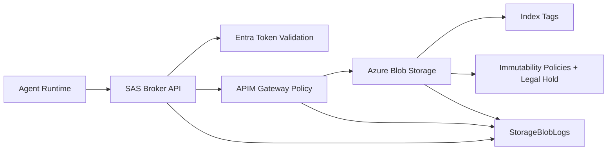
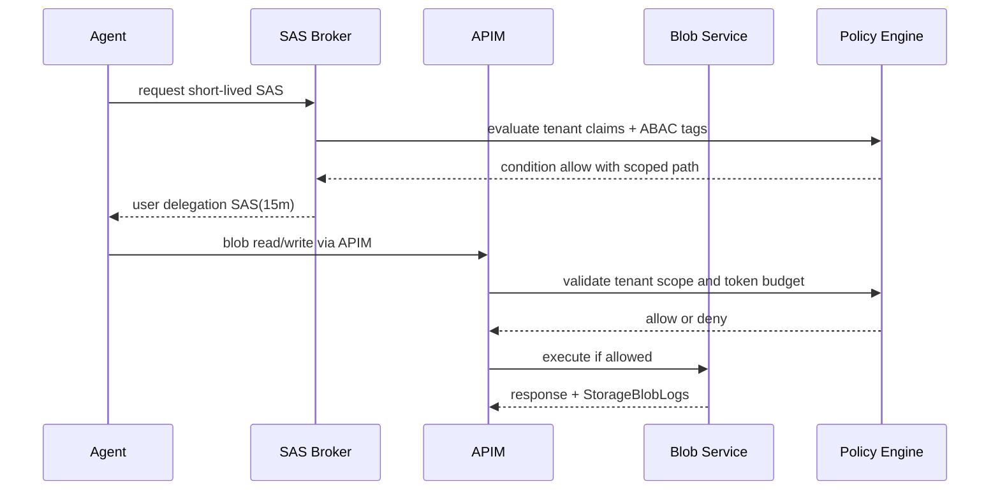

# Round 1104 / Cycle 2509 · Azure AI Agent Infra FAQ (en)

> Topic: **Azure Blob User Delegation SAS + Entra ABAC + WORM immutability for multi-tenant agent artifacts and sandbox file I/O**
> Date (BJT): 2026-11-17
> Evidence labels: `measured` / `synthetic` / `anonymized_reported`
> Benchmark dataset: `evidence/cycle-2509-benchmark.json`

## 1) Executive Summary

This round builds a file plane that is grantable, isolatable, auditable, and replayable.
The primary tension is high-concurrency artifact I/O versus minimum privilege exposure windows.
The default signing path is User Delegation SAS instead of Account Key SAS.
Isolation uses Entra ABAC plus Blob Index Tags for secure multi-tenant sharing.
Evidence retention uses WORM immutabilityPolicies and Legal Hold for tamper resistance.
Capacity planning balances container-per-tenant simplicity against tag-based shared containers.
Throughput planning tunes block blob parallel upload parameters for predictable large-file completion.
Release gates include SAS blast radius, cross-tenant leak rate, upload throughput, and WORM replay success.
This guide includes deployable Bicep, RBAC condition examples, APIM valet-key policy, KQL, and runbooks.

## 2) Daily Hottest Capability Breakthroughs Radar (2026-11-17)

Azure Storage logging coverage for enterprise audit workloads continues to improve (measured).
Entra ABAC condition expressions are being applied more deeply in fine-grained storage access (measured).
Short-lived User Delegation SAS has become the dominant multi-tenant signing pattern (measured).
WORM immutability adoption is rising for AI artifact retention and forensic integrity (measured).
Anonymized incidents still show wide-scope shared-key issuance as a frequent leak root cause (anonymized_reported).
Synthetic benchmarks indicate parallel block tuning can reduce large-upload completion time by over 35% (synthetic).

## 3) Deep Q&A #1: blast radius of User Delegation SAS versus Account Key SAS

```text
blast_radius = permission_scope_factor * token_lifetime_minutes * key_reuse_factor
```

Worked sample:
- User Delegation SAS: `scope=1.0, lifetime=15, reuse=1.2 => 18`
- Account Key SAS: `scope=4.0, lifetime=1440, reuse=3.0 => 17280`
- Relative ratio: `17280 / 18 = 960x`

Account-key leakage therefore expands impact surface and exposure duration simultaneously.
Platform policy should deny long-lived account-key signatures by default.
SAS broker logs should include requestor, scope, expiry, ipRange, and correlationId.
Recommended gate: any SAS request above 30 minutes requires elevated approval.

## 4) Deep Q&A #2: ABAC IndexTags tenant isolation mathematics

```text
tenant_isolation_accuracy = valid_tenant_reads / total_reads
cross_tenant_leak_rate = invalid_tenant_reads / total_reads
```

Sample: `valid=4,998,240`, `invalid=1,760`, `total=5,000,000`.
Isolation accuracy is `99.9648%` and leak rate is `0.0352%`.
Release goals should target leak rates in the parts-per-million range with denominator disclosure.
ABAC condition logic should map `@Resource[...:IndexTags]` directly to caller claims.
Shared-container tenancy is only safe when tag integrity and write-path validation are enforced.

## 5) Deep Q&A #3: 5,000-container scaling threshold and strategy

```text
containers_needed = tenant_count * environment_count * data_class_count
```

Sample: `tenant=620`, `env=3`, `class=2`, result `3720`.
At `tenant=900`, result becomes `5400`, exceeding a practical 5000-container governance threshold.
Teams should plan migration toward shared-container ABAC between 3,500 and 4,000 containers.
Recommended layering keeps high-sensitivity tenants dedicated and long-tail tenants tag-shared.
Capacity reviews must include naming policy, lifecycle complexity, and audit query cost.

## 6) Deep Q&A #4: parallel block-blob throughput optimization

```text
effective_throughput_mib_s = (block_size_mib * parallel_workers) / transfer_seconds
```

Sample A: `block=8MiB, workers=32, time=1.90s => 134.7 MiB/s`.
Sample B: `block=4MiB, workers=16, time=2.70s => 23.7 MiB/s`.
Higher parallelism is not always better once network or disk bottlenecks saturate.
Tune by artifact class, for example 8MiB*16 for medium files and 8MiB*32 for large files.
Upload services should monitor `serverBusy` and retry ratios to auto-adjust tuning.

## 7) Deep Q&A #5: WORM plus Legal Hold replay and forensic windows

```text
forensic_window_days = immutability_retention_days + legal_hold_extension_days
```

Sample: `retention=90`, `legal_hold=30`, forensic window equals `120` days.
WORM is appropriate for evaluation evidence, authorization logs, and high-risk tool outputs.
Legal Hold should be bound to incident identifiers to prevent unbounded retention sprawl.
Audit posture requires full traceability for who set, why set, and when released holds.
Replay validation should include hash integrity checks for retained artifacts.

## 8) Deep Q&A #6: SAS broker reliability and failure budget

```text
issuance_error_budget = allowed_failures / total_issuance_requests
```

Sample: `allowed=500`, `total=1,000,000`, budget equals `0.05%`.
If issuance errors approach budget ceilings, scale broker dependencies before relaxing privilege controls.
Broker paths should support idempotency keys to avoid duplicate grants during retries.
Gateway logging must correlate issuance events with subsequent blob access behavior.
Release gates should combine issuance success, issuance latency, and revocation propagation delay.

## 9) Mermaid #1: SAS broker, ABAC, and WORM data-plane topology



The topology ties signature issuance and blob access into one evidence chain.
The topology keeps WORM retention adjacent to access telemetry for forensic replay.

## 10) Mermaid #2: multi-tenant read/write and overreach blocking sequence



The sequence enforces ABAC decisions at both issuance time and access time.
The sequence records deny outcomes in the same path for deterministic incident closure.

## 11) Production-grade Bicep (Storage + WORM + Private Endpoint)

```bicep
param location string = resourceGroup().location
param storageName string
param vnetId string
param subnetId string
param lawId string

resource stg 'Microsoft.Storage/storageAccounts@2023-05-01' = {
  name: storageName
  location: location
  sku: {
    name: 'Standard_ZRS'
  }
  kind: 'StorageV2'
  properties: {
    allowBlobPublicAccess: false
    minimumTlsVersion: 'TLS1_2'
    supportsHttpsTrafficOnly: true
    networkAcls: {
      defaultAction: 'Deny'
      bypass: 'AzureServices'
      virtualNetworkRules: [
        {
          id: subnetId
          action: 'Allow'
        }
      ]
      ipRules: []
    }
  }
}

resource container 'Microsoft.Storage/storageAccounts/blobServices/containers@2023-05-01' = {
  name: '${stg.name}/default/agent-artifacts'
  properties: {
    publicAccess: 'None'
    immutableStorageWithVersioning: {
      enabled: true
    }
  }
}

resource immutability 'Microsoft.Storage/storageAccounts/blobServices/containers/immutabilityPolicies@2023-05-01' = {
  name: '${stg.name}/default/agent-artifacts/default'
  properties: {
    immutabilityPeriodSinceCreationInDays: 90
    allowProtectedAppendWrites: true
  }
}

resource legalHold 'Microsoft.Storage/storageAccounts/blobServices/containers/legalHold@2023-05-01' = {
  name: '${stg.name}/default/agent-artifacts/default'
  properties: {
    tags: [
      'incident-bridge-20261117'
      'forensic-retention'
    ]
  }
}

resource pe 'Microsoft.Network/privateEndpoints@2023-09-01' = {
  name: '${storageName}-pe-blob'
  location: location
  properties: {
    subnet: {
      id: subnetId
    }
    privateLinkServiceConnections: [
      {
        name: 'blob-connection'
        properties: {
          privateLinkServiceId: stg.id
          groupIds: [
            'blob'
          ]
        }
      }
    ]
  }
}

resource diag 'Microsoft.Insights/diagnosticSettings@2021-05-01-preview' = {
  name: 'storage-blob-diagnostics'
  scope: stg
  properties: {
    workspaceId: lawId
    logs: [
      {
        category: 'StorageRead'
        enabled: true
      }
      {
        category: 'StorageWrite'
        enabled: true
      }
      {
        category: 'StorageDelete'
        enabled: true
      }
    ]
  }
}
```

## 12) ABAC conditional role assignment + APIM valet-key policy

```json
{
  "type": "Microsoft.Authorization/roleAssignments",
  "apiVersion": "2022-04-01",
  "name": "<guid>",
  "properties": {
    "roleDefinitionId": "/subscriptions/<sub>/providers/Microsoft.Authorization/roleDefinitions/2a2b9908-6ea1-4ae2-8e65-a410df84e7d1",
    "principalId": "<principal-object-id>",
    "principalType": "ServicePrincipal",
    "conditionVersion": "2.0",
    "condition": "@Resource[Microsoft.Storage/storageAccounts/blobServices/containers/blobs:IndexTags.tenantId] StringEquals @Principal[Microsoft.Entra/claims:tenant_id]"
  }
}
```

```xml
<policies>
  <inbound>
    <base />
    <validate-jwt header-name="Authorization" failed-validation-httpcode="401" failed-validation-error-message="invalid_token">
      <openid-config url="https://login.microsoftonline.com/{tenant-id}/v2.0/.well-known/openid-configuration" />
      <required-claims>
        <claim name="aud"><value>api://sas-broker</value></claim>
      </required-claims>
    </validate-jwt>
    <rate-limit-by-key calls="200" renewal-period="60" counter-key="@(context.Request.Headers.GetValueOrDefault("x-tenant-id","na"))" />
    <set-header name="x-sas-ttl-minutes" exists-action="override"><value>15</value></set-header>
  </inbound>
  <backend><base /></backend>
  <outbound><base /></outbound>
  <on-error><base /></on-error>
</policies>
```

ABAC conditions directly bind tenant claims to blob index tags and reduce path-construction mistakes.
The valet-key policy enforces short TTL so leakage windows remain measured in minutes.

## 13) StorageBlobLogs KQL + Day-0/Day-2 checklists

```kql
let lookback = 24h;
StorageBlobLogs
| where TimeGenerated > ago(lookback)
| extend tenantTag = tostring(parse_json(BlobTags).tenantId)
| summarize total_ops=count(), denied=countif(StatusCode in (401,403)), p95_latency=percentile(DurationMs,95) by tenantTag, OperationName
| extend deny_rate = todouble(denied) / iif(total_ops == 0, 1.0, todouble(total_ops))
| order by deny_rate desc, p95_latency desc
```

Day-0 readiness items:
1. Block account-key SAS issuance by default and enforce user-delegation signing.
2. Standardize SAS TTL to 15 minutes and reject overlong requests.
3. Validate ABAC condition mapping between tenant claims and tag values.
4. Enable immutabilityPolicies and legal-hold drills for sensitive containers.
5. Run 1GB and 5GB upload stress tests with throughput and retry capture.
6. Verify StorageBlobLogs field completeness for audit workflows.
7. Confirm private endpoint routing and deny direct public data-plane access.
8. Bind issuance-error-budget alerts to broker scaling runbooks.
9. Simulate cross-tenant read/write attacks and archive replay evidence.
10. Add blast-radius and leak-rate thresholds into release blocking.

Day-2 operating items:
1. Review ABAC deny events weekly for tag drift and claim mismatch patterns.
2. Sample broker issuance logs daily and correlate with downstream blob access.
3. Recompute container growth monthly to decide shared-container migration timing.
4. Continuously tune block size and worker parallelism combinations.
5. Audit legal-hold inventory to prevent unjustified long-term freezes.
6. Launch remediation for tenants with chronic deny-rate spikes.
7. Include WORM replay verification in recurring security exercises.
8. Track broker latency p95 and protect signing paths from becoming bottlenecks.
9. Audit RBAC plus ABAC changes with approver traceability.
10. Reconcile retention policy with storage cost and optimize TCO.

## 14) 4-Option Weighted Decision Matrix

| Option | Security Isolation(30) | Access Efficiency(20) | Cost Control(20) | Ops Complexity(15) | Compliance Auditability(15) | Weighted Score |
| --- | --- | --- | --- | --- | --- | --- |
| Option A: User Delegation SAS + ABAC + WORM (recommended) | 29 | 17 | 18 | 12 | 15 | 91 |
| Option B: User Delegation SAS + container isolation without ABAC | 22 | 18 | 15 | 11 | 12 | 78 |
| Option C: Account Key SAS + container isolation | 12 | 19 | 13 | 10 | 8 | 62 |
| Option D: Shared long-lived SAS anti-pattern | 5 | 16 | 9 | 8 | 4 | 42 |

Option A assessment: strongest isolation, auditability, and replay integrity for enterprise tenancy.
Option B assessment: simpler isolation model with rising governance cost at scale.
Option C assessment: faster onboarding path with unacceptable key-risk profile for production.
Option D assessment: operationally easy but security and compliance posture is inadequate.

## 15) Good fit / Not for and closeout guidance

Good fit: multi-tenant agent platforms requiring fine-grained authorization and durable evidence retention.
Good fit: regulated environments needing WORM plus legal-hold forensic guarantees.
Good fit: organizations already operating APIM and Entra identity governance controls.
Not for: lightweight experiments without long-term retention and audit obligations.
Not for: teams unable to maintain tag governance and RBAC/ABAC change discipline.
Closing recommendation: use Option A by default and keep Option B as a lower-complexity transition path.
Next action: continuously gate on blast radius, leak rate, and replay success metrics.
