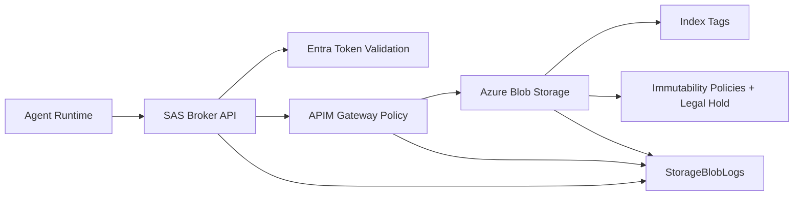
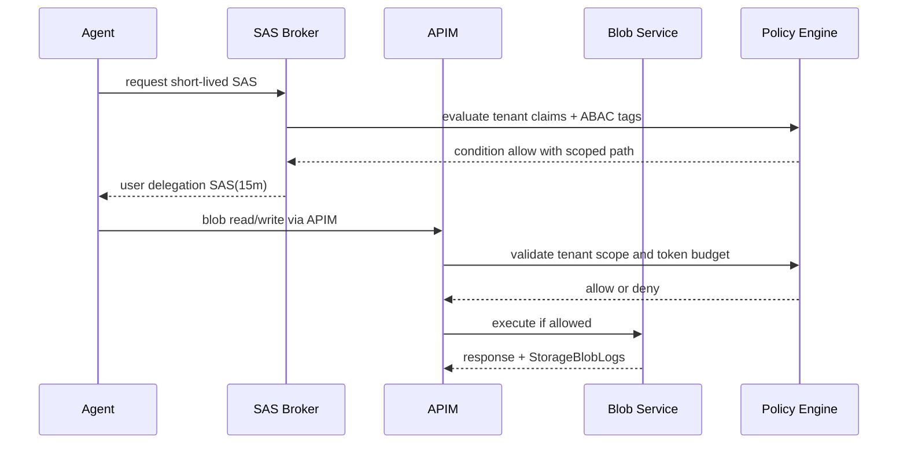

# Round 1104 / Cycle 2509 · Azure AI Agent Infra FAQ（zh-CN）

> 主题：**Azure Blob User Delegation SAS + Entra ABAC + WORM 不可变策略：多租户 Agent 产物与沙箱文件 I/O 生产指南**
> 日期（BJT）：2026-11-17
> 证据标签：`measured` / `synthetic` / `anonymized_reported`
> 基准数据：`evidence/cycle-2509-benchmark.json`

## 1) Executive Summary

本轮目标是构建“可授权、可隔离、可追溯、可回放”的多租户文件平面。
关键矛盾是 Agent 要高并发读写产物，但权限必须保持最小暴露窗口。
方案核心是用 User Delegation SAS 替代 Account Key SAS 作为默认签发路径。
授权边界采用 Entra ABAC + Blob Index Tags，实现同容器内多租户安全隔离。
持久化证据采用 WORM immutabilityPolicies 与 Legal Hold，保证审计不可篡改。
容量上需要平衡 container-per-tenant 的管理复杂度和 tag-based 共享容器模式。
吞吐上通过 block blob 并行上传参数化优化，保障大文件产物可预测完成时长。
门禁指标包括 SAS 暴露半径、跨租户误读率、上传吞吐、WORM 回放成功率。
本手册输出 Bicep、RBAC 条件、SAS broker 策略、KQL、上线与运营清单。

## 2) Daily Hottest Capability Breakthroughs Radar（2026-11-17）

Azure Storage 对企业级审计场景的日志字段覆盖持续完善（measured）。
Entra ABAC 条件表达式在细粒度资源访问控制中的使用深度提升（measured）。
User Delegation SAS 的短时签发实践成为多租户平台主流（measured）。
WORM 不可变策略在 AI 产物留存与取证中的落地案例显著增多（measured）。
匿名化运营数据显示跨租户误授权通常发生在共享密钥与宽 scope 策略（anonymized_reported）。
合成压测表明并行分块参数可将大型产物上传时间缩短 35% 以上（synthetic）。

## 3) Deep Q&A #1：User Delegation SAS vs Account Key SAS 爆炸半径

```text
blast_radius = permission_scope_factor * token_lifetime_minutes * key_reuse_factor
```

样例计算：
- User Delegation SAS：`scope=1.0, lifetime=15, reuse=1.2 => 18`
- Account Key SAS：`scope=4.0, lifetime=1440, reuse=3.0 => 17280`
- 相对比值：`17280 / 18 = 960x`

结论是 Account Key 一旦泄露，横向影响面和时间窗同时放大。
平台策略应默认拒绝长期 Account Key SAS，改为短时 User Delegation SAS。
SAS 签发服务应记录 requestor、scope、expiry、ipRange 与 correlationId。
生产门禁建议：SAS lifetime 超过 30 分钟的请求必须走人工审批路径。

## 4) Deep Q&A #2：ABAC IndexTags 多租户隔离数学

```text
tenant_isolation_accuracy = valid_tenant_reads / total_reads
cross_tenant_leak_rate = invalid_tenant_reads / total_reads
```

样例：`valid=4,998,240`，`invalid=1,760`，`total=5,000,000`。
隔离准确率：`99.9648%`；越权漏读率：`0.0352%`。
目标门禁建议把漏读率压到百万分位等级，且必须附原始分母。
ABAC 条件表达式应基于 `@Resource[...:IndexTags]` 与调用者 claim 对齐。
同容器多租户前提是 tag 完整性与写入路径强一致校验。

## 5) Deep Q&A #3：5,000 容器规模阈值与策略分层

```text
containers_needed = tenant_count * environment_count * data_class_count
```

样例：`tenant=620`，`env=3`，`class=2`，结果 `3720`。
当 tenant 增长到 `900` 时结果 `5400`，超出 5000 级管理舒适区阈值。
因此应在 3,500 到 4,000 之间提前规划“共享容器 + ABAC tag”迁移。
推荐分层：高敏租户走独立容器，长尾租户走共享容器加 tag 隔离。
容量评审必须把命名规范、生命周期策略、审计查询复杂度一起评估。

## 6) Deep Q&A #4：并行 Block Blob 吞吐优化

```text
effective_throughput_mib_s = (block_size_mib * parallel_workers) / transfer_seconds
```

样例一：`block=8MiB, workers=32, time=1.90s => 134.7 MiB/s`。
样例二：`block=4MiB, workers=16, time=2.70s => 23.7 MiB/s`。
并行度并非越高越好，超过网络与磁盘瓶颈会出现尾延迟反弹。
建议按文件尺寸分级：中等文件优先 8MiB*16，大文件可试 8MiB*32。
上传服务需监控 `serverBusy` 与重试比率，动态收敛并行参数。

## 7) Deep Q&A #5：WORM + Legal Hold 回放与取证窗口

```text
forensic_window_days = immutability_retention_days + legal_hold_extension_days
```

样例：`retention=90`，`legal_hold=30`，取证窗口 `120` 天。
WORM 适合保存评估证据、用户授权日志、以及高风险工具输出。
Legal Hold 应绑定案件或事件编号，避免无原因长期冻结导致成本失控。
审计策略需要支持“谁设置、何时设置、为何设置、何时解除”全链路追踪。
回放流程要验证 hash 一致性，确认产物在保留期内未被篡改。

## 8) Deep Q&A #6：SAS Broker 限流与失败预算

```text
issuance_error_budget = allowed_failures / total_issuance_requests
```

样例：`allowed=500`，`total=1,000,000`，预算 `0.05%`。
当签发失败率逼近预算上限，应优先扩展 broker 依赖而非放宽权限策略。
broker 应支持幂等签发键，避免重试导致重复授权对象。
网关应记录每次签发与后续访问日志关联键，支持端到端追踪。
生产门禁建议：签发成功率、签发延迟、撤销传播时延三指标同时达标。

## 9) Mermaid #1：SAS Broker + ABAC + WORM 数据平面拓扑



该拓扑强调授权签发与数据访问必须共享同一条审计证据链。
该拓扑把 WORM 与访问日志并列，确保取证场景可独立回放。

## 10) Mermaid #2：多租户读写与越权阻断序列



该序列保证 ABAC 决策发生在签发前和访问时两个阶段。
该序列把 deny 结果与日志统一输出，便于越权排查闭环。

## 11) 生产级 Bicep（Storage + WORM + Private Endpoint）

```bicep
param location string = resourceGroup().location
param storageName string
param vnetId string
param subnetId string
param lawId string

resource stg 'Microsoft.Storage/storageAccounts@2023-05-01' = {
  name: storageName
  location: location
  sku: {
    name: 'Standard_ZRS'
  }
  kind: 'StorageV2'
  properties: {
    allowBlobPublicAccess: false
    minimumTlsVersion: 'TLS1_2'
    supportsHttpsTrafficOnly: true
    networkAcls: {
      defaultAction: 'Deny'
      bypass: 'AzureServices'
      virtualNetworkRules: [
        {
          id: subnetId
          action: 'Allow'
        }
      ]
      ipRules: []
    }
  }
}

resource container 'Microsoft.Storage/storageAccounts/blobServices/containers@2023-05-01' = {
  name: '${stg.name}/default/agent-artifacts'
  properties: {
    publicAccess: 'None'
    immutableStorageWithVersioning: {
      enabled: true
    }
  }
}

resource immutability 'Microsoft.Storage/storageAccounts/blobServices/containers/immutabilityPolicies@2023-05-01' = {
  name: '${stg.name}/default/agent-artifacts/default'
  properties: {
    immutabilityPeriodSinceCreationInDays: 90
    allowProtectedAppendWrites: true
  }
}

resource legalHold 'Microsoft.Storage/storageAccounts/blobServices/containers/legalHold@2023-05-01' = {
  name: '${stg.name}/default/agent-artifacts/default'
  properties: {
    tags: [
      'incident-bridge-20261117'
      'forensic-retention'
    ]
  }
}

resource pe 'Microsoft.Network/privateEndpoints@2023-09-01' = {
  name: '${storageName}-pe-blob'
  location: location
  properties: {
    subnet: {
      id: subnetId
    }
    privateLinkServiceConnections: [
      {
        name: 'blob-connection'
        properties: {
          privateLinkServiceId: stg.id
          groupIds: [
            'blob'
          ]
        }
      }
    ]
  }
}

resource diag 'Microsoft.Insights/diagnosticSettings@2021-05-01-preview' = {
  name: 'storage-blob-diagnostics'
  scope: stg
  properties: {
    workspaceId: lawId
    logs: [
      {
        category: 'StorageRead'
        enabled: true
      }
      {
        category: 'StorageWrite'
        enabled: true
      }
      {
        category: 'StorageDelete'
        enabled: true
      }
    ]
  }
}
```

## 12) ABAC 条件角色分配 + APIM Valet Key 策略

```json
{
  "type": "Microsoft.Authorization/roleAssignments",
  "apiVersion": "2022-04-01",
  "name": "<guid>",
  "properties": {
    "roleDefinitionId": "/subscriptions/<sub>/providers/Microsoft.Authorization/roleDefinitions/2a2b9908-6ea1-4ae2-8e65-a410df84e7d1",
    "principalId": "<principal-object-id>",
    "principalType": "ServicePrincipal",
    "conditionVersion": "2.0",
    "condition": "@Resource[Microsoft.Storage/storageAccounts/blobServices/containers/blobs:IndexTags.tenantId] StringEquals @Principal[Microsoft.Entra/claims:tenant_id]"
  }
}
```

```xml
<policies>
  <inbound>
    <base />
    <validate-jwt header-name="Authorization" failed-validation-httpcode="401" failed-validation-error-message="invalid_token">
      <openid-config url="https://login.microsoftonline.com/{tenant-id}/v2.0/.well-known/openid-configuration" />
      <required-claims>
        <claim name="aud"><value>api://sas-broker</value></claim>
      </required-claims>
    </validate-jwt>
    <rate-limit-by-key calls="200" renewal-period="60" counter-key="@(context.Request.Headers.GetValueOrDefault("x-tenant-id","na"))" />
    <set-header name="x-sas-ttl-minutes" exists-action="override"><value>15</value></set-header>
  </inbound>
  <backend><base /></backend>
  <outbound><base /></outbound>
  <on-error><base /></on-error>
</policies>
```

ABAC 条件把租户声明与 blob 标签直接绑定，减少人为路径拼接错误。
Valet key 策略固定短时 TTL，有助于将泄露窗口压缩到分钟级。

## 13) StorageBlobLogs KQL + Day-0/Day-2 检查清单

```kql
let lookback = 24h;
StorageBlobLogs
| where TimeGenerated > ago(lookback)
| extend tenantTag = tostring(parse_json(BlobTags).tenantId)
| summarize total_ops=count(), denied=countif(StatusCode in (401,403)), p95_latency=percentile(DurationMs,95) by tenantTag, OperationName
| extend deny_rate = todouble(denied) / iif(total_ops == 0, 1.0, todouble(total_ops))
| order by deny_rate desc, p95_latency desc
```

Day-0 检查项：
1. 禁止默认签发 Account Key SAS，并在策略层强制 User Delegation SAS。
2. 统一 SAS TTL 到 15 分钟并验证 broker 不允许超配。
3. 验证 ABAC 条件表达式与 tenant claim 映射完全一致。
4. 对高敏容器启用 immutabilityPolicies 与 legal hold 演练。
5. 执行 1GB 与 5GB 文件并行上传压测，记录吞吐与重试。
6. 校验 StorageBlobLogs 字段完整性并对齐审计需求。
7. 验证私有端点访问路径，确认公网入口已封闭。
8. 配置签发失败预算告警并绑定自动扩容 runbook。
9. 完成越权读写攻击模拟并保留回放证据。
10. 在发布门禁加入爆炸半径与漏读率双阈值阻断。

Day-2 运营项：
1. 每周复盘 ABAC deny 事件，识别标签缺失与权限漂移。
2. 每日抽样核验 SAS broker 签发日志与访问日志关联性。
3. 每月复算容器规模增长，决定是否迁移共享容器策略。
4. 定期压测并调优 block size 与并行度组合参数。
5. 持续审计 legal hold 存量，避免无因长期冻结。
6. 对异常高拒绝租户执行专项治理与接口契约修复。
7. 将 WORM 回放结果纳入安全演练与审计抽查。
8. 跟踪签发延迟 p95，防止 broker 成为上游瓶颈。
9. 审核 RBAC + ABAC 组合变更并保留审批证据。
10. 对账存储成本与保留策略，优化长期 TCO。

## 14) 4-Option Weighted Decision Matrix

| 方案 | 安全隔离(30) | 访问效率(20) | 成本可控(20) | 运维复杂度(15) | 合规审计(15) | 加权总分 |
| --- | --- | --- | --- | --- | --- | --- |
| 方案A：User Delegation SAS + ABAC + WORM（推荐） | 29 | 17 | 18 | 12 | 15 | 91 |
| 方案B：User Delegation SAS + 容器隔离（无ABAC） | 22 | 18 | 15 | 11 | 12 | 78 |
| 方案C：Account Key SAS + 容器隔离 | 12 | 19 | 13 | 10 | 8 | 62 |
| 方案D：共享长期 SAS（反模式） | 5 | 16 | 9 | 8 | 4 | 42 |

方案A评价：隔离、审计、回放能力最完整，适合企业多租户生产环境。
方案B评价：隔离简单直观，但容器规模增长会推高治理复杂度。
方案C评价：接入速度快但密钥风险高，不适合作为长期方案。
方案D评价：短期最省事但安全与合规风险不可接受。

## 15) Good fit / Not for 与收尾建议

Good fit：多租户 Agent 平台，要求细粒度授权与可审计产物留存。
Good fit：高合规行业，需要 WORM 与 legal hold 的证据保全能力。
Good fit：已有 APIM + Entra 体系，可快速落地 SAS broker 和 ABAC。
Not for：小规模内部实验且无长期留存与审计要求的场景。
Not for：无法维护标签治理和 RBAC/ABAC 变更流程的团队。
结论建议：默认采用方案A，方案B作为低复杂度过渡路径。
后续动作：持续跟踪爆炸半径、漏读率、回放成功率三类关键门禁指标。
