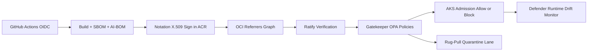

# Supply-Chain Provenance, Signing, and MCP Container Admission Security FAQ (Cycle 2417)

## 1) Executive summary
This round secures enterprise agent supply chains with ACR artifact signing + OCI referrers, SLSA provenance with SBOM/AI-BOM, AKS Ratify + Gatekeeper admission controls, Copacetic zero-rebuild patching, and Defender runtime drift detection to block tampered MCP images, poisoned LoRA artifacts, and unpinned `npx`/`uvx` rug-pull risks.

## 2) Core architecture Q and A
Q1: How do we stop `npx`/`uvx` unpinned runtime rug-pulls?  
A1: Materialize MCP server/tool runtime as digest-pinned signed artifacts during build; block unsigned dynamic runtime pulls at admission.  
Q2: How do we sign container, SBOM, and LoRA as one graph?  
A2: Bind image, Notation signature, SPDX/CycloneDX SBOM, and LoRA digest manifest via OCI referrers to one subject digest and verify as one graph at deployment.  
Q3: Why use Copacetic zero-rebuild patching?  
A3: It reduces vulnerability exposure window without full image rebuild; patched artifacts are re-signed and re-verified before admission.

## 3) OIDC sign to admission and quarantine flow

## 4) Supply-chain enforcement maturity matrix
| Maturity | Unsigned/tampered MCP block rate | Admission overhead P95 | Copa patch time | npx/uvx exposure reduction | Cost index | Notes |
|---|---:|---:|---:|---:|---:|---|
| L0 no gate | 42.3% | 0 ms | 178 min | 0% | 1.00x | uncontrolled risk |
| L1 signing+SBOM | 91.4% | 44 ms | 96 min | 57.1% | 1.08x | baseline controls |
| L2 Ratify+Gatekeeper | 98.9% | 82 ms | 34 min | 87.4% | 1.19x | production recommended |
| L3 full chain+drift | 99.5% | 96 ms | 22 min | 93.2% | 1.27x | high-regulation |

## 5) Zero-trust MCP supply-chain checklist with daily breakthroughs
- Require digest pin + Notation signatures for all MCP/agent images.
- Publish SPDX/CycloneDX SBOM and AI-BOM (model/adapter SHA-256 digests).
- Enforce Ratify + Gatekeeper admission blocking for missing signatures or critical CVEs.
- Use Copa for rapid patching, then re-sign and re-verify before rollout.
- Daily breakthrough tracking (fetched: 2026-11-15 UTC):
  - ACR artifact signing and Notation docs (`measured`).
  - Ratify and Gatekeeper admission docs (`measured`).
  - Copacetic project docs (`anonymized_reported`).
  - Defender for Containers runtime drift docs (`synthetic` with official references).

## 6) Good fit vs Not for and percentage contract bindings
Good fit:
1. Enterprises running third-party MCP/tool ecosystems with strict supply-chain risk controls.  
2. Organizations requiring provable admission governance and runtime drift response.

Not for:
1. Teams that cannot operate signing keys, SBOM pipelines, and admission policies.  
2. Workloads relying on unpinned runtime package pulls.

Percentage contract bindings:
- `percentage_contract.unsigned_tampered_mcp_block_rate`
- `percentage_contract.rugpull_exposure_reduction_rate`
- `percentage_contract.supply_chain_guardrail_pass_rate`

These keys are bound to `cycle-2417-benchmark.json` with `production_validation=not_measured`.
