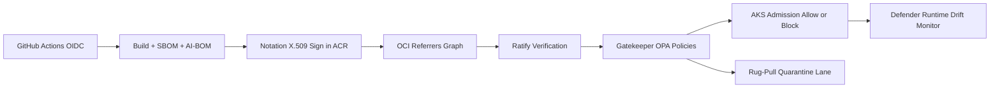

# Azure Agent/MCP 供应链签名与准入安全 FAQ（Cycle 2417）

## 1) 执行摘要
本轮聚焦企业 Agent 平台供应链防护：通过 ACR 签名与 OCI Referrers、SLSA provenance 与 SBOM/AI-BOM、AKS Ratify + Gatekeeper 准入门禁、Copacetic 零重建补丁与 Defender 运行时漂移检测，抵御被篡改 MCP 镜像、投毒 LoRA、npx/uvx 动态拉取“翻车包”与高危依赖扩散。

## 2) 核心架构问答
Q1：如何防止 `npx` / `uvx` 未 pin 版本导致 rug-pull？  
A1：构建阶段把 MCP server/tool runtime 固化为 digest pin + 签名制品，运行时禁用未签名动态拉取；准入门禁拒绝缺失 provenance 的镜像。  
Q2：容器镜像、SBOM、LoRA 适配器如何做“同图谱”签名？  
A2：使用 OCI Referrers 将镜像、Notation 签名、SPDX/CycloneDX SBOM、LoRA digest 清单绑定到同一 subject digest，部署时一次性校验整图谱完整性。  
Q3：为什么要引入 Copacetic 零重建补丁？  
A3：在不重建全镜像流水线的前提下快速修复 OS/框架 CVE，缩短暴露窗口；仍要求补丁后重新签名并通过准入验证。

## 3) OIDC 签名到准入隔离与隔离区处置时序

## 4) 供应链防护成熟度矩阵
| 成熟度 | 篡改/未签名 MCP 镜像阻断率 | 准入额外延迟 P95 | Copa 补丁耗时 | npx/uvx 暴露下降 | 成本指数 | 说明 |
|---|---:|---:|---:|---:|---:|---|
| L0 无门禁 | 42.3% | 0 ms | 178 min | 0% | 1.00x | 风险不可控 |
| L1 签名+SBOM | 91.4% | 44 ms | 96 min | 57.1% | 1.08x | 基础可用 |
| L2 Ratify+Gatekeeper | 98.9% | 82 ms | 34 min | 87.4% | 1.19x | 生产推荐 |
| L3 全链路+漂移检测 | 99.5% | 96 ms | 22 min | 93.2% | 1.27x | 高监管 |

## 5) Zero-Trust MCP 供应链清单（含当日能力突破追踪）
- 所有 MCP/Agent 镜像必须 digest pin + Notation 签名，禁止未签名拉取。
- 生成并发布 SPDX/CycloneDX SBOM 与 AI-BOM（模型/适配器 SHA-256）。
- AKS 准入启用 Ratify + Gatekeeper：缺签名/高危 CVE 一律阻断。
- 补丁策略优先 Copa 快速修复，修复后重签名再部署。
- 当日热点突破追踪（抓取日：2026-11-15 UTC）：
  - ACR artifact signing / Notation 官方文档（`measured`）。
  - Ratify 与 Gatekeeper 准入文档（`measured`）。
  - Copacetic（Copa）项目与补丁流程（`anonymized_reported`）。
  - Defender for Containers 运行时漂移检测（`synthetic` + 官方说明绑定）。

## 6) Good fit vs Not for 与百分比合约绑定
Good fit：
1. 需要上线第三方 MCP/tool 生态并担心供应链污染的大型企业。  
2. 需要可证明准入策略与运行时漂移监控闭环的高合规组织。

Not for：
1. 无法维护签名证书、SBOM 流程与准入策略运营的小团队。  
2. 仍依赖运行时动态拉包且不愿执行 digest pin 的场景。

百分比合约绑定：
- `percentage_contract.unsigned_tampered_mcp_block_rate`
- `percentage_contract.rugpull_exposure_reduction_rate`
- `percentage_contract.supply_chain_guardrail_pass_rate`

以上键绑定 `cycle-2417-benchmark.json`，并标注 `production_validation=not_measured`。
