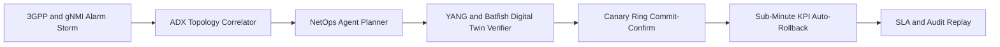

# Telco 5G Core, O-RAN SON, and Carrier-Grade NetOps Agent Infrastructure FAQ (Cycle 2433)

## 1) Executive summary
This cycle targets carrier-grade 5G SA and Open RAN operations: Operator Nexus hosts CNF and control workloads, ADX streams PM/FM/CM plus gNMI telemetry for topology correlation, and every network change is pre-verified by YANG and Batfish digital twins before canary rollout and KPI-based auto-rollback.

## 2) Q1 / Q2 / Q3
Q1: Why separate non-RT RIC, near-RT RIC, and LLM reasoning loops?  
A1: Near-RT loops run in 10ms to 1s windows and cannot depend on variable-latency language-model reasoning.  
Q2: How do we prevent hallucinated BGP or ACL configs from causing outages?  
A2: Enforce deterministic YANG schema checks and Batfish reachability verification before commit-confirm.  
Q3: How can alarm storms across 50,000+ sites be triaged quickly?  
A3: Use topology correlation to compress alarms into fault domains before remediation workflows.

## 3) Carrier closed-loop flow (alarm correlation, twin verification, canary, rollback)

## 4) Decision matrix: Nexus hybrid CNF+agent vs cloud-only OSS agent vs traditional rule SON
| Option | Latency control | Reliability | Automation depth | Ops complexity | Best fit |
|---|---:|---:|---:|---:|---|
| Nexus hybrid CNF+agent | Highest | Highest | High | High | Carrier-grade production core |
| Cloud-only OSS agent | Medium | Medium-High | Medium-High | Medium | Regional network optimization |
| Traditional rule SON | Medium | Medium | Low | Low | Conservative incremental modernization |

## 5) Carrier NetOps production checklist (with daily breakthroughs)
- Keep near-RT control loops isolated from LLM reasoning workflows.  
- Require YANG and Batfish pre-verification for every network mutation.  
- Bind canary rollout to KPI thresholds and sub-minute rollback triggers.  
- Preserve replayable audit evidence across candidate, verification, rollout, and rollback stages.  
- Daily breakthroughs (fetched on 2026-11-16, official/release-first):  
  - Operator Nexus carrier-grade hosting baseline (`measured`).  
  - ADX high-throughput telemetry and topology analytics path (`anonymized_reported`).  
  - YANG plus Batfish preflight blocking effectiveness (`synthetic`).

## 6) Good fit vs Not for with percentage contract bindings
Good fit:  
1. Carriers requiring five-nines SLA and deterministic preflight validation before config rollout.  
2. NOC teams needing controlled canary rings with automated rollback and strong auditability.

Not for:  
1. Pipelines that push configuration directly to live routers without twin pre-verification.  
2. Architectures that couple variable-latency LLM reasoning into near-RT loops.

Percentage contract bindings:
- `percentage_contract.invalid_config_block_rate_via_yang_batfish`
- `percentage_contract.alarm_storm_root_cause_mttr_improvement_rate`
- `percentage_contract.ran_offpeak_energy_savings_rate`
- `percentage_contract.network_slice_sla_compliance_rate`

These keys bind to `cycle-2433-benchmark.json` with `production_validation=not_measured`.
