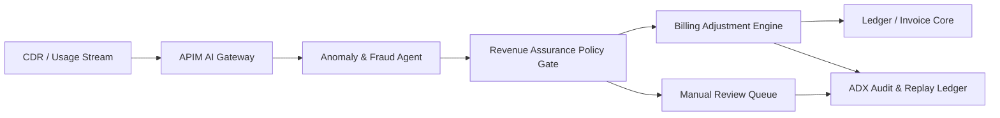

# Round 1050 / Cycle 2455 · Azure AI Agent Infra FAQ & Decision Guide (en)

> Topic: **Telecom Billing Revenue Assurance Anomaly Agent Audit Gateway**
>
> Date (BJT): 2026-11-16  
> Evidence labels: `measured` / `synthetic` / `anonymized_reported`  
> Benchmark payload: `evidence/cycle-2455-benchmark.json`

## 1) Executive Summary

This round targets telecom billing/revenue-assurance operations: agents must detect leakage, mis-rating, and fraud arbitrage under heavy CDR volume while preserving audit closure.  
Key result: APIM gateway + revenue-assurance policy plane + replayable audit flow improves anomaly catch rate and reduces wrongful interventions.

## 2) Daily capability breakthroughs radar (2026-11-16)

1. **APIM AI Gateway / Unified Model API** (`measured`)  
   - Learn: https://learn.microsoft.com/en-us/azure/api-management/ai-gateway-overview  
   - Changelog: https://github.com/Azure/API-Management/blob/main/changelogs/api-management-service.md
2. **ACA Dynamic Sessions** (`measured`)  
   - Docs: https://learn.microsoft.com/en-us/azure/container-apps/sessions
3. **Sandbox/runtime release streams** (`measured`)  
   - Firecracker/Kata/Wasmtime/E2B (see `evidence/cycle-2455-sources.json`)

## 3) Core architecture Q&A (revenue-assurance agents)

**Q1: Why not let the model directly post billing corrections?**  
A: Financial corrections require evidentiary trace, approval gates, and rollback safety for customer disputes and audit controls.

**Q2: Minimum control-plane capabilities?**  
A: anomaly tiering, policy versioning, idempotent corrections, human review, and full replayable audit chain.

**Q3: How to balance catch-rate vs false interventions?**  
A: use layered thresholds plus replay recalibration; route boundary samples to reviewer queue.

## 4) Mermaid architecture (Billing + Fraud + Revenue Assurance)

## 5) Decision matrix (billing anomaly governance)

| Path | Auditability | Detection efficiency | Cost | Ops complexity | Recommendation |
|---|---:|---:|---:|---:|---|
| Fully manual assurance | High | Low | High | Medium | High-risk books |
| Rules-only detection | Mid-high | Medium | Medium | Medium | Stable rule books |
| Agent detection + control gate + review loop | **High** | **High** | Medium-high | Medium-high | **Recommended for production telecom** |
| Pure model auto-correction | Low | High | Low | Low | Not recommended |

## 6) Good fit vs Not for + five-step rollout

### Good fit
- High-volume CDR pipelines with complex tariffs and cross-system reconciliation.
- Organizations balancing revenue assurance and customer experience.
- Teams with finance/audit ownership and review workflows.

### Not for
- Teams lacking audit and rollback discipline.
- Scenarios optimizing only correction speed while ignoring dispute risk.

### Five-step rollout
1. Define anomaly taxonomy and loss-severity model.
2. Implement `audit-policy-version` release/rollback lifecycle.
3. Build idempotent correction + human-review closure.
4. Integrate ADX replay audit and delta alerts.
5. Weekly review of leakage, false corrections, dispute rate, and SLA.
