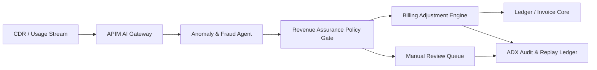

# Round 1050 / Cycle 2455 · Azure AI Agent Infra FAQ & 决策指南（zh-CN）

> Topic: **Telecom Billing Revenue Assurance Anomaly Agent Audit Gateway**
>
> Date (BJT): 2026-11-16  
> Evidence labels: `measured` / `synthetic` / `anonymized_reported`  
> Benchmark payload: `evidence/cycle-2455-benchmark.json`

## 1) Executive Summary

本轮聚焦运营商计费与收入保障：Agent 需要在大规模 CDR 处理下识别漏计费、错计费、欺诈套利，并保持审计闭环。  
核心结论：采用 APIM 网关 + 收入保障策略控制面 + 可回放审计链路，可在提升异常检出率的同时降低误拦截与营收损失。

## 2) Daily capability breakthroughs radar（2026-11-16）

1. **APIM AI Gateway / Unified Model API**（`measured`）  
   - Learn: https://learn.microsoft.com/en-us/azure/api-management/ai-gateway-overview  
   - Changelog: https://github.com/Azure/API-Management/blob/main/changelogs/api-management-service.md
2. **ACA Dynamic Sessions**（`measured`）  
   - Docs: https://learn.microsoft.com/en-us/azure/container-apps/sessions
3. **Sandbox/runtime release streams**（`measured`）  
   - Firecracker/Kata/Wasmtime/E2B（见 `evidence/cycle-2455-sources.json`）

## 3) Core architecture Q&A（收入保障 Agent）

**Q1: 为什么不能让模型直接写账务修正？**  
A: 账务修正涉及财务合规与客户争议，必须有规则证据链、审批门和回滚能力。

**Q2: 收入保障控制面的最小能力？**  
A: 异常分级、策略版本、幂等修正、人工复核、全量审计回放。

**Q3: 如何平衡“拦截风险”和“误伤正常流量”？**  
A: 以分层阈值 + 回放评估持续标定，边界样本进入人工复核池。

## 4) Mermaid architecture（Billing + Fraud + Revenue Assurance）

## 5) Decision matrix（计费异常治理）

| 路径 | 审计可追溯 | 异常检出效率 | 成本 | 运维复杂度 | 推荐 |
|---|---:|---:|---:|---:|---|
| 全人工稽核 | 高 | 低 | 高 | 中 | 高风险场景 |
| 规则引擎 | 中高 | 中 | 中 | 中 | 稳定规则场景 |
| Agent 检测 + 控制网关 + 复核 | **高** | **高** | 中高 | 中高 | **运营商生产推荐** |
| 纯模型自动修正 | 低 | 高 | 低 | 低 | 不建议 |

## 6) Good fit vs Not for + 五步落地

### Good fit
- 高并发话单、复杂资费、跨系统对账场景。  
- 需要兼顾营收保障与用户体验。  
- 有财务/审计治理团队与复核流程。

### Not for
- 无法维护审计链与回滚流程的团队。  
- 只追求“自动修正速度”忽视争议风险的场景。

### 五步落地
1. 建立异常类型与损失分级模型。  
2. 落地 `audit-policy-version` 策略发布/回滚。  
3. 构建自动修正幂等与人工复核闭环。  
4. 接入 ADX 回放审计与差异告警。  
5. 每周复盘漏计费、误修正、争议率和处理 SLA。  
