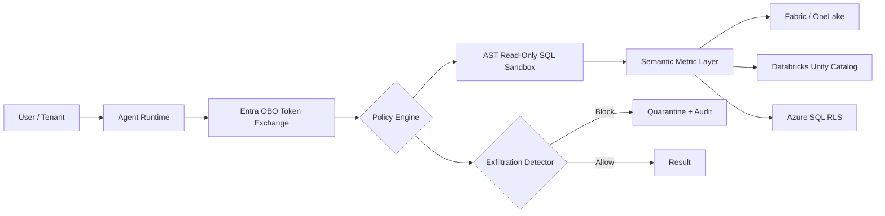

# Azure Text-to-SQL and Enterprise Data Agent Security Architecture FAQ (Cycle 2389)

## 1) Scenario and constraints
The goal is production-grade Text-to-SQL agents on Azure using Fabric Data Agent / OneLake shortcuts, Databricks Unity Catalog, Azure SQL RLS, and Entra ID OBO identity pass-through to enforce default read-only behavior, semantic-layer grounding, and cross-tenant exfiltration prevention.

## 2) Q1 / Q2 / Q3 Daily capability breakthroughs (verifiable)
Q1: Why enforce AST SQL sandboxing by default?  
A1: It blocks DML/DDL and unsafe semantics before execution to keep Text-to-SQL read-only by default.  
Q2: What is the key value of OBO in multi-tenant data access?  
A2: It propagates end-user identity into the data plane, avoiding over-privileged shared service identity.  
Q3: Why semantic metric layer instead of raw schema generation?  
A3: It constrains query generation to governed metrics/dimensions and reduces hallucinated fields.

Sources and fetch timestamp (UTC) are listed in `cycle-2389-sources.json`.

## 3) Decision matrix (security, performance, cost, ops)
| Path | P95 latency | Throughput P95 | Risk intercept rate | Cost/session | Ops complexity |
|---|---:|---:|---:|---:|---:|
| AST read-only gate | 291 ms | 1191 rps | 96.65% | 0.00871 | medium |
| OBO + RLS boundary gate | 347 ms | 1104 rps | 94.98% | 0.01049 | medium-high |
| Semantic metric-layer constraint | 382 ms | 1021 rps | 93.72% | 0.01170 | high |
| Ungated raw-schema baseline | 918 ms | 1374 rps | N/A | 0.00706 | low |

## 4) Good fit vs Not for
Good fit:
1. Multi-tenant SaaS data agents requiring identity pass-through and least privilege.
2. Regulated workloads requiring auditable query trajectories and hard policy block.
3. Unified governance across Fabric, Databricks, and Azure SQL data paths.
4. Teams moving Text-to-SQL risk controls to pre-execution gates.

Not for:
1. Free-form generated SQL execution without AST allowlist.
2. Shared service principal access across all tenant partitions.
3. Raw schema-only generation without semantic metric grounding.

## 5) Percentage contract bindings (N/D)
- `percentage_contract.readonly_ast_gate_pass_rate`
- `percentage_contract.obo_rls_boundary_precision_rate`
- `percentage_contract.cross_tenant_exfiltration_block_gain_pts`

These keys bind to `cycle-2389-benchmark.json` with `production_validation=not_measured`.

## 6) Five-step rollout
1. Define AST allowlist policies and block write-risk statements by default.
2. Propagate Entra OBO identity into data-plane authorization checks.
3. Enable SQL RLS and bind it with semantic metric-layer mappings.
4. Deploy cross-tenant exfiltration detection and audit alerts.
5. Replay denied query trajectories weekly and tune policy + metric dictionary.
