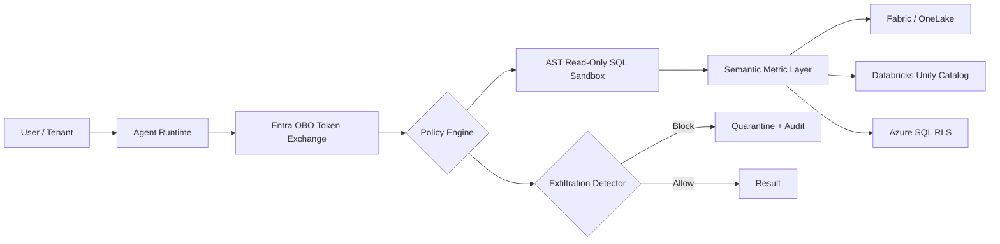

# Azure Text-to-SQL 与企业数据 Agent 安全架构 FAQ（Cycle 2389）

## 1) 场景与约束
目标是在 Azure 上实现企业级 Text-to-SQL Agent：围绕 Fabric Data Agent / OneLake Shortcuts、Databricks Unity Catalog、Azure SQL RLS 与 Entra ID OBO 身份透传，构建“默认只读 + 语义层约束 + 跨租户防外泄”的生产架构。

## 2) Q1 / Q2 / Q3 当日能力突破（可验证）
Q1：为什么要把 SQL AST 沙箱设为默认门禁？  
A1：可以在执行前阻断 DML/DDL 与高风险语义，确保 Text-to-SQL 默认为只读。  
Q2：OBO 在多租户数据访问中的关键价值？  
A2：将终端用户身份透传到数据平面，避免共享服务身份越权读取。  
Q3：为什么需要语义指标层而不是直接原始 schema 生成？  
A3：语义层可限定可解释指标与维度，降低幻觉字段与越界查询概率。

来源与抓取时间（UTC）见 `cycle-2389-sources.json`。

## 3) 决策矩阵（安全、性能、成本、运维）
| 路径 | P95 延迟 | 吞吐 P95 | 风险拦截率 | 单会话成本 | 运维复杂度 |
|---|---:|---:|---:|---:|---:|
| AST 只读门禁 | 291 ms | 1191 rps | 96.65% | 0.00871 | 中 |
| OBO+RLS 边界门禁 | 347 ms | 1104 rps | 94.98% | 0.01049 | 中高 |
| 语义指标层约束 | 382 ms | 1021 rps | 93.72% | 0.01170 | 高 |
| 无门禁原始 schema 基线 | 918 ms | 1374 rps | N/A | 0.00706 | 低 |

## 4) Good fit vs Not for
Good fit：
1. 多租户 SaaS 数据 Agent，要求身份透传与最小权限访问。  
2. 金融/政企场景，要求查询全链路可审计与越权硬拦截。  
3. 需要统一 Fabric + Databricks + SQL 的跨平台治理策略。  
4. 需要把 Text-to-SQL 风险控制前移到执行前闸门。

Not for：
1. 放行任意生成 SQL，不做 AST 白名单。  
2. 采用共享服务主体访问所有租户数据。  
3. 无语义指标层直接拼装原始 schema 查询。

## 5) Percentage contract bindings (N/D)
- `percentage_contract.readonly_ast_gate_pass_rate`
- `percentage_contract.obo_rls_boundary_precision_rate`
- `percentage_contract.cross_tenant_exfiltration_block_gain_pts`

以上键绑定 `cycle-2389-benchmark.json`，并标记 `production_validation=not_measured`。

## 6) 五步落地指南
1. 定义 AST 白名单策略，默认禁止写操作与危险函数。  
2. 打通 Entra OBO 到数据平面，并强制租户边界声明。  
3. 在 SQL 层启用 RLS，同时绑定语义指标层映射。  
4. 部署跨租户外泄检测规则并接入审计告警。  
5. 周度回放拒绝轨迹样本，迭代策略与指标词典。
