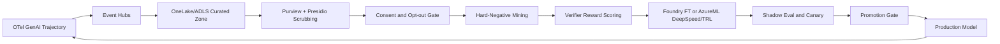

# Production Trajectory Curation and Post-Training Flywheel (SFT/DPO/RFT) FAQ (Cycle 2416)

## 1) Executive summary
This round designs an enterprise post-training flywheel: collect expensive frontier-agent trajectories via OTel GenAI telemetry, scrub sensitive content, mine hard negatives, score with teacher critique plus deterministic verifiers, and continuously distill into lower-latency lower-cost domain models using SFT/DPO/RFT with shadow eval and canary promotion controls.

## 2) Core architecture Q and A
Q1: When does Prompt/RAG hit the ceiling versus SFT/DPO/RFT?  
A1: Move to LoRA SFT when prompt-only gains flatten and context costs keep rising; add DPO for preference alignment gaps; adopt RFT when complex tool-use policy optimization is required.  
Q2: How do we prevent collapse and reward hacking?  
A2: Combine hard-negative mining, frontier-teacher critique, and deterministic verifier reward scoring; promotion gates require task gains plus forgetting/safety thresholds.  
Q3: How do we enforce tenant consent and opt-out isolation?  
A3: Apply Purview classification + Presidio scrubbing + tenant-level consent gate; opt-out tenants trigger blacklist filtering and incremental retraining.

## 3) Production trace to promotion flywheel

## 4) Prompt/RAG vs SFT vs DPO vs RFT decision matrix
| Path | Task accuracy | TTFT P95 | Monthly token cost | Forgetting guardrail pass | Cost index | Best fit |
|---|---:|---:|---:|---:|---:|---|
| Prompt/RAG baseline | 78.4% | 1.94 s | 1.00x | 99.1% | 1.00x | initial launch |
| LoRA SFT | 86.9% | 1.21 s | 0.71x | 97.8% | 0.82x | structured task gains |
| DPO | 88.7% | 1.26 s | 0.76x | 97.2% | 0.90x | preference alignment |
| RFT | 91.3% | 1.34 s | 0.83x | 96.9% | 1.07x | complex tool policy optimization |

## 5) Flywheel governance and promotion checklist with daily breakthroughs
- Ingest trajectories with task/tenant/version partitioning into OneLake/ADLS.
- Enforce PII/PHI/secret scrubbing before training.
- Make tenant consent explicit and enforce opt-out isolation/retraining.
- Promotion gates must check accuracy, latency, cost break-even, forgetting, and safety.
- Daily breakthrough tracking (fetched: 2026-11-15 UTC):
  - Azure Monitor OpenTelemetry docs (`measured`).
  - Fabric OneLake docs (`measured`).
  - Presidio and Purview official docs (`anonymized_reported`).
  - Foundry FT/RFT and Azure ML DeepSpeed/TRL docs (`synthetic` with official references).

## 6) Good fit vs Not for and percentage contract bindings
Good fit:
1. Enterprises distilling frontier-agent trajectories into lower-cost domain models with continuous releases.  
2. Organizations requiring strict data governance, tenant consent isolation, and rollback-safe promotions.

Not for:
1. Teams without governance, evaluation, and canary release operations.  
2. Workloads with insufficient sample volume or unstable task definitions.

Percentage contract bindings:
- `percentage_contract.distilled_accuracy_gain_rate`
- `percentage_contract.monthly_token_cost_reduction_rate`
- `percentage_contract.forgetting_guardrail_pass_rate`

These keys are bound to `cycle-2416-benchmark.json` with `production_validation=not_measured`.
