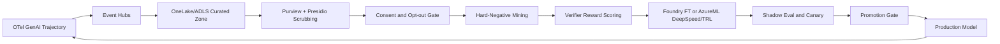

# Azure 生产轨迹蒸馏与后训练飞轮（SFT/DPO/RFT）FAQ（Cycle 2416）

## 1) 执行摘要
本轮聚焦企业级闭环后训练飞轮：将昂贵前沿模型推理轨迹通过 OTel GenAI 采集、脱敏治理、难例挖掘、教师批注与确定性奖励打分，持续蒸馏为低时延低成本领域模型（SFT/DPO/RFT），并以影子评估与灰度升级控制线上风险。

## 2) 核心架构问答
Q1：Prompt/RAG 何时到天花板，何时进入 SFT/DPO/RFT？  
A1：当任务精度提升对提示工程出现边际递减、并且长上下文成本持续上升时，先上 LoRA SFT；偏好对齐不足再加 DPO；需要复杂策略与工具链闭环再上 RFT。  
Q2：如何防止模型坍塌与奖励投机？  
A2：采用硬负例挖掘 + 教师批注 + 确定性验证器双通道评分，发布门禁要求“主任务提升 + 忘却回归不过线 + 安全指标不过线即回滚”。  
Q3：如何做租户数据同意与退出隔离？  
A3：Purview 数据分类 + Presidio 脱敏 + tenant-level consent gate，默认拒绝未授权轨迹进入训练湖，退出租户触发训练样本黑名单与增量重训。

## 3) Production Trace -> Verifier -> Training -> Shadow Eval -> Promotion 飞轮

## 4) Prompt/RAG vs LoRA SFT vs DPO vs RFT 决策矩阵
| 路径 | 任务准确率 | TTFT P95 | 月度 token 成本 | 灾难性遗忘守门通过率 | 成本指数 | 适用 |
|---|---:|---:|---:|---:|---:|---|
| Prompt/RAG 基线 | 78.4% | 1.94 s | 1.00x | 99.1% | 1.00x | 冷启动 |
| LoRA SFT | 86.9% | 1.21 s | 0.71x | 97.8% | 0.82x | 结构化任务提升 |
| DPO | 88.7% | 1.26 s | 0.76x | 97.2% | 0.90x | 偏好对齐强化 |
| RFT | 91.3% | 1.34 s | 0.83x | 96.9% | 1.07x | 工具链复杂决策 |

## 5) 数据飞轮治理与升级门禁清单（含当日能力突破追踪）
- OTel 轨迹按任务/租户/版本分层采集并写入 OneLake/ADLS 训练区。
- 训练前强制执行 PII/PHI/Secret 脱敏，未过线样本不得进入训练。
- Tenant opt-out 必须可追溯并触发样本隔离与增量重训。
- 发布门禁包含：准确率提升、时延改善、成本拐点、遗忘回归与安全指标。
- 当日热点突破追踪（抓取日：2026-11-15 UTC）：
  - Azure Monitor OpenTelemetry 文档（`measured`）。
  - Microsoft Fabric OneLake 文档（`measured`）。
  - Microsoft Presidio 与 Purview 官方资料（`anonymized_reported`）。
  - Azure AI Foundry FT/RFT 与 Azure ML DeepSpeed/TRL 训练文档（`synthetic` + 官方说明绑定）。

## 6) Good fit vs Not for 与百分比合约绑定
Good fit：
1. 需要把高成本前沿模型轨迹蒸馏为低成本领域模型并持续上线的企业。  
2. 需要严格数据治理、租户同意隔离和可回滚升级机制的组织。

Not for：
1. 无法维护数据治理、评测与灰度发布闭环的团队。  
2. 样本规模过小、任务稳定性不足以支撑后训练收益的场景。

百分比合约绑定：
- `percentage_contract.distilled_accuracy_gain_rate`
- `percentage_contract.monthly_token_cost_reduction_rate`
- `percentage_contract.forgetting_guardrail_pass_rate`

以上键绑定 `cycle-2416-benchmark.json`，并标注 `production_validation=not_measured`。
