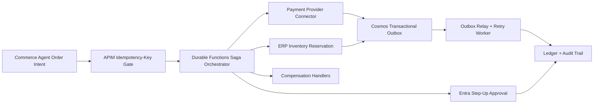

# Azure Transactional Agentic Commerce and Saga Compensation FAQ (Cycle 2400)

## 1) Scenario and constraints
We need autonomous commerce/procurement agents that never duplicate charges, never drift ERP inventory state, and never emit hallucinated refunds. The target architecture combines Durable Functions saga orchestration, Cosmos DB transactional outbox, APIM idempotency-key enforcement, and Entra step-up approvals.

## 2) Q1 / Q2 / Q3 daily breakthroughs (verifiable)
Q1: Why enforce idempotency at APIM instead of only in app code?  
A1: Gateway-level rejection blocks duplicate charge attempts before downstream side effects occur.  
Q2: Why pair saga orchestration with transactional outbox?  
A2: Outbox guarantees exactly-once event publication semantics for payment/ERP transitions under retries.  
Q3: Why require step-up approval for refund compensation?  
A3: It prevents autonomous agents from executing high-risk financial reversals without human confirmation.

Source URLs and fetch timestamps are listed in `cycle-2400-sources.json`.

## 3) Decision matrix (latency, throughput, cost, operability)
| Path | P95 order completion latency | Throughput P95 | Policy intercept rate | Cost per 1k orders (USD) | Ops complexity |
|---|---:|---:|---:|---:|---:|
| Durable Saga + Outbox target | 1386 ms | 1012 orders/min | 98.50% | 18.42 | Medium-high |
| Saga without outbox path | 1612 ms | 924 orders/min | 95.80% | 16.91 | Medium |
| Outbox without saga path | 1745 ms | 883 orders/min | 94.10% | 17.36 | Medium |
| Legacy callback baseline | 2488 ms | 621 orders/min | 89.70% | 23.84 | High |

## 4) Good fit vs Not for
Good fit:
1. Commerce and procurement agents with real payment and ERP side effects.  
2. Teams requiring auditable compensation workflows and human approval checkpoints.  
3. Environments where duplicate charges and inventory drift are top operational risks.

Not for:
1. Read-only recommendation agents with no transactional side effects.  
2. Flows where payment/ERP systems cannot expose deterministic idempotency keys.  
3. Deployments unwilling to run compensation governance and approval operations.

## 5) Percentage contract bindings (N/D)
- `percentage_contract.duplicate_charge_prevention_rate`
- `percentage_contract.erp_inventory_consistency_rate`
- `percentage_contract.refund_hallucination_reduction_rate`

These keys are bound to `cycle-2400-benchmark.json` and tagged with `production_validation=not_measured`.

## 6) Five-step rollout guide
1. Define idempotency-key schema and retention window at gateway and domain layers.  
2. Implement Durable saga states with explicit compensation paths and terminal outcomes.  
3. Add Cosmos transactional outbox and relay workers with replay-safe dedupe logic.  
4. Enforce Entra step-up approvals for high-risk refund and reversal operations.  
5. Gate release on duplicate-charge, ERP consistency, and compensation audit KPIs.
