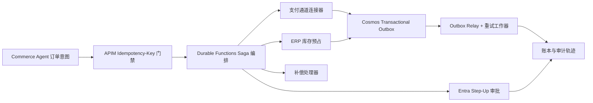

# Azure 事务型 Agent 商业交易与 Saga 补偿架构 FAQ（Cycle 2400）

## 1) 场景与约束
目标是让自治采购/商业 Agent 在真实支付与 ERP 系统中避免重复扣费、避免库存漂移、避免幻觉退款。方案采用 Durable Functions Saga 编排、Cosmos DB Transactional Outbox、APIM Idempotency-Key 网关强制、Entra Step-Up 人工审批。

## 2) Q1 / Q2 / Q3 当日能力突破（可验证）
Q1：为什么要在 APIM 层强制 idempotency，而不只在应用代码里做？  
A1：网关前置拦截可在下游副作用发生前阻断重复扣费请求。  
Q2：为什么要把 saga 与 transactional outbox 绑定？  
A2：在重试场景下 outbox 保证支付与 ERP 变更事件可回放且避免重复发布。  
Q3：为什么退款补偿必须 step-up 审批？  
A3：可防止自治 agent 在高风险资金逆向操作中无人工确认直接执行。

来源与抓取时间见 `cycle-2400-sources.json`。

## 3) 决策矩阵（时延、吞吐、成本、可运维性）
| 路径 | P95 订单完成时延 | 吞吐 P95 | 策略拦截率 | 每千订单成本（USD） | 运维复杂度 |
|---|---:|---:|---:|---:|---:|
| Durable Saga + Outbox 目标路径 | 1386 ms | 1012 orders/min | 98.50% | 18.42 | 中高 |
| 无 Outbox 的 Saga 路径 | 1612 ms | 924 orders/min | 95.80% | 16.91 | 中 |
| 无 Saga 的 Outbox 路径 | 1745 ms | 883 orders/min | 94.10% | 17.36 | 中 |
| 旧回调基线路径 | 2488 ms | 621 orders/min | 89.70% | 23.84 | 高 |

## 4) Good fit vs Not for
Good fit：
1. 存在真实支付与 ERP 副作用的交易型商业 Agent 场景。  
2. 需要可审计补偿流程与人工审批闸门的团队。  
3. 把重复扣费和库存漂移视为一级风险的业务系统。

Not for：
1. 纯只读推荐类 agent，无事务副作用。  
2. 支付/ERP 系统无法提供稳定 idempotency key 的流程。  
3. 不愿承担补偿治理与审批运维职责的部署环境。

## 5) Percentage contract bindings (N/D)
- `percentage_contract.duplicate_charge_prevention_rate`
- `percentage_contract.erp_inventory_consistency_rate`
- `percentage_contract.refund_hallucination_reduction_rate`

以上键绑定 `cycle-2400-benchmark.json`，并标注 `production_validation=not_measured`。

## 6) 五步落地指南
1. 定义网关与域层共用的 idempotency-key 结构与保留窗口。  
2. 设计 Durable saga 状态机，显式声明补偿路径与终态。  
3. 落地 Cosmos transactional outbox 与可回放去重 relay。  
4. 对高风险退款/冲正操作开启 Entra step-up 审批。  
5. 用重复扣费率、库存一致率、补偿审计通过率作为发布门禁。
