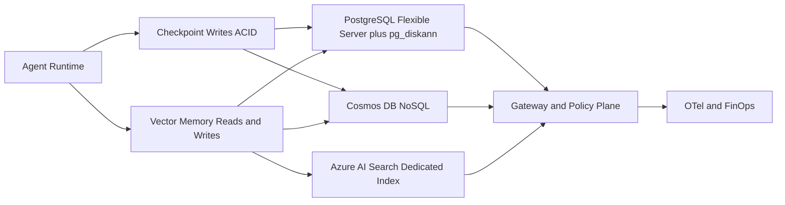

# Azure Unified Operational and Vector Agent Store Selection FAQ (Cycle 2407)

## 1) Scenario and constraints
This round evaluates a strategic storage decision: consolidate ACID checkpoints plus vector memory in one engine, or split operational and vector stacks. Candidate paths include Azure Database for PostgreSQL Flexible Server with pg_diskann / Elastic Clusters, Cosmos DB NoSQL DiskANN, and Azure AI Search dedicated indexes.

## 2) Q1 / Q2 / Q3 daily breakthroughs (verifiable)
Q1: Why reconsider single-engine consolidation now?  
A1: New vector index capabilities reduce historical tradeoffs between transactional state and semantic retrieval.  
Q2: Why keep split-stack as a first-class option?  
A2: Dedicated vector engines can still provide stronger recall and query isolation at high semantic QPS.  
Q3: Why use break-even TCO per million tasks instead of raw QPS only?  
A3: Agent platform choices are constrained by reliability and cost simultaneously, not by throughput alone.

Source URLs and fetch timestamps are listed in `cycle-2407-sources.json`.

## 3) Decision matrix (latency, throughput, cost, operability)
| Path | P99 recall latency | Throughput P95 | Policy intercept rate | Cost per 1M resolved tasks (USD) | Ops complexity |
|---|---:|---:|---:|---:|---:|
| PostgreSQL unified (ACID + pg_diskann) | 108 ms | 5980 qps | 97.90% | 46.80 | Medium-high |
| Cosmos unified (NoSQL + DiskANN) | 94 ms | 6640 qps | 98.30% | 52.40 | Medium |
| Split stack (Postgres + AI Search) | 86 ms | 7210 qps | 98.70% | 58.90 | High |
| Legacy dual-write baseline | 153 ms | 4310 qps | 89.60% | 71.30 | High |

## 4) Good fit vs Not for
Good fit:
1. Teams deciding whether to collapse checkpoint and vector memory into one data plane.  
2. Multi-tenant platforms needing policy and cost visibility for memory-store design.  
3. Workloads where recall-latency and ACID integrity both affect user outcomes.

Not for:
1. Tiny prototypes where schema and retrieval quality are not production constraints.  
2. Organizations without DBA and search operations ownership.  
3. Cases requiring niche retrieval features unavailable in chosen unified path.

## 5) Percentage contract bindings (N/D)
- `percentage_contract.unified_store_adoption_readiness_rate`
- `percentage_contract.p99_recall_slo_meet_rate`
- `percentage_contract.tco_break_even_success_rate`

These keys are bound to `cycle-2407-benchmark.json` and tagged with `production_validation=not_measured`.

## 6) Five-step rollout guide
1. Define checkpoint consistency and recall-latency SLO contracts per tenant tier.  
2. Benchmark unified PostgreSQL and unified Cosmos paths against split-stack baseline.  
3. Validate policy interception and dual-write elimination risk controls.  
4. Run break-even modeling for 100, 1k, 10k, and 100k concurrent agent sessions.  
5. Promote only when SLO, policy, and TCO gates all pass in replay and canary runs.
