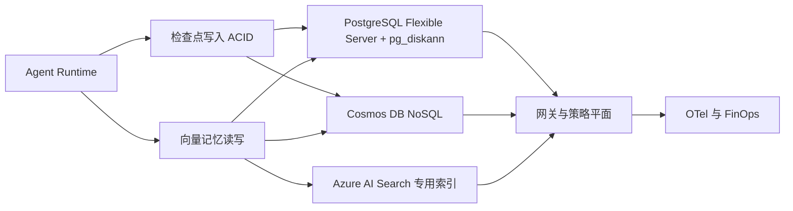

# Azure 统一操作型+向量 Agent 存储选型 FAQ（Cycle 2407）

## 1) 场景与约束
本轮评估核心存储决策：把 ACID 检查点与向量记忆合并到单引擎，还是采用操作库+向量库分层双栈。候选路径包括 Azure Database for PostgreSQL Flexible Server + pg_diskann / Elastic Clusters、Cosmos DB NoSQL DiskANN、Azure AI Search 专用索引。

## 2) Q1 / Q2 / Q3 当日能力突破（可验证）
Q1：为什么现在重新评估“单引擎合并”？  
A1：新一代向量索引能力降低了“事务状态 vs 语义检索”的历史权衡。  
Q2：为什么双栈仍要保留为一等候选？  
A2：在高语义 QPS 场景下，专用向量引擎通常有更强召回与隔离优势。  
Q3：为什么用“每百万任务 TCO”而非只看 QPS？  
A3：Agent 平台选型同时受可靠性与成本约束，吞吐并非唯一目标。

来源与抓取时间见 `cycle-2407-sources.json`。

## 3) 决策矩阵（时延、吞吐、成本、可运维性）
| 路径 | P99 召回时延 | 吞吐 P95 | 策略拦截率 | 每百万已解决任务成本（USD） | 运维复杂度 |
|---|---:|---:|---:|---:|---:|
| PostgreSQL 统一路径（ACID + pg_diskann） | 108 ms | 5980 qps | 97.90% | 46.80 | 中高 |
| Cosmos 统一路径（NoSQL + DiskANN） | 94 ms | 6640 qps | 98.30% | 52.40 | 中 |
| 双栈路径（Postgres + AI Search） | 86 ms | 7210 qps | 98.70% | 58.90 | 高 |
| 传统双写基线 | 153 ms | 4310 qps | 89.60% | 71.30 | 高 |

## 4) Good fit vs Not for
Good fit：
1. 需要在“检查点+向量记忆”是否合并之间做架构决策的团队。  
2. 需要按租户观察策略门禁与成本结构的平台。  
3. 召回时延与 ACID 一致性同等关键的生产负载。

Not for：
1. 未进入生产约束的小型 PoC。  
2. 缺乏数据库与搜索运维能力的组织。  
3. 所需检索特性超出统一路径能力边界的场景。

## 5) Percentage contract bindings (N/D)
- `percentage_contract.unified_store_adoption_readiness_rate`
- `percentage_contract.p99_recall_slo_meet_rate`
- `percentage_contract.tco_break_even_success_rate`

以上键绑定 `cycle-2407-benchmark.json`，并标注 `production_validation=not_measured`。

## 6) 五步落地指南
1. 明确租户分层的检查点一致性与召回时延 SLO 合约。  
2. 基准对比 PostgreSQL 统一、Cosmos 统一与双栈路径。  
3. 验证策略拦截门禁与消除双写的风险控制。  
4. 对 100/1k/10k/100k 并发会话运行 break-even 成本模型。  
5. 仅在 SLO、策略、TCO 三门禁同时通过后推广。
