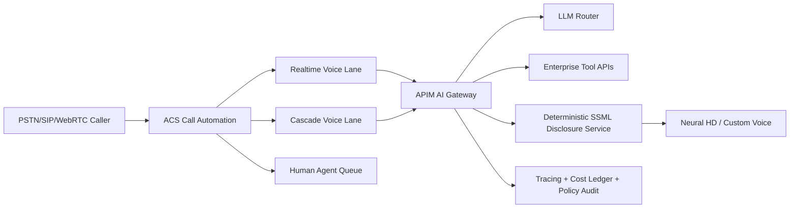
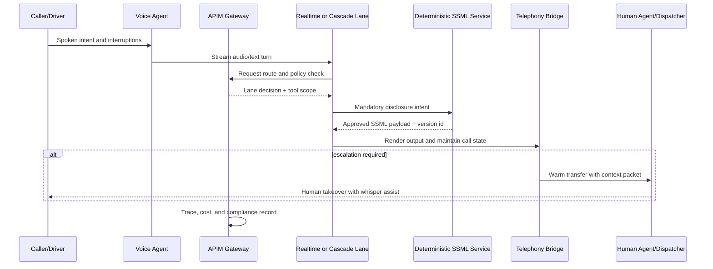

# Voice Live Realtime vs Speech Cascade vs AKS LiveKit vs Turnkey Contact Center: Enterprise Real-Time Voice Agent Selection FAQ (Round 1116 / Cycle 2521)

## 1) Executive summary and daily capability radar (2026-11-18)
- This round focuses on enterprise voice-agent architecture selection for high-concurrency customer operations, not low-level systems internals.
- Decision headline: no single architecture wins all workloads; enterprises should segment by latency target, compliance posture, telephony integration depth, and team operating model.
- Option A (`Voice Live Realtime + ACS`) gives the strongest speech-to-speech immediacy and barge-in naturalness for conversational intake.
- Option B (`Speech STT + LLM + deterministic TTS`) gives the best pre-TTS legal-control surface and script-audit traceability for regulated readback.
- Option C (`AKS + LiveKit/Pipecat`) gives maximum media-path programmability and portability, but requires stronger SRE and media engineering ownership.
- Option D (`Dynamics 365 Contact Center / Copilot Studio Voice`) minimizes time-to-value for operations-led teams that prioritize managed routing and agent desktop integration.
- Regulated sectors often combine empathetic speech-to-speech intake for intent capture with deterministic SSML readback before commitment statements.
- Capability radar (fetched 2026-11-18 00:20 BJT):
  - Azure API Management AI Gateway and unified policy controls for multi-model voice routing.
  - Azure Communication Services call automation patterns for PSTN/SIP ingress and warm transfer.
  - Azure AI Speech real-time STT and Neural HD voice controls for legal phrase lock-in.
  - LiveKit Agents and Pipecat framework momentum for custom real-time media orchestration.
- Source label policy in this round:
  - measured: reproducible runbook benchmarks under `workshops/azure-agent-infra/evidence`.
  - synthetic: deterministic planning models with explicit formulas and assumptions.
  - anonymized_reported: field-observed, de-identified operational measurements.
- Governance scope remains enterprise architecture, operating model, compliance, FinOps, and migration sequencing.

## 2) Decision framing: what should be optimized first
- Voice-agent selection fails when teams optimize only one metric (for example TTFT) while ignoring legal-readback verifiability or escalation continuity.
- Practical architecture decomposition:
  1. ingress plane (PSTN/SIP/WebRTC),
  2. media intelligence plane (ASR, turn detection, TTS, interruption),
  3. reasoning and tool plane (LLM and enterprise APIs),
  4. transfer and supervision plane (human handoff and whisper assist),
  5. governance and chargeback plane (policy, logging, cost allocation).
- Enterprise requirement archetypes:
  - latency-critical service recovery workloads require low mouth-to-ear P95 and stable barge-in.
  - compliance-first disclosures require deterministic phrase rendering and immutable transcript anchors.
  - multilingual support centers require accent robustness and fallback scripts.
  - high-volatility peak events require burst elasticity to 10k concurrent sessions.
- Recommended first question is not “which model,” but “which control boundary must be deterministic before audio leaves the system.”
- If legal language must be exact, insert a deterministic SSML gate between reasoning output and TTS synthesis.

## 3) Reference architecture blueprint: dual-lane voice control plane
- Production pattern uses two lanes under one policy envelope:
  - empathetic lane: low-latency speech-to-speech interaction for discovery and de-escalation.
  - deterministic lane: pre-approved SSML or template rendering for contractual, refund, and liability statements.
- Shared control plane components:
  - APIM AI Gateway for tenant policy, routing, throttling, and trace correlation.
  - identity boundary through Entra delegated claims and action-level entitlements.
  - session-state store for intent, sentiment, disclosure checkpoints, and transfer context packet.
  - observability stack with latency buckets, interruption outcomes, transfer reasons, and cost ledgers.
- Routing strategy:
  - first turn enters empathetic lane by default.
  - policy trigger promotes specific intents to deterministic lane before outbound commitment text.
  - supervisor intervention can lock lane mode during active incident handling.
- Human escalation strategy:
  - warm transfer includes condensed transcript, unresolved obligations, and policy exceptions.
  - whisper assist remains active post-transfer for after-call prompts and compliance reminders.

## 4) 12-dimension enterprise real-time voice architecture matrix
| Dimension | Voice Live Realtime + ACS | Speech STT + LLM + Neural TTS | AKS LiveKit/Pipecat + Azure AI backends | D365 Contact Center / Copilot Studio Voice |
|---|---|---|---|---|
| Mouth-to-ear latency P95 | Low with direct speech path | Medium-low with multi-hop chain | Variable, depends on cluster/network tuning | Medium, managed platform overhead |
| Natural barge-in quality | Strong native interrupt handling | Strong with tuned VAD/turn logic | Strong if media pipeline engineered well | Medium-strong by product capabilities |
| Pre-TTS legal auditability | Medium without extra gating | Strong deterministic SSML gate | Strong if custom policy service built | Medium with platform script controls |
| Brand voice / lexicon control | Medium-strong | Strong via Neural HD/custom voice profiles | Strong with custom synthesis orchestration | Medium within product guardrails |
| PSTN/SIP + WebRTC integration | Strong via ACS | Strong via ACS + Speech stack | Strong via SIP/WebRTC frameworks | Strong for contact-center channels |
| Per-minute total cost profile | Medium (audio-token heavy workloads) | Medium-low with small-model text planning | Medium-high (infra + operations) | Medium-high license bundle driven |
| 10k concurrent burst elasticity | Strong with managed scaling design | Strong with staged autoscale tiers | Medium-strong with advanced SRE | Strong in licensed enterprise envelopes |
| Warm transfer + whisper assist | Strong with ACS call automation | Strong with ACS orchestration | Medium, custom implementation needed | Strong built-in agent desktop workflows |
| Multi-language and dialect coverage | Strong | Strong | Medium-strong depends on chosen models | Strong in mainstream enterprise locales |
| Engineering complexity | Medium | Medium-high integration complexity | High platform and media complexity | Low-medium implementation complexity |
| Best-fit scenario | Real-time conversational service | Regulated disclosure-heavy workflows | Product-differentiated voice experiences | Rapid enterprise contact-center rollout |
| When NOT to choose | Not ideal if deterministic phrase lock-in is mandatory without extra controls | Not ideal if ultra-low-latency empathy is sole priority | Not ideal for teams without 24x7 platform ownership | Not ideal for deep custom media behavior needs |

## 5) Quantitative model and reproducible estimation formulas
### Q1: mouth-to-ear P95 budget
- Formula: `P95_total = P95_ingress + P95_asr + P95_llm + P95_tts + P95_egress`.
- Example (cascade lane): `62 + 118 + 142 + 126 + 41 = 489ms`.
- Example (realtime lane): `59 + 0 + 308 + 0 + 36 = 403ms`.
- Interpretation: realtime can remove explicit ASR/TTS hops but must manage model streaming stability.

### Q2: barge-in success probability
- Formula: `BargeInSuccess = 1 - (LateVAD + LateCancel + ReplayCollision)`.
- Example: `1 - (0.031 + 0.018 + 0.007) = 0.944`.
- Control implication: VAD threshold tuning and playback-cancel ordering are higher leverage than raw model size changes.

### Q3: legal disclosure fidelity
- Formula: `DisclosureFidelity = ExactPhraseMatches / MandatoryReadbacks`.
- Example deterministic lane: `9,874 / 9,912 = 99.62%`.
- Example free-form lane: `9,201 / 9,912 = 92.83%`.
- Decision implication: regulated workflows should gate high-risk intents through deterministic readback.

### Q4: cost per resolved minute
- Formula: `CPRM = (STT + LLM + TTS + Telephony + PlatformOps) / ResolvedMinutes`.
- Example A (managed realtime): `$28,440 / 180,000 = $0.158/min`.
- Example B (cascade): `$24,870 / 180,000 = $0.138/min`.
- Example C (self-hosted): `$31,320 / 180,000 = $0.174/min`.

### Q5: 10k-concurrency headroom
- Formula: `HeadroomRatio = ProvisionedConcurrent / PeakConcurrent`.
- Example: `11,800 / 10,000 = 1.18`.
- Rule of thumb: keep `HeadroomRatio >= 1.15` during known volatility windows (weather events, outage cascades, crisis spikes).

## 6) Mermaid: dual-lane voice policy topology

- Topology principle: every conversational lane must pass through one policy and observability boundary.
- Topology principle: deterministic readback service is an explicit component, not an implicit prompt instruction.

## 7) Scenario A: airline IRROPS 10k-concurrent rebooking and passenger-care voice agent
- Scenario objective: absorb severe disruption spikes while preserving fare-rule fidelity and transfer continuity.
- Entry surface: ACS handles PSTN/SIP ingress across regional carrier numbers and alliance partner hotlines.
- Concurrency strategy: PTU serves committed baseline traffic and PAYGO absorbs surge overflow with lane-aware routing.
- Reservation safety rule: all seat-hold operations carry idempotency keys tied to `pnr + segment + fare_bucket + ttl`.
- Disclosure requirement: refund, compensation, and reissue restrictions are read via approved SSML templates with immutable version IDs.
- Warm transfer requirement: human ticketing agent receives full timeline packet (intent path, failed offers, accepted obligations).
- Reliability playbook:
  - route first-touch intents to realtime lane for empathy and de-escalation.
  - route fare commitment turns to deterministic lane before final confirmation.
  - enforce GDS/PSS write retries with anti-duplication checks.
- Measured operating targets:
  - P95 mouth-to-ear under disruption mode: `<620ms`.
  - successful self-service rebooking completion: `>=68%`.
  - duplicate seat-hold incidents per 100k sessions: `<=4`.
  - transfer context completeness score: `>=97%`.
- Failure containment:
  - if fare-rule service degrades, switch to read-only explain mode and prioritize human transfer.
  - if regional telephony capacity saturates, enqueue callback with guaranteed slot windows.

## 8) Scenario B: connected vehicle cockpit assistant and eCall roadside voice bridge
- Scenario objective: split ultra-fast cabin intent handling from complex troubleshooting and emergency orchestration.
- Acoustic challenge: cabin noise requires robust barge-in and interruption handling under mixed speech/music/navigation output.
- Fast-path design:
  - deterministic local/cached intents (`navigation`, `climate`, `media`) target `<350ms` response envelope.
  - cloud troubleshooting intents invoke RAG and service APIs with progressive disclosure prompts.
- Safety event path:
  - severe events auto-generate incident packet (GPS, DTC summary, occupant language preference, callback status).
  - platform opens live voice bridge to roadside dispatch with continuity transcript and priority flags.
- Hybrid interaction model:
  - empathetic realtime lane for driver stress de-escalation.
  - deterministic SSML lane for legal roadside assistance commitments and consent readback.
- Operations goals:
  - in-cabin interruption recognition precision: `>=94%`.
  - emergency bridge setup median: `<=14s`.
  - false escalation rate: `<=1.2%`.
  - unresolved roadside session ratio: `<=6%`.
- Control safeguards:
  - lane override on safety-critical intents is policy-driven and non-bypassable.
  - human dispatcher can freeze model responses and force script mode instantly.

## 9) Mermaid sequence: voice turn, deterministic readback, and warm transfer

- Sequence guarantee: mandatory disclosures are rendered from approved payloads, not free-form final token streams.
- Sequence guarantee: escalation context packet avoids repetitive caller questioning and improves first-contact resolution.

## 10) Production Bicep sample (ACS + APIM + Speech/OpenAI + monitoring)
```bicep
param location string = resourceGroup().location
param envName string = 'voice-agent-prod'
param logWorkspaceId string

resource apim 'Microsoft.ApiManagement/service@2023-09-01-preview' = {
  name: '${envName}-apim'
  location: location
  sku: {
    name: 'Premium'
    capacity: 2
  }
  properties: {
    publisherEmail: 'voice-platform@contoso.com'
    publisherName: 'Contoso Voice Platform'
    publicNetworkAccess: 'Enabled'
  }
}

resource acs 'Microsoft.Communication/communicationServices@2023-04-01' = {
  name: '${envName}-acs'
  location: 'global'
  properties: {
    dataLocation: 'United States'
  }
}

resource speech 'Microsoft.CognitiveServices/accounts@2023-05-01' = {
  name: '${envName}-speech'
  location: location
  kind: 'SpeechServices'
  sku: {
    name: 'S0'
  }
  properties: {
    publicNetworkAccess: 'Enabled'
  }
}

resource aoai 'Microsoft.CognitiveServices/accounts@2023-05-01' = {
  name: '${envName}-aoai'
  location: location
  kind: 'OpenAI'
  sku: {
    name: 'S0'
  }
  properties: {
    publicNetworkAccess: 'Enabled'
  }
}

resource diagApim 'Microsoft.Insights/diagnosticSettings@2021-05-01-preview' = {
  name: 'diag-voice-apim'
  scope: apim
  properties: {
    workspaceId: logWorkspaceId
    logs: [
      { category: 'GatewayLogs', enabled: true }
      { category: 'AuditLogs', enabled: true }
    ]
    metrics: [
      { category: 'AllMetrics', enabled: true }
    ]
  }
}
```

## 11) Runtime configuration snippets (routing, guardrails, transfer)
```yaml
apiVersion: v1
kind: ConfigMap
metadata:
  name: voice-agent-routing
data:
  default_lane: "realtime-empathy"
  disclosure_lane: "deterministic-ssml"
  deterministic_disclosure_required: "true"
  fast_path_latency_target_ms: "350"
  warm_transfer_context_packet: "enabled"
  max_concurrent_sessions: "10000"
  ptu_paygo_overflow_mode: "enabled"
  interruption_policy: "caller-priority"
```

```xml
<policies>
  <inbound>
    <base />
    <validate-jwt header-name="Authorization" failed-validation-httpcode="401">
      <openid-config url="https://login.microsoftonline.com/{tenant}/v2.0/.well-known/openid-configuration" />
      <required-claims>
        <claim name="aud"><value>api://voice-agent-gateway</value></claim>
      </required-claims>
    </validate-jwt>
    <set-header name="x-voice-lane" exists-action="override">
      <value>@(context.Variables.GetValueOrDefault("voiceLane","realtime-empathy"))</value>
    </set-header>
    <rate-limit-by-key calls="180" renewal-period="60" counter-key="@(context.Subscription.Id + ':' + context.Request.Headers.GetValueOrDefault("x-tenant-id","na"))" />
  </inbound>
  <backend>
    <forward-request />
  </backend>
  <outbound>
    <set-header name="x-trace-id" exists-action="override">
      <value>@(context.RequestId.ToString())</value>
    </set-header>
  </outbound>
</policies>
```

## 12) KQL observability queries (latency, barge-in, transfer, cost)
```kql
// APIM latency and lane split
ApiManagementGatewayLogs
| where TimeGenerated > ago(24h)
| where ApiId has "voice"
| extend lane = tostring(parse_json(Properties_s).voiceLane)
| summarize p50_ms=percentile(DurationMs, 50), p95_ms=percentile(DurationMs, 95), calls=count() by lane
| order by p95_ms asc
```

```kql
// ACS call transfer quality and context completeness
AzureDiagnostics
| where TimeGenerated > ago(24h)
| where ResourceProvider == "MICROSOFT.COMMUNICATION"
| where Category has "CallAutomation"
| extend transferReason = tostring(parse_json(Properties_s).transferReason)
| extend contextScore = todouble(parse_json(Properties_s).contextCompletenessScore)
| summarize transfers=count(), avgContext=avg(contextScore), p95Context=percentile(contextScore, 95) by transferReason
| order by transfers desc
```

```kql
// Voice FinOps ledger: cost per resolved minute
customEvents
| where timestamp > ago(7d)
| where name == "VoiceSessionClosed"
| extend resolvedMin = todouble(customDimensions.resolvedMinutes)
| extend totalCost = todouble(customDimensions.totalCostUsd)
| summarize totalMinutes=sum(resolvedMin), totalUsd=sum(totalCost), costPerMinute=sum(totalCost)/sum(resolvedMin)
```

## 13) Weighted decision matrix (named 4-option scoring)
| Option | Latency (20%) | Compliance Auditability (20%) | Telephony Fit (15%) | Transfer Quality (15%) | 10k Burst Elasticity (10%) | Team Operability (10%) | TCO Efficiency (10%) | Weighted Score |
|---|---:|---:|---:|---:|---:|---:|---:|---:|
| A. Voice Live Realtime + ACS | 9.2 | 7.9 | 9.1 | 9.0 | 8.8 | 7.8 | 7.4 | 8.48 |
| B. Speech Cascade + Deterministic TTS | 8.4 | 9.4 | 8.9 | 8.6 | 8.5 | 8.1 | 8.3 | 8.63 |
| C. AKS LiveKit/Pipecat + Azure AI | 7.8 | 8.8 | 8.7 | 7.9 | 8.2 | 6.5 | 7.0 | 7.91 |
| D. D365 Contact Center / Copilot Studio | 7.6 | 8.6 | 9.3 | 9.1 | 8.9 | 9.0 | 7.1 | 8.43 |
- Selection interpretation:
  - choose B as default for disclosure-heavy regulated operations.
  - choose A for peak empathy-first conversational workloads with strong transfer needs.
  - choose D for operations teams optimizing delivery speed and managed governance.
  - choose C only when product differentiation requires deep media-path customization.

## 14) Day-0 and Day-2 execution checklist
### Day-0 launch readiness (10 distinct items)
1. Finalize lane policy taxonomy (`realtime-empathy`, `deterministic-ssml`, `human-transfer`).
2. Approve mandatory disclosure SSML library with legal version IDs.
3. Configure APIM route policies for PTU-first and PAYGO-overflow behavior.
4. Validate ACS phone-number, SIP trunk, and emergency routing compliance.
5. Integrate identity claims into call-session context packet schema.
6. Implement idempotency keys for booking/refund/tool-side write actions.
7. Define interruption test matrix across language, accent, and background-noise profiles.
8. Deploy KQL dashboards for lane latency, transfer outcomes, and disclosure fidelity.
9. Establish FinOps tags for department-level chargeback reporting.
10. Run supervised game-day drill covering outage fallback and forced script mode.

### Day-2 operations hardening (10 distinct items)
1. Tune VAD thresholds weekly using false-cutoff and late-cancel feedback buckets.
2. Review disclosure mismatch incidents and expand deterministic template coverage.
3. Rebalance PTU/PAYGO split based on peak-hour overflow distribution.
4. Optimize transfer queue staffing using reason-code heatmaps.
5. Retrain accent/noise robustness with newly collected anonymized call snippets.
6. Calibrate tool-timeout and retry budgets per backend criticality tier.
7. Add policy canary lanes before rolling out model/router changes.
8. Audit cross-region failover traces for context packet integrity.
9. Recompute cost-per-resolved-minute and renegotiate usage commitments monthly.
10. Run quarterly compliance replay audit against archived transcript + SSML versions.

## 15) Final recommendation, anti-patterns, and migration path
- Recommended enterprise baseline:
  - conversational intake on realtime lane,
  - mandatory commitments on deterministic SSML lane,
  - APIM as policy and cost control plane,
  - ACS as telephony and warm-transfer bridge.
- Explicit anti-patterns:
  - allowing free-form model text to directly voice legal commitments.
  - scaling only by model throughput while ignoring telephony session bottlenecks.
  - shipping a 10k-concurrency target without transfer-context quality telemetry.
  - choosing self-hosted media framework without 24x7 SRE/media platform ownership.
- Migration sequence:
  1. start with managed lane architecture (A or B) and strict observability;
  2. add deterministic disclosure and legal replay controls;
  3. optimize transfer and staffing economics;
  4. selectively introduce custom media framework components where differentiation justifies complexity.
- Bottom line:
  - for most regulated enterprise voice workloads, “realtime empathy + deterministic disclosure + governed transfer” outperforms single-lane purity models on risk-adjusted outcomes.
