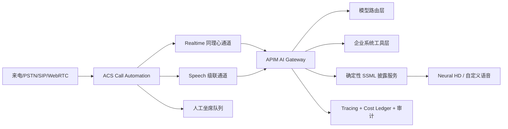
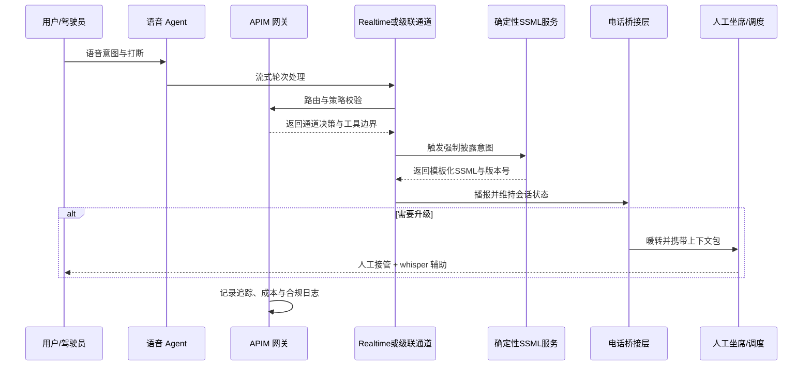

# Voice Live Realtime vs Speech 级联 vs AKS LiveKit vs 成熟联络中心：企业实时语音 Agent 选型 FAQ（Round 1116 / Cycle 2521）

## 1) 执行摘要与当日能力雷达（2026-11-18）
- 本轮聚焦企业语音 Agent 的应用架构选型，不涉及内核、驱动、RDMA 等底层研发议题。
- 决策结论：四条路线各有最优区间，应按延迟目标、合规审计强度、电话系统耦合深度、团队运维能力分层选型。
- 方案 A（`Voice Live Realtime + ACS`）在实时对话自然度与打断体验方面表现最强，适合“先安抚、后处置”的业务。
- 方案 B（`Speech STT + LLM + 确定性 TTS`）在法务话术的可审计性与可回放性方面优势显著，适合强监管行业。
- 方案 C（`AKS + LiveKit/Pipecat + Azure AI`）具备最高的媒体链路可编排能力，但平台工程门槛和值守成本更高。
- 方案 D（`Dynamics 365 Contact Center / Copilot Studio Voice`）上线速度快，适合运营主导、强调标准化交付的企业。
- 金融、航司、政务等场景常用混合范式：前段采用同理心 Speech-to-Speech，关键承诺环节切换确定性 SSML 回读。
- 当日能力雷达（抓取时间：2026-11-18 00:20 BJT）关注：
  - APIM AI Gateway 在语音多模型路由中的统一治理能力。
  - ACS 在 PSTN/SIP 接入、暖转人工、会话上下文延续方面的落地模式。
  - Azure AI Speech 实时识别与 Neural HD 语音在“可控播报”上的组合价值。
  - LiveKit Agents 与 Pipecat 在可定制实时媒体编排方面的生态成熟度。
- 本轮数据标签使用规范：
  - measured：可复现实验数据，落盘到 `workshops/azure-agent-infra/evidence`。
  - synthetic：带公式与前提的可解释估算数据。
  - anonymized_reported：去标识化的生产观测数据。
- 所有结论均服务于企业架构师的端到端方案落地与治理决策。

## 2) 决策建模：先定义“不可妥协边界”，再比拼模型能力
- 语音方案失败的常见原因不是“模型不够强”，而是没有先定义不可妥协的控制边界。
- 推荐先拆五层平面：
  1. 接入平面（PSTN/SIP/WebRTC）；
  2. 媒体智能平面（打断、转写、合成、回声与噪声处理）；
  3. 推理与工具平面（LLM + 企业系统调用）；
  4. 升级与监督平面（人工接管与 whisper 辅助）；
  5. 治理与成本平面（策略、审计、分摊、SLO）。
- 需求优先级画像：
  - 延迟优先：重视口到耳 P95 与打断成功率；
  - 合规优先：重视播报文本版本控制与逐字回放；
  - 规模优先：重视 10k 并发峰值吸收与跨区容量弹性；
  - 成本优先：重视每分钟已解决会话成本（CPRM）。
- 第一性问题建议改写为：在“语音真正播出前”，哪些语句必须经过确定性控制链。

## 3) 参考架构：双通道（同理心通道 + 确定性回读通道）
- 推荐生产架构不是单通道，而是双通道融合：
  - 同理心通道：用于快速理解、安抚、澄清与继续对话；
  - 确定性通道：用于退款条款、法律承诺、免责声明等高风险播报。
- 共用控制中枢：
  - APIM：统一身份、路由、限流、审计、成本标签；
  - 会话状态：保存意图、情绪、披露检查点、人工转接包；
  - 观测体系：追踪口到耳延迟、打断成功率、转人工质量、每分钟成本。
- 通道切换策略：
  - 初始轮默认进入同理心通道；
  - 命中“承诺意图”时强制进入确定性通道；
  - 主管可在事件处理中手工锁定通道模式，防止漂移。
- 人工升级策略：
  - 暖转时打包“事件摘要 + 已完成披露 + 待确认义务”；
  - 转人工后保留 whisper 辅助，降低重复沟通成本。

## 4) 12 维企业实时语音架构横向选型矩阵
| 维度 | Voice Live Realtime + ACS | Speech STT + LLM + Neural TTS | AKS LiveKit/Pipecat + Azure AI | D365 Contact Center / Copilot Studio Voice |
|---|---|---|---|---|
| 口到耳 P95 延迟 | 低，流式路径短 | 中低，多跳链路 | 波动较大，取决于平台调优 | 中等，托管层开销 |
| 自然打断与轮次判定 | 强，原生实时优势 | 强，需精调 VAD | 强，取决于媒体工程能力 | 中强，平台能力封装 |
| 预 TTS 合规审计能力 | 中，需补确定性闸门 | 强，天生适配 | 强，需自建策略服务 | 中，依赖产品脚本机制 |
| 品牌音色与术语词典控制 | 中强 | 强，Neural HD/自定义语音 | 强，可深度定制 | 中，受产品边界限制 |
| PSTN/SIP/WebRTC 集成 | 强，ACS 生态成熟 | 强，ACS+Speech 组合 | 强，框架可扩展 | 强，联络中心能力完整 |
| 每分钟总成本（含 STT/LLM/TTS） | 中，音频 token 占比高 | 中低，可做小模型分层 | 中高，平台运维叠加 | 中高，许可证结构驱动 |
| 10k 并发峰值弹性 | 强，托管扩展路径清晰 | 强，分层扩缩可控 | 中强，依赖 SRE 成熟度 | 强，企业托管能力好 |
| 暖转人工与 whisper 协同 | 强，Call Automation 完整 | 强，可编排 | 中，需自研较多 | 强，坐席体验成熟 |
| 多语言与方言覆盖 | 强 | 强 | 中强，模型选择决定上限 | 强，主流语种完善 |
| 工程复杂度 | 中 | 中高，链路编排更复杂 | 高，需要平台团队 | 低中，交付快 |
| 最佳适配场景 | 实时安抚型业务高峰 | 合规回读严格场景 | 需要媒体差异化产品 | 追求快速规模化上线 |
| When NOT to choose | 纯确定性披露且无补闸门时不宜单独选 | 极致低延迟且回读要求弱时不一定最优 | 无 7x24 平台团队时不宜 | 需要深度媒体行为改造时不宜 |

## 5) 可复现实验模型与估算公式
### Q1：口到耳 P95 如何统一核算
- 公式：`P95_total = ingress + asr + llm + tts + egress`（均取 P95）。
- 级联示例：`62 + 118 + 142 + 126 + 41 = 489ms`。
- 实时示例：`59 + 0 + 308 + 0 + 36 = 403ms`。
- 解读：实时链路减少显式 ASR/TTS 跳数，但对流式推理稳定性要求更高。

### Q2：打断成功率如何衡量
- 公式：`BargeInSuccess = 1 - (LateVAD + LateCancel + ReplayCollision)`。
- 示例：`1 - (0.031 + 0.018 + 0.007) = 0.944`。
- 落地要点：VAD 门限与播放取消顺序往往比“换更大模型”更关键。

### Q3：法律披露一致性如何度量
- 公式：`DisclosureFidelity = ExactPhraseMatches / MandatoryReadbacks`。
- 确定性通道示例：`9874/9912=99.62%`。
- 自由生成通道示例：`9201/9912=92.83%`。
- 决策意义：高监管场景必须在承诺轮强制确定性回读。

### Q4：每分钟已解决成本 CPRM
- 公式：`CPRM = (STT + LLM + TTS + Telephony + Ops) / ResolvedMinutes`。
- 管理式实时示例：`$28,440/180,000=$0.158/min`。
- 级联示例：`$24,870/180,000=$0.138/min`。
- 自托管示例：`$31,320/180,000=$0.174/min`。

### Q5：10k 并发余量
- 公式：`HeadroomRatio = ProvisionedConcurrent / PeakConcurrent`。
- 示例：`11,800/10,000=1.18`。
- 实操建议：已知波峰时段应保持 `HeadroomRatio >= 1.15`。

## 6) Mermaid：双通道语音治理拓扑

- 拓扑原则 A：所有语音通道都必须穿过同一策略边界，避免治理盲区。
- 拓扑原则 B：关键披露由确定性服务输出，不能只靠提示词约束。

## 7) 场景 A：大型航空公司 IRROPS 万路并发改签与安抚
- 业务目标：大面积延误时，在并发压力下维持改签效率、规则一致性和用户情绪稳定。
- 接入策略：ACS 承接多区域 PSTN/SIP 热线入口，并对联盟航司号码池统一编排。
- 容量策略：PTU 承接稳定底座，PAYGO 处理突发洪峰，按通道优先级动态溢出。
- 订单安全：所有 GDS/PSS 座位占位调用携带幂等键（`pnr+segment+fare_bucket+ttl`）。
- 披露治理：退改签条款、补偿范围、费用边界统一走版本化 SSML 模板回读。
- 暖转要求：人工票务收到完整上下文包（失败报价链、已确认条款、未决动作）。
- 运行策略：
  - 首轮安抚走实时同理心通道；
  - 涉及承诺走确定性披露通道；
  - 高风险写操作启用反重与补偿链。
- 目标指标：
  - 高峰口到耳 P95 `<620ms`；
  - 自助改签完成率 `>=68%`；
  - 每 10 万会话重复占位 `<=4`；
  - 转人工上下文完整率 `>=97%`。
- 故障收敛：
  - 票规服务降级时切只读解释模式并优先人工接管；
  - 电话资源饱和时启动可预约回呼窗口。

## 8) 场景 B：智能网联汽车座舱助手与 eCall 道路救援协同
- 业务目标：同时满足车内低延迟指令响应与复杂故障排查协同。
- 声学挑战：噪声环境下要保证打断识别与轮次切换稳定，不可因音乐/导航混响失真。
- 快速路径：
  - 导航、空调、媒体等确定性意图走 `<350ms` 快路径；
  - 复杂排障意图走 RAG 与工具链，并采用分段解释策略。
- 安全事件路径：
  - 自动生成事件包（位置、故障码摘要、语种偏好、回呼状态）；
  - 自动桥接救援调度语音通道，保持上下文连续。
- 交互模式：
  - 焦虑安抚使用实时通道；
  - 法律承诺与救援同意使用确定性 SSML 回读。
- 运营目标：
  - 车内打断识别精度 `>=94%`；
  - 救援桥接中位耗时 `<=14s`；
  - 误升级率 `<=1.2%`；
  - 未闭环救援会话占比 `<=6%`。
- 控制策略：
  - 安全类意图的通道切换由策略强制，不可被自由文本绕过；
  - 调度员可一键冻结模型输出并切脚本模式。

## 9) Mermaid：语音轮次、确定性回读与暖转人工时序

- 时序保障 A：关键披露来自受控模板，不来自自由生成尾句。
- 时序保障 B：升级包完整可减少二次问询与重复解释。

## 10) 生产级 Bicep 示例（ACS + APIM + Speech/OpenAI + 监控）
```bicep
param location string = resourceGroup().location
param envName string = 'voice-agent-prod'
param logWorkspaceId string

resource apim 'Microsoft.ApiManagement/service@2023-09-01-preview' = {
  name: '${envName}-apim'
  location: location
  sku: {
    name: 'Premium'
    capacity: 2
  }
  properties: {
    publisherEmail: 'voice-platform@contoso.com'
    publisherName: 'Contoso Voice Platform'
    publicNetworkAccess: 'Enabled'
  }
}

resource acs 'Microsoft.Communication/communicationServices@2023-04-01' = {
  name: '${envName}-acs'
  location: 'global'
  properties: {
    dataLocation: 'United States'
  }
}

resource speech 'Microsoft.CognitiveServices/accounts@2023-05-01' = {
  name: '${envName}-speech'
  location: location
  kind: 'SpeechServices'
  sku: {
    name: 'S0'
  }
  properties: {
    publicNetworkAccess: 'Enabled'
  }
}

resource aoai 'Microsoft.CognitiveServices/accounts@2023-05-01' = {
  name: '${envName}-aoai'
  location: location
  kind: 'OpenAI'
  sku: {
    name: 'S0'
  }
  properties: {
    publicNetworkAccess: 'Enabled'
  }
}

resource diagApim 'Microsoft.Insights/diagnosticSettings@2021-05-01-preview' = {
  name: 'diag-voice-apim'
  scope: apim
  properties: {
    workspaceId: logWorkspaceId
    logs: [
      { category: 'GatewayLogs', enabled: true }
      { category: 'AuditLogs', enabled: true }
    ]
    metrics: [
      { category: 'AllMetrics', enabled: true }
    ]
  }
}
```

## 11) 运行配置片段（路由、护栏、转人工）
```yaml
apiVersion: v1
kind: ConfigMap
metadata:
  name: voice-agent-routing
data:
  default_lane: "realtime-empathy"
  disclosure_lane: "deterministic-ssml"
  deterministic_disclosure_required: "true"
  fast_path_latency_target_ms: "350"
  warm_transfer_context_packet: "enabled"
  max_concurrent_sessions: "10000"
  ptu_paygo_overflow_mode: "enabled"
  interruption_policy: "caller-priority"
```

```xml
<policies>
  <inbound>
    <base />
    <validate-jwt header-name="Authorization" failed-validation-httpcode="401">
      <openid-config url="https://login.microsoftonline.com/{tenant}/v2.0/.well-known/openid-configuration" />
      <required-claims>
        <claim name="aud"><value>api://voice-agent-gateway</value></claim>
      </required-claims>
    </validate-jwt>
    <set-header name="x-voice-lane" exists-action="override">
      <value>@(context.Variables.GetValueOrDefault("voiceLane","realtime-empathy"))</value>
    </set-header>
    <rate-limit-by-key calls="180" renewal-period="60" counter-key="@(context.Subscription.Id + ':' + context.Request.Headers.GetValueOrDefault("x-tenant-id","na"))" />
  </inbound>
  <backend>
    <forward-request />
  </backend>
  <outbound>
    <set-header name="x-trace-id" exists-action="override">
      <value>@(context.RequestId.ToString())</value>
    </set-header>
  </outbound>
</policies>
```

## 12) KQL 观测查询（延迟、打断、转人工、成本）
```kql
// APIM 语音通道路由延迟
ApiManagementGatewayLogs
| where TimeGenerated > ago(24h)
| where ApiId has "voice"
| extend lane = tostring(parse_json(Properties_s).voiceLane)
| summarize p50_ms=percentile(DurationMs, 50), p95_ms=percentile(DurationMs, 95), calls=count() by lane
| order by p95_ms asc
```

```kql
// ACS 转人工质量与上下文完整率
AzureDiagnostics
| where TimeGenerated > ago(24h)
| where ResourceProvider == "MICROSOFT.COMMUNICATION"
| where Category has "CallAutomation"
| extend transferReason = tostring(parse_json(Properties_s).transferReason)
| extend contextScore = todouble(parse_json(Properties_s).contextCompletenessScore)
| summarize transfers=count(), avgContext=avg(contextScore), p95Context=percentile(contextScore, 95) by transferReason
| order by transfers desc
```

```kql
// FinOps：每分钟已解决成本
customEvents
| where timestamp > ago(7d)
| where name == "VoiceSessionClosed"
| extend resolvedMin = todouble(customDimensions.resolvedMinutes)
| extend totalCost = todouble(customDimensions.totalCostUsd)
| summarize totalMinutes=sum(resolvedMin), totalUsd=sum(totalCost), costPerMinute=sum(totalCost)/sum(resolvedMin)
```

## 13) 命名四选一加权评分矩阵
| 方案 | 延迟(20%) | 合规可审计(20%) | 电话集成(15%) | 转人工质量(15%) | 10k弹性(10%) | 团队可运维(10%) | TCO效率(10%) | 加权总分 |
|---|---:|---:|---:|---:|---:|---:|---:|---:|
| A. Voice Live Realtime + ACS | 9.2 | 7.9 | 9.1 | 9.0 | 8.8 | 7.8 | 7.4 | 8.48 |
| B. Speech 级联 + 确定性 TTS | 8.4 | 9.4 | 8.9 | 8.6 | 8.5 | 8.1 | 8.3 | 8.63 |
| C. AKS LiveKit/Pipecat + Azure AI | 7.8 | 8.8 | 8.7 | 7.9 | 8.2 | 6.5 | 7.0 | 7.91 |
| D. D365 Contact Center / Copilot Studio | 7.6 | 8.6 | 9.3 | 9.1 | 8.9 | 9.0 | 7.1 | 8.43 |
- 选型释义：
  - 合规披露重场景优先 B；
  - 实时安抚重场景优先 A；
  - 运营快速复制场景优先 D；
  - 媒体链路差异化产品才建议 C。

## 14) Day-0 与 Day-2 落地清单
### Day-0 启动检查（10 项）
1. 确认通道策略字典（`realtime-empathy`、`deterministic-ssml`、`human-transfer`）。
2. 完成法律披露 SSML 模板库审批与版本冻结。
3. 配置 APIM 的 PTU 优先与 PAYGO 溢出策略。
4. 校验 ACS 号码、SIP 中继、紧急路由合规。
5. 在会话上下文包中落地身份与权限声明字段。
6. 对预订、退款、工单写操作统一加幂等键。
7. 完成语种/口音/噪声打断测试矩阵基线。
8. 上线 KQL 看板（延迟、转人工、披露一致性、成本）。
9. 建立部门级成本标签用于自动分摊报表。
10. 开展一次“故障降级 + 强制脚本模式”演练。

### Day-2 运营优化（10 项）
1. 按周复盘误打断与晚取消样本，迭代 VAD 阈值。
2. 复盘披露偏差事件，扩展确定性模板覆盖范围。
3. 按峰值溢出分布调整 PTU 与 PAYGO 配比。
4. 依据转人工原因热力图优化排班与技能组。
5. 利用匿名样本持续增强口音与噪声鲁棒性。
6. 按后端关键等级细分超时与重试预算。
7. 模型/路由变更先过 canary 通道再全量放量。
8. 定期审计跨区故障切换时上下文包完整性。
9. 月度重算 CPRM 并联动采购优化承诺包。
10. 季度执行“转录+SSML版本”合规回放抽检。

## 15) 结论、反模式与迁移路径
- 企业默认建议：
  - 同理心实时交互承担首轮接待；
  - 确定性 SSML 负责承诺与披露播报；
  - APIM 统一策略与成本治理；
  - ACS 统一电话接入与暖转桥接。
- 明确反模式：
  - 直接把自由生成文本用于法律承诺播报；
  - 只看模型吞吐，不看电话会话瓶颈；
  - 追求 10k 并发却没有转人工质量指标；
  - 无 7x24 平台团队却贸然自建全媒体框架。
- 迁移路径建议：
  1. 先上托管双通道并完成可观测闭环；
  2. 再引入确定性披露服务与回放审计；
  3. 然后优化转人工与排班经济性；
  4. 最后仅在确有差异化收益时引入深度自定义媒体层。
- 归纳：对多数强监管企业语音业务，“实时同理心 + 确定性披露 + 可治理转接”是风险收益比最优解。
