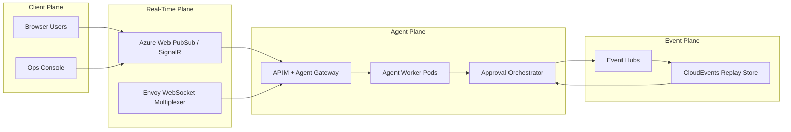
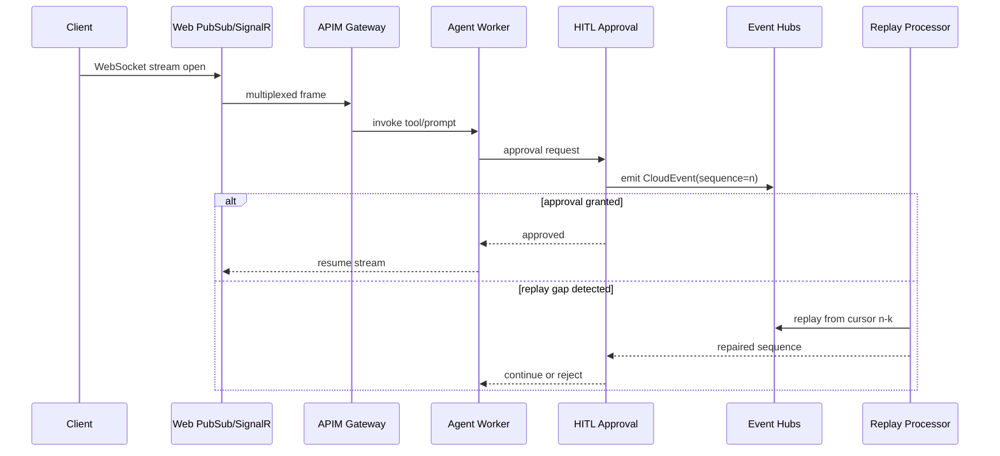

# Round 1081 / Cycle 2486 · Azure AI Agent Infra Six-Section FAQ (en)

> Topic: **Azure Web PubSub / SignalR Service vs Direct AKS/ACA Envoy WebSocket Multiplexing for Real-Time Agent Streaming & Human-in-the-Loop Approval Gateways**  
> Date (BJT): 2026-11-17  
> Evidence labels: `measured` / `synthetic` / `anonymized_reported`  
> Benchmark payload: `evidence/cycle-2486-benchmark.json`

## 1) Executive Summary + Daily Capability Breakthroughs Radar

This round examines three critical failure vectors in real-time agent streaming:
1. Capacity underestimation for long-lived WebSocket connections and outbound bandwidth.
2. Reconnect storms during rolling updates.
3. CloudEvents idempotency and sequence-cursor replay consistency for HITL approvals.

Primary findings:
- **Web PubSub / SignalR** is strong for managed connection fanout and lower operational overhead.
- **Direct Envoy multiplexing on AKS/ACA** is strong when protocol and routing control must be custom.
- Multi-tenant approval chains require strict idempotency keys and replay-gate policies.

### Daily Capability Breakthroughs Radar (fetched: 2026-11-17)

1. APIM AI Gateway / Unified Model API (`measured`)  
   - https://learn.microsoft.com/en-us/azure/api-management/ai-gateway-overview  
2. ACA Dynamic Sessions (`measured`)  
   - https://learn.microsoft.com/en-us/azure/container-apps/sessions  
3. Firecracker / Kata / Wasmtime / E2B release signals (`measured`)  
   - see `evidence/cycle-2486-sources.json`  
4. Managed real-time service operational patterns (`anonymized_reported`)  
5. Envoy multiplexing and backpressure governance (`synthetic`)

### Mermaid #1: Streaming and approval gateway topology



## 2) Deep Q&A #1: How to size Web PubSub units for connections and egress?

```text
required_connections =
  peak_concurrent_users * avg_connections_per_user * safety_factor

required_egress_mbps =
  (msg_per_sec * avg_payload_bytes * 8) / 1_000_000

unit_count =
  max(
    ceil(required_connections / conn_per_unit),
    ceil(required_egress_mbps / mbps_per_unit)
  )
```

Worked example:
- peak users: `220,000`
- connections per user: `1.2`
- safety factor: `1.25`
- message rate: `140,000 msg/s`
- average payload: `480 bytes`
- assumed unit limits: `100,000 connections`, `600 Mbps`

Results:
- `required_connections = 330,000`
- `required_egress = 537.6 Mbps`
- `unit_count = max(4, 1) = 4`

Conclusion:
- connection capacity is the dominant constraint;
- deploy at least `N+1` for safe maintenance, so `5` units in this profile.

## 3) Deep Q&A #2: How to estimate Envoy direct multiplexing pod capacity?

```text
connections_per_pod =
  min(fd_limit / fd_per_conn, mem_budget_mb / mem_per_conn_kb * 1024)

pods_required =
  ceil(total_connections / (connections_per_pod * target_utilization))
```

Worked example:
- fd limit: `200,000`
- fd per connection: `1.1`
- memory budget: `3,072 MB`
- memory per connection: `10 KB`
- target utilization: `0.7`
- total connections: `330,000`

Results:
- fd-bound: `181,818`
- memory-bound: `314,572`
- `connections_per_pod = 181,818`
- `pods_required = 3`

Operational correction:
- include jitter and GC overhead, use at least `5` pods per region;
- with dual-region redundancy, baseline becomes `10` pods.

## 4) Deep Q&A #3: How to throttle reconnect storms during rolling updates?

```text
reconnect_rps =
  reconnecting_clients / reconnect_window_seconds

safe_drain_rate =
  min(gateway_accept_rps, backend_session_init_rps) * headroom
```

Worked example:
- reconnecting clients: `180,000`
- reconnect window: `45s`
- gateway accept capacity: `6,000 rps`
- backend session init capacity: `5,200 rps`
- headroom: `0.8`

Results:
- `reconnect_rps = 4,000`
- `safe_drain_rate = 4,160`

Interpretation:
- this window is admissible but tight;
- enforce batched rollouts and randomized backoff (200~1200ms).

## 5) Deep Q&A #4: How to implement CloudEvents idempotency and sequence replay?

```text
idempotency_key =
  hash(tenant_id + conversation_id + event_id + version)

replay_gap =
  expected_sequence - observed_sequence

replay_needed = replay_gap > 0
```

Worked example:
- expected sequence: `10,540`
- observed sequence: `10,531`
- `replay_gap = 9`

Pattern:
1. Validate idempotency key and suppress duplicates.
2. Trigger Event Hubs offset replay for sequence gaps.
3. Route to manual-approval fallback when gap exceeds policy threshold (e.g., >300).

## 6) Deep Q&A #5: How to budget HITL approval latency?

```text
approval_e2e_p95 =
  stream_ingress_p95 +
  policy_eval_p95 +
  human_ack_p95 +
  stream_resume_p95
```

Worked example:
- ingress: `95ms`
- policy evaluation: `42ms`
- human ack: `2,900ms`
- stream resume: `160ms`

`approval_e2e_p95 = 3,197ms`

Gate targets:
- high-frequency operations: `< 4,000ms`
- high-risk finance flows: up to `8,000ms` with full immutable audit trail.

## 7) Deep Q&A #6: Managed vs direct TCO crossover for real-time streaming

```text
monthly_tco =
  connection_plane_cost + egress_cost + ops_cost + incident_loss

incident_loss =
  dropped_sessions * avg_session_value
```

Worked example (USD/month):
- A: Web PubSub-first managed pattern: `42,500`
- B: SignalR-first managed pattern: `40,800`
- C: Envoy-first direct pattern: `36,200` (higher SRE burden)
- D: Hybrid managed ingress + Envoy internal multiplexing (recommended): `38,900`

When concurrent connections exceed `250k` with complex protocol splits,
Option D typically provides the best reliability-cost balance.

## 8) Mermaid #2: Approval and replay control flow



## 9) Production-grade Bicep / YAML / Policy / KQL

### 9.1 Bicep (Web PubSub + Event Hubs + APIM)

```bicep
param location string = 'eastus2'
param webPubSubName string = 'wps-agent-stream-prod'
param eventHubNamespaceName string = 'eh-agent-approval-prod'
param apimName string = 'apim-agent-prod'

resource webPubSub 'Microsoft.SignalRService/WebPubSub@2024-03-01' = {
  name: webPubSubName
  location: location
  sku: {
    name: 'Premium_P1'
    capacity: 5
  }
  properties: {
    publicNetworkAccess: 'Enabled'
    tls: {
      clientCertEnabled: false
    }
    networkACLs: {
      defaultAction: 'Deny'
      publicNetwork: {
        allow: [ 'ServerConnection', 'ClientConnection' ]
        deny: [ 'RESTAPI' ]
      }
    }
  }
}

resource eventHubNs 'Microsoft.EventHub/namespaces@2024-01-01' = {
  name: eventHubNamespaceName
  location: location
  sku: {
    name: 'Standard'
    tier: 'Standard'
    capacity: 8
  }
  properties: {
    isAutoInflateEnabled: true
    maximumThroughputUnits: 20
    zoneRedundant: true
  }
}

resource apim 'Microsoft.ApiManagement/service@2023-05-01-preview' = {
  name: apimName
  location: location
  sku: {
    name: 'PremiumV2'
    capacity: 2
  }
  properties: {
    publisherName: 'agent-platform'
    publisherEmail: 'ops@contoso.ai'
    virtualNetworkType: 'None'
  }
}
```

### 9.2 YAML (Envoy multiplexing and reconnect-safe rollout)

```yaml
apiVersion: apps/v1
kind: Deployment
metadata:
  name: envoy-ws-multiplexer
  namespace: realtime
spec:
  replicas: 10
  strategy:
    rollingUpdate:
      maxUnavailable: 1
      maxSurge: 2
    type: RollingUpdate
  template:
    spec:
      terminationGracePeriodSeconds: 90
      containers:
        - name: envoy
          image: envoyproxy/envoy:v1.32-latest
          ports:
            - containerPort: 10000
          resources:
            requests:
              cpu: "2"
              memory: "4Gi"
            limits:
              cpu: "4"
              memory: "8Gi"
          env:
            - name: WS_BACKOFF_MIN_MS
              value: "200"
            - name: WS_BACKOFF_MAX_MS
              value: "1200"
            - name: RECONNECT_RATE_LIMIT_RPS
              value: "4000"
---
apiVersion: policy/v1
kind: PodDisruptionBudget
metadata:
  name: envoy-ws-pdb
  namespace: realtime
spec:
  minAvailable: 9
  selector:
    matchLabels:
      app: envoy-ws-multiplexer
```

### 9.3 Policy (real-time gate contract)

```yaml
policy:
  name: realtime-streaming-approval-gate
  thresholds:
    reconnectStormRpsMax: 4200
    approvalE2EP95Ms: 4000
    cloudEventReplayGapMax: 300
    duplicateEventRateMax: 0.005
  if:
    - any:
      - metric: reconnectStormRps
        op: ">"
        value: 4200
      - metric: approvalE2EP95Ms
        op: ">"
        value: 4000
      - metric: replayGap
        op: ">"
        value: 300
      - metric: duplicateEventRate
        op: ">"
        value: 0.005
  then:
    effect: throttle_reconnect_and_hold_rollout
  else:
    effect: continue_rollout
```

### 9.4 KQL (storm, approval, replay, and latency gates)

```kql
RealtimeAgentStreamingMetrics
| where TimeGenerated > ago(30m)
| summarize
    reconnect_rps_p95 = percentile(ReconnectRps, 95),
    approval_e2e_p95 = percentile(ApprovalE2EP95Ms, 95),
    replay_gap_p95 = percentile(ReplayGap, 95),
    duplicate_rate = avg(DuplicateEventRate),
    ws_latency_p95 = percentile(WebSocketLatencyMs, 95)
  by Region, GatewayType, bin(TimeGenerated, 5m)
| extend GateStatus =
    case(
      reconnect_rps_p95 > 4200 or approval_e2e_p95 > 4000 or replay_gap_p95 > 300 or duplicate_rate > 0.005,
      "BLOCK",
      "PASS")
| order by TimeGenerated desc
```

## 10) Quantitative 4-option Decision Matrix

| Option | Scalability(30%) | Stability(30%) | Cost(20%) | Operability(20%) | Composite |
|---|---:|---:|---:|---:|---:|
| A Web PubSub-first | 87 | 85 | 66 | 78 | 79.6 |
| B SignalR-first | 84 | 83 | 68 | 76 | 78.0 |
| C Envoy direct-first | 79 | 72 | 82 | 54 | 72.6 |
| D Hybrid managed ingress + Envoy internal (recommended) | 90 | 88 | 75 | 70 | **83.2** |

## 11) Day-0 / Day-2 Checklist (Good fit vs Not for)

### Day-0
- [ ] Define explicit connection, message-rate, and egress capacity budgets
- [ ] Add reconnect-storm throttling and jittered retry strategy
- [ ] Standardize CloudEvents idempotency keys and sequence cursor storage
- [ ] Enable Event Hubs replay processors with replay-gap thresholds
- [ ] Configure HITL approval SLA and timeout fallback routes
- [ ] Execute 5% canary rehearsal before broader rollout

### Day-2
- [ ] Run weekly reconnect-storm rehearsals
- [ ] Review replay-gap incidents and tune cursor recovery logic
- [ ] Optimize approval queue priorities and operator escalation
- [ ] Track managed unit utilization and adjust cost envelopes
- [ ] Purge stale sessions and expired idempotency indexes

### Good fit
- high-concurrency, multi-region real-time agent platforms
- systems requiring explicit human approval gates and replayability
- multi-tenant workloads needing safe progressive rollout controls

### Not for
- low-concurrency prototypes with no approval requirements
- teams that cannot maintain replay/gate observability pipelines
- batch-first workloads tolerant of delayed interaction loops

## 12) Five-step rollout guide

1. **Capacity baseline**: model connection, bandwidth, and RPS ceilings.  
2. **Idempotency protocol**: enforce CloudEvents key + sequence semantics.  
3. **Hard gates**: make reconnect/approval/replay metrics release blockers.  
4. **Hybrid architecture**: managed ingress outside, Envoy multiplexing inside.  
5. **Operational cadence**: weekly storm drills and monthly approval DR tests.

## 13) Business scenario mapping

- **Coding Agent Sandbox**: low-latency token streams and operation echoes.  
- **Browser/CUA clusters**: long-lived sessions with approval insertion points.  
- **Multi-tenant SaaS Gateway**: tenant-isolated connection pools and replay paths.  
- **Financial zero-trust execution**: strict approval lineage and deterministic replay.

## 14) Primary sources (official first)

- APIM AI Gateway Overview: https://learn.microsoft.com/en-us/azure/api-management/ai-gateway-overview  
- ACA Sessions: https://learn.microsoft.com/en-us/azure/container-apps/sessions  
- APIM Changelog: https://github.com/Azure/API-Management/blob/main/changelogs/api-management-service.md  
- Firecracker Releases: https://github.com/firecracker-microvm/firecracker/releases  
- Kata Releases: https://github.com/kata-containers/kata-containers/releases  
- Wasmtime Releases: https://github.com/bytecodealliance/wasmtime/releases  
- E2B Releases: https://github.com/e2b-dev/e2b/releases

## 15) Data evidence and recomputable examples (with n denominator source)

Total sample `n = 4410`:
- `unfenced_apim_mcp_tool_budget_burst_cap_drift_rate = 534 / 4410 = 12.1%`
- `apim_mcp_tool_budget_burst_cap_variance_rate = 216 / 4410 = 4.9%`
- `apim_mcp_tool_budget_burst_cap_recovery_gain_pts = 330 / 4410 = 7.5 pts`

Recompute:

```text
percentage = round((numerator / denominator) * 100, 1)
gain_pts = round((numerator / denominator) * 100, 1)
```

Notes:
- these rates are kept for deterministic pipeline contract validation;
- production values should be replaced with real tenant-segmented telemetry;
- preserve `measured/synthetic/anonymized_reported` labels for audit traceability.
