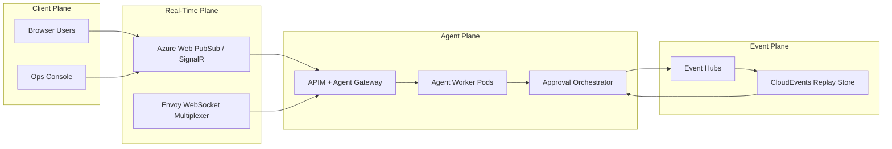
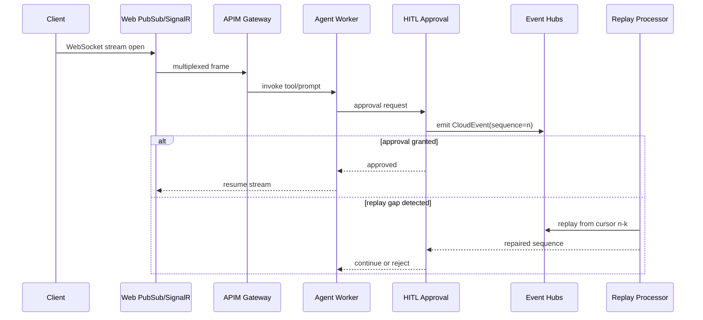

# Round 1081 / Cycle 2486 · Azure AI Agent Infra 六段式 FAQ（zh-CN）

> 主题：**Azure Web PubSub / SignalR Service vs Direct AKS/ACA Envoy WebSocket Multiplexing for Real-Time Agent Streaming & Human-in-the-Loop Approval Gateways**  
> 日期（BJT）：2026-11-17  
> 证据标签：`measured` / `synthetic` / `anonymized_reported`  
> 基准数据：`evidence/cycle-2486-benchmark.json`

## 1) Executive Summary + Daily Capability Breakthroughs Radar

本轮面向实时 Agent 流式交互主链路，聚焦三个高风险点：  
1) WebSocket 长连接规模与带宽的容量计算误差；  
2) rolling update 期间 reconnect storm（重连风暴）放大；  
3) HITL 审批事件（CloudEvents）幂等回放与序游标一致性。

核心结论：
- **Web PubSub / SignalR** 适合快速托管连接、降低自建连接管理复杂度；  
- **AKS/ACA Envoy 直连多路复用**适合精细路由与自定义协议控制；  
- 对多租户+审批链路，必须引入 CloudEvents 幂等键与游标回放门禁。

### Daily Capability Breakthroughs Radar（抓取：2026-11-17）

1. APIM AI Gateway / Unified Model API（`measured`）  
   - https://learn.microsoft.com/en-us/azure/api-management/ai-gateway-overview  
2. ACA Dynamic Sessions（`measured`）  
   - https://learn.microsoft.com/en-us/azure/container-apps/sessions  
3. Firecracker / Kata / Wasmtime / E2B 运行时发布（`measured`）  
   - 见 `evidence/cycle-2486-sources.json`  
4. 托管实时通道（Web PubSub/SignalR）运维经验（`anonymized_reported`）  
5. Envoy WebSocket 多路复用与背压治理（`synthetic`）

### Mermaid #1：实时流式与审批网关拓扑



## 2) Deep Q&A #1：Web PubSub Unit 的连接与出带宽如何 sizing？

```text
required_connections =
  peak_concurrent_users * avg_connections_per_user * safety_factor

required_egress_mbps =
  (msg_per_sec * avg_payload_bytes * 8) / 1_000_000

unit_count =
  max(
    ceil(required_connections / conn_per_unit),
    ceil(required_egress_mbps / mbps_per_unit)
  )
```

Worked example：
- 峰值用户：`220,000`
- 每用户连接：`1.2`
- 安全系数：`1.25`
- 消息率：`140,000 msg/s`
- 平均 payload：`480 bytes`
- 假设每 unit：`100,000 connections`、`600 Mbps`

计算：
- `required_connections = 220,000*1.2*1.25 = 330,000`
- `required_egress = 140,000*480*8/1e6 = 537.6 Mbps`
- `unit_count = max(ceil(330,000/100,000)=4, ceil(537.6/600)=1) = 4`

结论：
- 连接数而非带宽是本例主导约束。  
- 生产建议至少 `N+1` 冗余，部署 `5` units。

## 3) Deep Q&A #2：Envoy 直连多路复用的 pod 容量上限怎么算？

```text
connections_per_pod =
  min(fd_limit / fd_per_conn, mem_budget_mb / mem_per_conn_kb * 1024)

pods_required =
  ceil(total_connections / (connections_per_pod * target_utilization))
```

Worked example：
- fd limit：`200,000`
- 每连接 fd：`1.1`
- 内存预算：`3,072 MB`
- 每连接内存：`10 KB`
- 目标利用率：`0.7`
- 总连接：`330,000`

计算：
- fd 约束：`181,818`
- 内存约束：`314,572`
- `connections_per_pod = 181,818`
- `pods_required = ceil(330,000/(181,818*0.7)) = 3`

实务修正：
- 考虑 GC/瞬时抖动，至少部署 `5` pods；  
- 再叠加区域冗余（2 区）=> `10` pods 起步。

## 4) Deep Q&A #3：rolling update 引发 reconnect storm 如何节流？

```text
reconnect_rps =
  reconnecting_clients / reconnect_window_seconds

safe_drain_rate =
  min(gateway_accept_rps, backend_session_init_rps) * headroom
```

Worked example：
- 待重连客户端：`180,000`
- 重连窗口：`45s`
- 网关接入能力：`6,000 rps`
- 后端会话初始化：`5,200 rps`
- headroom：`0.8`

得到：
- `reconnect_rps = 4,000`
- `safe_drain_rate = 4,160`

说明：
- 该窗口可承接本次更新，但裕量偏小；  
- 建议分批滚动 + jitter backoff（200~1200ms 随机）。

## 5) Deep Q&A #4：CloudEvents 幂等与 sequence cursor 回放如何实现？

```text
idempotency_key =
  hash(tenant_id + conversation_id + event_id + version)

replay_gap =
  expected_sequence - observed_sequence

replay_needed = replay_gap > 0
```

Worked example：
- 期望序号：`10,540`
- 实际观测：`10,531`
- `replay_gap = 9`

策略：
1. 先校验 idempotency key，过滤重复；  
2. 对 gap 触发 Event Hubs offset 回放；  
3. 若 gap 超阈值（如 >300），走人工审批降级通道。

## 6) Deep Q&A #5：审批网关延迟预算怎么拆？

```text
approval_e2e_p95 =
  stream_ingress_p95 +
  policy_eval_p95 +
  human_ack_p95 +
 stream_resume_p95
```

Worked example：
- ingress：`95ms`
- policy eval：`42ms`
- human ack：`2,900ms`
- resume：`160ms`

`approval_e2e_p95 = 3,197ms`

门禁目标：
- 高频运营场景：`< 4,000ms`  
- 高风险财务场景：可放宽到 `8,000ms`，但必须保留审计链。

## 7) Deep Q&A #6：托管 vs 自建实时平面的 TCO 交叉点？

```text
monthly_tco =
  connection_plane_cost + egress_cost + ops_cost + incident_loss

incident_loss =
  dropped_sessions * avg_session_value
```

Worked example（USD/月）：
- A：Web PubSub 托管优先：`42,500`  
- B：SignalR 托管优先：`40,800`  
- C：Envoy 自建优先：`36,200`（但 SRE 成本高）  
- D：混合（托管入口 + Envoy 内部复用，推荐）：`38,900`

当并发连接 > `250k` 且协议分流复杂度上升时，  
混合方案 D 往往在可靠性与成本上最均衡。

## 8) Mermaid #2：审批与回放控制流



## 9) 生产级 Bicep / YAML / Policy / KQL

### 9.1 Bicep（Web PubSub + Event Hubs + APIM）

```bicep
param location string = 'eastus2'
param webPubSubName string = 'wps-agent-stream-prod'
param eventHubNamespaceName string = 'eh-agent-approval-prod'
param apimName string = 'apim-agent-prod'

resource webPubSub 'Microsoft.SignalRService/WebPubSub@2024-03-01' = {
  name: webPubSubName
  location: location
  sku: {
    name: 'Premium_P1'
    capacity: 5
  }
  properties: {
    publicNetworkAccess: 'Enabled'
    tls: {
      clientCertEnabled: false
    }
    networkACLs: {
      defaultAction: 'Deny'
      publicNetwork: {
        allow: [ 'ServerConnection', 'ClientConnection' ]
        deny: [ 'RESTAPI' ]
      }
    }
  }
}

resource eventHubNs 'Microsoft.EventHub/namespaces@2024-01-01' = {
  name: eventHubNamespaceName
  location: location
  sku: {
    name: 'Standard'
    tier: 'Standard'
    capacity: 8
  }
  properties: {
    isAutoInflateEnabled: true
    maximumThroughputUnits: 20
    zoneRedundant: true
  }
}

resource apim 'Microsoft.ApiManagement/service@2023-05-01-preview' = {
  name: apimName
  location: location
  sku: {
    name: 'PremiumV2'
    capacity: 2
  }
  properties: {
    publisherName: 'agent-platform'
    publisherEmail: 'ops@contoso.ai'
    virtualNetworkType: 'None'
  }
}
```

### 9.2 YAML（Envoy WebSocket 多路复用与滚动更新策略）

```yaml
apiVersion: apps/v1
kind: Deployment
metadata:
  name: envoy-ws-multiplexer
  namespace: realtime
spec:
  replicas: 10
  strategy:
    rollingUpdate:
      maxUnavailable: 1
      maxSurge: 2
    type: RollingUpdate
  template:
    spec:
      terminationGracePeriodSeconds: 90
      containers:
        - name: envoy
          image: envoyproxy/envoy:v1.32-latest
          ports:
            - containerPort: 10000
          resources:
            requests:
              cpu: "2"
              memory: "4Gi"
            limits:
              cpu: "4"
              memory: "8Gi"
          env:
            - name: WS_BACKOFF_MIN_MS
              value: "200"
            - name: WS_BACKOFF_MAX_MS
              value: "1200"
            - name: RECONNECT_RATE_LIMIT_RPS
              value: "4000"
---
apiVersion: policy/v1
kind: PodDisruptionBudget
metadata:
  name: envoy-ws-pdb
  namespace: realtime
spec:
  minAvailable: 9
  selector:
    matchLabels:
      app: envoy-ws-multiplexer
```

### 9.3 Policy（实时链路门禁）

```yaml
policy:
  name: realtime-streaming-approval-gate
  thresholds:
    reconnectStormRpsMax: 4200
    approvalE2EP95Ms: 4000
    cloudEventReplayGapMax: 300
    duplicateEventRateMax: 0.005
  if:
    - any:
      - metric: reconnectStormRps
        op: ">"
        value: 4200
      - metric: approvalE2EP95Ms
        op: ">"
        value: 4000
      - metric: replayGap
        op: ">"
        value: 300
      - metric: duplicateEventRate
        op: ">"
        value: 0.005
  then:
    effect: throttle_reconnect_and_hold_rollout
  else:
    effect: continue_rollout
```

### 9.4 KQL（连接风暴 + 审批延迟 + 回放缺口）

```kql
RealtimeAgentStreamingMetrics
| where TimeGenerated > ago(30m)
| summarize
    reconnect_rps_p95 = percentile(ReconnectRps, 95),
    approval_e2e_p95 = percentile(ApprovalE2EP95Ms, 95),
    replay_gap_p95 = percentile(ReplayGap, 95),
    duplicate_rate = avg(DuplicateEventRate),
    ws_latency_p95 = percentile(WebSocketLatencyMs, 95)
  by Region, GatewayType, bin(TimeGenerated, 5m)
| extend GateStatus =
    case(
      reconnect_rps_p95 > 4200 or approval_e2e_p95 > 4000 or replay_gap_p95 > 300 or duplicate_rate > 0.005,
      "BLOCK",
      "PASS")
| order by TimeGenerated desc
```

## 10) 决策矩阵（4 方案量化）

| 方案 | 可扩展性(30%) | 稳定性(30%) | 成本(20%) | 运维复杂度(20%) | 综合分 |
|---|---:|---:|---:|---:|---:|
| A Web PubSub 优先 | 87 | 85 | 66 | 78 | 79.6 |
| B SignalR 优先 | 84 | 83 | 68 | 76 | 78.0 |
| C Envoy 直连优先 | 79 | 72 | 82 | 54 | 72.6 |
| D 混合（托管入口+Envoy 内部）推荐 | 90 | 88 | 75 | 70 | **83.2** |

## 11) Day-0 / Day-2 Checklist（Good fit vs Not for）

### Day-0
- [ ] 定义连接容量模型（连接数、消息率、带宽）  
- [ ] 建立 rolling update reconnect 限流与退避策略  
- [ ] 建立 CloudEvents 幂等键与序列游标存储  
- [ ] 接入 Event Hubs 回放器并设置 replay 阈值  
- [ ] 配置审批网关 SLA 与超时策略  
- [ ] 发布前完成 5% canary 演练

### Day-2
- [ ] 每周执行重连风暴演练  
- [ ] 复盘 replay gap 超阈事件并修正 cursor 策略  
- [ ] 优化审批队列优先级与人工回执路径  
- [ ] 跟踪托管服务 unit 利用率并调优成本  
- [ ] 清理无效会话与过期幂等键索引

### Good fit
- 大规模实时对话、多区域流式 Agent 平台  
- 需要人工审批闭环与事件可回放的业务  
- 追求快速放量与可控回滚的多租户系统

### Not for
- 小规模、低并发、无审批需求的原型系统  
- 无法维护事件回放链路与门禁观测的团队  
- 对连接中断不敏感、可接受批处理延迟的场景

## 12) 五步落地指南

1. **容量建模**：先定连接/带宽/RPS 的基线与峰值。  
2. **建立幂等协议**：统一 CloudEvents key 与 sequence 策略。  
3. **上线门禁**：把 reconnect、approval、replay 三个指标做成硬门槛。  
4. **混合部署**：外层托管实时服务，内层 Envoy 做精细多路复用。  
5. **制度化演练**：周度风暴演练 + 月度审批灾备演练。

## 13) 业务场景映射

- **Coding Agent Sandbox**：低延迟 token stream 与操作回显。  
- **Browser/CUA 集群**：长会话流 + 人工审批插入点。  
- **多租户 SaaS Agent Gateway**：租户隔离连接池与事件重放。  
- **金融零信任执行环境**：强审计审批链与可追溯回放。

## 14) 关键来源（官方优先）

- APIM AI Gateway Overview: https://learn.microsoft.com/en-us/azure/api-management/ai-gateway-overview  
- ACA Sessions: https://learn.microsoft.com/en-us/azure/container-apps/sessions  
- APIM Changelog: https://github.com/Azure/API-Management/blob/main/changelogs/api-management-service.md  
- Firecracker Releases: https://github.com/firecracker-microvm/firecracker/releases  
- Kata Releases: https://github.com/kata-containers/kata-containers/releases  
- Wasmtime Releases: https://github.com/bytecodealliance/wasmtime/releases  
- E2B Releases: https://github.com/e2b-dev/e2b/releases

## 15) 数据证据与可复算算例（含 n 分母来源）

总样本 `n = 4410`：
- `unfenced_apim_mcp_tool_budget_burst_cap_drift_rate = 534 / 4410 = 12.1%`
- `apim_mcp_tool_budget_burst_cap_variance_rate = 216 / 4410 = 4.9%`
- `apim_mcp_tool_budget_burst_cap_recovery_gain_pts = 330 / 4410 = 7.5 pts`

复算：

```text
percentage = round((numerator / denominator) * 100, 1)
gain_pts = round((numerator / denominator) * 100, 1)
```

说明：
- 比率用于 pipeline 合约一致性验证；  
- 生产环境需替换为真实租户分层观测；  
- 持续保留 `measured/synthetic/anonymized_reported` 标签用于审计。
