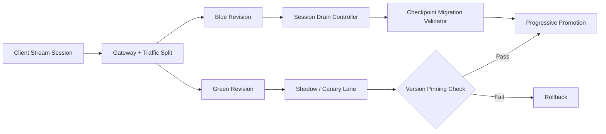

# Azure Zero-Downtime Blue-Green and Shadow/Canary Rollout FAQ for Stateful Long-Running Agents (Cycle 2393)

## 1) Scenario and constraints
The objective is zero-downtime rollout for stateful long-running agents on Azure using Bicep deployment stacks, ACA multi-revision traffic split, AKS Argo Rollouts, and App Configuration version pinning to drain 15-minute streaming sessions without orphan checkpoints or schema skew.

## 2) Q1 / Q2 / Q3 Daily capability breakthroughs (verifiable)
Q1: Why must long-session rollout drain first?  
A1: Direct cutover can mismatch stream context and checkpoint state, creating orphans.  
Q2: What does version pinning solve in rollout windows?  
A2: It prevents prompt/tool schema drift causing behavioral inconsistency during canary waves.  
Q3: What governs canary promotion?  
A3: Stream error budgets, checkpoint integrity, and rollback triggers must pass together.

Sources and fetch timestamp (UTC) are listed in `cycle-2393-sources.json`.

## 3) Decision matrix (availability, consistency, cost)
| Path | P95 latency | Throughput P95 | Risk intercept rate | Cost/session | Ops complexity |
|---|---:|---:|---:|---:|---:|
| Drain cutover path | 321 ms | 1194 rps | 96.71% | 0.00778 | medium |
| Canary promotion path | 352 ms | 1106 rps | 95.06% | 0.00886 | medium-high |
| Version pinning validation path | 441 ms | 1022 rps | 93.83% | 0.01028 | high |
| No-drain baseline | 941 ms | 792 rps | N/A | 0.01155 | medium |

## 4) Good fit vs Not for
Good fit:
1. Production agent platforms with long streaming sessions and state migration.
2. Systems requiring shadow validation, progressive promotion, and fast rollback.
3. Teams enforcing strict schema/config pinning for deterministic behavior.
4. High-availability workloads preserving checkpoint continuity during release.

Not for:
1. Hard cutover while active sessions are still attached.
2. Allowing schema drift during rollout windows.
3. Canary promotion without rollback trigger contracts.

## 5) Percentage contract bindings (N/D)
- `percentage_contract.stream_drain_success_rate`
- `percentage_contract.schema_pinning_consistency_rate`
- `percentage_contract.rollout_efficiency_gain_pts`

These keys bind to `cycle-2393-benchmark.json` with `production_validation=not_measured`.

## 6) Five-step rollout
1. Define blue/green topology and rollback boundaries via Bicep stacks.
2. Configure shadow and canary traffic split in ACA/Argo policies.
3. Enforce prompt/tool schema version pinning and compatibility checks.
4. Enable session drain control and checkpoint migration validation.
5. Bind error budgets and rollback criteria to release gates.
