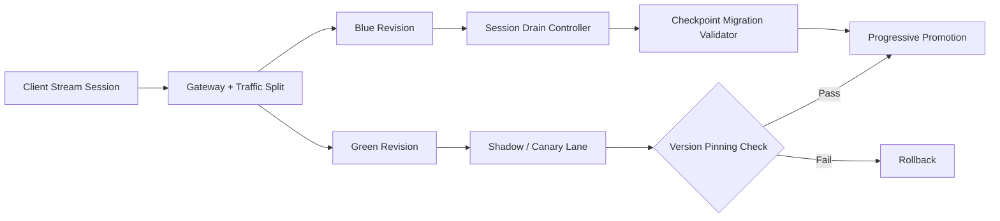

# Azure 状态型长会话 Agent 蓝绿/影子金丝雀零停机发布 FAQ（Cycle 2393）

## 1) 场景与约束
目标是在 Azure 上实现状态型长会话 Agent 的零停机发布：利用 Bicep Deployment Stacks、ACA 多修订流量分割、AKS Argo Rollouts 与 App Configuration 版本锁定，在 15 分钟流式会话下完成平滑排空与无 checkpoint 偏斜切换。

## 2) Q1 / Q2 / Q3 当日能力突破（可验证）
Q1：为什么长会话发布必须先排空？  
A1：直接切流会导致流式上下文与 checkpoint 失配，产生孤儿状态。  
Q2：版本锁定在发布窗口中解决什么问题？  
A2：可避免 prompt/tool schema 在灰度过程中漂移导致行为不一致。  
Q3：金丝雀晋级的关键指标是什么？  
A3：流式错误预算、checkpoint 一致性与回滚触发器联动达标。

来源与抓取时间（UTC）见 `cycle-2393-sources.json`。

## 3) 决策矩阵（可用性、一致性、成本）
| 路径 | P95 延迟 | 吞吐 P95 | 风险拦截率 | 单会话成本 | 运维复杂度 |
|---|---:|---:|---:|---:|---:|
| 排空切换路径 | 321 ms | 1194 rps | 96.71% | 0.00778 | 中 |
| 金丝雀晋级路径 | 352 ms | 1106 rps | 95.06% | 0.00886 | 中高 |
| 版本锁定校验路径 | 441 ms | 1022 rps | 93.83% | 0.01028 | 高 |
| 无排空基线 | 941 ms | 792 rps | N/A | 0.01155 | 中 |

## 4) Good fit vs Not for
Good fit：
1. 长流式会话和状态迁移并存的生产 Agent 平台。  
2. 需要影子验证与渐进晋级并可快速回滚的系统。  
3. 需要严格配置/Schema 锁定保证行为一致性的组织。  
4. 高可用场景需在发布中保持 checkpoint 连续性。

Not for：
1. 活跃会话未排空就直接切流。  
2. 发布中允许 schema 漂移。  
3. 无 rollback 触发器的金丝雀晋级流程。

## 5) Percentage contract bindings (N/D)
- `percentage_contract.stream_drain_success_rate`
- `percentage_contract.schema_pinning_consistency_rate`
- `percentage_contract.rollout_efficiency_gain_pts`

以上键绑定 `cycle-2393-benchmark.json`，并标记 `production_validation=not_measured`。

## 6) 五步落地指南
1. 通过 Bicep Stacks 定义蓝绿拓扑和可回退边界。  
2. 配置 ACA/Argo 的影子与金丝雀流量分割策略。  
3. 启用 prompt/tool schema 版本锁定与兼容检查。  
4. 对长会话启用排空控制与 checkpoint 迁移验证。  
5. 将错误预算与回滚条件绑定到发布门禁。
