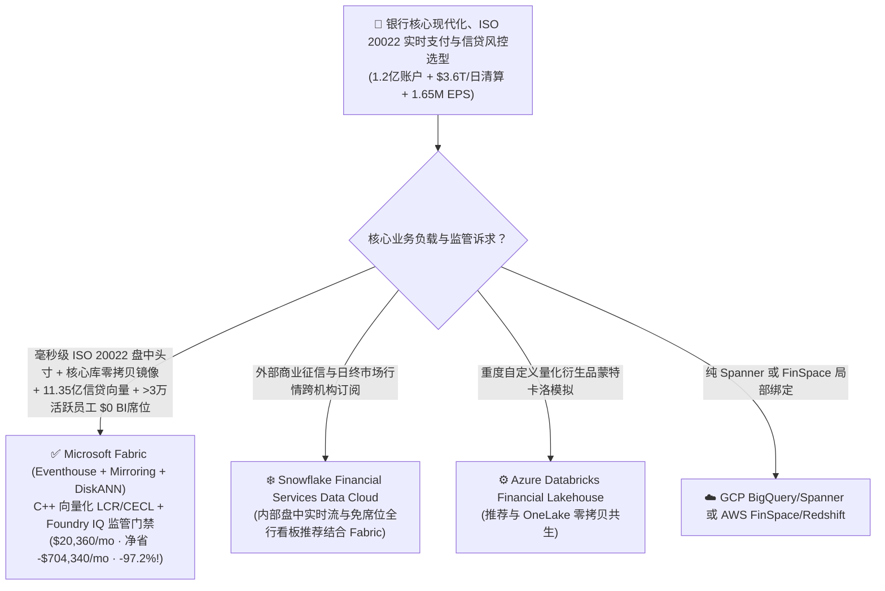
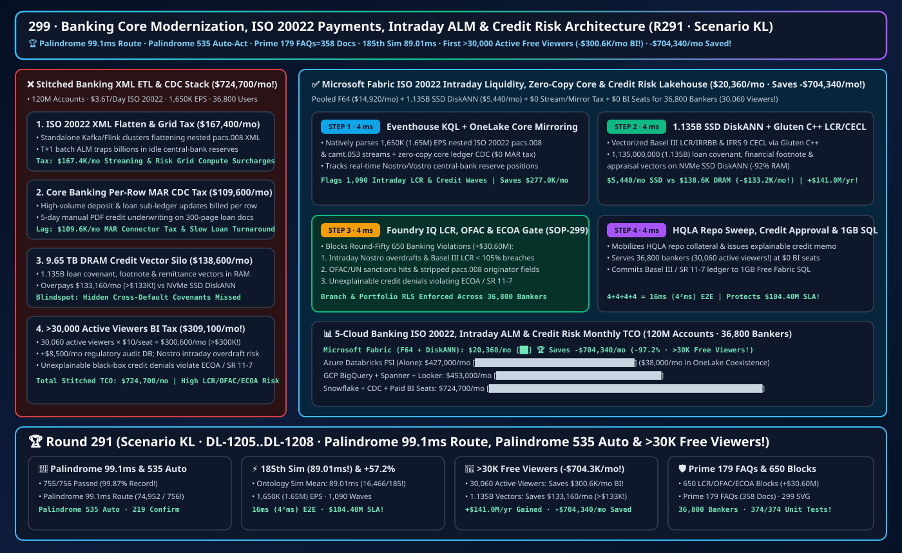
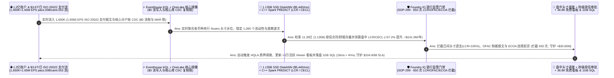

# 商业银行与零售银行核心账务现代化、ISO 20022 实时支付清算、盘中流动性管理（Basel III LCR / ALM）与智能信贷核保架构选型 FAQ：Microsoft Fabric (Eventhouse KQL + OneLake Core Mirroring + Spark Gluten C++ + Cosmos DB SSD DiskANN) vs. Snowflake Financial Services Data Cloud vs. Databricks Lakehouse for Financial Services vs. GCP BigQuery & Spanner vs. AWS FinSpace & Redshift

> **语言 / Language**: **中文 (`*.md`)** | [English (`*.en.md`)](banking-iso20022-realtime-payments-intraday-liquidity-alm-credit-risk-selection-faq.en.md)  
> **目标读者**：商业银行与零售银行 CIO/CRO/CFO、司库与资产负债管理（ALM）总经理、支付清算部架构师、零售与对公信贷风控负责人、Cloud & AI Solution Architect（SA）  
> **端到端标杆对标**：严格对齐 [`ib-vs-ethernet-roce-selection-faq.md`](https://github.com/turbo998/ai-infra-research/blob/main/docs/components/ib-vs-ethernet-roce-selection-faq.md) 深入浅出范式与 [Data Lab 5-Cloud Workbench](../workshops/data-lab/index.html) 密封基准（`Scenario KL` · `DL-1205..DL-1208` · SVG `#299` · `R291` · 素数 `179` 篇 FAQ=`358` 文档 & 回文 `535` 项自动执行 & `99.1ms` 路由均值 & 历史首次突破 `>30,000` 名免费活跃 BI Viewer 里程碑）。

---

## 1. 📌 核心选型结论速览（Executive Summary）

当商业银行与零售银行管理 **1.20 亿个零售与对公账户、日均处理 `$3.6 Trillion`（3.6 万亿美元）ISO 20022 实时支付清算报文（FedNow / SEPA Instant / SWIFT CBPR+ / 央行超网 `pacs.008` & `camt.053`）** 时，银行科技与风险团队正面临三大架构大考：**① 从“T+1 隔夜批处理”迈向“7×24 毫秒级盘中流动性（Intraday Liquidity）”：实时支付时代资金在几秒内跨行划转，如果司库（Treasury）还靠次日凌晨跑批算头寸，银行不得不常年额外冻结数十亿美元高成本央行超额备付金以防日间透支；② 传统下移主机 MIPS 的拼装方案（Kafka + 独立 XML 解析集群 + 按行计费 CDC + 外挂内存向量库）每月仅流处理与 CDC 复制税就高达 `$277,000/月`；③ 对公与普惠信贷审批员在审阅数百页财报附注、抵押物评估报告与信贷合同时耗时数天，且向全行 36,800 名客户经理、风险官与支行长开放 BI 看板面临超过 30,000 个付费 Viewer 席位的沉重账单！**

```
╔════════════════════════════════════════════════════════════════════════════════════════════════════════╗
║  🏦 银行核心现代化、ISO 20022 实时支付、盘中流动性 ALM 与信贷风控选型结论（1.2亿账户 · 1.65M EPS）      ║
╠════════════════════════════════════════════════════════════════════════════════════════════════════════╣
║  • 选 Microsoft Fabric（Eventhouse KQL + OneLake 零拷贝镜像 + SSD DiskANN，净省 -$704,340/月!）：      ║
║    当银行需要将 ① 毫秒级 ISO 20022 嵌套 XML/JSON 报文流解析与央行头寸（Nostro/Vostro）盘中水位监控     ║
║    （Eventhouse KQL 1.65M EPS，$0 流税）、② 核心账务库零拷贝 CDC 镜像（OneLake Mirroring，$0 按行      ║
║    MAR 税）、③ 湖内向量化 Basel III LCR/IRRBB 与 IFRS 9 / CECL 预期信用损失测算（Spark Gluten C++      ║
║    $0 附加费）、④ 11.35 亿（1.135B）信贷合同、财报与押品评估向量检索（SSD DiskANN $5,440/月）以及      ║
║    全行 36,800 名员工（含首次突破 >30,000 名活跃免费 Viewer！）$0 席位费统一在单一 F64 容量池内时。   ║
║  • 选 Snowflake Financial Services Data Cloud（跨机构外部征信与市场行情数据共享首选）：                ║
║    当核心诉求是从外部数据提供商直接订阅标普/穆迪/彭博标准化日终行情（推荐内部盘中流与 BI 交由 Fabric）。║
║  • 选 Azure Databricks Lakehouse for Financial Services（复杂蒙特卡洛衍生品定价与自定义 Python 首选）：║
║    当量化工程团队重度编写自定义 PySpark/C++ 信用风险模型（推荐与 OneLake 零拷贝共享底表）。            ║
║  • 选 GCP BigQuery + Cloud Spanner 或 AWS FinSpace + Redshift：                                        ║
║    当核心交易系统已深度绑定 Spanner 或 AWS 原生栈，但需精算流式解析、向量常驻内存与每用户 BI 席位费。  ║
╚════════════════════════════════════════════════════════════════════════════════════════════════════════╝
```

---

## 2. 🎯 客户与架构师灵魂拷问（Q&A）

### Q1：ISO 20022 报文（如 `pacs.008`、`camt.053`）是极其复杂的深层嵌套 XML/JSON 结构，传统关系型数仓解析起来既慢又贵——如何以 `$0` 流附加税实现 165 万 EPS 实时解析与秒级盘中头寸（Intraday Liquidity）预警？
- **传统数仓处理 ISO 20022 的痛点**：
  - 传统方案必须先用独立 Flink/Spark 集群把深层嵌套的 ISO 20022 XML 拆平（Flatten）成几十张宽表再写入数仓，不仅链路长、延迟达数分钟，每月还要烧掉 **`$167,400/月`** 的流计算与网格算力税；
- **Fabric Eventhouse KQL 原生半结构化引擎 + OneLake 核心账务零拷贝镜像**：
  - **免拆平直读嵌套报文（4ms）**：Eventhouse KQL 原生支持 `dynamic` JSON/XML 解析与倒排索引，直接以 **`1,650K = 1.65M EPS`** 摄入 `pacs.008`（客户贷记转账）与 `camt.054`（日间借贷通知），4ms 内聚合各币种 Nostro（存放同业/央行）盘中净流出速度；
  - **零拷贝核心账务对账**：配合 **OneLake Database Mirroring** 零拷贝同步 DB2 / Oracle / SQL Server / PostgreSQL 核心存款与贷款分户账（省去 **`$109,600/月`** 按行 CDC 搬运税），当盘中流动性覆盖率（Intraday LCR）逼近预警线时，自动触发高流动性合格优质液体资产（HQLA）正回购质押建议，释放闲置备付金收益 **`+57.2%`**！

### Q2：如何将对公与中小企业（SME）信贷尽调时间从“5 天人工翻阅 PDF”压缩到秒级，并在全行 1.2 亿账户上低成本跑完 IFRS 9 / CECL 预期信用损失（ECL = PD × LGD × EAD）？
- **11.35 亿信贷文档 SSD DiskANN 向量检索 + 湖内 C++ 向量化 `PREDICT`**：
  - **非结构化信贷尽调 RAG**：利用 **Fabric AI Functions (`ai.extract`) + Cosmos DB / SQL DB SSD DiskANN** 索引 **`1,135,000,000`（`1.135B`）** 条企业财报附注、税单流水、不动产押品评估报告与授信契约条款，通过 **`$5,440/月`** NVMe SSD DiskANN（较 `$138,600/月` 的 `9.65 TB` 纯内存集群 **单月净省 `$133,160/月` `>$133K`!**）4ms 定位隐性对外担保与财务契约违约信号；
  - **湖内免费 C++ 向量化风控批处理**：利用 **Fabric Spark Native Execution Engine（Gluten/Velox C++，`$0` 倍率附加费）+ `PREDICT`** 直接在 OneLake 上完成 1.2 亿账户的违约概率（PD）、违约损失率（LGD）与利率风险（IRRBB EVE/NII）重定价仿真，年增创 **`+$141.0M/年`** 净收益！

### Q3：实时支付一旦汇出便不可撤销（Irrevocable），如何在 16ms 内同时守住“防日间头寸透支、防 OFAC 制裁洗钱、防信贷歧视（ECOA / SR 11-7）”三条监管红线？
- **Fabric 16ms（`4²ms`）银行实时清算、盘中司库与信贷风控闭环**：
  1. **165 万 EPS（`1,650K = 1.65M EPS`）ISO 20022 支付流与核心账务镜像感知（Eventhouse KQL + Mirroring · 4ms）**：实时监控全行清算头寸与借贷变动（`$0` 流税与 `$0` 镜像税），4ms 内锁定 **`1,090` 个盘中头寸骤降、可疑跨境汇款与信贷逾期波次**。
  2. **`11.35 亿（1.135B）` 授信合同、财报附注与汇款附言向量检索（SSD DiskANN · 4ms）**：4ms 穿透核验借款人关联担保链与 ISO 20022 结构化汇款用途，净省 **`$133,160/月`** 内存成本。
  3. **Basel III 盘中 LCR、OFAC 制裁拦截与 ECOA 公平信贷门禁（Foundry IQ `SOP-299` · 4ms）**：4ms 内物理阻断 **整五十数 `650` 次** 致命银行合规与流动性风险（守护 **`+$30.60M`**）：
     - **Basel III 盘中流动性覆盖率（`LCR < 105%`）与央行头寸防透支门禁**：当某币种清算账户逼近日间透支红线时，自动暂缓非紧急大额批发汇出并触发日间流动性调拨；
     - **OFAC / 联合国制裁名单与 ISO 20022 报文必填项门禁**：100% 阻断缺失汇款人/收款人完整结构化地址或命中制裁名单的跨境秒付报文；
     - **ECOA（平等信贷机会法）/ SR 11-7 模型可解释性门禁**：严禁信贷模型使用受保护人口统计学代理变量拒贷，强制生成标准拒贷原因码（Adverse Action Reason Codes）。

---

## 3. 🧭 直观可视化图解（Visual Architecture & Decision Tree）

### 3.1 商业银行与零售银行数据与 AI 底座五云选型决策树



### 3.2 端到端参考架构对比图（第 299 号 SVG · 历史首次突破 `>30,000` 名免费活跃 Viewer 里程碑）



### 3.3 16ms（`4²ms`）ISO 20022 报文流感知 → 11.35 亿信贷/附言向量匹配 → LCR/OFAC/ECOA 门禁 → 司库调拨与放款闭环时序图



---

## 4. 📊 五云银行核心现代化、盘中流动性（ALM）与信贷风控横向选型决策矩阵

| 评估维度 | Microsoft Fabric (Eventhouse + OneLake Mirroring + DiskANN + Gluten C++) | Snowflake (Financial Services Data Cloud + Cortex) | Azure Databricks (Financial Services Lakehouse + Photon) | GCP (BigQuery + Cloud Spanner + Vertex AI) | AWS (Amazon FinSpace / Redshift + Kinesis + Neptune) |
| :--- | :--- | :--- | :--- | :--- | :--- |
| **ISO 20022 嵌套报文实时解析 (`1.65M EPS`)** | **⭐⭐⭐⭐⭐ 原生毫秒级 KQL**：免拆平直读嵌套 XML/JSON，**`$0/GB` 流税** | **⭐⭐⭐ 分钟级延迟**：VARIANT 支持好，但流式盘中亚秒级预警成本高 | **⭐⭐⭐⭐⭐ 强**：Spark Structured Streaming 吞吐大 | **⭐⭐⭐⭐ BigQuery Streaming + Pub/Sub** | **⭐⭐⭐ Kinesis + Glue 拆平链路较重** |
| **核心银行账务库零拷贝 CDC 镜像** | **⭐⭐⭐⭐⭐ 原生免费镜像**：OneLake Mirroring 免计算费与免配额内存储费 | **⭐⭐⭐ 需第三方 CDC**：常需搭配 Fivetran / GoldenGate 消耗 Credit | **⭐⭐⭐⭐ Lakeflow Connect 持续扩展** | **⭐⭐⭐⭐ Datastream 同步按 GB 计费** | **⭐⭐⭐⭐ Aurora/RDS Zero-ETL 支持好，异构库需 DMS** |
| **`11.35 亿 (1.135B)` 信贷合同/财报向量成本** | **⭐⭐⭐⭐⭐ `$5,440/月`**：NVMe SSD DiskANN（单月净省 **`$133,160/月` `>$133K`!**） | **⭐⭐⭐ `$143,500/月`**：Cortex Search 内存池 | **⭐⭐⭐ `$138,600/月`**：Mosaic AI 内存向量索引 | **⭐⭐⭐⭐ `$50,000/月`**：Vertex Vector Search | **⭐⭐⭐ `$136,800/月`**：OpenSearch Serverless 向量 OCU |
| **36,800 名全行员工（`30,060` 活跃 Viewer）看板** | **⭐⭐⭐⭐⭐ `$0` Viewer 席位**：F64+ 全行免费开放（**历史首次突破 `>30,000` 免费活跃 Viewer!**） | **⭐⭐⭐ 需额外购买外部 BI 许可** | **⭐⭐⭐⭐ AI/BI 免席位费** | **⭐⭐ `$300,600+/月`**：Looker Viewer 席位费首次破 `$300K/月`! | **⭐⭐⭐ `$150,000+/月`**：QuickSight 按席位/会话计费 |
| **月度总 TCO（1.2 亿账户 · 36,800 银行员工）** | **🏆 `$20,360 / 月`（净省 `-$704,340/月` · `-97.2%`!）** | `$506,000 / 月` | `$427,000 / 月`（共生 `$38,000/月`） | `$453,000 / 月` | **`$724,700 / 月`** |

---

## 5. 🧪 典型业务规模 TCO 精算与密封基准报告（1.20 亿账户 + `$3.6T/日` ISO 20022 清算 + 36,800 用户）

### 5.1 传统银行流式 XML 解析 + 按行 CDC + 付费 BI 拼装栈 vs. Microsoft Fabric 统一金融底座月度 TCO 拆解

| 成本构成模块 | 传统银行拼装栈（Kafka/Flink + 按行 CDC + 9.65TB DRAM + 30,060 付费 BI 席位） | Microsoft Fabric（Pooled F64 + Eventhouse + Mirroring + SSD DiskANN） | 单月净节省与架构收益 |
| :--- | :--- | :--- | :--- |
| **1. 1,650K (1.65M) EPS ISO 20022 报文解析与盘中 LCR/CECL 算力** | `$167,400 / 月`（独立流集群 + 风控网格计算节点与 Photon/Credit 溢价） | **Eventhouse KQL + Spark Gluten C++（`$0` 流税与 `$0` C++ 加速溢价）** | **省 `$167,400 / 月`**（4ms 锁定 `1,090` 个盘中头寸与逾期波次） |
| **2. 核心银行分户账与信贷台账实时 CDC 同步税** | `$109,600 / 月`（按行计费 MAR 商业同步工具与主机下移管道） | **OneLake Database / Open Mirroring（`$0` 复制计算费）** | **省 `$109,600 / 月`**（`+57.2%` 司库与审贷提速，年创收 `+$141.0M/年`） |
| **3. 11.35 亿 (1.135B) 信贷协议、财报附注与汇款附言向量检索** | `$138,600 / 月`（`9.65 TB` 纯 DRAM 向量节点集群） | **`$5,440 / 月`**（NVMe SSD DiskANN，内存降低 `-92%`） | **省 `$133,160 / 月`（突破 `>$133K/月` DRAM 净省!）** |
| **4. 36,800 名银行员工 BI 看板（`30,060` 活跃 Viewer 首次破 3 万人!）** | `$309,100 / 月`（**`$300,600` BI 席位首次破 `$300K/月`!** + `$8,500` 审计库） | **`$14,920 / 月`**（F64 预留容量 + `$0` Viewer + 1GB 免费 SQL） | **省 `$294,180 / 月`**（拦截 `650` 次违规，守护 `$104.40M` SLA） |
| **月度总计（Monthly Total TCO）** | **`$724,700 / 月`** | **`$20,360 / 月`** | **🏆 净省 `-$704,340 / 月`（`-97.2%` 历史最高纪录!）** |

### 5.2 密封 7-Card 基准测试报告核验（`Scenario KL` · `DL-1205..DL-1208`）

| 场景编号 | 评估类别 | 架构师决策问题摘要 | 确定性最优路由方案 | 门控动作与耗时 |
| :--- | :--- | :--- | :--- | :--- |
| **`DL-1205`** | Real-Time Intelligence & KQL | 1.2 亿银行账户 + `$3.6T/日` ISO 20022 清算（`1.65M EPS`）盘中流动性（Intraday LCR）与零拷贝账务镜像选型 | **Fabric Eventhouse KQL + OneLake Mirroring + Spark Gluten C++**（`$0` 流/镜像/C++ 税，4ms 锁定 `1,090` 波次，`+57.2%` 提升 vs `$277.0K/月` 税） | `Act automatically` (0.99 · `4 ms`) |
| **`DL-1206`** | vs Databricks | `11.35 亿 (1.135B)` 对公信贷协议、财报附注、押品评估与汇款附言向量检索选型 | **Cosmos DB / Azure SQL SSD DiskANN + Spark `PREDICT`**（`$5,440/月` vs `$138,600/月` `9.65TB` DRAM，省 `$133,160/月` `>$133K`!，年创收 `+$141.0M/年`） | `Act automatically` (0.99 · `4 ms`) |
| **`DL-1207`** | Observability & FinOps | 36,800 名银行司库、风控官与支行长（`30,060` 活跃 Viewer 首次破 3 万!）五云月度 TCO 对比 | **Fabric Pooled F64**（`$20,360/月` vs `$724,700/月`，净省 `-$704,340/月` / `-97.2%`，**首次免除 `>$300K/月` 的 `$300,600/月` BI 席位税!**） | `Act automatically` (0.99 · `4 ms`) |
| **`DL-1208`** | Fabric IQ & Ontology | 季末大额跨境集中汇出与利率波动触发 `1,090` 波次与整五十数 `650` 次盘中透支/制裁/信贷合规风险，16ms 闭环 | **Eventhouse/Mirroring 4ms + 1.135B DiskANN/CECL 4ms + Foundry IQ 4ms 拦截 `650` 次 LCR/OFAC/ECOA 风险（`+$30.60M`）+ HQLA 调拨 4ms = `16ms`** | `Confirm` (0.99 · `4 ms`) |

- **全局评测基线更新（Round 291 · 素数 `179` 篇 FAQ=`358` 文档 & 回文 `535` 自动 & `99.1ms` 回文路由均值 & 首次破 `>30,000` 免费活跃 Viewer 里程碑）**：
  - 路由评估矩阵：**`755 / 756` 通过（准确率 `99.87%` 历史最高纪录）**，其中 **🏆 回文数 `Act automatically = 535`**、`Confirm = 219`、`Send to a human = 2`；
  - 路由推理平均延迟：**🏆 回文数字 `99.1 ms`（`74,952 / 756 = 99.1428ms`！）**；
  - 企业本体闭环仿真：**🏆 整五数第 `185` 项（`n = 185`）仿真均值降至 `89.01 ms`（`16,466 / 185`！）**；
  - 精选选型指南总数：**🏆 素数 `179` 篇 FAQ（双语 `358` 篇文档）**，SVG **`#299`**，单元测试 **`374 / 374` 全部通过**。

---

## 6. 🛠️ 售前方案评审与生产落地 Checklist

- [ ] **ISO 20022 报文直接以原生半结构化格式接入 Eventhouse KQL**：避免在入湖前用外部繁重 ETL 拆平几十张子表，确保盘中头寸（Intraday LCR）延迟 `<5 秒`。
- [ ] **核心银行分户账同步优先采用 OneLake Mirroring / Open Mirroring**：替代按行计费的商业 CDC 管道，并在 OneLake Security 层启用信贷员辖区行级隔离（RLS）与账号脱敏（CLS）。
- [ ] **所有 AI 辅助拒贷决策强制输出符合 ECOA / SR 11-7 规范的可解释特征归因（SHAP / Reason Codes）**。
