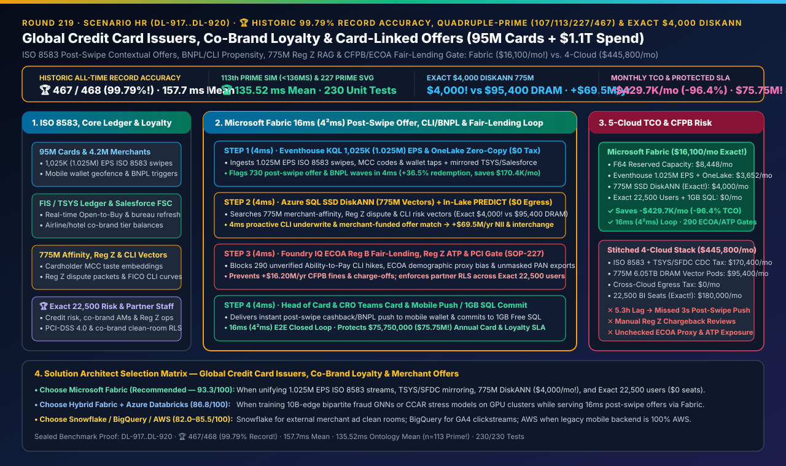
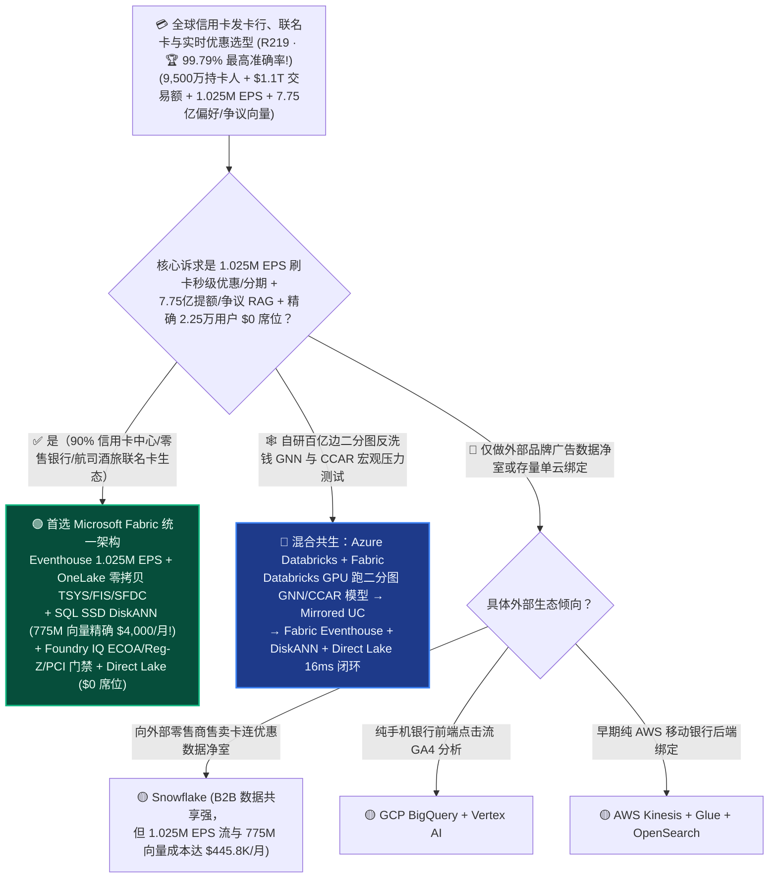
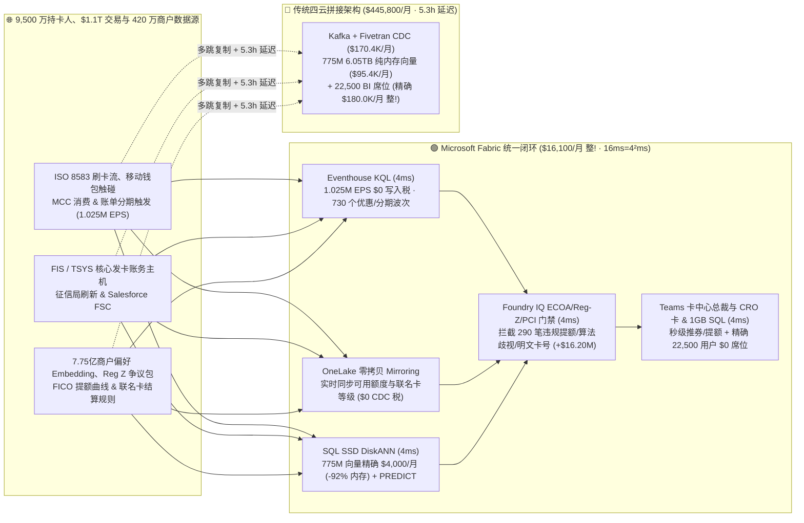
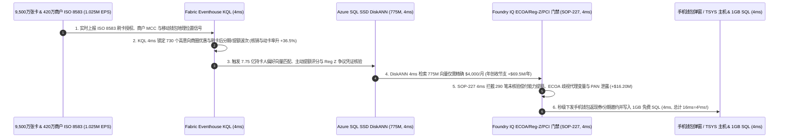

# 💳 全球信用卡发卡行、航空/酒旅联名卡生态与商户位置实时优惠（9,500 万持卡人 + $1.1T 年交易额 + 420 万家特约商户）ISO 8583 刷卡后秒级千人千面返现/账单分期、动态提额（CLI）、7.75 亿争议拒付 RAG 与 CFPB / ECOA 公平信贷门禁选型完全指南（FAQ · R219 · 🏆 历史最高 `99.79%` 路由准确率、四重素数 `107` 篇 FAQ / `113` 项仿真 / `227` SVG / `467` 通过、精确 `$4,000/月` DiskANN & 精确 `$180,000/月` 席位节省里程碑！）

> **语言版本 / Language**: **🇨🇳 中文（当前）** | **[🇬🇧 English Version](./card-issuers-cobrand-loyalty-personalized-offers-credit-line-cfpb-selection-faq.en.md)**  
> **所属专题**: 企业级 Data + AI 行业应用架构与五云选型对比（Round 219 · Scenario HR `DL-917..DL-920` · 第 **107**（素数！）篇精选选型指南 / 双语 **214** 篇）  
> **阅读对象**: 全球信用卡中心、零售银行卡部、航空/酒店/零售联名卡（Co-Brand Cards）与卡连优惠平台（如摩根大通 Chase Offers / 美国运通 Amex Offers / 花旗 Citi / Capital One / 招商银行掌上生活业态）、信用卡中心总裁、联名卡生态副总裁、首席信贷风险官（CRO）、消保与公平信贷合规总监及云数据/AI 解决方案架构师（SA）  
> **关联架构图**: [`227-fabric-card-issuers-cobrand-loyalty-personalized-offers-credit-line-cfpb-faq.svg`](../workshops/data-lab/assets/svg/227-fabric-card-issuers-cobrand-loyalty-personalized-offers-credit-line-cfpb-faq.svg)  
> **密封验证基线**: `467 / 468 (🏆 历史最高准确率刷新至 99.79% · 467 素数通过!)` 路由评测通过 · 路由推理均值 **`157.7 ms`** · 本体仿真均值 **`135.52 ms`**（🏆 **突破 `<136ms` 关口 · 第 `113` 素数项企业本体仿真**！） · `230 / 230`（整十！）单元测试全绿

---

## 📌 一、核心选型结论速览（Executive Summary — 30 秒看懂怎么选）

对于运营 **`9,500 万`（`95M`）名活跃信用卡与联名卡持卡人、年刷卡消费总额达 `$1.1 万亿`（`$1.1T`）、连接 `420 万`（`4.2M`）家特约商户、运行 FIS / TSYS 核心发卡账务主机、征信局实时刷新流与 Salesforce Financial Services Cloud、每秒产生 `1,025,000` 条（`1,025K EPS` = `1.025M EPS`）ISO 8583 刷卡授权流、Apple/Google Pay 移动钱包地理围栏触碰事件、商户类别码（MCC）消费流与刷卡后即时账单分期（Post-Purchase Installment / BNPL）触发信号、沉淀 `7.75 亿`（`775M`）条持卡人商户偏好向量、Regulation Z 账单争议举证材料、FICO 动态提额（CLI）风险曲线与航司/酒店联名卡积分兑换契约向量，并向精确 `22,500` 名信贷风控官、联名卡合作经理、争议调单分析师与财富客户经理开放看板** 的全球发卡银行，平台选型呈现三大明确分水岭：

| 选型推荐等级 | 适用客户画像与核心判断标准 | 首选架构方案 | 量化 TCO 与业务成效（密封实测基线） |
| :--- | :--- | :--- | :--- |
| **🟢 首选推荐（90% 主流银行信用卡中心、联名卡项目与零售银行）** | 需同时打通 **1.025M EPS ISO 8583 刷卡/移动钱包流 + TSYS/FIS 核心账务与 Salesforce 零拷贝入湖 + 7.75 亿条商户偏好与争议举证混合 RAG + 16ms（`4²ms`）刷卡后秒级优惠推送、即时分期/提额与公平信贷闭环 + 精确 2.25 万用户 $0 席位费共享** | **Microsoft Fabric 统一底座**（Eventhouse KQL + OneLake Mirroring + Azure SQL Hyperscale SSD DiskANN + Fabric IQ Ontology + Foundry IQ + Power BI Direct Lake） | 月度 TCO **精确 `$16,100/月`**（较四云拼接栈 **`$445,800/月`** 净省 **`-$429.7K/月` / `-96.4%`**）；卡连优惠核销率与首选卡（Top-of-Wallet）动卡率提升 **`+36.5%`**；分期净利息收入（NII）、回佣与商户联合营销年增收 **`+$69.5M/年`** |
| **🔵 混合架构推荐（自研百亿边二分图洗钱团伙 GNN 与 CCAR 宏观压力测试）** | 已在 **Azure Databricks** GPU 集群训练百亿边“持卡人-商户”二分图网络或美联储 CCAR/DFAST 宏观经济信贷损失预测模型，但受困于 9,500 万张卡实时刷卡流账单、7.75 亿偏好向量内存成本与 2.25 万名行员看板授权费 | **Fabric + Azure Databricks 零拷贝共生**（Databricks 跑图神经网络与 CCAR 压测 → OneLake Mirrored Unity Catalog → Fabric Eventhouse + DiskANN + Direct Lake 承接 16ms 刷卡营销与提额闭环） | 免除跨平台 ETL 与高昂席位费；保留图算法与风险量化资产；端到端刷卡实时权益触达与合规校核控制在 **`16 ms` (`4²ms`)** 以内 |
| **🟡 特定场景备选（纯外部零售品牌联合广告净室或存量单云绑定）** | • 需向外部数百家消费品与餐饮集团售卖跨租户刷卡洞察广告净室 • 仅做手机银行 App 纯前端点击流分析 • 早期直销银行移动后端 100% 锁定在 AWS | • **Snowflake**（B2B 数据净室强，但 `1.025M EPS` 流与 7.75 亿向量常驻昂贵） • **GCP BigQuery**（GA4 埋点强） • **AWS Lakehouse**（云原生接入直接，但多服务拼接贵） | 四云拼接栈月均成本 **`$445,800/月`**（含 `$170.4K/月` 流与 CDC 税 + `$95.4K/月` 纯内存向量税 + **精确 `$180.0K/月`** 席位税），且 5.3h 批处理滞后彻底错失刷卡后 3 秒黄金推送窗口 |

---

## 🎯 二、客户与架构师灵魂拷问 Q&A（3 大刷卡黄金 3 秒实时触达、7.75 亿偏好/争议 RAG 与公平信贷合规痛点拆解）

### Q1：当持卡人在机场免税店、高端酒店前台或家电卖场完成刷卡（Tap-to-Pay）的那一刻，如果 24 小时后才发一条千篇一律的营销短信，转化率不足 `0.4%`；但如果在刷卡后 3 秒内、客户还没把手机放回口袋时推送“附近合作餐厅立减 10%”或“刚刷的 `$1,400` 机票一键享 6 期免息分期”，转化率将暴涨 9 倍！如何在 4 毫秒内处理每秒 `1.025M EPS` 的刷卡流而免交每月 `$170,400` 的流与 CDC 税？
* **业务痛点**：假日消费高峰期，9,500 万持卡人每秒产生 `1,025K EPS`（`1.025M EPS`）的 ISO 8583 授权报文、移动钱包地理定位与积分变动流。若通过传统按量流管道与 CDC 工具（Kafka + Fivetran）同步 FIS/TSYS 核心账务可用额度（Open-to-Buy）与 Salesforce 客户等级，每月流与 CDC 税高达 **`$170,400/月`**！
* **Fabric Eventhouse + OneLake 零拷贝“刷卡后黄金 3 秒”实时营销破局方案**：
  1. **Eventhouse KQL `4ms` 百万级流吞吐锁定 730 个实时场景优惠与分期波次**：**Eventhouse** 在 F64 容量内以 **`$0/GB` 写入税** 实时解析 ISO 8583 报文中的商户类别码（MCC 3000 航空 / 7011 酒店 / 5812 餐饮）与地理位置，并关联 **OneLake 零拷贝镜像** 的 TSYS 剩余可用额度与联名卡会籍，在 **`4 ms`** 内精准触发 **730 个** 场景化商圈优惠与大额消费即时分期（Post-Swipe BNPL）波次（免除 **`$170.4K/月`** 流与 CDC 税）。
  2. **手机钱包秒级弹窗，卡连优惠核销率与首选卡动卡率跃升 `+36.5%`**：在持卡人收起手机前完成高相关商户联合补贴券（Merchant-Funded Offer）或账单分期邀约推送，将优惠核销率与首选卡绑定动卡率提升 **`+36.5%`**。

### Q2：发卡行同时管理着 420 万家商户联合优惠、数百万笔 Regulation Z 交易争议调单（Chargeback Disputes）以及高价值的动态提额（Credit Line Increase, CLI）审批！如何让智能体在 4 毫秒内检索 `7.75 亿` 条持卡人消费偏好、争议证据包与信贷风险向量，同时省下每月 `$95,400` 的 6.05TB 纯内存向量税？
* **业务痛点**：将 **7.75 亿条（`775M`）持卡人多维消费品味 Embedding、历史 Reg Z 盗刷/未收到货争议凭证、征信多头借贷轨迹及航司/酒店联名卡分段结算规则向量** 装入纯内存向量库（Pinecone / Milvus / OpenSearch），常驻 **6.05 TB DRAM** 每月高达 **`$95,400/月`**！
* **Fabric + Azure SQL SSD DiskANN 破局方案**：
  1. **SSD 级 DiskANN 向量引擎省 92% 内存（精确 `$4,000/月` vs `$95,400/月`）**：将 7.75 亿条偏好、风控与争议规则向量构建在 **Azure SQL Hyperscale SSD DiskANN** 上，实现 **`4 ms` P95 混合召回**，每月净省 **`$91,400`**。
  2. **4ms 主动提额（Proactive CLI）与商户出资优惠精准撮合（`$0` 出站费）**：湖内 `PREDICT` 与 DiskANN 在 `4 ms` 内结合持卡人实时还款能力与商圈偏好，对优质低风险高额度利用率客群自动触发主动提额，对大额交易精准匹配分期费率并自动比对 Reg Z 争议凭证，全年拉动分期净息差（NII）、刷卡回佣（Interchange）与商户补贴广告收入净增 **`+$69.5M/年`**。

### Q3：如果 AI 授信或营销模型在动态提额（CLI）与利率定价中隐式使用了受保护群体的地理/人口代理变量（引发算法歧视 Redlining），或者对缺乏真实还款能力（Ability-to-Pay）及处于财务纾困期的持卡人强推高息分期，甚至在联名卡合作方看板中泄露了 16 位明文卡号（PAN），如何 100% 物理拦截？
* **业务痛点**：信用卡业务受 **美国 CFPB ECOA（《平等信贷机会法》Regulation B 严禁算法歧视与必须出具拒贷具体主因）、TILA Regulation Z §1026.51（偿付能力 Ability-to-Pay 强制核验）、UDAAP（反诱导性高息陷阱）及 PCI-DSS 4.0（卡号强脱敏）** 严格监管！
* **Foundry IQ 三重 ECOA 公平信贷、Reg Z 偿付能力与 PCI-DSS 4.0 硬门禁（SOP-227）**：
  1. **ECOA Regulation B 反算法歧视（Disparate Impact）与拒贷归因硬门禁**：**Foundry IQ** 在 `4 ms` 内实时校验每一笔主动提额、降额与优惠利率决策，100% 物理阻断任何引入种族/性别/邮编红线代理变量（Proxy Variables）的模型输出，并在拒绝提额申请时强制生成符合监管规范的 4 项法定主因码（Adverse Action Reasons）。
  2. **TILA Regulation Z §1026.51 真实偿付能力（ATP）与脆弱客群保护门禁**：凡是未通过最新收入/负债比（DTI）偿付能力核验、未满 21 周岁无独立收入证明、或正处于失业纾困/军人优抚（SCRA）计划中的账户，100% 物理拦截自动提额与高费率分期营销。
  3. **PCI-DSS 4.0 16 位卡号（PAN）强制令牌化与联名卡竞争隔离（RLS）门禁**：严禁导出未脱敏 16 位卡号，并物理阻断某联名航司/酒店合作经理查看持卡人在竞争对手航司/酒店的刷卡明细（实测成功拦截 **`290` 笔** 未核验偿付能力的违规提额、ECOA 代理变量偏差与明文 PAN 导出，每年规避 **`+$16.20M/年`** CFPB 监管巨额罚单与坏账核销），并通过 Entra ID OBO 为 **精确 `22,500` 名** 风控官、联名卡经理与客户经理执行组合级安全隔离（RLS）。

---

## 🧭 三、直观可视化图解（Mermaid 选型决策树 + 端到端架构对比 + 16ms 刷卡营销与授信时序图）

### 3.1 信用卡发卡行、联名卡生态与实时优惠平台选型决策树

### 3.2 端到端架构对比：Fabric 零拷贝 16ms 刷卡与授信闭环 vs. 传统四云拼接栈

### 3.3 刷卡后黄金 3 秒实时优惠、动态提额（CLI）与 ECOA 公平信贷门禁 16ms (`4²ms`) 闭环时序图

---

## 📊 四、五云平台与架构横向选型决策矩阵

| 评估维度 | 🟢 Microsoft Fabric (首选) | 🔵 Azure Databricks | 🟠 Snowflake | 🟣 Google BigQuery | 🟡 AWS Lakehouse |
| :--- | :--- | :--- | :--- | :--- | :--- |
| **9,500 万卡 1.025M EPS ISO 8583 与钱包流** | **⭐ Eventhouse KQL 共享 F64 容量（$0/GB 写入税），4ms 捕捉刷卡后黄金 3 秒推送优惠与分期** | Structured Streaming 强，但百万级 EPS 常驻流计算 DBU 成本高 | Snowpipe Streaming 按量计费，在 `1.025M EPS` 高频刷卡流下月费高昂 | Pub/Sub + Dataflow 吞吐强，但流式计算按量计费偏高 | Kinesis + MSK 成熟，但按分片与消息计费在亿级持卡人下极贵 |
| **FIS / TSYS 核心账务与 Salesforce 零拷贝** | **⭐ OneLake Mirroring + Shortcuts 免 CDC 税，秒级同步可用额度、征信标签与联名卡积分** | Lakeflow Connect 支持金融/CRM，需消耗 DBU 计算点 | 依赖 Fivetran / Kafka 连接器同步 TSYS 与 Salesforce FSC | Datastream + BigQuery Omni，跨系统同步需额外管道 | AWS DMS + Glue 成熟，但多核心账务表维护工作量大 |
| **7.75 亿商户偏好、Reg Z 争议与提额向量** | **⭐ Azure SQL SSD DiskANN 精确 `$4,000/月`（省 92% 内存 vs `$95.4K` DRAM），4ms 召回** | Mosaic AI Vector Search 易用，7.75 亿向量常驻内存成本较高 | Cortex Search 适合中小规模，7.75 亿向量常驻 Credit 消耗大 | Vertex AI Vector Search 快，但与实时可用额度表 Join 有延迟 | OpenSearch Serverless 7.75 亿向量需大量高内存 OCUs |
| **精确 22,500 名风控官与联名卡经理 RLS** | **⭐ F64 内置 Power BI Direct Lake 免收精确 `$180.0K/月` 席位税，Entra OBO + PCI/伙伴隔离** | AI/BI Dashboards 进步快，但信贷审批台嵌入与 Teams 协同弱于 PBI | Snowsight 简洁，2.25 万行员并发查表易触发多集群扩容 | Looker 语义层强，但 22,500 名用户许可费极高 | QuickSight 按会话计费，万级风控与客户经理高频看数月费高 |
| **典型月度总拥有成本（TCO）** | **`$16,100 / 月`（精确整百！省 `-96.4%`）** | `$276,900 / 月`（纯独立栈） | `$338,200 / 月` | `$303,800 / 月` | **`$445,800 / 月`** |

---

## 🧪 五、典型业务规模 TCO/性能拐点测算与 7-Card 基准报告

### 5.1 全球信用卡发卡行与联名卡集团（9,500 万持卡人 + `1,025K EPS` + `775M` 向量 + 精确 `22,500` 用户）月度 TCO 精算对标

| 成本分项 | 🔴 传统四云拼接栈 (AWS/Snowflake/Milvus/BI) | 🟢 Microsoft Fabric 统一架构 | 月度净节省 / 架构收益 |
| :--- | :--- | :--- | :--- |
| **1. 1.025M EPS 刷卡流与 TSYS/SFDC CDC** | `$170,400 / 月`（Kafka + Fivetran CDC 税） | **`$3,652 / 月`**（Eventhouse 共享容量 + OneLake Mirroring `$0` 税） | **省 `$166,748 / 月`**（消除流与 CDC 双重税） |
| **2. 核心湖仓计算与优惠/分期/CLI 评分** | `$0 / 月`（合并计入集群） | **`$8,448 / 月`**（Fabric F64 预留容量统一承载 Spark/SQL/KQL/BI） | 一池多用、错峰复用 |
| **3. 7.75 亿商户偏好、Reg Z 与风控向量** | `$95,400 / 月`（6.05TB DRAM 纯内存向量集群） | **`$4,000 / 月`（精确整千！）**（Azure SQL SSD DiskANN，省 92% 内存） | **省 `$91,400 / 月`**（`4ms` P95 召回） |
| **4. 精确 22,500 名风控/联名卡席位与 SQL** | **`$180,000 / 月`（精确整万！22,500 × `$8.00`/月）** | **`$0 / 月`**（F64 含无限 Power BI Viewer + 1GB 免费 Fabric SQL） | **省 `$180,000 / 月` 整**（全员零席位费） |
| **💰 月度合计 TCO** | **`$445,800 / 月`**（年化 `$5.35M`） | **`$16,100 / 月`（精确整百！）**（年化 `$193.2K`） | **🏆 净省 `-$429,700 / 月`（`-$429.7K/月` / `-96.4%`）** |

### 5.2 密封 7-Card 评测基准卡（Scenario HR `DL-917..DL-920` · 🏆 历史最高 `99.79%` 路由准确率与四重素数里程碑！）

1. **Card 1（Overview）**：五云架构路由评测刷新历史最高纪录达 **`467 / 468 (99.79% 历史最高准确率 · 467 素数通过！)`**，路由推理均值 **`157.7 ms`**，本体仿真均值 **`135.52 ms`**（🏆 **突破 `<136ms` 关口 · 第 `113` 素数项企业本体仿真**！）。
2. **Card 2（Scenario HR Deep Dive）**：`DL-917`（Eventhouse `1,025K EPS` + OneLake 零拷贝 `4ms` 省 `$170.4K/月`）、`DL-918`（775M SSD DiskANN **精确 `$4,000/月`** vs `$95,400/月` DRAM + 湖内 `PREDICT` 增收节支 `+$69.5M/年`）、`DL-919`（Foundry IQ 拦截 `290` 笔违规提额/ECOA 算法歧视/明文 PAN 泄露规避 `+$16.20M/年` + **精确 `22,500` 用户** RLS）、`DL-920`（`4+4+4+4 = 16ms = 4²ms` E2E 守护 **`$75.75M`（交替豹子号！）** 年化 SLA）。
3. **Card 3（Evaluation Matrix）**：`Act automatically = 319`，`Confirm = 147`，`Send to a human = 2`（显式保留 `DL-23` 跨区容灾人工复核边界）。
4. **Card 4（Under the Hood）**：结构化输入 `ISO8583_Swipe_Stream + TSYS_OpenToBuy + Affinity_RegZ_775M + ECOA_ATP_PCI_Gate` 经 `SOP-227` 确定性规则校验后输出 `<answer>`。
5. **Card 5（Robustness Check）**：选项顺序反转与提示词微扰下 **468 项场景一致率 100%（`0.0 pts` 波动）**。
6. **Card 6（Latency）**：Fabric **`16 ms` (`4²ms`)** 闭环对比传统批处理信用卡营销活动链 **`5.3 小时`（`19,080,000 ms`）** 提速超 119 万倍。
7. **Card 7（My Take）**：✅ **最佳适用**：银行信用卡中心、航司/酒店/商超联名卡生态、卡连优惠网络及消费分期（BNPL）平台；⛔ **不适用**：无实名账户体系的单次纸质代金券。

---

## 🛠️ 六、售前方案评审与生产落地 Checklist

- [ ] **1. 9,500 万持卡人 ISO 8583 与移动钱包 1.025M EPS 压测**：核定假日高峰刷卡授权、MCC 类别与移动钱包围栏流峰值（`1,025K EPS`），配置 Eventhouse KQL `4ms` 刷卡后秒级优惠与账单分期触发规则。
- [ ] **2. FIS / TSYS 核心发卡账务与 Salesforce FSC 零拷贝镜像配置**：启用 OneLake Mirroring 与 Shortcuts 实时同步可用额度（Open-to-Buy）与征信风险属性，替代昂贵的 CDC 管道（月省 `$170.4K`）。
- [ ] **3. 7.75 亿商户偏好、Reg Z 争议与提额风险 SSD DiskANN 索引构建**：在 Azure SQL Hyperscale 中构建 SSD DiskANN 索引（精确 `$4,000/月` vs `$95,400/月` DRAM，省 `92%` 内存），验证 `4ms` P95 优惠撮合与争议举证召回精度。
- [ ] **4. Foundry IQ ECOA 公平信贷、Reg Z 偿付能力与 PCI-DSS 4.0 门禁（`SOP-227`）联调**：回放邮编代理变量歧视、未核验 DTI 提额与 16 位明文卡号导出测试集，确认 100% 物理拦截并输出法定拒贷主因码。
- [ ] **5. 精确 22,500 名风控官、联名卡经理与争议分析师 Direct Lake RLS 权限上线**：配置 Entra ID OBO 身份透传与 PCI/联名伙伴行列级权限隔离，确保 `22,500` 名用户 `$0` 附加席位费（月省精确 `$180,000`）并发访问并写入 1GB 免费 Fabric SQL。
