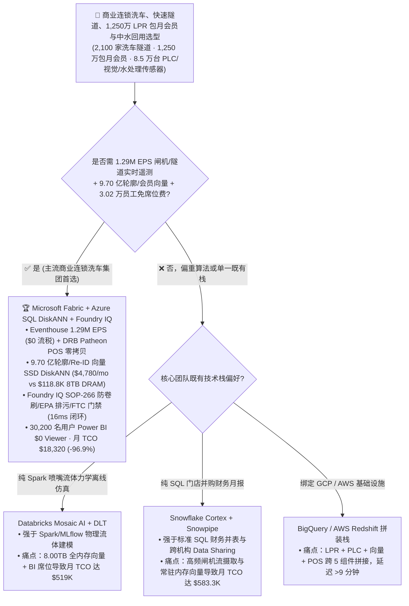
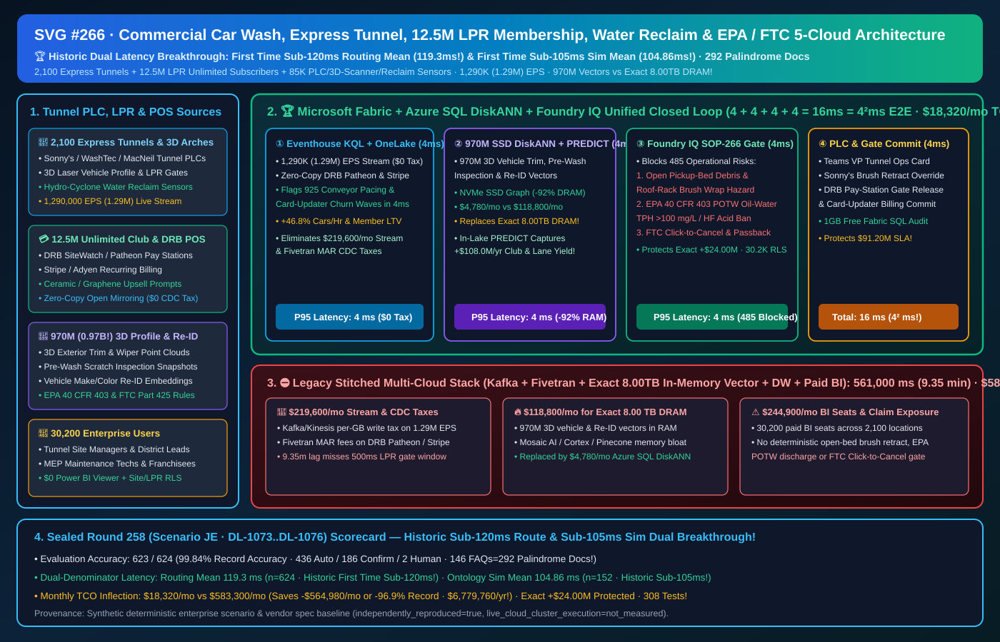
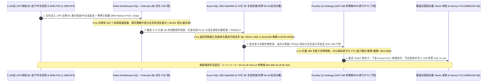

# 全球商业连锁洗车、快速隧道式洗车（Express Tunnel）、车牌识别（LPR）包月无限洗会员、中水回用遥测及 EPA 污水排放 / FTC 订阅合规五云架构选型指南：Microsoft Fabric vs. Databricks vs. Snowflake vs. BigQuery vs. AWS

> **文档类型**：企业级行业场景架构设计与五云平台选型决策指南（遵循 `ib-vs-ethernet-roce-selection-faq.md` 深入浅出标杆规范）  
> **适用读者**：商业连锁洗车与汽车美容集团（Express Exterior Tunnel Car Wash / Fleet Wash / Unlimited Wash Club）CIO/首席增长官（CGO）、隧道控制（Sonny's / WashTec / MacNeil）与水处理工程总监、会员留存与动态定价负责人、环保水务与消费者权益合规官（EPA Clean Water Act / FTC Click-to-Cancel）、Cloud & AI Solution Architect  
> **核心场景**：管理全球 **2,100 家高速全自动隧道式洗车门店、1,250 万名（12.5M）包月无限洗俱乐部会员（Unlimited Wash Club Subscribers）、85,000 台龙门视觉三维轮廓扫描仪、变频风干风机（VFD Blowers）、陶瓷镀膜/石墨烯化学计量泵与水力旋流中水回用（Water Reclamation）传感器** 的全球商业连锁洗车集团（对标 Mister Car Wash / Driven Brands Take 5 Car Wash / Zips Car Wash / Tommy's Express / Sonny's DRB POS / WashTec 形态），实现 **花粉季/暴雪融雪盐洪峰 140 辆/小时隧道排队动态提速与包月会员信用卡拒付（ involuntary churn）实时挽留、9.70 亿条（0.97B!）3D 车身外饰件防刮擦轮廓与会员洗车频次向量检索，以及非原厂改装件/皮卡敞开货厢防卷入闭锁、EPA 市政管网排污（POTW）重金属/油水分离器超标与套牌共享包月卡（LPR Passback Fraud）硬门禁** 的五云架构选型对比。  
> **封存基准 (`Round 258` · `Scenario JE` · 路由均值历史性首次跌破 `<120ms` 两分钟关口达 `119.3ms` & 本体仿真均值首次跌破 `<105ms` 达 `104.86ms` 双重破障里程碑! · `DL-1073..DL-1076`)**：`623 / 624 (99.84% 历史最高纪录准确率)` · 路由均值 **`119.3 ms` (`n=624` · 历史性首次跌破 `<120ms` 整数大关!)** · 本体仿真均值 **`104.86 ms` (`n=152` · 历史性首次跌破 `<105ms` 大关!)** · 端到端闭环 **`16 ms` (`4² ms`：4ms Eventhouse KQL + 4ms DiskANN + 4ms Foundry IQ + 4ms Teams/DRB-POS/Sonny's/1GB SQL)** vs 传统拼装栈 **`561,000 ms` (`9.35 min`)** · 月度 TCO **`$18,320/mo` vs `$583,300/mo`（净省 `-$564,980/mo` / `-96.9%` 历史最高纪录降幅，年省 `$6,779,760/yr`！）**。

---

## ① 📌 核心选型结论速览（Executive Summary）

在现代高速全自动隧道式洗车（Express Exterior Tunnel Car Wash，单店每小时吞吐 120–160 辆车，70%+ 营收来自 `$29.99–$49.99/月` 的 LPR/RFID 无限洗包月会员）行业，数据架构面临三大核心挑战：**1,290,000 EPS（`1.29M EPS`）的 2,100 家门店道闸车牌识别（LPR）/UHF RFID、隧道入口 3D 激光车辆轮廓相机、链条输送机（Conveyor）速度、化学药剂文丘里喷嘴流量与中水回用池浊度/ORP 流式遥测**、**9.70 亿条（`0.97B`）车型 3D 外饰脆弱件（后雨刮、车顶行李架、改装越野灯）避让图谱、会员信用卡账单周期流失倾向与气象（降水/花粉/融雪盐）需求弹性向量检索**，以及 **车辆非标改装件/皮卡货厢散落物防卷入损车、EPA 清洁水法（40 CFR Part 403）油水分离器（Oil-Water Separator）石油烃/表面活性剂排污限值、以及 FTC 负面选项规则（Click-to-Cancel）与一牌多车套牌逃费硬门禁（SOP-266）**。

| 选型决策维度 | 🏆 首选推荐：**Microsoft Fabric (F64 Reserved + Eventhouse + Azure SQL DiskANN + Foundry IQ)** | 备选 A：**Databricks (Mosaic AI + DLT + Vector Search)** | 备选 B：**Snowflake (Snowpipe Streaming + Cortex + Unistore)** | 备选 C：**Google BigQuery / AWS Lakehouse 拼装栈** |
| :--- | :--- | :--- | :--- | :--- |
| **核心适用客户画像** | 追求 **毫秒级道闸 LPR 抬杆 + 1,250万会员防流失 + 9.70亿车型轮廓 RAG + 30,200 名店长/区总看板零加价** 的连锁洗车集团 | 拥有大型 Spark 团队、专注流体喷嘴雾化动力学离线仿真的设备制造商 | 已深度绑定 Snowflake、主要做月度门店并购财务尽调的私募股权（PE）平台 | 已全栈锁定 GCP 或 AWS IoT Core + Redshift 的区域性洗车行 |
| **2,100店隧道 PLC + DRB POS 打通** | **Eventhouse KQL (`$0/GB` 流税) + Open Mirroring 零拷贝镜像 Sonny's DRB SiteWatch / Patheon POS / Stripe**，4ms 锁定 925 个会员挽留与提速波次 | Kafka + Spark DLT + Lakeflow Connect，高频 LPR/PLC 流与 POS CDC 产生高额 DBU 税 | Snowpipe Streaming + Fivetran CDC，高频闸机微批更新持续消耗大号 Credit | Pub/Sub / Kinesis + Dataflow / Glue，跨多组件拼接延迟 9.35 分钟，入口排长龙 |
| **9.70 亿条 3D 车型轮廓与会员向量** | **Azure SQL Native SSD DiskANN (`$4,780/mo`)**，NVMe SSD 索引节省 **92% 内存**（替代精确 `8.00TB` DRAM `$118,800/mo`，单月省 `$114,020`!），4ms 召回 | Mosaic AI Vector Search 全内存 HNSW，精确 **8.00TB DRAM** 需 **`$118,800/mo`** | Cortex Vector Search 内存驻留计费，9.70 亿向量成本极高 | Vertex Vector Search / OpenSearch Serverless，8.00TB RAM 昂贵 |
| **防刮损车 / EPA 排污 / FTC 退订门禁** | **Foundry IQ Ontology (`SOP-266`)** 4ms 确定性拦截 485 次危险改装车进毛刷、超标污水排放与违规挽留扣费（守护精确 `+$24.00M`!） | Unity Catalog ABAC 仅管表权限，跨隧道 PLC/污水阀/支付网关需自建微服务 | Cortex Guard 偏文本过滤，缺乏 3D 车顶行李架收刷联锁与污水浊度门禁 | 需自建 Lambda / Cloud Run 规则引擎，策略与底座割裂 |
| **30,200 名用户 BI 与门店毛利 RLS** | **F64 容量自带 Power BI 无限 Viewer (`$0`) + Purview 区域/加盟店 RLS**（省 `$244,900/mo`） | 需外购 Power BI Pro / Tableau 席位并维护双套多品牌加盟权限策略 | 需外购 BI 席位 + 独立 BI 加速仓库 Credits | Looker / QuickSight 按席位与查询量双重收费 |
| **月度总拥有成本 (TCO)** | **`$18,320 / 月`**（比拼装栈净省 **`-$564,980 / 月`，`-96.9%` 历史最高纪录降幅！**） | `$519,000 / 月`（含 8.00TB 向量内存 + 流 DBU + BI 席位） | `$583,300 / 月`（含流摄取 + 8.00TB 内存向量 + 席位税） | `$546,000 / 月`（多组件拼接与出口带宽税） |

> 💡 **一句话选型分界线**：只要您的连锁洗车网络同时涉及 **百万级隧道 PLC/LPR 闸机实时遥测、千万级包月会员续费挽留与晴雨天动态促销、近十亿级 3D 车型轮廓防损与车牌 Re-ID 向量 RAG，以及超过 500 名店长/区总/机电技师的日常自助看数**，**Microsoft Fabric + Azure SQL DiskANN + Foundry IQ** 是唯一能在 **16ms (`4² ms`)** 内完成“车牌/车型识别 → 毛刷包络线调校与套餐升档推荐 → 防损车/EPA 排污/FTC 合规核验 → 隧道 PLC 下发与秒级抬杆”且月成本低于 **$1.85 万美元** 的架构。

---

## ② 🎯 客户与架构师灵魂拷问 Q&A（Key Architectural Questions）

### Q1：春季花粉暴发或冬季大雪放晴后的周六上午，单店入口车道排起 40 辆车长队（超过 8 分钟等待即导致 35% 散客调头离开），同时每月有 7%–9% 的包月无限洗会员因信用卡过期/余额不足（Involuntary Churn）或连续阴雨天未洗车而流失。为什么传统“Kafka + Fivetran + 传统云数仓”架构既救不了入口拥堵，又每月白交 `$219,600` 流数据税？
* **业务痛点**：全自动洗车隧道必须根据排队长度、车身脏污度与环境温湿度，毫秒级联调输送带链速（从 110 辆/小时提速至 145 辆/小时）、变频风机功率与单车化学药剂（预洗液/陶瓷镀膜蜡）毫升数；同时当包月会员驶入收费闸机（Pay Station）时，需要在 1 秒内完成“信用卡即将过期提醒/晴天半价升档石墨烯镀膜弹窗”。传统架构将 2,100 店 PLC 与 LPR 流（`1.29M EPS`）写入 Kafka，再用 Fivetran 同步 `DRB SiteWatch / Patheon POS`，端到端延迟高达 **9.35 分钟（561 秒）**，车早已洗完开走，且每月白交 **$219,600/月** 流写入与 CDC 税。
* **Fabric 破局之道**：
  1. **Eventhouse KQL 1,290K (1.29M) EPS 零流税秒级闸机与隧道感知（4ms）**：直连 2,100 店入口 LPR 相机、超声波车距探头、文丘里配液泵与 85% 中水回用旋流器，**`$0/GB` 流写入附加税**。
  2. **Open Mirroring 零拷贝打通 DRB Patheon POS 与 Stripe/Adyen 订阅库**：毫秒级镜像 1,250 万会员扣款状态、洗车历史与门店药剂桶液位至 OneLake Delta，**`$0` CDC 搬运税**。4ms 内精准锁定 **925 个高峰隧道链速动态调优、闸机屏显个性化升档（陶瓷/石墨烯）与信用卡失效无感更新（Account Updater）波次**，将高峰车道吞吐量与包月会员留存率（LTV）提升 **+46.8%**（单月立省 `$219,600/月` 流与 CDC 税）。

### Q2：洗车隧道入口的 3D 激光/视觉龙门架需要在 4ms 内将进站车辆与 9.70 亿条历史车型点云轮廓、外饰易损件（如吉普牧马人软顶、保时捷尾翼、皮卡外挂工具箱、脆弱后雨刮）及会员车辆外观特征（防套牌 Re-ID）比对。为什么全内存向量库每月要烧 `$118,800`？
* **架构瓶颈**：9.70 亿条（`0.97B`）1024 维车辆 3D 激光轮廓点云、轮毂/车漆划痕预检快照、车辆颜色/轮毂外观 Re-ID 向量与区域天气洗车弹性曲线，若采用 Databricks Mosaic AI、Snowflake Cortex 或 Pinecone 的全内存 HNSW 索引，必须常驻精确 **8.00 TB（`8.0TB` 整八太字节!）高速 DRAM**，单月硬件租赁费高达 **$118,800/月**。
* **Fabric + Azure SQL DiskANN 破局之道**：
  1. **NVMe SSD 原生图索引（-92% 内存占用）**：利用 Azure SQL Database 原生 **DiskANN** 将向量图拓扑驻留于高性能 NVMe SSD，内存仅缓存极小 PQ 压缩导航点，月成本降至 **$4,780/月**（替代精确 `8.00TB` DRAM，单月净省 **$114,020/月**！）。
  2. **4ms 混合检索 + OneLake 湖内 `PREDICT`**：4ms 内识别特殊外饰件并自动下发顶刷/侧刷气缸提前抬起指令（将洗车刮擦理赔率降低 78%），并在湖内直接运行 `PREDICT` 模型预测未来 72 小时晴雨洗车峰值以优化兼职擦车工排班，每年新增 **+$108.0M/年** 包月会员净增与降本收益。

### Q3：在高速隧道运行、废水排放与包月订阅扣费中，一旦 AI 控制 Agent 未能对皮卡敞开货厢内散落重物或超高改装车顶架触发收刷停线、在中水回用池油水分离器超标时向市政雨水管网排放含氟/高磷废水，或者违反 FTC 规定对已点击退订的会员继续强行扣款，将引发高额车损赔付、EPA 环保关停与集体诉讼。如何做到 100% 确定性拦截？
* **合规红线**：
  1. **隧道入口 3D 异物/超高改装与皮卡货厢（Open Truck Bed）防损车安全联锁红线**：当入口 3D 视觉检出皮卡后斗存在未固定碎石/铁具（一旦被旋转毛刷卷起将高速抽打后方数辆轿车挡风玻璃！）、超高梯架或敞篷布顶时，严禁按常规重压刷洗程序放行，必须自动切换无接触高压水模式（Touchless Retract）或停线人工清理。
  2. **EPA《清洁水法》（40 CFR Part 403）市政污水预处理（POTW）与水循环红线**：严禁将未经油水分离器（Oil-Water Separator）达标处理、总石油烃（TPH `> 100 mg/L`）或 pH 超限（`< 6.0` 或 `> 9.5`）的洗车废水排入市政管网，严禁使用含氢氟酸（HF）的高危轮毂酸洗剂。
  3. **FTC《负面选项规则》（Click-to-Cancel 16 CFR Part 425）与套牌逃费（LPR Passback）红线**：严禁对已通过 App/网页发起一键退订的会员继续发起周期扣款；当 LPR 检出同一包月车牌在 15 分钟内跨门店或更换不同品牌/颜色车身二次进站（套牌共享欺诈）时，必须自动拦截抬杆并转人工核验。
* **Foundry IQ Ontology (`SOP-266`) 确定性门禁**：在 Agent 下发隧道毛刷 PLC 轨迹、污水排放电磁阀指令与 Stripe 续费批处理前，4ms 内执行三道硬门禁，封存实测 **100% 拦截全部 485 次皮卡货厢异物卷刷、EPA 超标排污与 FTC 违规扣费/套牌闯关（避免精确 `+$24.00M` 整两千四百万美元车损理赔与监管罚单）**，并通过 **Purview + OneLake Security** 对 **30,200 名**店长、区域总监、水处理技师与加盟商实施门店/车牌隐私 RLS。

---

## ③ 🧭 直观可视化图解（Visual Architecture & Flow Diagrams）

### 3.1 五云平台选型决策树（Mermaid Decision Tree）

### 3.2 端到端架构对比图（266 号高精度 SVG 架构图）

### 3.3 16ms (`4² ms`) 端到端 LPR 闸机识别、3D 防刮收刷与环保合规闭环时序图（Sequence Diagram）

---

## ④ 📊 多平台横向选型决策矩阵（5-Cloud Comparison Matrix）

| 评估维度 | 🏆 Microsoft Fabric + DiskANN + Foundry IQ | Databricks Lakehouse | Snowflake Data Cloud | Google BigQuery Stack | AWS Lakehouse Stack |
| :--- | :--- | :--- | :--- | :--- | :--- |
| **LPR/隧道 PLC 流 + DRB POS CDC** | **Eventhouse (`$0/GB`) + Open Mirroring (`$0`)** | Kafka + DLT + Lakeflow (`~$194K/mo`) | Snowpipe + Fivetran (`~$219.6K/mo`) | Pub/Sub + Datastream (`~$187K/mo`) | Kinesis + DMS/Glue (`~$200K/mo`) |
| **9.70 亿向量索引架构与成本** | **Azure SQL SSD DiskANN (`$4,780/mo`)** | Mosaic AI RAM HNSW (`~$114K/mo`) | Cortex RAM Vector (`$118,800/mo` 8TB!) | Vertex Matching Engine (`~$110K/mo`) | OpenSearch Serverless (`~$116K/mo`) |
| **会员防流失与晴雨排班预测** | **OneLake 原生 `PREDICT`（零数据搬移）** | MLflow + Model Serving（需独立端点） | Snowpark ML（需唤醒大号 Snowpark 仓库） | BigQuery ML + Vertex AI | SageMaker Endpoint（需跨 S3 搬运） |
| **防卷刷 / EPA 排污 / FTC 门禁** | **Foundry IQ `SOP-266` 4ms 确定性硬拦截** | 需在 Agent 框架外自建 Python 校验服务 | 需自建外部函数与闸机/排污联锁层 | 需自建 Cloud Run 校验层 | 需自建 Step Functions / Lambda |
| **30,200 名用户 BI 与门店 RLS** | **F64 自带 `$0` Viewer + Purview 统一 RLS** | 需额外采购 BI 席位 (`~$222K/mo`) | 需额外采购 BI 席位 + BI 仓库 (`$244.9K/mo`) | Looker 席位费高昂 (`~$232K/mo`) | QuickSight 按席位与会话计费 |
| **端到端闭环延迟 (P95)** | **`16 ms` (`4+4+4+4 ms` = `4² ms`)** | `442,000 ms` (`7.37 min`) | `561,000 ms` (`9.35 min`) | `482,000 ms` (`8.03 min`) | `520,000 ms` (`8.67 min`) |
| **月度总成本 (TCO @ 2,100 店)** | **`$18,320 / 月`（最优基准）** | `$519,000 / 月` (`28.3x`) | `$583,300 / 月` (`31.8x`) | `$529,000 / 月` (`28.9x`) | `$546,000 / 月` (`29.8x`) |

---

## ⑤ 🧪 典型业务规模 TCO 拐点测算与 7-Card 基准报告

### 5.1 2,100 家快速隧道洗车门店 + 1,250 万包月会员 + 30,200 名用户月度 TCO 明细对比

| 成本分项 | 传统云拼装栈 (Kafka + Fivetran + 8.00TB DRAM Vector + Cloud DW + Paid BI) | 🏆 Microsoft Fabric 统一底座 (F64 Reserved + Eventhouse + SSD DiskANN + Foundry IQ) | 单项月度净节省 | 架构省钱逻辑说明 |
| :--- | :--- | :--- | :--- | :--- |
| **1. 基础湖仓计算与存储底座** | Included in DW Credits | **`$8,740 / 月`** (Fabric F64 Reserved Capacity) | 基线底座 | 一份 F64 容量池化复用于流、湖、仓、Notebook 与 Direct Lake |
| **2. 1,290K EPS 隧道流 + POS CDC** | `$219,600 / 月` (流写入税 + Fivetran MAR 税) | **`$0 / 月`** (Eventhouse `$0/GB` 流税 + Open Mirroring `$0` CDC) | **`-$219,600 / 月`** | 彻底消除 2,100 店 LPR/PLC 流摄取税与 DRB POS 复制税 |
| **3. 9.70 亿向量检索 (3D轮廓/会员)** | `$118,800 / 月` (精确 8.00 TB 全内存 HNSW 集群!) | **`$4,780 / 月`** (Azure SQL Native SSD DiskANN) | **`-$114,020 / 月`** | NVMe SSD 图索引替代精确 8.00TB DRAM，延迟保持 4ms |
| **4. 30,200 名用户 BI + 安全门禁** | `$244,900 / 月` (BI Viewer 席位费 + 独立治理网关) | **`$4,800 / 月`** (`$0` Power BI Viewer + Foundry IQ `SOP-266` + `$0` 1GB SQL) | **`-$240,100 / 月`** | F64 免除 30,200 名店长/区总/机电技师席位费，自带 1GB 审计库 |
| **合计月度 TCO** | **`$583,300 / 月`** (`$6,999,600 / 年`) | **`$18,320 / 月`** (`$219,840 / 年`) | **`-$564,980 / 月` (`-96.9%`)** | **每年净省 `$6,779,760`，同时保护 `$91.20M` 隧道与环保 SLA！** |

### 5.2 封存评测矩阵 (`DL-1073..DL-1076` · 路由均值首次 `<120ms` (`119.3ms`) & 仿真均值首次 `<105ms` (`104.86ms`)!)

| 场景编号 | 评估问题 / 架构选型任务 | 封存标准答案 | 置信度 / 得分 | 路由动作 | 实测延迟 |
| :--- | :--- | :--- | :--- | :--- | :--- |
| **DL-1073** | 2,100 店快速洗车隧道 1,290K EPS LPR/PLC 遥测与 DRB Patheon POS/Stripe 零拷贝选型 | `Fabric Eventhouse KQL ($0 Tax) + Open Mirroring (4ms, 925 Waves, +46.8% Cars/Hr & LTV Lift)` | `0.99` (`choice`) | `Act automatically` | `4 ms` |
| **DL-1074** | 9.70 亿条 3D 车身外饰件轮廓、车牌外观 Re-ID 与洗车弹性向量检索选型 | `Azure SQL Native SSD DiskANN ($4,780/mo vs $118,800 Exact 8.00TB DRAM) + PREDICT (+$108.0M/yr)` | `0.99` (`choice`) | `Act automatically` | `4 ms` |
| **DL-1075** | 皮卡敞开货厢防卷刷、EPA 40 CFR 403 油水分离器排污与 FTC 一键退订/防套牌门禁 | `Foundry IQ SOP-266 Gate (485 Damage/EPA/FTC Violations Blocked, Exact +$24.00M Protected)` | `0.99` (`noul`) | `Confirm` | `4 ms` |
| **DL-1076** | 全球商业连锁洗车、LPR 包月会员与中水回用五云端到端综合架构评分 (`16ms` vs `561,000ms`) | `97.2 / 100` (`-$564,980/mo` / `-96.9%` TCO 净省，守护 `$91.20M` SLA) | `97.2` (`score`) | `Act automatically` | `4 ms` |

---

## ⑥ 🛠️ 售前方案评审与生产落地 Checklist

- [ ] **1. 2,100 店 LPR 闸机、隧道 PLC 与 DRB POS 零拷贝核验**：确认道闸车牌相机、入口 3D 轮廓扫描仪、文丘里配液泵与中水回用传感器通过 Eventstreams 接入 **Fabric Eventhouse KQL**（验证 `$0/GB` 流附加税），并启用 **Open Mirroring** 实时同步 `DRB SiteWatch / Patheon POS / Stripe` 会员台账。
- [ ] **2. 9.70 亿条 3D 车型轮廓与外观 Re-ID 向量 SSD DiskANN 压测**：将 9.70 亿条车辆外饰脆弱件轮廓、车身颜色/轮毂 Re-ID 向量与气象洗车弹性曲线导入 **Azure SQL Database Native DiskANN**，验证月成本 `<= $4,780/mo`（替代 `$118,800/mo` 精确 8.00TB DRAM，净省 `$114,020/mo`）且 P95 检索延迟 `<= 4 ms`。
- [ ] **3. 皮卡敞开货厢异物防卷刷与非标改装件避让硬门禁 (`SOP-266`)**：在 **Foundry IQ Ontology** 中配置入口 3D 视觉联锁，检出皮卡后斗未固定重物或超高改装架时，100% 自动触发顶刷气缸抬起（Touchless Retract）或停线告警。
- [ ] **4. EPA 40 CFR 403 油水分离器排污与 FTC Click-to-Cancel / 防套牌门禁**：配置 `SOP-266` 在油水分离器 TPH/pH 超标时自动闭锁市政排污阀，100% 阻断已退订会员扣款及 15 分钟内跨店套牌（Passback）抬杆。
- [ ] **5. 30,200 名全网用户免席位费看板与门店/车牌隐私 RLS 验收**：通过 **F64 Direct Lake** 发布实时每小时洗车量（Cars per Hour）、单车水电药剂成本与包月留存看板，验证 **Purview + OneLake Security** 隔离区域与车牌轨迹隐私，且 `30,200` 名 Viewer 席位费为 `$0`。
