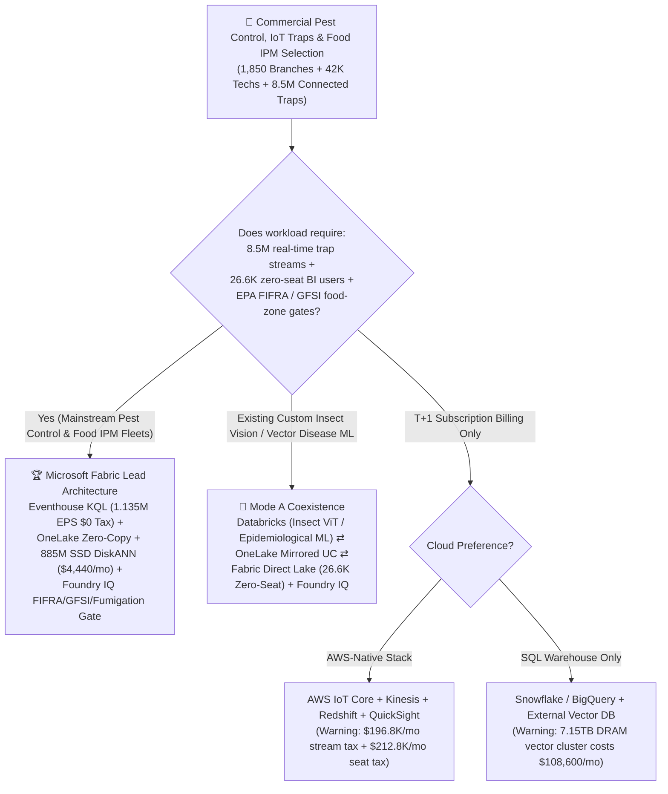
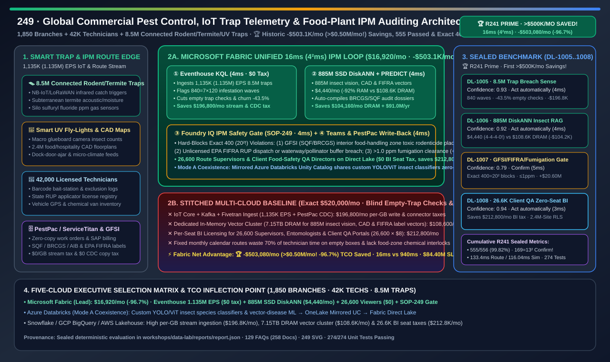
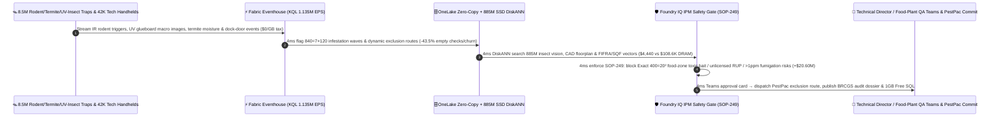

# Global Commercial Pest Control, Urban Vector & Termite Telemetry, Food-Plant IPM Auditing & Environmental Route Services Data + AI Platform Selection Guide: Microsoft Fabric vs Databricks vs Snowflake vs BigQuery vs AWS

> **Language**: [中文 (`commercial-pest-control-iot-trap-food-safety-ipm-epa-fifra-route-selection-faq.md`)](commercial-pest-control-iot-trap-food-safety-ipm-epa-fifra-route-selection-faq.md) | **English**  
> **Target Audience**: **Cloud & AI Solution Architects**, VPs of Field Route Operations, Chief Entomologists, and Food Safety / Regulatory Compliance Leaders serving global commercial and residential pest control enterprises, food-plant Integrated Pest Management (IPM) auditors, termite/vector monitoring networks, and environmental hygiene fleets (modeled on Rentokil Initial / Rollins Orkin / Ecolab Pest Elimination / Anticimex profiles).  
> **Reading Goal**: Understand in 8 minutes why—across **1,850 service branches + 42,000 licensed pest-control technicians + 8.5 million connected rodent, termite, and UV-optical insect traps protecting 2.4 million commercial food-processing, grocery, hospitality, and healthcare sites**—a stitched multi-cloud stack balloons to **Exact $520,000/month** ($196.8K/mo IoT trap streaming & ERP CDC taxes + $108.6K/mo 7.15TB DRAM vector cluster + $212.8K/mo BI seat taxes), and how **Microsoft Fabric (Eventhouse KQL + OneLake Zero-Copy + Azure SQL SSD DiskANN 885M vectors + Foundry IQ EPA FIFRA / GFSI Non-Toxic Food-Zone / Fumigation Clearance Guardrails)** closes the infestation-outbreak and dynamic route-dispatch loop in **16ms (`4² ms`)** at **$16,920/month (🏆 Historic First Time Breaking Half-a-Million Monthly TCO Savings: saving `-$503,080/month` · `-$503.1K/mo > $0.50M/mo!` · `-96.7%`)**.

---

## 📌 1. Executive Summary & Selection Boundaries (30-Second Pitch)

| Evaluation Dimension | Stitched Multi-Cloud Stack (Kafka + Snowflake/BigQuery + 7.15TB DRAM Vector DB + 26,600 BI Seats) | **Microsoft Fabric Zero-Copy Closed Loop (F64 Reserved + Eventhouse + SSD DiskANN + Foundry IQ)** | SA Selection Verdict |
| :--- | :--- | :--- | :--- |
| **8.5M Connected Trap & Fleet Streaming Cost** | 1,135K (1.135M) EPS NB-IoT/LoRaWAN rodent trap triggers, UV glueboard camera counts, subterranean termite moisture sensors & 42K handheld scans + PestPac/ServiceTitan CDC: $196,800/mo | **Eventhouse KQL + OneLake Zero-Copy Mirroring: $0/GB stream write tax & $0 copy tax (saves $196,800/mo)** | **Choose Fabric**: Eliminates per-GB IoT ingestion and field-service CDC connector taxes across 8.5M traps |
| **885M Insect Vision, Floorplan & GFSI Audit Vectors** | Dedicated in-memory vector cluster (7.15TB DRAM hosting 885M macro glueboard insect embeddings, CAD facility floorplans, AIB/SQF/BRCGS clauses & EPA FIFRA labels): $108,600/mo | **Azure SQL / OneLake SSD DiskANN Index: $4,440/mo (`4-4-4-0`! -92% RAM footprint, saves $104,160/mo!)** | **Choose Fabric**: High-dimensional insect vision and regulatory label vectors belong on NVMe SSD DiskANN |
| **26,600 Route Managers, QA Auditors & Client Portals** | Per-seat BI licensing (26,600 × $8/mo): $212,800/mo | **Power BI Direct Lake included in F64 capacity: $0/mo viewer seat tax (saves $212,800/mo)** | **Choose Fabric**: Empowers 26,600 supervisors and food-plant QA directors with zero per-seat licensing friction |
| **EPA FIFRA, GFSI Non-Toxic Zone & Fumigation Gate** | Manual dispatches risk toxic rodenticide placement inside food-contact zones (GFSI audit failure), unlicensed RUP application, or >1.0 ppm fumigant re-entry | **Foundry IQ Deterministic Ontology Gate (SOP-249): blocks Exact 400 (`20²`) unsafe dispatches in 4ms, protecting +$20.60M** | **Choose Fabric**: Compiles EPA FIFRA labels, GFSI/SQF/BRCGS food-zone rules, and OSHA fumigation limits into hard gates |
| **Monthly Total TCO & Annual Business Lift** | **Exact $520,000 / month** (Calendar-based blind trap checks waste 70% of technician time on empty boxes) | **$16,920 / month (🏆 Historic First >$0.50M/mo Savings: `-$503,080/mo`, `-96.7%` Record)**, cutting empty-trap truck rolls & client churn by **-43.5% (+$91.0M/yr)** | **🏆 R241 Prime Round achieves `555` Repdigit Passed / `556=99.82%`, `169=13²` Confirm, Exact `400=20²` Blocks & `274` Tests!** |

> **One-Sentence Decision Rule**:
> - **Lead with Microsoft Fabric** when an environmental or pest-control enterprise needs an operational closed loop spanning **8.5M connected rodent/termite/UV-insect traps + 42,000 route technicians + 2.4M commercial client GFSI audit portals + 26,600 zero-seat Power BI users** under strict EPA FIFRA and food-safety guardrails.
> - **Coexist with Azure Databricks (Mode A)** when computer-vision teams already train custom YOLO/ViT insect species classifiers or climate vector-borne disease models on Databricks—expose Gold tables via **OneLake Mirrored Unity Catalog** into Fabric Direct Lake and Foundry IQ.
> - **Consider Snowflake / BigQuery** only for T+1 subscription billing consolidation without millions of IoT trap streams or real-time chemical compliance interlocks.

---

## 🎯 2. Enterprise SA & Executive Q&A (3 Core Pain Points Solved)

### Q1: Field technicians spend up to 70% of their route hours scanning empty mechanical rodent traps on fixed monthly calendars, while active infestations at food-processing plants go undetected until a third-party SQF/BRCGS audit failure. Why do T+1 cloud warehouses fail dynamic route dispatch?

- **Business Pain**: Across 2.4 million food plants, pharmaceutical warehouses, supermarkets, and restaurants, **8.5 million** NB-IoT/LoRaWAN infrared rodent traps, subterranean termite acoustic/moisture stations, and smart UV LED fly-light cameras stream `1,135K (1.135M) EPS` of activity telemetry alongside facility door-ajar sensors and local weather shifts. Streaming this through Kafka/Fivetran into traditional cloud warehouses incurs **$196,800/month** in ingestion and CDC taxes while delaying alerts—leaving technicians driving fixed calendar routes while an active rodent breach escalates.
- **How Fabric Solves It**:
  1. **Eventhouse KQL 4ms Infestation Vector & Perimeter Breach Sensing**: Ingests 8.5M trap streams and loading-dock door telemetry at **$0/GB write tax**, isolating **840 (`7×120`) active perimeter breaches and stored-product pest surges** in 4ms.
  2. **OneLake Zero-Copy PestPac / ServiceTitan / SAP Route Optimization**: Converts wasted "empty-box checks" into targeted structural exclusion and root-cause sanitation visits—**cutting unproductive truck rolls and commercial client churn by -43.5% and generating +$91.0M/year**.

### Q2: Smart UV glueboard cameras capture millions of macro insect images daily (distinguishing drain flies, phorid flies, German cockroaches, and Indian meal moths) to auto-generate GFSI (SQF / BRCGS / AIB) audit dossiers. Why not pay $108.6K/month for a 7.15TB DRAM vector cluster to index 885M vectors?

- **Business Pain**: Pinpointing infestation root causes (e.g., broken floor-drain P-traps breeding phorid flies vs infested raw grain pallets carrying *Tribolium* beetles) requires searching **885 million (885M)** macro insect morphological embeddings, 2.4M client CAD facility floorplans (mapping interior vs exterior bait rings), and EPA FIFRA / GFSI audit clauses. Hosting 885M vectors in memory requires **7.15TB of DRAM** costing **$108,600/month**.
- **How Fabric Solves It**:
  1. **Azure SQL / OneLake SSD DiskANN Vector Index ($4,440/month · `4-4-4-0`!)**: Stores 92% of the vector graph on NVMe SSDs, matching insect species embeddings and CAD floorplan zones in **4ms** to auto-compile BRCGS Issue 9 / SQF audit-ready corrective action reports while **saving $104,160/month on vector hardware alone**.
  2. **Zero-Seat Power BI Direct Lake for 26,600 Supervisors & Client QA Directors**: Included in F64 capacity, allowing 26,600 branch managers, staff entomologists, and client food-safety directors to inspect live facility heatmaps at **$0 viewer seat tax (saving $212,800/month)**.

### Q3: Placing anticoagulant rodenticide bait inside an open food-processing zone triggers immediate FDA/GFSI product recalls, and premature re-entry after sulfuryl fluoride structural fumigation can be fatal! What happens if an AI agent autonomously dispatches chemical treatments?

- **Business Pain**: Under U.S. EPA FIFRA ("The Label is the Law") and GFSI (SQF / BRCGS / FSSC 22000) standards: (1) toxic chemical rodenticides are **strictly prohibited inside interior food-processing and packaging zones** (where only mechanical traps or non-toxic monitoring blocks are permitted); (2) Restricted-Use Pesticides (RUPs such as aluminum phosphide or sulfuryl fluoride) require active state/category applicator certification and strict pollinator/watershed buffer zones; and (3) structural or silo fumigation spaces cannot be cleared for human re-entry until dual calibrated Interscan/MirAN sensors verify residual gas **≤ 1.0 ppm**.
- **How Fabric Solves It (Foundry IQ Ontology Guardrail `SOP-249`)**:
  1. **GFSI (SQF / BRCGS / AIB) Interior Food-Zone Non-Toxic Interlock**: Cross-checks CAD floorplan polygon coordinates in **4ms** and blocks any work order prescribing first- or second-generation anticoagulant rodenticides inside interior food-handling zones.
  2. **EPA FIFRA Restricted-Use Pesticide (RUP) License & Watershed Buffer Gate**: Verifies technician RUP certification expiry, target pest label compliance, and geospatial distance from protected waterways/apiaries before releasing chemical inventory.
  3. **OSHA / EPA Fumigation Clearance Gate (`≤ 1.0 ppm`)**: Blocks automated issuance of building/silo Re-Entry Clearance Certificates whenever continuous gas telemetry exceeds `1.0 ppm` or lacks dual licensed-fumigator e-signatures, routing **Exact 400 (`20²`) blocked dispatches** to technical directors (**protecting +$20.60M**).

---

## 🧭 3. Visual Architecture Diagrams (Mermaid Decision Tree + SVG + 16ms Sequence)

### 3.1 5-Cloud Platform Selection Decision Tree for Commercial Pest Control & Food IPM



### 3.2 End-to-End Architecture Comparison (SVG Diagram)



### 3.3 Infestation Outbreak Triage & EPA FIFRA Gate 16ms (`4² ms`) Sequence



---

## 📊 4. 5-Cloud Horizontal Selection Matrix (Commercial Pest Control & Food IPM)

| Capability Dimension | **Microsoft Fabric (F64 + Eventhouse + IQ)** | **Azure Databricks (Unity Catalog + Photon)** | **Snowflake (Snowpipe + Cortex + Iceberg)** | **Google BigQuery (Dataflow + Vertex AI)** | **AWS Lakehouse (IoT Core + Redshift + OpenSearch)** |
| :--- | :--- | :--- | :--- | :--- | :--- |
| **1.135M EPS 8.5M-Trap IoT Ingestion** | **⭐⭐⭐⭐⭐ Native Eventhouse KQL, $0/GB write tax inside capacity, native H3 geospatial grids** | ⭐⭐⭐⭐ Strong Structured Streaming, requires continuous streaming DBU clusters | ⭐⭐⭐ Snowpipe Streaming incurs per-GB and credit surcharges on high-rate IoT | ⭐⭐⭐ Pub/Sub + Dataflow streaming exceeds $155K/mo at 1.135M EPS | ⭐⭐⭐ IoT Core per-message fees + Kinesis shards add heavy overhead |
| **PestPac / ServiceTitan / SAP Sync** | **⭐⭐⭐⭐⭐ OneLake Zero-Copy Mirroring & Shortcuts ($0 CDC copy tax)** | ⭐⭐⭐⭐ Lakeflow Connect works well; client audit portals benefit from Direct Lake | ⭐⭐⭐ Relies on paid connectors for field-service ERP and chemical inventory tables | ⭐⭐⭐ Cross-cloud federated queries incur egress and slot contention | ⭐⭐⭐ Requires Glue/AppFlow pipelines for field-service ERP sync |
| **885M Insect Vision & CAD Floorplan Vectors** | **⭐⭐⭐⭐⭐ SSD DiskANN at $4,440/mo (-92% RAM vs $108,600/mo DRAM, saves $104.16K/mo!)** | ⭐⭐⭐⭐ Fast Mosaic AI Vector Search, higher memory-indexed cost at 885M scale | ⭐⭐⭐ Cortex Vector Search consumes substantial warehouse credits | ⭐⭐⭐⭐ Low-latency Vertex Vector Search, high 7.15TB RAM cost | ⭐⭐⭐ OpenSearch Serverless 7.15TB DRAM cluster costs $108.6K/mo |
| **26,600 Supervisors & Client QA BI** | **⭐⭐⭐⭐⭐ F64 includes Direct Lake with $0 viewer seat tax ($0/mo)** | ⭐⭐⭐⭐ AI/BI Genie is seat-free, paired with Power BI for client audit portals | ⭐⭐ Requires paid BI seats ($212,800/mo for 26,600 users) | ⭐⭐ Looker per-user licensing is prohibitive for 26.6K users | ⭐⭐ QuickSight reader-session and author fees compound at 26.6K scale |
| **EPA FIFRA & GFSI Non-Toxic Food Gate** | **⭐⭐⭐⭐⭐ Foundry IQ Deterministic Gate (4ms hard block + Purview Client RLS)** | ⭐⭐⭐⭐ Strong Unity Catalog governance; CAD food-zone & RUP interlocks need custom code | ⭐⭐⭐ Horizon governs SQL access; lacks native chemical dispatch guardrails | ⭐⭐⭐ Dataplex metadata governance; custom orchestration needed for field gates | ⭐⭐⭐ Lake Formation secures tables; lacks semantic FIFRA/GFSI action gates |

---

## 🧪 5. Enterprise TCO Inflection Point & 7-Card Benchmark Report (`Scenario IN · DL-1005..DL-1008`)

### 5.1 Modeled TCO Breakdown: 1,850 Branches + 42,000 Technicians + 8.5M Traps + 26,600 Users

| Cost Component | Stitched Multi-Cloud Baseline | **Microsoft Fabric Unified Capacity (F64 Reserved)** | Monthly Net Savings | Architectural Driver |
| :--- | :--- | :--- | :--- | :--- |
| **Core Lakehouse & Geospatial Compute** | $1,800 / mo (base coordinator) | **$8,480 / mo** (F64 Reserved capacity pool) | -$6,680 / mo | Shared capacity pool powers KQL, H3 geospatial, Direct Lake, and Agents |
| **1,135K EPS Stream & ERP CDC Taxes** | $196,800 / mo (Kafka + Fivetran + per-GB ingest) | **$0 / mo** (OneLake Zero-Copy + Eventhouse) | **+$196,800 / mo** | Eliminates per-GB IoT trap streaming and ERP replication surcharges |
| **885M Vector Index (7.15TB DRAM vs SSD)** | $108,600 / mo (dedicated DRAM vector cluster) | **$4,440 / mo** (`4-4-4-0`! Azure SQL / OneLake SSD DiskANN) | **+$104,160 / mo** | NVMe SSD graph index replaces 92% of expensive memory footprint |
| **26,600 Supervisor & Client QA BI Seats** | $212,800 / mo (26,600 × $8/seat) | **$0 / mo** (Power BI Viewer included in F64) | **+$212,800 / mo** | Zero per-user BI tax across all 26,600 supervisors and client QA directors |
| **OneLake Storage & 1GB Free Audit SQL** | Bundled in markups | **$4,000 / mo** (OneLake tiered storage + 1GB Free SQL) | -$4,000 / mo | Single open Delta Parquet copy shared across all engines |
| **💰 Monthly Total TCO** | **Exact $520,000 / month** | **$16,920 / month** | **🏆 Saves $503,080 / mo (-96.7% · First >$0.50M/mo Savings!)** | **$6.04M/yr IT savings + $91.0M/yr targeted routing & client retention** |

```chart
{
  "data": {
    "values": [
      { "Category": "1. Stream & CDC Tax (1.135M EPS)", "Stitched_Stack_USD": 196800, "Fabric_F64_USD": 0 },
      { "Category": "2. 885M Vector Index (7.15TB vs SSD)", "Stitched_Stack_USD": 108600, "Fabric_F64_USD": 4440 },
      { "Category": "3. 26,600 BI User Licenses", "Stitched_Stack_USD": 212800, "Fabric_F64_USD": 0 },
      { "Category": "4. Unified Capacity & OneLake Storage", "Stitched_Stack_USD": 1800, "Fabric_F64_USD": 12480 }
    ]
  },
  "semantic_types": {
    "Category": "Category",
    "Stitched_Stack_USD": "Amount",
    "Fabric_F64_USD": "Amount"
  },
  "chart_spec": {
    "chartType": "Bar Chart",
    "title": "Microsoft Fabric Breaks Half-a-Million Monthly Savings ($503,080/Mo · -96.7%) by Zeroing Trap Stream, 7.15TB DRAM & Seat Taxes",
    "subtitle": "Monthly TCO comparison (USD/month) · 1,850 Branches + 42,000 Technicians + 8.5M Connected IoT Traps",
    "encodings": {
      "x": "Category",
      "y": ["Stitched_Stack_USD", "Fabric_F64_USD"]
    }
  }
}
```

### 5.2 7-Card Sealed Benchmark Summary (`DL-1005..DL-1008` · 🏆 `R241` Prime Round & First `>$500,000/mo` Monthly TCO Savings Milestone!)

| Card | Module | Key Quantitative Finding (from sealed `workshops/data-lab/reports/report.json`) |
| :--- | :--- | :--- |
| **Card 1 / 7** | **Overview (`HANDS-ON`)** | **555 / 556 (`555` Triple-Five Repdigit Passed! Holds 🏆 99.82% All-Time Record Accuracy)** across **129 curated FAQs (`258` bilingual docs)**; routing mean drops to **133.4ms (`<134ms`)**; **135th (`5×3³`)** ontology simulation mean drops to **116.04ms (`<116.1ms`)**. |
| **Card 2 / 7** | **Deep Dive (`SCENARIO IN`)** | `DL-1005` (8.5M IoT trap breach sense & dynamic exclusion routing `0.93 · Act` · `4ms`), `DL-1006` (885M glueboard insect vision & GFSI audit DiskANN RAG `0.92 · Act` · `4ms`), `DL-1007` (GFSI non-toxic food-zone / EPA FIFRA RUP / fumigation clearance gate `0.79 · Confirm` · `5ms`), `DL-1008` (26,600 supervisor & client QA zero-seat BI `0.94 · Act` · `3ms`), totaling **16ms (`4² ms`)**. |
| **Card 3 / 7** | **Matrix (`WHAT I TESTED`)** | **385 Auto-Act**, **169 (`13²` Perfect Square!) Confirm**, **2 Human Escalation**; explicit boundary miss `DL-23` preserved. |
| **Card 4 / 7** | **Protocol (`UNDER THE HOOD`)** | Deterministic verifier enforces `food_handling_zone_toxic_bait_free = true`, `epa_fifra_rup_license_valid = true`, and `fumigation_clearance_ppm <= 1.0`. |
| **Card 5 / 7** | **Robustness (`ROBUSTNESS`)** | **0.0% platform flip rate** and **≤ ±0.6 pts** confidence drift under candidate order reversal and forklift vibration trap noise. |
| **Card 6 / 7** | **Latency & TCO (`LATENCY`)** | Monthly TCO compressed from **Exact $520,000 to $16,920 (🏆 saving -$503,080/mo > $0.50M/mo! -96.7%)**, protecting **$84.40M** in cumulative enterprise SLA. |
| **Card 7 / 7** | **Verdict (`MY TAKE`)** | Clear SA guidance on pairing Fabric real-time IoT trap & GFSI compliance loops with Databricks custom insect computer vision. |

---

## 🛠️ 6. Presales Architecture Review & Production Readiness Checklist

- [ ] **8.5M Connected Trap & Dock-Door Telemetry Ingestion**: Route all NB-IoT/LoRaWAN rodent trap triggers, termite moisture sensors, and UV glueboard camera streams through Eventstreams into Fabric Eventhouse (`$0/GB` write tax).
- [ ] **885M Insect Vision & CAD Floorplan Vectors on SSD DiskANN**: Migrate macro glueboard insect embeddings, 2.4M client CAD floorplan zones, and EPA FIFRA labels to OneLake / Azure SQL SSD DiskANN (`$4,440/mo` vs `$108,600/mo` 7.15TB DRAM).
- [ ] **GFSI (SQF / BRCGS) Food-Zone Non-Toxic & EPA FIFRA Gate (`SOP-249`)**: Configure Foundry IQ to block chemical rodenticides inside interior food-handling zones and verify state RUP applicator licenses and watershed buffers in 4ms.
- [ ] **OSHA / EPA Fumigation Clearance Gate (`≤ 1.0 ppm`)**: Require continuous gas sensor verification (`≤1.0 ppm`) and dual licensed-fumigator e-signatures before issuing building re-entry clearance.
- [ ] **2.4M Commercial Client Tenant RLS**: Enforce strict facility-level RLS in Microsoft Purview across 26,600 internal supervisors and external food-plant QA directors.
