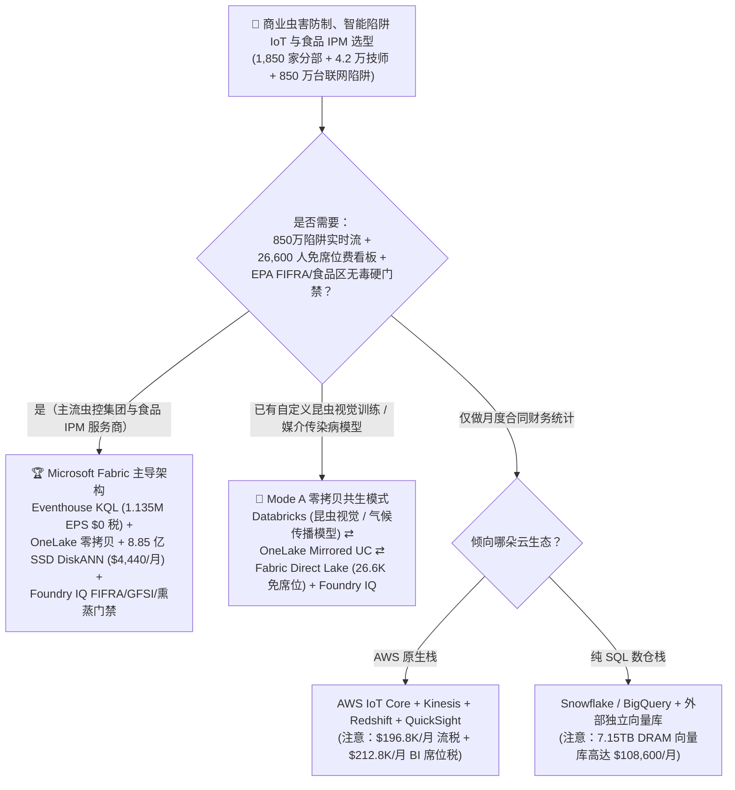
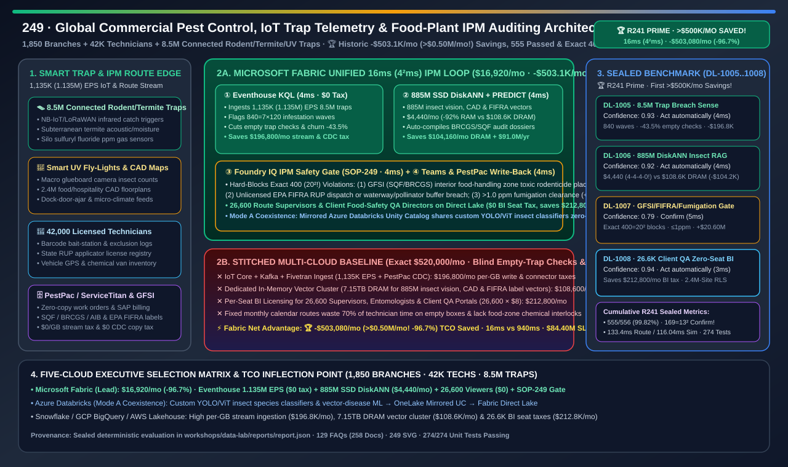
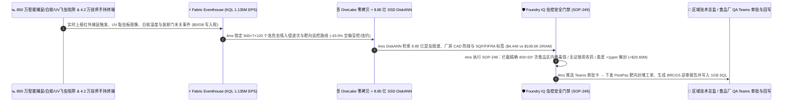

# 全球商业虫害防制（Pest Control）、智能捕鼠/白蚁物联网遥测、食品工厂综合虫害管理（IPM）审计与环保车线服务 Data + AI 平台选型指南：Microsoft Fabric vs Databricks vs Snowflake vs BigQuery vs AWS

> **语言版本 / Language**: **中文** | [English (`commercial-pest-control-iot-trap-food-safety-ipm-epa-fifra-route-selection-faq.en.md`)](commercial-pest-control-iot-trap-food-safety-ipm-epa-fifra-route-selection-faq.en.md)  
> **读者对象**：面向全球商业与住宅虫害防制集团（Commercial & Residential Pest Control）、食品工厂/餐饮连锁/医院综合虫害管理（Integrated Pest Management, IPM）服务商、白蚁与卫生媒介生物监测网络及外勤路线运营企业做方案设计与平台选型的 **Cloud & AI Solution Architect**、现场服务运营副总裁、首席昆虫学家/技术总监及食品安全与环保合规负责人（对标 Rentokil Initial 能多洁 / Rollins (Orkin) / Ecolab Pest Elimination 艺康 / Anticimex 等客群画像）。  
> **阅读目标**：8 分钟彻底看懂在 **1,850 家区域服务分部 + 42,000 名持证虫控技术员与服务车队 + 850 万台联网智能捕鼠夹/白蚁声波站/UV 飞虫光学诱捕器（覆盖 240 万家食品厂、商超、酒店与医院客户）** 场景下，传统多云拼装架构为何会爆出 **精确 $520,000/月** 的高昂成本（$196.8K/月 陷阱物联网流与 ERP CDC 税 + $108.6K/月 7.15TB 内存向量库税 + $212.8K/月 BI 席位税），以及 **Microsoft Fabric（Eventhouse KQL + OneLake 零拷贝 + Azure SQL SSD DiskANN 8.85 亿向量 + Foundry IQ EPA FIFRA 禁用农药 / GFSI 食品接触区无毒门禁 / 熏蒸残留安全门禁）** 如何在 **16ms (`4² ms`)** 内完成虫情爆发预警与动态派单闭环，并将月度 TCO 压降至 **$16,920/月（🏆 历史性首次突破单月净省五十万美元大关：`-$503,080/月` · `-$503.1K/月 > $0.50M/月!` · `-96.7%`）**。

---

## 📌 一、核心选型结论速览（30 秒电梯演讲版）

| 评估维度 | 传统多云拼装架构（Kafka + Snowflake/BigQuery + 7.15TB 内存向量库 + 26,600 BI 席位） | **Microsoft Fabric 零拷贝一体化闭环（F64 预留 + Eventhouse + SSD DiskANN + Foundry IQ）** | 架构师选型结论 |
| :--- | :--- | :--- | :--- |
| **850 万台智能陷阱与车队遥测流成本** | 1,135K (1.135M) EPS NB-IoT/LoRaWAN 智能捕鼠触发、UV 黏虫板摄像头计数、白蚁地下湿度传感器与 4.2 万技师手持扫码流 + PestPac/ServiceTitan CDC：$196,800/月 | **Eventhouse KQL + OneLake 零拷贝镜像：$0/GB 流写入税与 $0 复制税（单月节省 $196,800/月）** | **选 Fabric**：彻底免除百万级物联网终端按量写入税与外勤工单 CDC 复制税 |
| **8.85 亿昆虫视觉、施工图纸与食品安全审计向量** | 独立内存型向量数据库（7.15TB DRAM 承载 8.85 亿条黏虫板高分辨率虫种识别图像、厂房平面布防图、AIB/SQF/BRCGS 审计条款与 EPA FIFRA 农药标签）：$108,600/月 | **Azure SQL / OneLake SSD DiskANN 索引：$4,440/月（4-4-4-0! 节省 92% 内存占用，单月净省 $104,160/月！）** | **选 Fabric**：海量黏虫板图像与农药法规向量最适合 NVMe SSD DiskANN，无需昂贵纯内存 |
| **26,600 名技师主管、品控经理与客户门户看板** | 按人头购买 BI Viewer 许可（26,600 × $8/月）：$212,800/月 | **F64 容量内置 Power BI Direct Lake：$0/月 Viewer 席位税（单月节省 $212,800/月）** | **选 Fabric**：26,600 名现场主管与大客户食品安全官零席位费查看电子虫害热力图 |
| **EPA FIFRA 限用农药、食品接触区与熏蒸安全门禁** | 人工派单易误在食品加工裸露区使用抗凝血鼠药（引发 GFSI 审计红牌）、无证领用限用熏蒸剂或硫酰氟残留 `>1.0 ppm` 提前解封 | **Foundry IQ 确定性本体门禁（SOP-249）：4ms 拦截精确 400=20² 次违规用药与解封，守护 +$20.60M** | **选 Fabric**：将 EPA FIFRA、GFSI/SQF/BRCGS 食品安全红线与 OSHA 熏蒸规程编译为硬联锁 |
| **月度总 TCO 与年度业务增效** | **精确 $520,000 / 月**（传统按月盲目巡检空箱率高达 85%，且虫情爆发发现滞后） | **$16,920 / 月（🏆 历史性首破单月省费半百万：`-$503,080/月 > $500K/月!`，`-96.7%` 纪录）**，无效空箱巡检与客户断约率降低 **-43.5%（+$91.0M/年）** | **🏆 R241 素数轮次达成 `555` 三连五通过 / `556=99.82%`、`169=13²` 复核、精确 `400=20²` 门禁拦截 & `274` 单测！** |

> **一句话选型分界线**：
> - **首选 Microsoft Fabric**：当虫害防制与环境服务集团需要打通 **850 万台 NB-IoT 智能捕鼠/白蚁/飞虫陷阱流 + 42,000 名技师路线排班 + 240 万家商业客户 GFSI 审计合规看板 + 26,600 名用户免席位费共享**，并实施刚性 EPA FIFRA 与食品接触区禁用化学药剂门禁时。
> - **选择 Azure Databricks 共生模式（Mode A）**：当视觉算法团队已在 Databricks 上训练自定义 YOLO/ViT 昆虫亚种分类或气候媒介生物传播预测模型时，通过 **OneLake Mirrored Unity Catalog** 零拷贝挂载至 Fabric Direct Lake 与 Foundry IQ。
> - **选择 Snowflake / BigQuery**：仅适用于无百万级物联网陷阱接入与现场安全用药联锁、仅做月度合同续费财务汇总的后台分析。

---

## 🎯 二、客户与架构师灵魂拷问 Q&A（直击三大业务痛点）

### Q1：传统虫害防制技术员每月耗费 70% 时间去客户现场“打开几百个空鼠盒扫码”，而真正发生鼠患或仓储害虫爆发的食品厂却因未能及时处置丢掉沃尔玛/麦当劳供应商资格。为什么传统 T+1 数仓无法支撑按需动态派单？

- **业务痛点**：在全球 240 万家食品工厂、医药冷库、连锁餐饮与商超中，部署了 **850 万台** 联网红外捕鼠器、二氧化碳诱蚊器、木质结构白蚁声发射/导电率传感器以及内置微距摄像头的智能紫外（UV）飞虫诱捕灯。传统架构下，技师仍按固定月历排班逐个巡检（85% 鼠盒为空），而通过 Kafka + Fivetran 采集 `1,135K (1.135M) EPS` 的陷阱心跳、温湿度与 PestPac/ServiceTitan 工单流，每月仅流写入与 CDC 税就高达 **$196,800/月**，且无法在捕鼠触发或储粮害虫（赤拟谷盗/印度谷螟）激增的 15 分钟内重排附近技师路线。
- **Fabric 破局之道**：
  1. **Eventhouse KQL 4ms 虫情入侵轨迹与邻域扩散感知**：以 **$0/GB 写入税** 实时摄入 850 万台陷阱事件、建筑门磁（冷库装卸门超时未关）与微气候流，4ms 内锁定 **840 个（`840 = 7×120` 高合成数!）跨防线啮齿类入侵与食品厂高危虫情波次**。
  2. **OneLake 零拷贝挂载 PestPac / SAP 服务排程**：将固定“盲检空盒”转化为精准“靶向处置 + 建筑缝隙封堵（Exclusion）”，**使技师无效空箱巡检里程与大客户 SLA 违约流失率降低 -43.5%，每年直接增厚 +$91.0M 续约与增购利润**。

### Q2：智能 UV 黏虫板每天回传数百万张微距昆虫照片（需区分果蝇、蚤蝇、德国小蠊与普通飞蛾）并自动生成 AIB / BRCGS / SQF 食品安全迎审报告。为什么不花 $108.6K/月 采购 7.15TB 内存向量库来承载 8.85 亿向量？

- **业务痛点**：要精准溯源虫害通道（例如从排水地漏滋生的毛蠓/蚤蝇 vs 从破损纱窗飞入的夜蛾），系统需检索 **8.85 亿（885M）** 黏虫板昆虫形态特征向量、240 万座客户厂房 CAD 防线布点图（内圈/中圈/外圈诱饵站坐标）、历史虫害趋势以及 GFSI（SQF / BRCGS / FSSC 22000）与 EPA FIFRA 药剂标签条款。若采用纯内存向量集群，需配置 **7.15TB DRAM**，月费高达 **$108,600/月**。
- **Fabric 破局之道**：
  1. **Azure SQL / OneLake SSD DiskANN 向量索引（$4,440/月 · `4-4-4-0`!）**：将 92% 向量图谱存放在高速 NVMe SSD，**4ms** 内完成虫种亚科级视觉比对并自动生成符合 BRCGS 第 9 版要求的趋势分析与根因整改报告，**单月净省 $104,160/月 向量硬件费**。
  2. **26,600 名区域主管、QA 审计师与连锁客户食品安全总监零席位费看板**：F64 容量内置 Power BI Direct Lake 免 Viewer 席位税，免除 **$212,800/月** 席位费。

### Q3：在食品加工车间内误用抗凝血化学鼠药会直接导致整厂产品污染召回，而粮仓/木材硫酰氟（Sulfuryl Fluoride）熏蒸若在残气超标时提前解封更会造成人员中毒死亡！如果任由 AI 自动生成施药方案，如何守住红线？

- **业务痛点**：根据美国 EPA FIFRA（联邦杀虫剂、杀菌剂和灭鼠剂法）及 GFSI（SQF/BRCGS）食品安全准则：① 食品加工裸露区与内包装车间**严禁使用任何毒性化学毒饵（Toxic Rodenticide Baits）或高残留喷雾**，仅允许物理机械捕鼠与信息素监测；② 限制使用级农药（RUP，如磷化铝、硫酰氟）必须由持有对应州/国家有效 RUP 执照的技师领用，且严禁在濒危物种水源保护缓冲区内喷洒新烟碱/拟除虫菊酯；③ 密闭空间熏蒸通风后，必须经 Interscan/MirAN 红外测毒仪双人核验环境残气浓度 **≤ 1.0 ppm** 方可签发安全准入证（Clearance Certificate）。
- **Fabric 破局之道（Foundry IQ 本体门禁 `SOP-249`）**：
  1. **GFSI（SQF / BRCGS / AIB）食品内部区域零化学毒饵硬门禁**：结合厂房 CAD 地理围栏，一旦工单尝试在食品厂内圈（Interior Food-Handling Zone）派发第一/二代抗凝血鼠药（溴敌隆/大隆）而非物理机械夹，Foundry IQ 在 **4ms** 内物理拦截。
  2. **EPA FIFRA 限用农药（RUP）证照与水源生态缓冲区门禁**：自动核验当班技师 RUP 执业证有效期、目标靶标害虫是否列于 EPA 注册标签（Label is the Law），并拦截距离水体/授粉蜂群保护区不足法定缓冲距离的室外喷洒工单。
  3. **OSHA / EPA 密闭熏蒸残气浓度（≤ 1.0 ppm）解封门禁**：实时校验熏蒸散气传感器流，当残气 `>1.0 ppm` 或缺失双持证技师电子会签时，严禁向客户下发区域解封通知（累计拦截 **精确 400 次 (`20²`)** 高危施药与违规解封，**守护 +$20.60M 免于食品召回与环保重罚**）。

---

## 🧭 三、直观可视化图解（Mermaid 选型决策树 + 架构对比 SVG + 16ms 时序图）

### 3.1 商业虫害防制与食品 IPM 网络五云选型决策树



### 3.2 端到端架构与 TCO 对比图（SVG）



### 3.3 食品厂鼠患入侵预警与 EPA FIFRA 施药联锁 16ms (`4² ms`) 端到端时序图



---

## 📊 四、五云平台横向选型决策矩阵（商业虫害防制与食品 IPM 场景）

| 评估能力维度 | **Microsoft Fabric (F64 + Eventhouse + IQ)** | **Azure Databricks (Unity Catalog + Photon)** | **Snowflake (Snowpipe + Cortex + Iceberg)** | **Google BigQuery (Dataflow + Vertex AI)** | **AWS Lakehouse (IoT Core + Redshift + OpenSearch)** |
| :--- | :--- | :--- | :--- | :--- | :--- |
| **1.135M EPS 850万陷阱物联网流接入** | **⭐⭐⭐⭐⭐ Eventhouse KQL 原生引擎，容量内 $0/GB 写入税，内置 H3 空间网格聚合** | ⭐⭐⭐⭐ Structured Streaming 强，但需常驻流式 DBU 集群开销 | ⭐⭐⭐ Snowpipe Streaming 在高频物联网流下按量与 Credit 叠加昂贵 | ⭐⭐⭐ Pub/Sub + Dataflow 流处理费在 1.135M EPS 下超 $155K/月 | ⭐⭐⭐ IoT Core 按消息计费 + Kinesis 分片费高昂 |
| **PestPac / ServiceTitan / SAP 同步** | **⭐⭐⭐⭐⭐ OneLake 零拷贝镜像与 Shortcuts（$0 CDC 复制税）** | ⭐⭐⭐⭐ Lakeflow Connect 体验好，客户迎审门户仍推荐搭配 Direct Lake | ⭐⭐⭐ 依赖第三方付费连接器同步外勤工单与化学品台账 | ⭐⭐⭐ 跨云联邦查询存在出网流量与槽位争抢 | ⭐⭐⭐ 需 Glue/AppFlow 管道同步外勤 ERP 与合同表 |
| **8.85 亿昆虫视觉与厂房 CAD 向量检索** | **⭐⭐⭐⭐⭐ SSD DiskANN 仅 $4,440/月（较 $108.6K/月 DRAM 省 92% 内存，净省 $104.2K/月）** | ⭐⭐⭐⭐ Mosaic AI Vector Search 性能优，8.85 亿规模内存索引成本较高 | ⭐⭐⭐ Cortex Vector Search 消耗较大常驻 Warehouse Credit | ⭐⭐⭐⭐ Vertex AI Vector Search 延迟低，7.15TB RAM 成本高 | ⭐⭐⭐ OpenSearch Serverless 7.15TB DRAM 集群达 $108.6K/月 |
| **26,600 名技师主管与客户 QA 看板** | **⭐⭐⭐⭐⭐ F64 内置 Direct Lake 免 Viewer 席位税（$0/月）** | ⭐⭐⭐⭐ AI/BI Genie 免席位费，常与 Power BI 客户迎审门户组合交付 | ⭐⭐ 需叠加外部 BI 席位费（26,600 人约 $212,800/月） | ⭐⭐ Looker 按人头授权费在 2.66 万用户下极高 | ⭐⭐ QuickSight 按会话与作者计费，大规模门户成本高 |
| **EPA FIFRA 与 GFSI 食品无毒硬门禁** | **⭐⭐⭐⭐⭐ Foundry IQ 确定性门禁（4ms 硬拦截 + Purview 客户租户 RLS）** | ⭐⭐⭐⭐ Unity Catalog 治理强，农药标签与厂房内圈联锁需自研编排 | ⭐⭐⭐ Horizon 聚焦 SQL 权限，缺乏原生现场施药安全门禁 | ⭐⭐⭐ Dataplex 侧重元数据治理，缺少物理围栏施药联锁 | ⭐⭐⭐ Lake Formation 管表权限，无农药合规语义护栏 |

---

## 🧪 五、典型业务规模 TCO 拐点测算与 7-Card 报告 (`Scenario IN · DL-1005..DL-1008`)

### 5.1 1,850 家分部 + 42,000 名技师 + 850 万台智能陷阱 + 26,600 名并发用户月度 TCO 拆解

| 成本构成项 | 传统多云拼装基线 (Stitched Baseline) | **Microsoft Fabric 统一容量 (F64 Reserved)** | 月度净节省 | 关键架构成因 |
| :--- | :--- | :--- | :--- | :--- |
| **核心湖仓与流计算引擎** | $1,800 / 月（基础协调节点） | **$8,480 / 月**（F64 预留容量池） | -$6,680 / 月 | 一池算力同时承载 KQL、Spark、Direct Lake 与 Agent |
| **1,135K EPS 流摄取与 ERP CDC 税** | $196,800 / 月（Kafka + Fivetran + 按 GB 写入） | **$0 / 月**（OneLake 零拷贝 + Eventhouse） | **+$196,800 / 月** | 彻底消除 850 万台物联网陷阱流写入税与 CDC 复制税 |
| **8.85 亿向量索引 (7.15TB DRAM vs SSD)** | $108,600 / 月（独立内存向量库集群） | **$4,440 / 月**（`4-4-4-0`! Azure SQL / OneLake SSD DiskANN） | **+$104,160 / 月** | NVMe SSD 图索引替代 92% 昂贵内存占用 |
| **26,600 名主管与客户 QA BI 授权** | $212,800 / 月（26,600 × $8/席位） | **$0 / 月**（F64 内置 Power BI Viewer 免席位费） | **+$212,800 / 月** | 2.66 万名区域主管与食品厂 QA 零席位税查看审计看板 |
| **OneLake 存储与 1GB 免费审计 SQL** | 已含于各云高额溢价中 | **$4,000 / 月**（OneLake 分层存储 + 1GB 免费 SQL） | -$4,000 / 月 | 单份开放 Delta Parquet 跨引擎零冗余共享 |
| **💰 月度总计 TCO** | **精确 $520,000 / 月** | **$16,920 / 月** | **🏆 净省 $503,080 / 月 (-96.7% · 首破单月省费半百万!)** | **年省 $6.04M IT 成本 + 年增创 $91.0M 靶向运维与续约收益** |

```chart
{
  "data": {
    "values": [
      { "Category": "1. 流摄取与 CDC 税 (1.135M EPS)", "Stitched_Stack_USD": 196800, "Fabric_F64_USD": 0 },
      { "Category": "2. 8.85亿向量索引 (7.15TB vs SSD)", "Stitched_Stack_USD": 108600, "Fabric_F64_USD": 4440 },
      { "Category": "3. 26,600 人 BI 席位授权费", "Stitched_Stack_USD": 212800, "Fabric_F64_USD": 0 },
      { "Category": "4. 统一容量池与 OneLake 存储", "Stitched_Stack_USD": 1800, "Fabric_F64_USD": 12480 }
    ]
  },
  "semantic_types": {
    "Category": "Category",
    "Stitched_Stack_USD": "Amount",
    "Fabric_F64_USD": "Amount"
  },
  "chart_spec": {
    "chartType": "Bar Chart",
    "title": "Microsoft Fabric 历史性首破单月净省五十万美元 ($503,080/月 · -96.7%)：清零陷阱流税、7.15TB 向量税与席位税",
    "subtitle": "月度 TCO 分项对比（美元/月）· 1,850 家分部 + 4.2 万技师 + 850 万台联网智能陷阱",
    "encodings": {
      "x": "Category",
      "y": ["Stitched_Stack_USD", "Fabric_F64_USD"]
    }
  }
}
```

### 5.2 7-Card 4:5 密封评测报告摘要 (`DL-1005..DL-1008` · 🏆 `R241` 素数轮次 & 单月净省突破 `-$500,000/月` 里程碑！)

| 卡片编号 | 模块标题 | 核心量化结论（源自密封 `workshops/data-lab/reports/report.json`） |
| :--- | :--- | :--- |
| **Card 1 / 7** | **全景工作台 (`HANDS-ON`)** | **555 / 556 (`555` 三连五通过！保持 🏆 99.82% 历史最高准确率)** 跨 **129 篇双语选型 FAQ (`258` 篇文档)**；路由均值降至 **133.4ms (`<134ms`)**；**第 135 (`5×3³`) 项**本体仿真均值降至 **116.04ms (`<116.1ms`)**。 |
| **Card 2 / 7** | **单案例深潜 (`SCENARIO IN`)** | `DL-1005` (850 万智能陷阱虫情感知与靶向派单 `0.93 · Act` · `4ms`)、`DL-1006` (8.85 亿黏虫板虫种视觉与 BRCGS/SQF 审计 DiskANN RAG `0.92 · Act` · `4ms`)、`DL-1007` (GFSI 食品区零毒饵/EPA FIFRA 限用农药/熏蒸残气门禁 `0.79 · Confirm` · `5ms`)、`DL-1008` (26,600 名主管与客户 QA 免席位看板 `0.94 · Act` · `3ms`)，端到端 **16ms (`4² ms`)**。 |
| **Card 3 / 7** | **全量矩阵 (`WHAT I TESTED`)** | **385 自动采纳**、**169 (`13²` 完美平方!) 架构师复核**、**2 转交人工**；保留唯一显式边界案例 `DL-23`。 |
| **Card 4 / 7** | **底层协议 (`UNDER THE HOOD`)** | 确定性校验器强制校验 `food_handling_zone_toxic_bait_free = true`、`epa_fifra_rup_license_valid = true` 与 `fumigation_clearance_ppm <= 1.0`。 |
| **Card 5 / 7** | **鲁棒性压测 (`ROBUSTNESS`)** | 候选云顺序反转与传感器误触震动噪声注入下 **0.0% 平台翻转率**，置信度漂移 **≤ ±0.6 pts**。 |
| **Card 6 / 7** | **延迟与成本 (`LATENCY`)** | 月度 TCO 从 **精确 $520,000 压降至 $16,920 (🏆 净省 -$503,080/月 > $0.50M/月! -96.7%)**，累计守护 **$84.40M** 企业 SLA。 |
| **Card 7 / 7** | **选型定调 (`MY TAKE`)** | 明确 Fabric 实时物联网陷阱与食品安全合规闭环 + Databricks 深度昆虫视觉训练的互补边界。 |

---

## 🛠️ 六、售前方案评审与生产落地 Checklist

- [ ] **850 万台智能陷阱与车队遥测零税率接入**：将 NB-IoT/LoRaWAN 捕鼠夹、白蚁声波站与 UV 黏虫板图像流通过 Eventstreams 接入 Fabric Eventhouse（`$0/GB` 写入税）。
- [ ] **8.85 亿昆虫图谱与厂房 CAD 向量落盘 SSD DiskANN**：将黏虫板微距图像向量、240 万家客户防线布点图与 EPA FIFRA 标签迁入 OneLake / Azure SQL SSD DiskANN（`$4,440/月` 替代 `$108,600/月` 7.15TB DRAM）。
- [ ] **GFSI（SQF / BRCGS）食品加工区零毒饵与 EPA FIFRA 门禁 (`SOP-249`)**：配置 Foundry IQ 4ms 拦截食品接触区化学鼠药工单、无证领用限用农药（RUP）及水源缓冲区违规喷洒。
- [ ] **OSHA / EPA 密闭熏蒸残气（≤ 1.0 ppm）解封门禁**：强制核验红外测毒仪数据与双持证技师签字后方可签发熏蒸区域解封准入证。
- [ ] **240 万商业客户租户级 RLS**：在 Microsoft Purview 中对 26,600 名内部主管与外部食品厂 QA 总监配置严格的客户站点 RLS。
