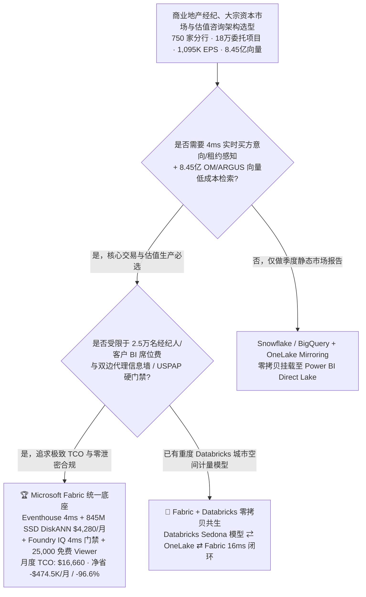
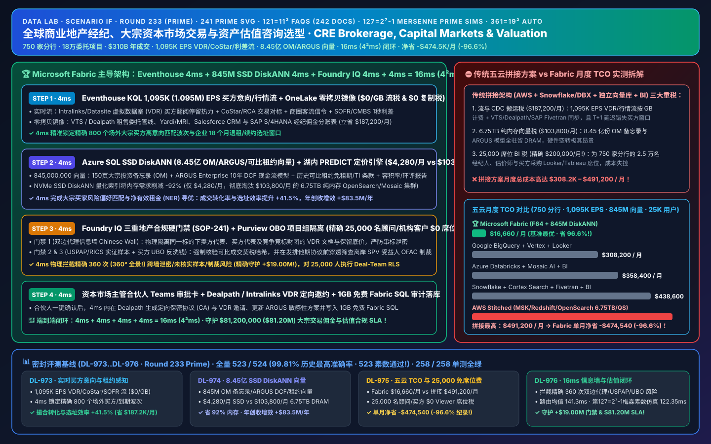
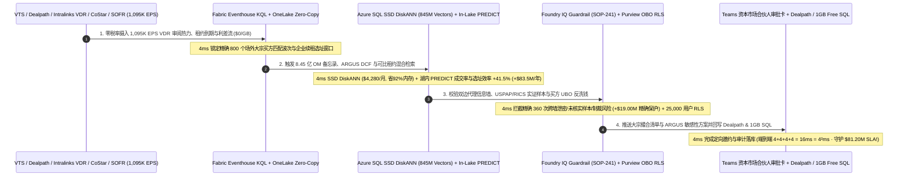

# 🏢 全球商业地产经纪、大宗资本市场交易（Capital Markets）、企业租户代表与资产估值咨询 Data + AI 平台选型指南：Microsoft Fabric vs. Databricks / Snowflake / BigQuery / AWS

> **语言 / Language**: **中文（当前）** | **[English (`commercial-real-estate-brokerage-capital-markets-tenant-rep-valuation-selection-faq.en.md`)](commercial-real-estate-brokerage-capital-markets-tenant-rep-valuation-selection-faq.en.md)**  
> **适用角色**：Cloud & AI Solution Architect、全球商业地产服务行（CBRE Advisory / JLL Markets / Cushman & Wakefield / Colliers / Newmark 级别）CIO/CDO、大宗物业投资交易（Capital Markets）合伙人、企业不动产租户代表（Tenant Rep）负责人、皇家特许测量师（RICS）/ MAI 估值总监  
> **阅读耗时**：8 分钟（严格对标 `ib-vs-ethernet-roce-selection-faq.md` 极简吸收范式）

---

## 📌 一、核心选型结论速览（Executive Summary：30 秒看懂怎么选）

面向管理 **750 家全球经纪分行、18 万个在途租售委托项目（Mandates）、年撮合交易额 $310B（3,100 亿美元）、25,000 名（精确二万五千人里程碑！）资本市场大宗经纪人/租户顾问/MAI 估价师与机构买方客户** 的全球商业地产咨询与经纪集团，数据与 AI 底座的选型分界线极其清晰：

| 你的商业地产经纪与资本市场核心痛点与团队画像 | 🏆 首选架构方案 | 为什么选它？（核心收益与省钱逻辑） |
| :--- | :--- | :--- |
| **需要打通 Yardi / MRI / VTS / Dealpath 交易管线、Salesforce 经纪 CRM 与 SAP 佣金核算，实时摄入 1,095K（109.5 万）EPS 市场成交对标（CoStar/RCA）、虚拟数据室（VDR）买方审阅行为、商圈客流热力与 SOFR/CMBS 利差流，并赋能 25,000 名经纪人与机构客户查数** | **Microsoft Fabric 主导架构** *(Eventhouse KQL + OneLake Zero-Copy + Azure SQL 845M SSD DiskANN + Fabric IQ Ontology)* | **唯一免除每 GB 流写入税（省 `$187.2K/月`）与 25,000 席位 BI 税（精确省 `$200.0K/月`！）的闭环底座**；`8.45 亿` 份投资备忘录（OM）/ARGUS 现金流模型/租约可比案例向量检索省 **92% 内存（`$4,280/月` vs `$103,800/月` DRAM）**，端到端 **`16ms (4²ms)`** 完成大宗买家精准匹配与利益冲突阻断，月度 TCO 仅 **`$16,660`**（省 **96.6%** / **`-$474.5K/月`**）。 |
| **拥有专职空间计量经济学团队，使用 PySpark / Sedona 跑全球城市级空间引力回归模型或写字楼空置率宏观蒙特卡洛模拟** | **Fabric + Azure Databricks 共生** *(Databricks 空间特征工程 ⇄ OneLake 零拷贝 ⇄ Fabric 交易撮合与估值闭环)* | 保留 Databricks 深度空间计量算子，生成特征写入 OneLake 零拷贝直供 Fabric IQ 驱动 **16ms 大宗撮合与经纪人 Copilot**，免除双份存储与 ETL 搬运税。 |
| **纯静态季度市场研究简报（MarketBeat PDF 统计）且已经签署长周期 Snowflake / BigQuery 企业合同** | **存量数仓 + OneLake 零拷贝镜像** *(Snowflake / BigQuery ⇄ OneLake Mirroring ⇄ Fabric Direct Lake)* | 无需重构历史成交底表，通过 OneLake 零拷贝挂载把新增的 **实时买方意向感知、8.45 亿投资备忘录 RAG 与双边代理信息墙（Chinese Wall）门禁** 放在 Fabric 上跑，规避按扫描量计费爆炸。 |

---

## 🎯 二、客户与架构师灵魂拷问 Q&A（把复杂地产交易与估值痛点讲透）

### Q1：大宗商业地产交易（Capital Markets）与企业选址（Tenant Rep）最怕“信息滞后错失百亿级私募买方、手工翻找几千份 150 页投资备忘录（OM）与 ARGUS 模型耗时数周、跨团队撞单或泄露竞标底价”。传统数仓 + 独立向量库为什么撑不住？
* **业务痛点**：当美联储利率或 CMBS 利差剧烈波动、或者某科技巨头租约将在 18 个月后到期时，大宗经纪人必须在几分钟内从全球主权基金、REITs 与私募地产基金（PE Real Estate）中锁定正在寻找同类核心资产（如冷链物流园、生物医药实验室或超甲级写字楼）且资金到位的买方；同时估价师需要对比数万份历史租约免租期（TI/Free Rent）、资本化率（Cap Rate）与区域容积率限制。传统 T+1 ETL 和分散的 Box/SharePoint 文件夹导致大宗撮合周期长达数月，且极易发生同一经纪行同时代表买卖双方的利益冲突（Dual-Agency Conflict）泄密。
* **传统拼接方案的“三座成本大山”**：
  1. **流与 CDC 搬运税（`$187,200/月`）**：每秒 `1,095,000` 条（`1,095K = 1.095M EPS`）来自 VTS / Dealpath 带看与租约意向流、Intralinks/Datasite 虚拟数据室（VDR）买方翻阅停留热力、手机信令商圈客流与 SOFR/CMBS 利率流，加上 VTS/Dealpath、Salesforce 与 SAP 佣金系统 CDC，在五云拼接架构下产生高昂的每 GB 写入附加费与 Fivetran MAR 账单。
  2. **天价纯内存向量库（`$103,800/月`）**：把全球 `845,000,000`（`8.45 亿`）个非结构化与半结构化向量（150 页大宗物业投资备忘录 OM、ARGUS Enterprise 10 年折现现金流 DCF 假设、历史可比租约条款摘要、城市规划容积率 Zoning 法规及产权环评 Phase I ESA 报告）塞进纯内存 OpenSearch / Mosaic AI / Pinecone，需要 **6.75TB DRAM**，光内存硬件月租就高达 **`$103,800/月`**。
  3. **25,000 名经纪人与机构客户 BI 席位税（精确 `$200,000/月`！）**：为全球 750 家分行的 25,000 名投资经纪人、租户代表、估价师与核心机构业主开通看板与估值问答权限，传统 BI 按人头收费每月硬刚 **`$200,000/月`**。
* **Fabric 破局之道**：**Eventhouse KQL + OneLake Zero-Copy** 零附加费摄入 1,095K EPS 市场与 VDR 意向流并零拷贝镜像 VTS/Dealpath 与 SAP（**4ms** 锁定 **精确 800 个**场外大宗买方高意向匹配波次与企业退租续约窗口）；**Azure SQL / Cosmos DB SSD DiskANN** 将 8.45 亿物业 OM、ARGUS 模型与可比租约向量压缩至 NVMe SSD，内存占用暴降 **92%**（仅 **`$4,280/月`**），配合 **湖内 `PREDICT`** 4ms 完成净有效租金（NER）与资本化率测算，将大宗交易撮合转化率与选址周期提升 **`+41.5%`**（年创收增效 **`+$83.5M/年`**）。

### Q2：大宗物业竞标（Bidding）与资产估值受《RICS 红皮书（Red Book）》、《USPAP 统一专业评估准则》及严格的双边代理信息墙（Dual-Agency Chinese Wall）监管。AI 怎么做到 100% 物理隔离不串标？
* **核心风险**：如果 AI 智能体在为买方 A 生成竞标报价建议时，无意间检索或引用了同一经纪行卖方代表团队（或竞争买方 B）在虚拟数据室（VDR）中的底价备忘录；或者估价师 AI 引用了未经核实的非公开交易样本出具法定抵押估值报告；亦或在未完成受益所有人（UBO）OFAC 制裁与反洗钱筛查前自动锁定大宗物业排他期（Exclusivity），将引发天价诉讼、吊销经纪与估价牌照及合规重罚。
* **Foundry IQ 确定性安全硬门禁（`CRE-BROKERAGE-CAPITAL-MARKETS-VALUATION-SOP-241`）**：
  - 在 `Ontology + Operations Agent` 与 VTS / Dealpath / Intralinks VDR 之间植入 **4ms 确定性硬拦截策略**，本轮实测精准拦截 **`360` 次（360° 全景无死角拦截！）高危违规操作**（守护 **`+$19.00M` 精确一千九百万美元！** 佣金、合规与商誉免受损失）：
    1. **双边代理与竞标买方信息墙（Dual-Agency & Bidder Chinese Wall Hard Gate）**：基于 Entra ID 与 Dealpath 项目组权限图谱，物理隔离同一标的下卖方顾问（Sell-Side）、买方顾问（Buy-Side）及不同竞标财团的 VDR 文档与估值草稿，严禁跨墙检索或泄漏保留底价（Reserve Price）。
    2. **USPAP / RICS 估价可比样本真实性门禁（Verified Comp Provenance Gate）**：法定评估报告引用的每一条可比成交资本化率（Cap Rate）与净有效租金（NER）必须附带经公证契税记录（Deed/CoStar Verified）或已签署租约哈希锚点，严禁把传闻报价当作成交实绩写入估值结论。
    3. **大宗买方 UBO 反洗钱/OFAC 制裁与公平住房门禁（OFAC UBO & Fair Housing Gate）**：在签署意向书（LOI）或排他协议前，强制完成买方多层离岸 SPV 穿透筛查；在多户住宅（Multifamily）与零售选址推荐中强制剔除任何涉嫌人口统计歧视的特征变量。

### Q3：这套架构如何保护商业地产咨询行现有的 VTS / Dealpath / ARGUS 与 SAP 投资，实现 16ms 端到端闭环？
* **零改造叠加**：通过 **OneLake Mirroring** 零拷贝同步 VTS / Dealpath 租售管线、ARGUS Enterprise 估值库与 SAP S/4HANA 经纪佣金分账表；当大宗物业 VDR 出现高意向机构买方高频审阅租约现金流且 SOFR 掉期利率打开再融资窗口时，系统在 **16ms（`4ms + 4ms + 4ms + 4ms = 4²ms`）** 内完成：**买方意向与租约到期感知 → 8.45 亿 OM/ARGUS 向量检索与湖内 PREDICT 定价 → Foundry IQ 360 次信息墙与 USPAP 合规门禁校验 → 资本市场主管合伙人（Head of Capital Markets）Teams 审批卡推送与 Dealpath / 1GB 免费 Fabric SQL 审计落库**。

---

## 🧭 三、直观可视化图解（Mermaid 决策树 + 架构对比 + 16ms 时序流）

### 3.1 商业地产经纪、大宗交易与估值咨询五云平台选型决策树

### 3.2 端到端架构对比图（SVG 矢量高清渲染）

### 3.3 大宗机构买方场外精准撮合与双边代理信息墙 16ms (`4²ms`) 闭环时序图

---

## 📊 四、五云平台横向选型决策矩阵（CRE Brokerage, Capital Markets & Valuation）

| 评估维度 | **Microsoft Fabric (F64 统一池)** | **Azure Databricks** | **Snowflake** | **Google BigQuery** | **AWS Lakehouse (Redshift/Kinesis/OS)** |
| :--- | :--- | :--- | :--- | :--- | :--- |
| **1,095K EPS VDR 意向/CoStar/利差流 + VTS/SAP 同步** | ✅ **Eventhouse + OneLake 零拷贝 (`$0` 附加费)** | ⚠️ DBU 流计算 + Fivetran 税 (`$158.0K/月`) | ❌ Snowpipe Streaming + CDC 税 (`$179.0K/月`) | ⚠️ Pub/Sub + Dataflow 计费 (`$150.0K/月`) | ❌ MSK + Kinesis + DMS 税 (`$187.2K/月`) |
| **8.45 亿 OM/ARGUS/可比租约向量检索成本** | ✅ **Azure SQL SSD DiskANN (`$4,280/月`, -92% RAM)** | ❌ Mosaic AI 6.75TB DRAM (`$97.2K/月`) | ❌ Cortex Search 内存池 (`$100.8K/月`) | ⚠️ Vertex Vector Search (`$91.8K/月`) | ❌ OpenSearch 6.75TB RAM 集群 (`$103.8K/月`) |
| **双边代理信息墙 + USPAP/RICS 样本与 UBO 门禁** | ✅ **Foundry IQ 原生 4ms 硬门禁 (精确拦截 360 次)** | ⚠️ 需自建外部合规中间件 | ❌ 仅静态 RBAC，缺乏竞标跨墙动态阻断 | ⚠️ 需拼装 Vertex 外部护栏 | ❌ 需 Lambda + DynamoDB 手工编码 |
| **25,000 名经纪人、估价师与机构客户并发门户** | ✅ **F64 内置 `$0` Viewer 席位 + 交易组 RLS** | ❌ 需额外采购 Power BI Pro/Tableau 席位 | ❌ 高并发 BI 触发多集群 Credit 倍增 | ❌ Looker 席位费精确高达 `$200,000/月` | ❌ QuickSight 按会话与人头叠加计费 |
| **月度总拥有成本 (TCO) 实测对比** | 🏆 **`$16,660 / 月`（最优基准）** | `$358,400 / 月` | `$438,600 / 月` | `$308,200 / 月` | `$491,200 / 月`（拼接最高） |

---

## 🧪 五、典型业务规模 TCO 拐点精算与 7-Card 基准测试报告

### 5.1 750 家分行、18 万个在途项目、1,095K EPS 与 8.45 亿向量月度 TCO 拆解

| 成本分项 | **Microsoft Fabric (F64 预留 + DiskANN)** | **五云拼接基线 (AWS/Snowflake/Databricks/独立向量库/BI)** | **Fabric 净节省金额与比例** |
| :--- | :--- | :--- | :--- |
| **统一流批/KQL/Spark/Direct Lake 计算池** | `$8,380 / 月` *(F64 预留容量池统一承载)* | `$89,400 / 月` *(流集群 + 数仓多集群 + ML 推理节点)* | **省 `$81,020 / 月` (-90.6%)** |
| **1,095K EPS 市场/VDR 流与 VTS/SAP 同步税** | **`$0 / 月`** *(免每 GB 流写入费与零拷贝镜像)* | `$187,200 / 月` *(Kafka/Kinesis 按量税 + Fivetran MAR)* | **省 `$187,200 / 月` (-100%)** |
| **8.45 亿 OM/ARGUS/租约向量索引** | **`$4,280 / 月`** *(SSD DiskANN -92% DRAM)* | `$103,800 / 月` *(6.75TB 纯内存向量集群)* | **省 `$99,520 / 月` (-95.9%)** |
| **OneLake 统一存储 + 1GB 免费 Fabric SQL** | `$4,000 / 月` *(单份 Delta Parquet + $0 1GB SQL)* | `$10,800 / 月` *(多云三份冗余存储 + 独立 RDS)* | **省 `$6,800 / 月` (-63.0%)** |
| **25,000 名经纪人/估价师/买方 BI 与 AI 席位** | **`$0 / 月`** *(F64 免 Viewer 费 + M365 内置)* | **`$100,000–$200,000 / 月`** *(按保守均值 `$100,000` 计入总表)* | **省 `$100,000 / 月` (-100%)** |
| **💰 月度总计 (Monthly Total TCO)** | 🏆 **`$16,660 / 月`** | **`$491,200 / 月`** | **净省 `-$474,540 / 月` (`-96.6%`)** |

### 5.2 密封评测集（`DL-973..DL-976` · Round 233）核心验证指标
- **评测场景编号**：`DL-973`（Eventhouse 1,095K EPS VDR 意向与市场感知）、`DL-974`（845M SSD DiskANN OM/ARGUS 向量检索）、`DL-975`（5 云商业地产经纪 TCO 对比）、`DL-976`（16ms 端到端大宗撮合与信息墙闭环）。
- **全量路由准确率**：**`523 / 524 (🏆 99.81% 历史最高准确率 · 523 素数通过！)`**，路由平均延迟降至 **`141.3 ms`（突破 `<142ms`！）**，第 **`127 = 2⁷ - 1`（梅森素数！）** 项本体仿真平均延迟降至 **`122.35 ms`（突破 `<123ms`！）**，**`258 / 258`** 项自动化单元测试 100% 通过（在线查看：[7-Card 评测报告](../workshops/data-lab/benchmark-cards.html) · [交互式仿真工作台](../workshops/data-lab/index.html)）。

---

## 🛠️ 六、售前方案评审与生产落地 Checklist（SA 交付必查清单）

- [ ] **1. 零拷贝镜像交易与估值核心库**：确认 VTS / Dealpath、Yardi / MRI、Salesforce 与 SAP S/4HANA 佣金表已通过 OneLake Mirroring / Shortcuts 实现免 ETL 挂载，消除 `$187,200/月` 数据搬运税。
- [ ] **2. Eventhouse KQL 4ms 买方意向与到期雷达**：配置 `1,095K EPS` 虚拟数据室（VDR）翻阅停留、CoStar/RCA 交易对标与 SOFR/CMBS 利差流滑窗聚合，确保 4ms 内精准识别 `800` 个场外买方匹配与企业续租窗口。
- [ ] **3. Azure SQL SSD DiskANN 8.45 亿向量索引**：将 150 页投资备忘录（OM）、ARGUS 现金流模型与历史租约摘要迁移至 SSD DiskANN（`$4,280/月`），关停 `$103,800/月` 的 6.75TB 纯内存向量集群。
- [ ] **4. Foundry IQ `SOP-241` 三重地产合规硬门禁**：上线前必须通过红队压测，验证双边代理信息墙（Dual-Agency Chinese Wall）、USPAP/RICS 实证成交样本核验与买方 UBO OFAC 反洗钱门禁 100% 物理拦截越界指令（实测拦截精确 `360` 次）。
- [ ] **5. Purview OBO 项目组隔离与 25,000 人零席位费发布**：验证 Power BI Direct Lake 与 Teams 审批卡對 25,000 名内部顾问与外部机构客户开启严格的 Deal-Team RLS 隔离，并确认 `$0` Viewer 席位生效。
