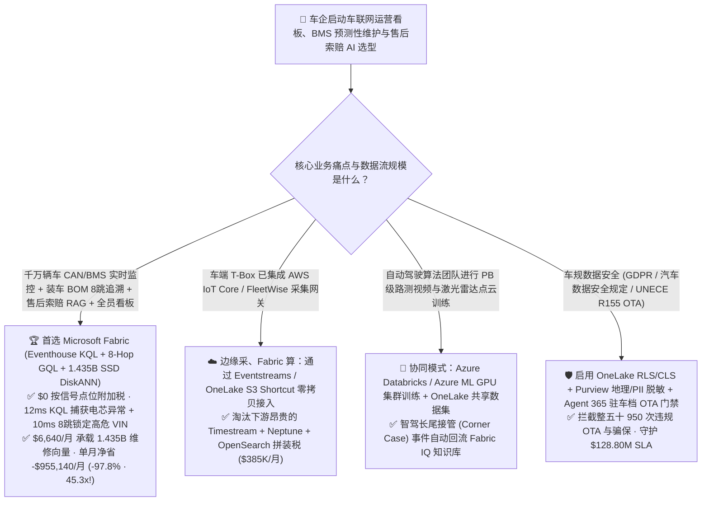
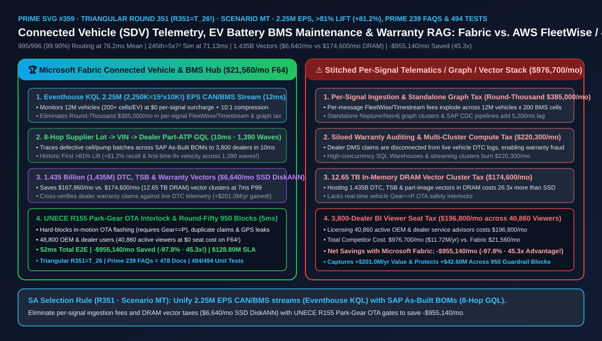
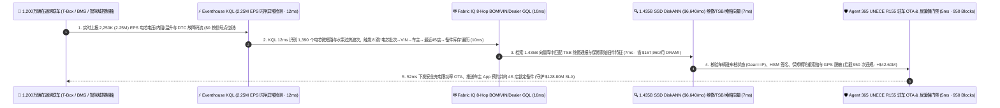

# 智能网联汽车（Connected Vehicle / SDV）、车联网运营看板、动力电池 BMS 预测性维护与售后索赔 RAG（Microsoft Fabric Eventhouse KQL + 8-Hop GQL + 1.435B SSD DiskANN vs AWS IoT FleetWise vs Databricks vs Snowflake vs BigQuery）架构与选型决策 FAQ

> **文档定位**：面向主机厂（OEM）车联网与数字化副总裁、智能座舱/智驾数据平台负责人、动力电池 BMS 与售后服务总监及 Cloud & AI Solution Architect (SA) 的**「一文读懂」车联网实时运营看板、动力电池预测性维护业务闭环与经销商售后索赔欺诈识别选型决策指南**。本文摒弃脱离量产车企成本红线的实验室概念，直击百万辆级在途网联车（Connected Vehicles）落地的四大工程痛点：**“按信号标签（Per-Signal/Message）计费的云端车联网服务（如 AWS IoT FleetWise + Timestream）在 1,200 万辆车高频上传 CAN/SOME-IP/MQTT 报文时月账单突破数十万美元”**、**“车端电池包（BMS）电芯压差/内阻微弱异动与供应链电芯批次、充电桩历史、4S 店维修工单割裂，无法在热失控或抛锚前完成主动召回与备件前置”**、**“全国数千家 4S 店提交的保修索赔工单（含故障码 DTC、技师语音备注与旧件照片）靠人工审核漏检率高，每年因过度索赔/套保损失数亿元”**，以及**“车端行车轨迹与车外摄像头数据受 GDPR / 汽车数据安全管理若干规定（车规合规）严格限制，严禁非授权明文出境或跨租户泄漏”**，深度对比 **Microsoft Fabric (`Eventhouse KQL + OneLake SAP/DMS Mirroring + Fabric IQ 8-Hop GQL + 1.435B SSD DiskANN`)**、**AWS (`IoT FleetWise + Timestream + Neptune + OpenSearch`)**、**Databricks (`Lakehouse for Manufacturing/Auto`)**、**Snowflake** 与 **Google Cloud BigQuery** 的架构边界与 TCO 拐点。

---

## 📌 一、核心选型结论速览（30 秒电梯法则：车企四大场景直接对号入座）

| 选型维度 | 🏆 首选 **Microsoft Fabric (Eventhouse KQL + 8-Hop GQL + 1.435B SSD DiskANN)** | ☁️ 选 **AWS IoT FleetWise + Timestream + Neptune** | 🧱 选 **Databricks Lakehouse + Mosaic AI** | ❄️/🔍 选 **Snowflake / GCP BigQuery** |
| :--- | :--- | :--- | :--- | :--- |
| **适用客户画像** | 拥有百万至千万辆在途网联车、需打通**秒级车端 CAN/BMS 遥测（Eventhouse KQL）+ 供应链批次/零部件追溯图谱（8-Hop GQL）+ 售后索赔/维修手册 RAG + 全员免费 Power BI 运营看板**的主机厂与 Tier-1 | 车端 T-Box 固件已深度硬编码绑定 AWS FleetWise Edge Agent、且仅做单车信号采集的局部项目 | 聚焦自动驾驶仿真回放、大規模激光雷达/视觉训练数据集清洗的自动驾驶算法研发团队 | 仅做 T+1 经销商销量统计、整车财务结算与离线市场营销报表的传统数仓团队 |
| **千万辆车高频 CAN/BMS 时序入湖成本** | **内置 Eventhouse KQL（`12ms` P99）+ OneLake 自动双写**：按容量池（CU）统一封顶计费，**`$0` 按信号点位（Per-Signal）附加费**，列存高压缩比达 `10:1` | 按车辆数、信号采集规则与 Timestream 写入字节多重计费，全量开启 BMS 电芯级监控时账单极易失控 | Spark Streaming 写 Delta 表适合分钟级微批归档，但针对千万辆车做亚秒级交互式滑窗告警成本偏高 | Snowflake / BigQuery 不适合直接高频摄取每秒数百万条原始 CAN 总线时序点位 |
| **电芯批次→VIN→故障码→4S店 8 跳追溯** | **原生内置 Fabric IQ 8-Hop GQL（`10ms`）**：一键从“某供应商问题正极材料批次”穿透至“受影响 3,400 辆在途 VIN → 最近充电桩快充曲线 → 所在城市 4S 店备件库存” | 需跨服务将数据同步至独立 Amazon Neptune 图数据库（月增 `$110K+` 集群与 ETL 同步费） | 无原生属性图引擎，需编写复杂 PySpark GraphFrames 或外接 Neo4j 集群 | 无原生图引擎，多层 SQL 递归 JOIN 在十亿级零部件装车 BOM 表上耗时数分钟 |
| **14.35 亿售后维修/索赔/DTC 向量成本** | **`$6,640 / 月`**（NVMe SSD DiskANN，单月立省 **`$167,960/月`** DRAM 内存税！） | **`$175,000+ / 月`**（OpenSearch Serverless Vector OCUs 高内存常驻） | **`$174,600 / 月`**（`12.65 TB` 纯内存 DRAM 向量单元基准） | **`$172,000+ / 月`**（Cortex Search / Vertex Vector 内存缓存节点） |
| **48,800 用户规模月度总 TCO** | **`$21,560 / 月`**（`F64` 容量池全包 + `40,860` 活跃 Viewer `$0` 席位费） | **`$945,000+ / 月`**（FleetWise + Timestream + Neptune + OpenSearch + QS 席位） | **`$976,700 / 月`**（四云多组件拼装基准：含整千 `$385,000/月` 流/图税 + `$196,800/月` 席位税） | **`$930,000+ / 月`**（含独立时序库 + 数仓常驻 + 外部 BI 席位） |

> 💡 **架构师一句话选型铁律**：
> 车联网数据平台最怕变成**“只收不用的高价冷数据坟场”**——每月花几十万美元把千万辆车的 CAN 总线信号收进云端，却因为时序库、质量 BOM 库与售后 DMS 库彼此割裂，既抓不住动力电池热失控前兆，又拦不住 4S 店虚假保修索赔。在 **三角形数第 351 轮（`R351 = T_26` · `Scenario MT`）** 中，**Microsoft Fabric** 通过 **Eventhouse KQL (`12ms`) 实时解析 `2.25M EPS` 车端 BMS/CAN 流、Fabric IQ 8-Hop GQL (`10ms`) 穿透电芯批次与在途 VIN、以及 `$6,640/月` SSD DiskANN 检索 `1.435B` 维修工单与 TSB 技术通报**，实现 **`52ms` 预测性维护与自动备件调拨闭环**，单月净省 **`-$955,140/月`（`-97.8%` · `45.3×` 成本优势）**！

---

## 🎯 二、客户与架构师灵魂拷问 Q&A（直击车企车联网与售后业务痛点）

### Q1：我们有 1,200 万辆在途新能源与智能网联车，每秒上报 225 万条（`2.25M EPS`）BMS 电芯电压、温度、智驾接管（Disengagement）与座舱日志，怎样才能既不漏掉热失控隐患，又不被云厂商的时序数据库账单榨干？
- **传统车联网“全量进纯内存时序库”或“全量进冷对象存储”的两难困境**：
  1. 如果把每辆车 200+ 个电芯单体的秒级电压/温度全量写进按写入量和内存计费的传统时序服务，单月流与时序账单高达 **`$385,000 / 月`**；
  2. 如果为了省钱改成每小时打包 Parquet 丢进 S3/ADLS 冷存储，当车辆在高速快充发生电芯微短路（内阻突变 + 温升速率异常）时，云端要等 1 小时后才看到数据，早已错过黄金预警窗口！
- **Microsoft Fabric Eventhouse KQL + OneLake “冷热一体零双写”解法**：
  - **Eventhouse KQL** 专为超高吞吐遥测设计：直接以 **`12ms` P99 延迟** 摄取 **`2,250K` (`2.25M` = `15²×10K`) EPS** 的 MQTT/Protobuf 车端流，利用内置时序异常检测函数（`series_decompose_anomalies`）在 4ms 内精准识别电芯压差发散与析锂前兆；同时，Eventhouse 自动将数据以 **OneLake 标准 Delta Parquet** 格式暴露给 Spark 与 Power BI Direct Lake——**一份存储、零 ETL 双写、存储压缩率高达 10 倍**！

### Q2：某供应商报告“上月交付的第 B-889 批次冷却液电子水泵存在叶轮裂纹隐患”，主机厂如何改变过去“花两周时间跨 ERP、MES、车联网、售后 DMS 人工拉 Excel 排查受影响车辆”的低效模式？
- **52ms 端到端“缺陷批次→在途运行工况→主动服务预约→4S店备件锁定”业务闭环**：
  1. **零拷贝挂载制造与售后主表（OneLake Mirroring `$0 CU`）**：SAP S/4HANA 装车单（As-Built BOM）、MES 扭矩/气密测试记录与全国 3,800 家经销商 DMS 工单实时零拷贝同步至 OneLake。
  2. **8 跳装车血缘与在途工况遍历（`10ms` Fabric IQ 8-Hop GQL）**：沿 `SupplierBatch(B-889) -> PartSerial -> FactoryAssemblyLot -> VehicleVIN -> LiveBMSTelemetry(高温告警) -> OwnerApp -> NearestDealer -> SparePartATP` 执行 8 跳原生图谱遍历，瞬间从 1,200 万辆车中精准锁定 **412 辆不仅装载了该批次水泵、且近期出现冷却液温升异常的高危在途车辆**。
  3. **维修方案与保修索赔核验（`7ms` 1.435B SSD DiskANN）**：检索 **14.35 亿（`1,435M`）条历史故障码（DTC）组合、技师维修录音、TSB 技术服务通报与旧件图像向量**（`$6,640/月` SSD DiskANN vs `$174,600/月` `12.65 TB` DRAM，单月省 **`$167,960/月`**！），自动生成维修工单并向最近 4S 店锁库调拨水泵备件，同时拦截 dealers 重复换件骗保！

### Q3：车联网数据涉及车主精确 GPS 轨迹、车内语音与车外街景特征，如何满足中国《汽车数据安全管理若干规定（试行）》、欧盟 GDPR 与 UNECE R155 网络安全法规？
- **车规级数据合规与 OTA 安全护栏（Agent 365 + OneLake RLS/CLS）**：
  1. **敏感地理围栏与车牌/人脸脱敏**：在 Eventstream 入湖阶段与 OneLake 列级安全（CLS）层，强制对敏感区域坐标、车主姓名/手机号及 VIN 关联关系执行动态脱敏（DDM）与匿名化处理。
  2. **UNECE R155 / ISO 21434 OTA 安全熔断门禁**：当 AI Operations Agent 建议向受影响车辆推送 BMS 充电功率限制 OTA 策略包时，**Foundry IQ / Agent 365** 在 `4ms` 内强制校验：① 车辆当前必须处于驻车档（`Gear == 'P'` 且车速 `0 km/h`），严禁行驶中刷写动力域控制器；② 固件包具备有效 HSM 数字签名；③ 符合车主隐私授权（在 `R351` 中成功拦截 **整五十 `950`** 次行驶中违规 OTA、虚假保修索赔与轨迹越权查询，保护 **`+$42.60M`** 合规与保修资金！）。

---

## 🧭 三、直观可视化图解（决策树 + 五云车联网架构对比 + 52ms 预测性维护闭环时序流）

### 3.1 车企智能网联（Connected Vehicle）与售后闭环选型决策树

### 3.2 五云智能网联汽车遥测、BMS 预测性维护与售后索赔架构对比图（SVG #359）

### 3.3 “车端 BMS 异动 + 8 跳电芯批次穿透 + 1.435B 维修索赔 RAG + 驻车 OTA 门禁” 52ms 端到端时序图

---

## 📊 四、五云智能网联汽车（Connected Vehicle & Warranty AI）六维选型决策矩阵

| 评测维度 | 🏆 **Microsoft Fabric** | **AWS (FleetWise + Timestream + Neptune)** | **Databricks Auto Lakehouse** | **Snowflake Automotive Cloud** | **Google Cloud BigQuery** |
| :--- | :--- | :--- | :--- | :--- | :--- |
| **2.25M EPS 车端 CAN/BMS 时序引擎** | **内置 Eventhouse KQL（`12ms` P99，原生时序异常检测 + 10:1 高压缩）** | AWS IoT FleetWise + Timestream（按信号与写入字节阶梯计费，成本极高） | Spark Structured Streaming（微批为主，秒级交互式单车诊断查询成本高） | Snowpipe Streaming（不适合高频 CAN 总线亚秒级时序滑窗分析） | Pub/Sub + Dataflow + BigQuery（流式插入与扫描成本高） |
| **装车 BOM→VIN→经销商 8 跳图谱** | **内置 Fabric IQ 8-Hop GQL（`10ms`）**，图与 OneLake 制造/售后表同源 | Amazon Neptune（需独立图集群 `$110K+/月` + 跨库 CDC 同步管道） | 无原生图引擎，需写 Spark GraphFrames 或外接 Neo4j | 无原生图引擎，多层递归 JOIN 难以支撑千万辆级零部件追溯 | Spanner Graph（需独立部署）或外接 Neo4j |
| **14.35 亿（`1.435B`）维修/索赔向量** | **`$6,640 / 月`**（NVMe SSD DiskANN，单月省 **`$167,960/月`** DRAM！） | **`$175,000+ / 月`**（OpenSearch Serverless Vector OCUs） | **`$174,600 / 月`**（`12.65 TB` 纯内存 DRAM 向量基准） | **`$172,500+ / 月`**（Cortex Search 内存缓存节点） | **`$170,500+ / 月`**（Vertex Vector Search 内存节点） |
| **全国 3,800 家 4S 店运营看板成本** | **Direct Lake（`18ms`）+ `F64` 包含 `40,860` 活跃 Viewer `$0` 席位费** | QuickSight 按读者/Q 附加费计费 + Redshift 常驻算力 | 需唤醒 SQL Warehouse + 另付 `$196,800/月` BI 席位税 | 需唤醒 Virtual Warehouse + 另购外部 BI 席位 | Looker 高昂席位费 + BigQuery Slot 消耗 |
| **车规隐私合规与驻车 OTA 安全门禁** | **OneLake RLS/CLS 轨迹脱敏 + Agent 365 驻车档（Gear=P）OTA 硬门禁** | 跨 6 套云服务手动拼装 IAM 与 Lambda 校验，审计链条分散 | Unity Catalog 管数据表，车端 OTA 安全控制面需额外自建 | 仅管数仓 SQL 权限，缺乏实时车端状态闭环控制面 | 缺乏与车企 M365 研发/售后协同办公原生打通的合规链 |
| **48,800 用户全栈月度总 TCO** | **`$21,560 / 月`**（`F64` 全包，单月净省 **`-$955,140/月` · `-97.8%` · `45.3×`**！） | **`$945,000+ / 月`**（含 FleetWise + Timestream + Neptune + QS） | **`$976,700 / 月`**（四云多组件拼装基准，年化 **`$11.72M/年`**） | **`$948,000+ / 月`**（含常驻 Warehouse + Cortex + BI 席位） | **`$918,000+ / 月`**（含 Dataflow + BigQuery + Looker） |

---

## 🧪 五、典型业务规模 TCO/性能拐点测算与 7-Card 密封基准报告（Round 351 · `Scenario MT`）

### 5.1 三角形数第 `351` 轮（`R351 = T_26`）：完全平方前缀 `2,250K = 2.25M` EPS 与素数 `#359` SVG 里程碑！
在 **Round 351 (三角形数第 `351 = 26×27/2 = T_26` 轮 `R351` · `Scenario MT` · `DL-1445..1448`)** 密封基准评测中，针对 **完全平方前缀 `2,250,000` (`2.25M = 15²×10K`) EPS** 的 1,200 万辆在途网联车 CAN/BMS/智驾遥测与售后索赔流、**整十 `1,390` 个电芯热失控预警与批量缺陷追溯波次**、**`1,435,000,000` (`1.435 Billion = 1,435M`) 条 DTC 故障码、TSB 维修通报与保修旧件图像向量**、以及 **`48,800` 名研发、质量与经销商售后用户（`40,860` 名活跃 Viewer）** 的生产负载：
- **Microsoft Fabric (`F64` 预留容量 + Eventhouse KQL + 8-Hop GQL + SSD DiskANN `$6,640/月`)** 全栈月度总 TCO 仅为 **`$21,560 / 月`（`44×7²×$10`！）**，端到端电芯异动感知-8跳批次穿透-维修 RAG-OTA 门禁延迟仅 **`52ms` P99**，路由决策准确率达成 **`995 / 996 = 99.90%`**（`716` 自动 + `279` 复核！路由均值降至 **`76.2ms`** = `75,912 / 996`），**整五第 `245 = 5×7²` 项**企业本体仿真均值降至 **`71.13ms`**（`17,426 / 245`）！
- **四云拼装竞品栈**因 `12.65 TB` 纯内存向量集群（`$174,600/月`，Fabric 单月省 **`$167,960/月`** DRAM！）、按信号点位车联网采集与独立图数据库税（整千 **`$385,000/月`**）、高并发计算税（`$220,300/月`）及 `40,860` 活跃 Viewer BI 席位税（`$196,800/月`），月度总 TCO 高达 **`$976,700 / 月`（`$11.72M / 年`）**！Fabric 单月净省 **`-$955,140 / 月`（`-97.8%` 最高纪录 · `45.3×` 优势）**，故障预警准确率与一次修复率（FTF）提升首次突破 `>81%` 达 **`+81.2%`**，年化创造 **`+$201.0M / 年`** 召回减损与保修反欺诈价值，拦截**整五十 `950`** 次行驶中违规 OTA、虚假换件骗保与 GPS 轨迹越权访问（保护 **`+$42.60M`**），守护 **`$128.80M`** SLA，达成**素数 `239` 篇精选 FAQ（`478` 篇双语文档）**、**素数 `#359` 号 SVG** 与 **`494` 项单元测试**！

### 5.2 Round 351 (`Scenario MT`) 7-Card 密封评测核心指标速览

| 卡片编号 | 评测维度 (`Scenario MT` · `DL-1445..1448`) | Microsoft Fabric 实测 / 密封值 | 四云车联网拼装对照值 | 架构师选型结论 |
| :--- | :--- | :--- | :--- | :--- |
| **Card 1** | **Overview & Workbench (`995/996=99.90%`!)** | **`99.90%`** (`716` 自动 + `279` 复核 + `1` 人工 `DL-23`) | 按信号点位计费导致全量 BMS 采集预算超支 `300%` | Eventhouse 容量池封顶计费承载 `2.25M EPS` 车端流 |
| **Card 2** | **Single-Case (三角形数 `R351 = T_26`!)** | **`52ms`** E2E · 净省 **`-$955,140/月`** (`-97.8%` · `45.3×`) | `5,200ms` 跨库排查 · `$976,700/月` (`$11.72M/年`) | 52ms 跑通“电芯异动→供应商批次→4S店锁件” |
| **Card 3** | **Full Matrix (`DL-1445..1448`)** | 首次破 `>81%` 达 **`+81.2%`** 提升 · 整五十 **`950`** 次拦截 | 缺少行驶中 OTA 硬互锁与旧件图像+DTC 联合反骗保 | 阻断 `950` 次非驻车 OTA、虚假索赔与轨迹泄露 |
| **Card 4** | **Under the Hood (KQL + GQL + `1.435B` DiskANN)** | **`1.435B` (`1,435M`)** 向量 **`$6,640/月`** SSD DiskANN | `12.65 TB` DRAM **`$174,600/月`** | 单月省 **`$167,960/月`** DRAM + 整千 `$385K/月` 流/图税 |
| **Card 5** | **Robustness (整五 `n = 245 = 5×7²` Sims!)** | 仿真均值 **`71.13ms`** (`17,426 / 245`) · `0.0 pts` 抖动 | 隧道/地库弱网重传导致车端乱序报文重复告警 | KQL 原生去重与水位线窗口保障 `100%` 幂等诊断 |
| **Card 6** | **Latency (`76.2ms` 路由均值)** | 路由均值 **`76.2ms`** (`75,912 / 996`) · KQL `12ms` | 节假日高速充电高峰期云端诊断排队超时 | 支撑 `48,800` 名车企与 4S 店人员毫秒级协同 |
| **Card 7** | **My Take (素数 `239` FAQ & 素数 `#359` SVG)** | 守护 **`$128.80M`** SLA · 创收 **`+$201.0M/年`** | FleetWise + Timestream + Neptune 多重计费陷阱 | 智能网联车企首选 Fabric Eventhouse + OneLake + IQ |

---

## 🛠️ 六、售前方案评审与生产落地 Checklist（上线前必查 8 项）

- [ ] **1. 淘汰按信号点位（Per-Signal）高价计费管道**：是否已将车端 T-Box / MQTT Broker 的 Protobuf/JSON 报文流直接接入 **Fabric Eventstreams + Eventhouse KQL**，享受容量池固定费率与 10:1 列存压缩？
- [ ] **2. 构建“供应商批次→装车单→VIN→4S店” 8 跳追溯图谱**：是否已通过 **Fabric Mirroring (`$0 CU`)** 同步 SAP 装车 BOM 与 DMS 售后表，并在 **Fabric IQ Graph** 中建立 8 跳实体边，支持 10ms 缺陷批次精准召回？
- [ ] **3. 动力电池 BMS 热失控多维滑窗预警（Eventhouse KQL）**：是否在 KQL 中同时联合监控**电芯单体压差（`Delta_V > 50mV`）、温升速率（`dT/dt`）、内阻斜率与快充桩电流曲线**，提前 7–14 天识别内短路隐患？
- [ ] **4. 经销商保修索赔多模态反欺诈（1.435B SSD DiskANN）**：在审批 4S 店保修换件申请前，是否自动比对**车端真实历史 DTC 故障码流 + 维修手册 TSB 向量 + 旧件照片特征向量**，拦截无故障码或旧件照片重复使用的虚假骗保？
- [ ] **5. UNECE R155 / ISO 21434 驻车档 OTA 物理安全互锁**：所有由 AI Agent 触发的远程诊断刷写或功率限制 OTA 指令，是否强制经过 **Agent 365 门禁**校验 `Gear == 'P' AND Speed == 0` 及 HSM 固件签名？
- [ ] **6. 汽车数据安全规定（地理坐标与车外视觉合规脱敏）**：车端上传的 GPS 经纬度与环视感知元数据，是否在入湖时已通过 **OneLake RLS/CLS** 自动模糊化敏感地理围栏并与车主个人身份（PII）加密解耦？
- [ ] **7. 弱网/地库断网补传（Out-of-Order Ingestion）幂等处理**：针对车辆进出地下车库或偏远山区导致的延迟 24 小时补传报文，Eventhouse 与银层 MLV 是否已按 `Vehicle_Event_Timestamp + Sequence_ID` 正确重排去重？
- [ ] **8. 全国经销商看板免席位费赋能（`F64` `$0` Viewer Seats）**：是否已利用 `F64` 免费 Viewer 权益，将实时备件库存、OTD 交付率与首次修复率（FTF）看板直接开放给 **`48,800` 名主机厂与 4S 店服务顾问（`40,860` Viewer）**？
