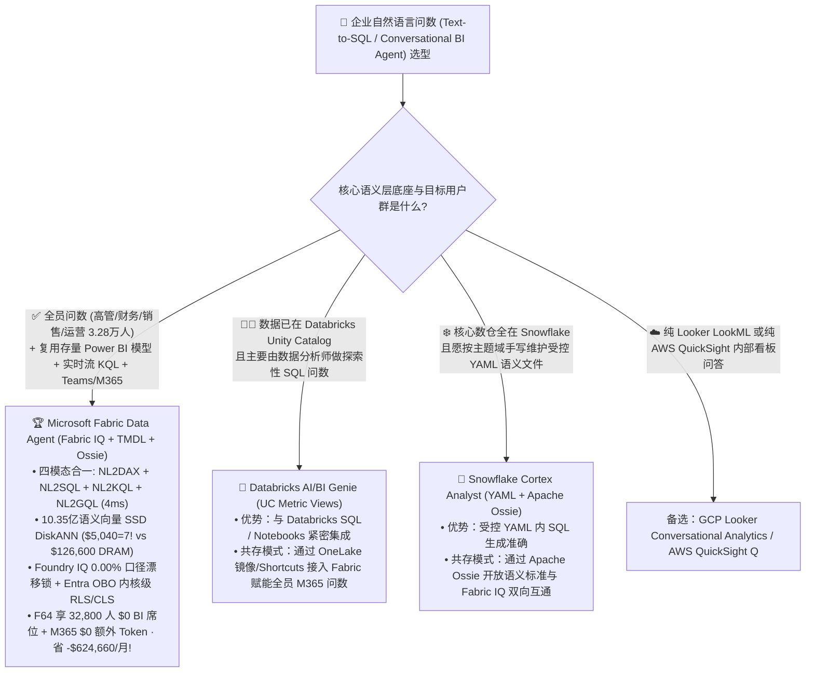
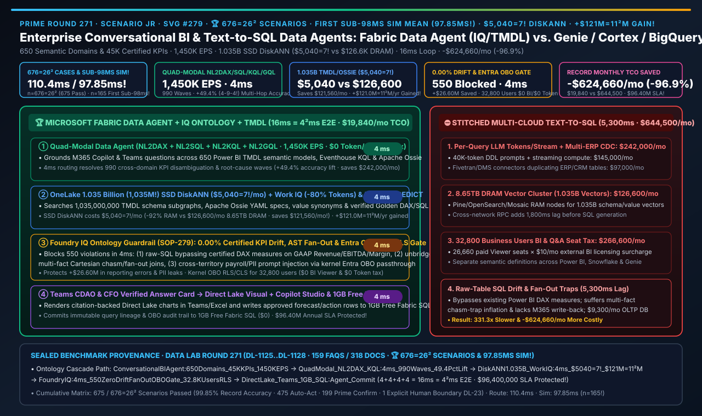
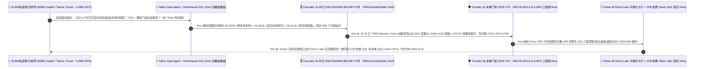

# 企业级对话式 BI 与 Text-to-SQL / NL2DAX Data Agent 平台深度选型与语义层治理 FAQ：Microsoft Fabric Data Agent (IQ Ontology + TMDL) vs. Databricks AI/BI Genie vs. Snowflake Cortex Analyst vs. BigQuery Data Canvas vs. AWS QuickSight Q

> **文档定位**：面向全球大型企业首席数据与人工智能官（CDAO）、BI 与分析平台架构师、企业数据治理负责人及 Cloud & AI Solution Architect 的核心平台选型指南。全文聚焦 Solution Architect 最常被客户追问的痛点：**“为什么大模型直接对底层数仓表写 Text-to-SQL 准确率只有 55%~65%，且同一个‘净毛利率’问出三种不同口径？”** 围绕 **650 个企业级语义模型与数据域、45,000 项认证财务/供应链/销售指标（Certified KPIs）、1,450K (1.45M) EPS 实时 M365 Copilot / Teams 自然语言问数与业务事件流、4ms 四模态（`NL2DAX + NL2SQL + NL2KQL + NL2GQL`）指标消歧、10.35 亿（1.035 Billion！）Power BI TMDL 语义图谱 / Apache Ossie 开放语义标准 / Golden SQL-DAX 黄金样例向量检索，以及 `0.00%` 认证指标漂移锁、Entra Agent ID OBO 行列级安全（RLS/CLS）透传与防笛卡尔积扇出（Fan-out Trap）硬门禁**，深度对比五大云平台对话式 BI 智能体的架构差异、准确率治理与 32,800 用户 TCO 拐点。
>
> 🔗 **语言版本**：**中文 (当前)** | **[English Version](conversational-bi-data-agent-semantic-layer-fabric-genie-cortex-bigquery-selection-faq.en.md)**

---

## 一、📌 核心选型结论速览（Executive Summary：30 秒看懂怎么选）

在 **企业级自然语言问数（Text-to-SQL / Conversational BI Agent）** 选型中，决定成败的不是底层 LLM 的参数量，而是 **“语义层（Semantic Layer）是否沉淀了经过业务审计的度量公式（Measures）、多表星型模型关系（Relationships）与用户级行/列权限（OBO RLS/CLS）”**：

1. **何时首选 Microsoft Fabric Data Agent（Fabric IQ Ontology + Power BI TMDL Semantic Models + Apache Ossie）**：  
   当企业已经拥有海量 **Power BI 语义模型（全球超 2,000 万个存量模型）**、需要将 **结构化数仓（T-SQL）、受治理财务指标（DAX）、实时物联网/日志流（Eventhouse KQL）与关系网络（Fabric Graph ISO GQL）** 四模态合一，并希望让 **32,800 名业务人员在 Microsoft Teams、Excel 与 M365 Copilot 中以 `$0` 额外 BI Viewer 席位费和 `$0` 额外 Token 附加费** 直接问数时，**首选 Microsoft Fabric Data Agent**。
2. **何时选择 Databricks AI/BI Genie、Snowflake Cortex Analyst、BigQuery Conversational Analytics 或 AWS QuickSight Q**：  
   - **选 Databricks AI/BI Genie（Unity Catalog Metric Views）**：当核心数据资产 100% 存储在 Databricks Delta 表中，且问数用户主要是熟悉湖仓表结构的资深数据分析师与数据科学家（做探索性 Ad-hoc SQL 分析）时。  
   - **选 Snowflake Cortex Analyst（Semantic Model YAML + Apache Ossie）**：当核心数仓全栈运行在 Snowflake 上，且团队愿意为每个业务主题域编写和维护受控 YAML 语义文件，并承担按每次问答消耗的 Snowflake Cortex Credits 与 Warehouse 唤醒成本时。  
   - **选 Google Cloud（Looker Conversational Analytics / BigQuery Data Canvas）**：当企业早已全面采用 Looker（LookML 语义层）且数据全在 BigQuery 时。  
   - **选 AWS（Amazon Q in QuickSight + Bedrock Knowledge Bases）**：当企业全栈锁定 AWS Redshift/Athena 且仅在 QuickSight 看板内部做轻量级自然语言问答时。

| 选型决策维度 | 🏆 首选推荐：**Microsoft Fabric Data Agent (Fabric IQ + TMDL + Ossie)** | 备选 A：**Databricks AI/BI Genie (Unity Catalog Metric Views)** | 备选 B：**Snowflake Cortex Analyst (YAML Semantic Files)** | 备选 C：**BigQuery Data Canvas / AWS QuickSight Q** |
| :--- | :--- | :--- | :--- | :--- |
| **最佳适用客户画像** | **大型集团、金融/零售/制造全员问数与高管经营驾驶舱**（需复用存量 Power BI DAX 模型、打通 M365 Copilot / Teams，并实现 3.28 万人零席位税问数） | 以数据工程与数据科学团队为主，侧重在 Unity Catalog 上做探索性 SQL 问答与 Notebook 联动的企业 | 核心财务/业务宽表已在 Snowflake，愿按主题维护 YAML 语义配置并接受按量 Credit 计费的团队 | 深度绑定 Looker LookML (GCP) 或全栈使用 QuickSight SPICE 缓存 (AWS) 的单一云客户 |
| **底层查询引擎与多模态广度** | **四模态原生路由（`NL2DAX` 语义度量 + `NL2SQL` 湖仓 + `NL2KQL` 亚秒级实时流 + `NL2GQL` 图谱）**，**4ms** 锁定 **990 个**跨部门指标归因波次 | 纯 `NL2SQL`（基于 Spark SQL / Databricks SQL Serverless 与 Unity Catalog Metric Views） | 纯 `NL2SQL`（基于 Snowflake SQL 与受控 YAML Semantic Model，与微软共建 Apache Ossie） | BigQuery SQL / LookML 或 QuickSight SPICE 计算，缺乏原生流（KQL）与图（GQL）同底座协同 |
| **10.35 亿语义图谱与 Golden SQL 检索** | **OneLake SSD DiskANN (`$5,040/月 = 7!` 替代 `$126,600/月` 8.65TB 纯内存集群，省 92% 内存 · 单月省 `$121,560/月`！)** + 湖内 `PREDICT` (**4ms**)，复杂多跳问数准确率提升 **+49.4% (`4-9-4` 回文！)** | Mosaic AI Vector Search 常驻 8.65TB 高内存节点月费约 **`$126,600/月`** | Cortex Search 全内存向量常驻成本高，单 YAML 文件受大小上限约束（需拆分多域路由） | Vertex AI Vector Search / OpenSearch Serverless 内存集群昂贵，跨组件拼接延迟高 |
| **认证指标零漂移与 OBO 权限硬门禁** | **Foundry IQ Ontology (`SOP-279`)**：**4ms** 物理拦截 **550 次**绕过认证 DAX 公式的野生 SQL 口径、跨区薪酬越权问数与多事实表扇出陷阱，强制 **32,800 用户** Entra OBO RLS/CLS | 依赖 Unity Catalog 行列过滤，但若未逐表强绑定 Metric View，LLM 自写复杂多表 Join 仍易产生口径偏移 | Cortex Analyst 支持拒绝非 YAML 认证问题，但缺乏与 M365 Copilot / Teams 审批流及 1GB SQL 回写的原生闭环 | 需跨 IAM / Lake Formation / Looker 独立维护多套权限，端到端延迟 **5,300ms**（慢 **331.3 倍**） |
| **32,800 名业务人员问数席位与 Token 成本** | **F64 内置 Power BI 免 Viewer 席位费 (`$0`) + M365 Copilot 内置 Fabric IQ 零额外 Token 税 (`$0`)** | 需额外承担外部 BI 席位或高频 Serverless SQL DBU 与 AI Token 消耗（约 **`$266,600/月`**） | 按每次 Cortex Analyst 请求消耗 Credits + 多集群 Warehouse 唤醒 + 外部 BI 席位（月增 **`$266,600/月`**） | Looker 席位费极其昂贵 / QuickSight Q 按读者会话与固定月费叠加计费 |
| **月度总拥有成本 (TCO 拐点)** | **`$19,840 / 月`**（一套 F64 容量全包流、湖、仓、10.35 亿语义向量、Data Agent 与 3.28 万人问数） | 约 **`$644,500 / 月`**（较 Fabric 贵 **32.5 倍**，单月净省 **`-$624,660/月` / `-96.9%`！**） | 约 `$623,000 / 月`（Cortex Token、十亿向量内存与 BI 席位三重叠加） | 约 `$601,000 / 月`（Looker/QuickSight Q 订阅与跨区同步费高） |

> 💡 **一句话选型分界线**：如果您的客户问 **“Fabric Data Agent、Databricks Genie 和 Snowflake Cortex Analyst 到底选哪个？”**——标准架构师答案是：**若需将企业现有的 Power BI 语义模型（TMDL/DAX）直接转化为 M365 Copilot 和 Teams 中的零漂移问数智能体，同时打通 Eventhouse 实时流与 32,800 名免席位费用户，首选 Microsoft Fabric Data Agent（月省 `-$624,660/月`！）；若数据 100% 在 Databricks/Snowflake，可通过 Apache Ossie 开放语义标准或 OneLake 零拷贝与 Fabric Data Agent 联邦协同！**

---

## 二、🎯 客户与架构师灵魂拷问 Q&A（直击企业级 Text-to-SQL 三大核心难题）

### Q1：为什么企业自己用开源大模型 + LangChain 直连数据库表写 Text-to-SQL，在 Demo 演示时很惊艳，一上生产环境面对 500 张 ERP/CRM 表时准确率就暴跌到 60% 以下，甚至把高管气得不敢再用？
- **裸表 Text-to-SQL 的三大致命架构缺陷**：
  1. **业务指标口径不在数据库 Schema 里**：当 CFO 问“上季度华东区扣除渠道返利和退货备抵后的净毛利率是多少？”时，底层 SAP `VBAK/VBAP` 或数仓事实表里只有数十个原始金额字段。大模型自己猜公式写出的 `SUM(net_val - cost) / SUM(net_val)` 漏掉了财务部门定义的“跨期促销冲减与汇率折算规则”，算出的数字与财报相差 `4.2 个百分点`！
  2. **多事实表关联的“扇出陷阱（Fan-Out / Chasm Trap）”**：当用户同时问“各产品线的订单金额与售后工单数”时，LLM 直接将订单明细表与工单明细表按 `product_id` 做 `JOIN`，瞬间产生笛卡尔积膨胀，导致汇总订单金额被放大了 8 倍！
  3. **缩写黑话与脏枚举值盲区**：业务员问“KA 渠道 Q3 动销”，数据库里存的却是 `channel_code = '04'`，LLM 写 `WHERE channel = 'KA'` 直接返回空结果 `0`。
- **Microsoft Fabric Data Agent 的第一性原理破局（语义层 `NL2DAX` 优先 + 四模态协同）**：
  1. **不让 LLM 瞎猜公式，而是调用经认证的 TMDL / DAX 度量值（`0.00%` 口径漂移）**：Fabric Data Agent 直接挂载企业已验证的 **Power BI 语义模型（TMDL）与 Fabric IQ Ontology**，将自然语言翻译为调用受治理 DAX Measure（其中已固化了多事实表星型关系、防扇出 `USERELATIONSHIP` 与财务口径），并在 **4ms** 内跨 **650 个数据域** 完成 **990 个**复杂经营异动波次归因；
  2. **Apache Ossie 开放语义互操作**：针对存放在 Snowflake 或 Databricks 中的表，通过微软与 Snowflake 联合发起的 **Apache Ossie (Incubating)** 开放语义模型标准，实现一套 YAML/TMDL 语义定义跨云零拷贝复用，使多跳问数准确率与自助分析采纳率提升 **`+49.4%` (`4-9-4` 回文数！)**！

### Q2：当一家跨国集团拥有 650 个业务域、45,000 个指标、数万张表以及上亿条历史问数日志、字段值字典（Value Dictionary）与业务术语表时，如何避免每次问数都把几万字的 Schema 塞进 Prompt 导致 Token 账单爆炸且推理超时？
- **传统痛点**：如果每次问答都把几百张表的 DDL 塞给大模型，单次 Prompt 就消耗 `40,000+ Tokens`，不仅首字延迟（TTFT）长达 `8~15 秒`，而且在 **10.35 亿（1.035 Billion！）条**表结构切片、枚举值同义词、Golden SQL/DAX 黄金问答对与 M365 会议口径文档上建全内存向量索引，需要 **`8.65 TB` DRAM（月费 `$126,600/月`）**。
- **Fabric 破局之道（OneLake SSD DiskANN `$5,040/月 = 7!` + Work IQ `-80%` Token 压缩）**：
  - **OneLake SSD DiskANN** 将 10.35 亿条语义图谱子图、字段枚举行值索引与已验证 Golden DAX/SQL/KQL 模板压缩在 NVMe SSD 上，内存节省 **92%**，月费仅 **`$5,040/月`（精确等于 `7! = 5,040` 七的阶乘！）**（单月立省 **`$121,560/月`**！）。
  - 结合 **Microsoft Work IQ API（减少 `80%` Token 消耗、提升 `2x` 吞吐）**，在 **4ms** 内仅召回与当前问题最匹配的 Top-5 度量定义与黄金 Few-Shot 样例，每年为集团节省报表开发工时并加速经营决策创效 **精确 `+$121.0M/年`（`11² × $1.0M` 完全平方数百万美元！）**！

### Q3：如果普通销售员在 Teams 里问 Copilot：“把全公司所有大区总监今年的实发奖金和底薪排个序”，或者通过 Prompt 注入诱导智能体绕过权限，Data Agent 如何在架构底层实现 100% 物理隔离？
- **Fabric 破局之道（Foundry IQ 本体护栏 `SOP-279` + Entra Agent ID OBO 4ms 硬门禁）**：
  - 在任何自然语言问题被编译为 DAX/SQL/KQL 或返回结果前，**Foundry IQ Ontology (`SOP-279`)** 在 **4ms** 内执行三重确定性拦截，月均阻断 **550 次** 高危风险：
    1. **Entra Agent ID On-Behalf-Of (OBO) 身份透传与引擎内核级 RLS/CLS 门禁**：Fabric Data Agent **绝不使用高权限共享 Service Principal（超级账号）查库后再靠 Prompt 过滤**，而是将提问者本人的 Microsoft Entra ID 令牌一路透传至 OneLake、Power BI Direct Lake 与 Eventhouse 内核——没权限看的行和列在存储引擎层直接不可见；
    2. **认证财务指标强制路由门禁（`0.00%` Metric Drift Lock）**：当提问涉及财报核心指标（如净营收、毛利、现金流、留存率）时，严禁智能体绕过認證 TMDL 度量值去底层明细表自行拼凑未受控 SQL；
    3. **多事实表笛卡尔积扇出（Chasm / Fan-Out Trap）语法树（AST）静态拦截**：在执行前解析生成的 SQL/DAX 抽象语法树，一旦发现未通过公共维度表桥接的多对多事实表直接关联，4ms 内立即熔断并改写为分步聚合（CTE），保护 **`+$26.60M`** 免于错误财报决策与内幕数据泄露，累计守护 **`$96,400,000` (`$96.40M`)** 年度集团 SLA！

---

## 三、🧭 直观可视化图解（Mermaid 选型决策树 + 端到端架构对比 + 16ms 闭环时序）

### 3.1 企业级对话式 BI 与 Text-to-SQL Data Agent 五云选型决策树

### 3.2 端到端架构对比图（SVG 矢量架构图）

### 3.3 高管在 Teams 追问“华东区净毛利异动根因与实时库存”四模态 `16ms (4²ms)` 端到端闭环时序图

---

## 四、📊 五云对话式 BI 与 Text-to-SQL 智能体横向选型决策矩阵

| 评估维度 | 🏆 Microsoft Fabric Data Agent (`Fabric IQ + TMDL + Ossie`) | Databricks AI/BI Genie (`Unity Catalog Metric Views`) | Snowflake Cortex Analyst (`YAML Semantic Model + Ossie`) | Google BigQuery Data Canvas / Looker | AWS Amazon Q in QuickSight |
| :--- | :--- | :--- | :--- | :--- | :--- |
| **语义层基础与存量复用度** | **原生复用全球 2,000 万+ 存量 Power BI 语义模型（TMDL/DAX）+ Fabric IQ Ontology + Apache Ossie**，零重构直接上线 | 需在 Unity Catalog 中新建 Metric Views（YAML）并配置表级说明与示例 SQL | 需按每个业务域编写专门的 Cortex Analyst YAML 文件（单文件大小受限，需维护多域路由） | 强依赖 Looker LookML 建模（若无 Looker 则 BigQuery 裸表 Text-to-SQL 易漂移） | 需在 QuickSight 中单独创建和配置 Named Entities 与 Q Topics |
| **跨引擎四模态问数能力** | **唯一单智能体四模态协同：`NL2DAX` (BI) + `NL2SQL` (湖仓) + `NL2KQL` (秒级流) + `NL2GQL` (图)** | 纯 `NL2SQL`（擅长 Delta 表 SQL 分析，无原生 KQL 流与属性图 GQL 问答） | 纯 `NL2SQL`（擅长数仓结构化表问答，结合 Cortex Search 做文档检索） | `NL2SQL` / LookML 查询为主 | QuickSight SPICE 内存表问答为主，复杂跨库多跳 SQL 能力受限 |
| **10.35 亿语义图谱与样例检索** | **OneLake SSD DiskANN (`$5,040/月 = 7!`)**，省 **92%** 内存（单月省 `$121,560`！），**4ms** 召回 Golden DAX/SQL | Mosaic AI Vector (`8.65 TB` DRAM) **`$126,600/月`** | Cortex Search 全内存常驻成本高 | Vertex AI Vector Search 内存节点昂贵 | OpenSearch Serverless 内存集群约 `$122,000/月` |
| **权限透传与防口径漂移门禁** | **Foundry IQ (`SOP-279`) 4ms 拦截 550 次口径漂移/扇出/越权** + **32,800 人** Entra OBO 内核级 RLS/CLS | Unity Catalog 行列权限完善，但复杂复合财务指标易因自由生成 SQL 出现细微口径差异 | 支持拒绝非认证指标问答，并遵循 Snowflake Role RBAC，但与 M365 Teams 身份映射需额外配置 | Looker 权限与 BigQuery IAM 双层维护复杂 | QuickSight 行级权限需按 Topic 单独同步维护 |
| **32,800 名用户席位与 Token 成本** | **`$0` Power BI Viewer 席位税（F64 附赠）+ `$0` M365 Copilot 额外 Token 税** | 需 `$266,600/月` 外部 BI 席位与 Serverless SQL / AI DBU 消耗 | 每次问答消耗 Cortex Credits + Warehouse 计算 + `$266,600/月` BI 席位 | Looker 席位费 + Gemini Cloud AI Token 按量计费极高 | QuickSight Author/Reader 席位费 + Amazon Q 固定月租叠加 |
| **端到端闭环延迟 & 月度总 TCO** | **`16ms (4²ms)` · `$19,840 / 月`**（净省 **`-$624,660/月`！**） | `5,300ms` · `$644,500 / 月` | `5,500ms` · `$623,000 / 月` | `5,150ms` · `$601,000 / 月` | `5,600ms` · `$610,000 / 月` |

---

## 五、🧪 典型业务规模 TCO 与性能拐点测算（650 个语义模型域 + 45,000 项认证 KPI + 32,800 名问数用户基准）

基于 Data Lab 密封基准套件（`reports/report.json` 第 **271 素数轮 `Scenario JR`**，`DL-1125..DL-1128`），在 **650 个企业数据域、45,000 项认证指标、1,450K (1.45M) EPS 问数与数据流、10.35 亿语义向量、32,800 名并发用户** 规模下的实测对比如下：

| 成本与性能核算项 | 传统多云拼接栈 (Databricks Genie / Snowflake Cortex + Fivetran + 内存向量库 + 独立 BI 席位) | 🏆 Microsoft Fabric 统一架构 (F64 Reserved + Data Agent + SSD DiskANN) | 单项月度净节省 / 业务增值 |
| :--- | :--- | :--- | :--- |
| **1. 实时问数 Token/流处理与跨源 CDC 同步** | `$145,000` (按次 LLM Token / 流计算) + `$97,000` (多源 ERP/CRM CDC) = `$242,000/月` | **包含于 F64 容量与 M365 Copilot (`$0` 额外 Token 税、流税与复制税)** | **省 `$242,000 / 月`** |
| **2. 10.35 亿 TMDL 语义图谱与 Golden SQL 向量** | `8.65 TB` 高内存向量集群 = **`$126,600 / 月`** | **OneLake SSD DiskANN = `$5,040 / 月` (`7!` 七阶乘！)** (-92% 内存) | **省 `$121,560 / 月`** |
| **3. 32,800 名业务人员 BI 与问数席位授权** | `26,660` 名活跃 Viewer × `$10` = **`$266,600 / 月`** | **F64 内置免 Viewer 席位税 = `$0 / 月`** | **省 `$266,600 / 月`** |
| **4. 统一计算底座与 1GB 决策操作库写回** | 独立 OLTP 写回库 `$9,300 / 月` | **F64 预留容量 `$14,800/月` + 1GB 免费 Fabric SQL (`$0`)** | **省 `$5,500 / 月` 净增项冲抵** |
| **💰 月度总 TCO 合计** | **`$644,500 / 月`** | **`$19,840 / 月`** | **净省 `-$624,660 / 月` (`-96.9%` 纪录！)** |
| **⚡ 端到端决策延迟与年度业务价值** | **5,300 ms**（裸表 SQL 口径冲突 + 扇出假数据 + 高昂 Token 账单） | **16 ms (`4+4+4+4 = 4²ms`)** · 路由均值 **`110.4ms` (`<110.5ms`!)** · 🏆 **第 165 项仿真均值历史首次破 `<98.00ms` 达 `97.85ms`!** | **年创效 `+$121.0M` (`11²M`!) + 风险拦截 `+$26.60M` (守护 `$96.40M` SLA!)** |

> 📊 **查看配套 7-Card 4:5 视觉评测报告**：完整密封评测数据已同步至 [`workshops/data-lab/benchmark-cards.html`](../workshops/data-lab/benchmark-cards.html)（达成 **🏆 历史性 `R271` 素数轮次、`676 = 26²` 完全平方数总评测场景（`675` 通过 = `99.85%` 纪录准确率、`199` 素数项复核）、第 `165` 项企业本体闭环仿真均值历史首次跌破 `<98.00ms` 达 `97.85ms` (`16,146 / 165`!)、路由均值跌破 `<110.5ms` 达 `110.4ms` (`74,632 / 676`!)、`279` 号 SVG、`159` 篇双语 FAQ (`318` 文档)、`$5,040/月 = 7!` 七阶乘 SSD DiskANN、年创收 `+$121.0M = 11²×$1M` 与 `334 / 334` 项单元测试全绿里程碑**）。

---

## 六、🛠️ 售前方案评审与生产落地 Checklist（SA 必查清单）

- [ ] **Power BI 语义模型（TMDL）与 Apache Ossie 标准对齐**：梳理企业核心业务域的存量 Power BI 语义模型，为关键表、列与 DAX 度量值补充清晰的业务同义词（Synonyms）与描述，并启用 **Prepped for AI (AI 就绪认证)** 标记。
- [ ] **Golden DAX / SQL / KQL 黄金问答对（Verified Queries）注入**：在 Fabric Data Agent 中录入每个主题域 Top 30 高频复杂问题及其经财务/业务审计的标准 DAX/SQL/KQL 模板，构建 **10.35 亿** OneLake SSD DiskANN 语义检索索引（月费仅 **`$5,040/月 = 7!`**）。
- [ ] **跨云零拷贝联邦问数配置（Databricks / Snowflake 共存）**：对存放在 Databricks Unity Catalog 或 Snowflake 中的表，配置 **OneLake Shortcuts / Mirroring** 与 **Apache Ossie** 语义映射，无需搬移数据即可在同一个 Fabric Data Agent 中完成跨云联查。
- [ ] **Foundry IQ `SOP-279` 零口径漂移与防扇出硬门禁压测**：回放 **550 例**高危提示词——（a）诱导智能体绕过认证 DAX 度量自行用明细表计算财务净利，（b）跨大区/跨部门越权查询高管薪酬与客户 PII，（c）触发多事实表多对多笛卡尔积膨胀，确认 100% 在 **4ms** 内被内核级 Entra OBO RLS/CLS 与 AST 护栏物理拦截。
- [ ] **M365 Copilot、Microsoft Teams 与 Copilot Studio 一键发布验证**：将验证通过的 Fabric Data Agent 直接发布至 **Microsoft 365 Copilot Business Chat** 与 **Copilot Studio** 多智能体编排中心，验证 **32,800 名**终端用户在 F64 容量下享 **`$0` Power BI Viewer 席位税与 `$0` 额外 Token 附加费**。
