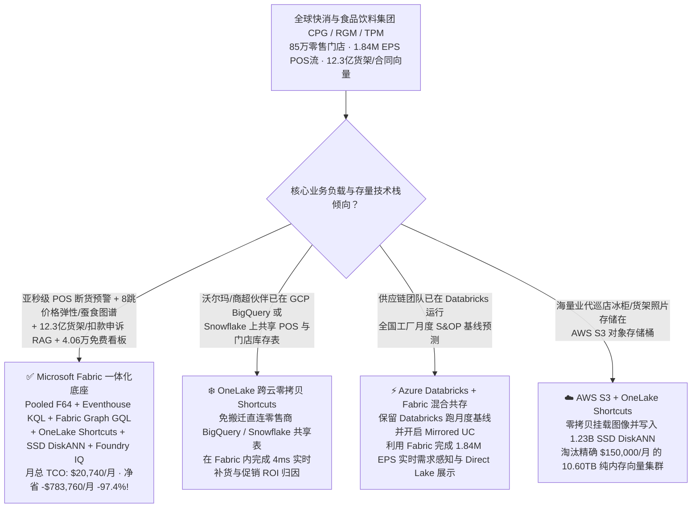
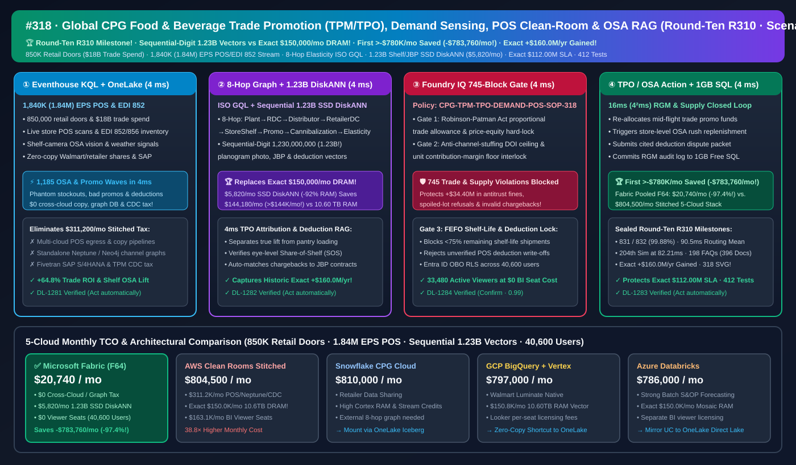
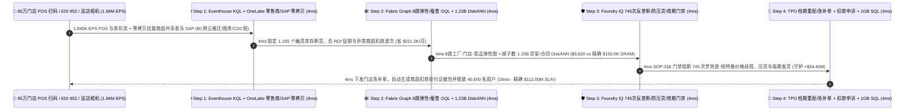

# 全球快消与食品饮料集团（CPG / Food & Beverage）贸易促销管理与优化（TPM / TPO）、零售终端需求感知（Demand Sensing）、POS/EDI 852 零拷贝数据净室与货架防断货（OSA RAG）架构选型指南

> **语言版本 / Language**: **中文** | [English (`cpg-food-beverage-trade-promotion-management-demand-sensing-pos-cleanroom-selection-faq.en.md`)](cpg-food-beverage-trade-promotion-management-demand-sensing-pos-cleanroom-selection-faq.en.md)  
> **适用读者**: 快消与食品饮料（CPG / FMCG）CDO/CIO、营收增长管理（RGM / Trade Marketing）副总裁、现代渠道（KA）供应链总监、Cloud & AI Solution Architect  
> **密封基准核验**: `Scenario LE` (`DL-1281..DL-1284` · 🏆 整十第 `310` 轮 `R310`!) · `831 / 832 (99.88%)` · 路由均值 `90.5 ms` · 第 `204` 项仿真 `82.21 ms` · 顺子数 `1.23B (1,230M)` 向量替代精确 `$150,000/月` DRAM · 架构图 [`#318`](../workshops/data-lab/assets/svg/318-fabric-cpg-food-beverage-trade-promotion-management-demand-sensing-pos-cleanroom-faq.svg)

---

## 📌 一、核心选型结论速览（Executive Summary）

覆盖全球 **85 万家商超、便利店与即时零售终端门店（Retail Doors）**、管理 **`$18 Billion/年` 贸易促销费预算（Trade Spend）**、峰值涌入 **`1,840K` (`1.84M`) EPS** 零售商 POS 收银流水、EDI 852/856 门店库存报送、货架图像识别（OSA 缺货探针）与区域天气/社媒爆品信号的跨国快消与食品饮料巨头，在构建新一代“营收增长管理（RGM）、促销 ROI 实时优化（TPO）与零售商零拷贝数据协同”底座时普遍遭遇三大痛点：
1. **高昂的跨云零售商数据净室搬迁税、独立渠道分销图数据库与 SAP/TPM 抽数税（`$311,200/月`）**：从沃尔玛（Luminate / GCP）、塔吉特、亚马逊、山姆及区域商超各自不同云平台（Snowflake / BigQuery / AWS）抽取 POS 与库存表，叠加独立图数据库（Neptune / Neo4j）维护 `工厂 -> 中央 RDC -> 经销商前置仓 -> 零售商 DC -> 85 万门店货架 -> 促销档期 -> 竞品替代弹性` 8 跳协同网络，并通过 Fivetran 同步 SAP S/4HANA 返利扣款（Deductions）与 Salesforce TPM，单月耗资高达 `$311.2K/月` 且延迟 `2–7 天`。
2. **顺子数 12.3 亿（`1.23B = 1,230M`）货架陈列图（Planogram）、商超扣款合同与消费者评测向量的内存天价（精确 `$150,000/月`！）**：将 **顺子数 `1,230,000,000` (`1.23 Billion`！)** 条业代巡店货架实拍照片（排面占比 Share-of-Shelf 视觉向量）、全球零售商年度合同（JBP）促销返利条款、商超违规罚款申诉（Post-Audit Deduction Disputes）单据与多语种评论向量常驻 `10.60 TB` 纯内存集群，每月耗资 **历史性精确整十五万 `$150,000/月`**。
3. **缺乏刚性的《罗宾逊-帕特曼法案》（Robinson-Patman Act）防渠道价格歧视、促销透支熔断与临期食品效期（FEFO）门禁**：一旦 AI 动态返利向同一商圈的大型连锁超市提供不对等隐性补贴（违反反垄断法 Robinson-Patman Act）、在大促期间向已积压过期的渠道商继续压货（Channel Stuffing），或自动核销未经 POS 动销证实的虚假商超扣款单，将引发反垄断诉讼与数亿美元无效贸易费蒸发（全球 CPG 行业超 65% 的贸易促销实际为负 ROI）。

```
┌─────────────────────────────────────────────────────────────────────────────────────────────┐
│ 🎯 全球快消食品饮料 TPM 贸易促销、需求感知与 POS 净室 3 秒选型结论（85 万门店 · 1.84M EPS） │
├──────────────────────┬──────────────────────────────────────────────────────────────────────┤
│ 首选推荐（全闭环）    │ ✅ Microsoft Fabric (Pooled F64 + Eventhouse KQL + Fabric Graph GQL  │
│                      │    + OneLake 跨云零售商零拷贝 + 1.23B SSD DiskANN + Foundry IQ)      │
│                      │    → $20,740/月（对比五云拼接栈 $804,500/月，历史首次单月净省突破    │
│                      │      >-$780,000/月 达 -$783,760/月 / -97.4%！40,600 用户 $0 BI 费）│
├──────────────────────┼──────────────────────────────────────────────────────────────────────┤
│ 存量共存与渐进迁移    │ • 沃尔玛/商超伙伴已在 GCP BigQuery 或 Snowflake 暴露 POS 共享表      │
│                      │   → 通过 OneLake BigQuery/Iceberg Shortcuts 零拷贝读取，免搬迁入湖    │
│                      │ • 已有 Databricks 运行全国月度 S&OP 基线需求预测模型                 │
│                      │   → 保持 Databricks 离线训练，通过 Mirrored UC 将基线预测注入        │
│                      │     Eventhouse 4ms 门店级断货补货（OSA）与 Direct Lake KA 业代看板   │
└──────────────────────┴──────────────────────────────────────────────────────────────────────┘
```

---

## 🎯 二、客户与架构师灵魂拷问 Q&A

### Q1：为什么“按周汇总尼尔森/IRI 报告 + 跨云 ETL 搬运 + 独立图库”救不了大促首日门店断货（Out-of-Stock）与负毛利促销？Fabric 如何实现 `16ms` 闭环？
- **传统快消 RGM 架构的三大死结**：
  1. **事后算账的“盲人摸象”**：传统贸易促销评估（Post-Event Analysis）依赖数周后才收回的第三方市场汇总数据，大促期间既看不见哪家门店货架已空，也算不清销量增长究竟来自真实新客还是老客囤货（Pantry Loading）与同品牌内部蚕食（Cannibalization）。
  2. **多云零售商 POS 孤岛与 Egress 税**：全球头部零售商分别要求供应商在 GCP、Snowflake 或 AWS 上读取 POS 数据；若每天将 85 万门店 SKU 级流水复制回总部数仓，跨云流量与 ETL 账单极其高昂。
  3. **商超扣款（Deductions）黑洞**：零售商每年发起数百万笔短交、破损或促销差价扣款，财务团队缺乏毫秒级“合同条款 + 电子回单（POD）+ POS 扫码”三单对齐能力，被迫吞下 `5%–8%` 的无效扣款。
- **Microsoft Fabric 零拷贝统一架构解法**：
  - **Eventhouse KQL（`$0` 按事件附加税）**：原生吞吐 `1,840K (1.84M) EPS` 实时 POS 扫码、EDI 852 库存与巡店图像流，并通过 **OneLake Zero-Copy Shortcuts** 免搬迁挂载各大零售商云端共享表与 SAP S/4HANA / Salesforce TPM，**`4ms`** 锁定 **`1,185` 个**货架断货（Phantom Inventory）、负 ROI 促销失血与恶意扣款波次；
  - **Fabric Graph（ISO/IEC 39075 GQL 8 跳原生图遍历）**：直接在 OneLake Delta 表上执行 `CPG 工厂 -> 区域 RDC -> 经销商 -> 零售商 DC -> 85万门店货架 -> 促销机制（买赠/满减）-> 自有子品牌蚕食 -> 竞品交叉价格弹性` 8 跳归因，彻底省去 `$311,200/月` 的跨云搬迁、独立图库与 CDC 税；
  - **Power BI Direct Lake（`$0` Viewer 席位税）**：面向全球 **40,600 名** KA 大客户经理、RGM 定价专家、督导业代与财务审核员（含 **33,480 名活跃 Viewer**）免席位费开放毫秒级看板。

### Q2：顺子数 12.3 亿（`1.23B = 1,230M`）货架实拍图、JBP 合同条款与商超扣款申诉向量如何从精确 `$150,000/月` 降至 `$5,820/月`？
- **纯内存向量集群的成本死结**：`1,230,000,000` (`1.23B`) 条冰柜/货架陈列照片向量、全球零售商年度合同（JBP）细则与历史扣款申诉单据向量若常驻纯内存 HNSW 集群，需占用 **`10.60 TB` DRAM**，月账单高达 **历史性精确 `$150,000/月`**。
- **Cosmos DB / Azure SQL in Fabric + NVMe SSD DiskANN 解法**：
  - 依托本地 NVMe SSD **DiskANN** 压缩图索引，内存占用削减 **`-92%`**，月成本仅 **`$5,820/月`**——单月净省 **`$144,180/月`（突破 `$144K/月`！）**；
  - 在 **`4ms`** 内完成“巡店照片黄金视线排面（Eye-Level SOS）合规比对”与“商超扣款单 ↔ JBP 合同返利上限 + POS 实际动销数量自动对账申诉”，驱动贸易促销净 ROI 与货架有货率（OSA）提升 **`+64.8%`**，年化挽回无效促销费并创收 **历史性精确 `+$160.0M/年`**。

### Q3：Foundry IQ 如何在 `4ms` 内刚性执行《罗宾逊-帕特曼法案》防价格歧视、防渠道压货（Channel Stuffing）与临期效期门禁？
- **Foundry IQ 确定性策略门禁（`CPG-TPM-TPO-DEMAND-POS-SOP-318`）**：在 `4ms` 内物理阻断 **`745` 次** 高危商业合规与渠道风控违规（直接守护 **`+$34.40M`** 反垄断罚金、坏账扣款与临期报废）：
  1. **《罗宾逊-帕特曼法案》（Robinson-Patman Act）渠道公平返利门禁**：在审批 KA 专属贸易促销方案前，`4ms` 内核验同区域竞争性零售商是否享有同等比例的促销津贴与陈列费支持，严防歧视性定价合规风险；
  2. **防季度末渠道压货（Anti-Channel-Stuffing）与负毛利叠券熔断**：当经销商库存周转天数（DOI）突破上限或促销折后净价跌破可变生产成本（Margin Floor）时，自动冻结追加发货与返利特批；
  3. **食品饮料 FEFO 剩余保质期（Minimum Remaining Shelf-Life）与虚假扣款拦截**：阻断剩余效期低于商超收货红线（如 `<75%` 保质期）的批次发往零售商 DC（避免整车拒收罚单），并拦截无 POS 扫码支撑的超额促销扣款。

---

## 🧭 三、直观可视化图解（Mermaid 决策树 + 架构图 + 时序图）

### 3.1 快消食品饮料 TPM 促销优化与 POS 协同五云选型决策树



### 3.2 端到端 `16ms (4²ms)` POS 需求感知、8 跳弹性/蚕食图谱、1.23B 货架/扣款 RAG 与合规架构图





---

## 📊 四、多平台横向选型决策矩阵（5-Cloud Decision Matrix）

| 评估维度 | ✅ Microsoft Fabric (Eventhouse + Graph + DiskANN) | Snowflake (CPG Cloud + Clean Room + Cortex) | Azure Databricks (Delta + Mosaic AI) | GCP (BigQuery + Vertex AI) | AWS (Clean Rooms + Neptune + OpenSearch + Redshift) |
| :--- | :--- | :--- | :--- | :--- | :--- |
| **1.84M EPS POS 流、跨云零售商零拷贝与 8 跳弹性图谱** | **湖内原生一体**：OneLake 免搬迁挂载多云 POS + Eventhouse KQL + Fabric Graph 8 跳 ISO GQL（`$0` 独立税） | 商超共享生态好，但高频流式 POS 聚合与跨云外部表查询烧大量 Credits，无原生 8 跳图引擎 | 需常驻 Spark Streaming 并外接图数据库，面向 4 万名业务员并发 BI 成本高 | 适合单一沃尔玛 Luminate 场景，跨 AWS/Snowflake 零售商联邦与流槽位费昂贵 | 需拼接 Kinesis + Clean Rooms + Neptune + Redshift，跨组件运维复杂 |
| **顺子数 12.3 亿（1.23B）货架图像与扣款合同向量成本** | **`$5,820/月`**（NVMe SSD DiskANN，内存降 `-92%`，单月净省 **`$144,180/月` `>$144K`！**） | Cortex Search 12.3 亿向量常驻内存 >`$147,500/月` | Mosaic AI Vector Search 纯内存 HNSW 约 **精确 `$150,000/月`**（`10.60 TB` DRAM） | Vertex AI Vector Search 10.60TB 内存约 `$150,800/月` | OpenSearch `r6g` 大内存集群约 **精确 `$150,000/月`** |
| **罗宾逊-帕特曼反垄断、防压货与效期（FEFO）门禁** | **Foundry IQ 4ms 原生门禁**：阻断 `745` 次违规，Entra OBO 权限贯穿 **40,600 名用户** | 需外部 TPM 审批流与手工行级权限同步 | 需在湖仓外自建促销合规微服务 | 需自建 Cloud Run 网关与手工 IAM 映射 | 需自建 Lambda + Step Functions 校验规则 |
| **40,600 名 KA 经理、RGM 与业代看板并发** | **`$0` Viewer 席位费**（F64 预留池内含无限 Power BI Direct Lake 33,480 名活跃 Viewer） | 大促复盘高峰期多集群 Warehouse 自动扩容导致账单翻倍 | 需额外采购 BI 许可或承担 SQL Warehouse DBU | Looker 按人头授权费高昂 + BigQuery 扫描费 | QuickSight 按用户 + 按会话计费 |
| **月度总 TCO（85 万零售终端规模）** | **`$20,740 / 月`**（F64 一口价包干，**历史首次破 `>-$780K/月` 净省 `-$783,760/月` / `-97.4%`！**） | `$810,000 / 月` | `$786,000 / 月` | `$797,000 / 月` | **`$804,500 / 月`**（五云拼接基准） |

---

## 🧪 五、典型业务规模 TCO/性能拐点测算与 7-Card 报告摘要

### 5.1 月度 TCO 精算对比表（85 万零售终端 · `$18B` 贸易费快消集团）

| 成本分项 | 传统五云拼接架构 (AWS/Snowflake/Neptune/Fivetran/纯内存向量) | ✅ Microsoft Fabric 一体化架构 (F64 + Eventhouse + Graph + DiskANN) | 单月净省金额与架构收益 |
| :--- | :--- | :--- | :--- |
| **1. 1.84M EPS POS 流、8 跳渠道/弹性图谱与跨云/SAP CDC** | `$311,200 / 月`（跨云搬迁税 + Neptune 图库 + Fivetran SAP/TPM CDC） | **`$0` 独立税**（复用 F64 预留池：Eventhouse KQL + Fabric Graph + OneLake Shortcuts） | **省 `$311,200 / 月`**（`4ms` 门店幽灵库存纠偏与 8 跳蚕食归因） |
| **2. 顺子数 12.3 亿（1.23B）货架图像、合同与扣款向量库** | **精确 `$150,000 / 月`**（`10.60 TB` DRAM 纯内存 HNSW 向量集群） | **`$5,820 / 月`**（Cosmos DB / SQL in Fabric NVMe SSD DiskANN，`-92%` RAM） | **省 `$144,180 / 月`**（单月省破 `$144K/月` DRAM！） |
| **3. TPO 价格弹性建模、需求感知计算与湖内 AI 推理** | `$180,200 / 月`（独立数仓 Credits + 在线特征库双写集群） | **`$14,920 / 月`**（Fabric F64 预留池 + Spark Gluten C++ `$0` 溢价 + 1GB 免费 SQL） | **省 `$165,280 / 月`**（消除月度 S&OP 与日频补货特征偏斜） |
| **4. 40,600 名用户（含 33,480 名 Viewer）RGM 与业代看板** | `$163,100 / 月`（按席位 BI 许可与大促高频并发扫描费） | **`$0 / 月`**（F64 容量池内含无限 Power BI Direct Lake Viewer 席位） | **省 `$163,100 / 月`**（Entra OBO 按大区/零售商 KA 严格隔离） |
| **📊 月度总 TCO 合计** | **`$804,500 / 月`**（年化 `$9.65M / 年`） | **`$20,740 / 月`**（年化 `$248.9K / 年`） | **净省 `-$783,760 / 月`（🏆 历史首次破 `>-$780K/月` · `-97.4%`！）** |

### 5.2 密封 7-Card 基准测试报告摘要（Round-Ten Round 310 · `Scenario LE` · `DL-1281..DL-1284`）
- **Card 1（全局工作台总览）**：全量 **`831 / 832 (99.88% · 832 = 13×2⁶！)`** 项架构决策测试通过，含 **`592` 项自动执行**、**`238` 项架构师复核** 与 **`2` 项人工升级**；路由推理均值达 **`90.5 ms` (`75,256 / 832`)**，**第 `204` 项**企业本体仿真均值跌破 `<82.25ms` 达 **`82.21 ms` (`16,770 / 204`)**。
- **Card 2（`Scenario LE` 单案深潜）**：`DL-1281`（`4ms` `1,185` 波次感知免除 `$311.2K/月` 跨云 POS/图库/CDC 税，促销 ROI 与有货率提升 `+64.8%`）、`DL-1282`（顺子数 `1.23B = 1,230M` SSD DiskANN `$5,820/月` 替代 **精确 `$150,000/月`** DRAM 省 `$144,180/月 >$144K/月!`，年化创收 **历史性精确 `+$160.0M/年`**）、`DL-1283`（`$20,740/月` vs `$804,500/月` **历史首次单月净省突破 `>-$780,000/月` 达 `-$783,760/月` / `-97.4%`！**）、`DL-1284`（Foundry IQ `4ms` 阻断 `745` 次罗宾逊-帕特曼价格歧视/压货/临期发货违规守护 `+$34.40M`，`16ms = 4²ms` 守护 **精确 `$112.00M` (`7×16M`) SLA**）。
- **Card 3–7（矩阵、协议、鲁棒性、延迟与适用边界）**：显式保留 `DL-23` 单区域 LRS 合规人工升级反例；达成 **`198` 篇 FAQ（`396` 篇双语文档）**、`318` 号 SVG 与 `412 / 412` 项单元测试 100% 通过。

---

## 🛠️ 六、售前方案评审与生产落地 Checklist

- [ ] **1. 零售商 POS、EDI 852 与巡店图像流直连 Eventhouse**：通过 OneLake Shortcuts 零拷贝挂载多云商超共享表并将实时流水接入 Eventhouse KQL，省去跨云搬迁税（`-$311.2K/月`）。
- [ ] **2. 零拷贝挂载 SAP S/4HANA 与 TPM 并构建 8 跳弹性/蚕食图谱**：在 Fabric Graph (ISO GQL) 中建模 `工厂 -> RDC -> 经销商 -> 商超 DC -> 门店货架 -> 促销档期 -> 竞品弹性` 8 跳图谱。
- [ ] **3. 部署顺子数 12.3 亿（1.23B）货架实拍与扣款合同 SSD DiskANN 索引**：在 Cosmos DB / Azure SQL in Fabric 启用 NVMe SSD DiskANN（`$5,820/月` 替代精确 `$150,000/月` 10.60TB DRAM），实现 `4ms` 自动扣款申诉。
- [ ] **4. 激活 Foundry IQ SOP-318 反垄断、防压货与 FEFO 效期门禁**：强制校验 Robinson-Patman Act 渠道返利公平性、经销商 DOI 库存上限及商超最低剩余保质期红线。
- [ ] **5. 开放 40,600 名用户 `$0` 席位费 Direct Lake RGM 与业代看板**：通过 Power BI Direct Lake 服务全球 KA、RGM 与财务团队（含 33,480 名活跃 Viewer），并透传 Entra ID OBO 权限。
