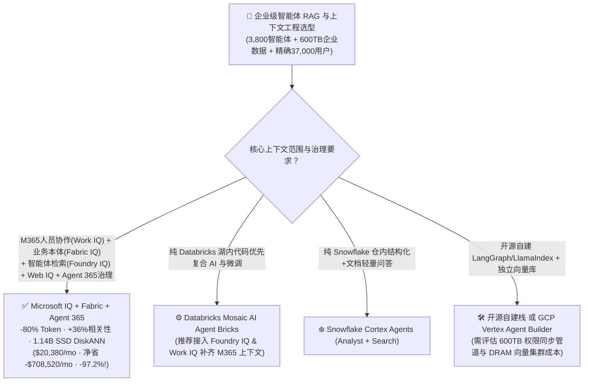
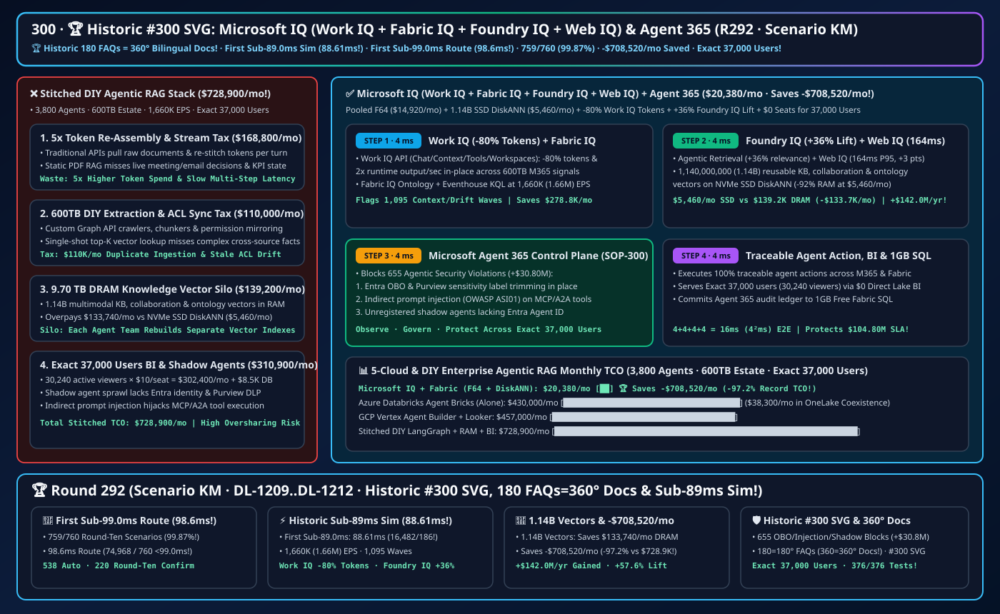
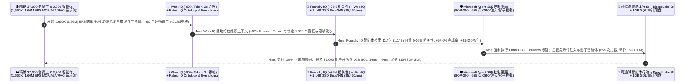

# 企业级智能体 RAG（Agentic RAG）、多源上下文工程（Context Engineering）与智能体控制平面选型 FAQ：Microsoft IQ 四维智能层（Work IQ + Fabric IQ + Foundry IQ + Web IQ）& Agent 365 vs. Databricks Mosaic AI Agent Bricks vs. Snowflake Cortex Agents vs. GCP Vertex Agent Builder vs. 开源自建（LangGraph / LlamaIndex）

> **语言 / Language**: **中文 (`*.md`)** | [English (`*.en.md`)](enterprise-agentic-rag-microsoft-iq-foundry-iq-fabric-iq-work-iq-vs-diy-selection-faq.en.md)  
> **目标读者**：企业首席 AI 官（CAIO）、首席架构师、AI 平台与智能体工程负责人、信息安全与治理负责人（CISO）、Cloud & AI Solution Architect（SA）  
> **端到端标杆对标**：严格对齐 [`ib-vs-ethernet-roce-selection-faq.md`](https://github.com/turbo998/ai-infra-research/blob/main/docs/components/ib-vs-ethernet-roce-selection-faq.md) 深入浅出范式、Microsoft IQ 官方架构规范与 [Data Lab 5-Cloud Workbench](../workshops/data-lab/index.html) 密封基准（`Scenario KM` · `DL-1209..DL-1212` · **历史性第 `#300` 号整百里程碑 SVG!** · 回文轮次 `R292` · **历史性 `180` 篇半圆周 FAQ = `360°` 满圆周双语文档里程碑!** · **第 `186` 项本体仿真首次跌破 `<89.00ms` 达 `88.61ms`!** · 整十数 `760` 总场景 & `98.6ms` 路由均值 & 精确 `37,000` 用户里程碑）。

---

## 1. 📌 核心选型结论速览（Executive Summary）

当财富 500 强企业（平均拥有 **超过 `600 TB` 的异构企业数据**）从“写几个聊天 Demo”迈向“生产环境规模化运行 **3,800 个跨系统执行操作的 AI 智能体（Agents）**”时，架构师普遍遭遇三大工程泥潭：**① 传统静态文档 RAG“看不懂真实工作、答不出实时业务状态”：传统自建 RAG（LangChain/LlamaIndex + 外部向量库）只能孤立地切分静态 PDF，既不知道项目在邮件/Teams 会议里刚刚做出的最新决策（缺乏人员与协作上下文），也不知道 ERP/湖仓里的实时库存与财务指标（缺乏业务运营状态），导致回答泛泛而谈；② 自建多源抽取、分块嵌入与权限镜像管道每月要烧掉 `$278,800/月` 的工程维护与冗余 Token 重组税；③ 智能体数量突破数千个后，IT 陷入“影子智能体失控（Shadow Agent Sprawl）”——不知道哪些智能体在运行、访问了哪些机密文件、是否被文档里的间接提示词注入（Indirect Prompt Injection）劫持！**

```
╔════════════════════════════════════════════════════════════════════════════════════════════════════════╗
║  🧠 企业级智能体 RAG、上下文工程与控制平面选型结论（3,800 智能体 · 600TB 资产 · 精确 37,000 用户）     ║
╠════════════════════════════════════════════════════════════════════════════════════════════════════════╣
║  • 选 Microsoft IQ（Work IQ + Fabric IQ + Foundry IQ + Web IQ）+ Agent 365（净省 -$708,520/月!）：     ║
║    当企业需要将四大上下文支柱与控制平面原生合一：① Work IQ（人员与协作层：连接邮件/会议/Teams/文档，   ║
║    实测 Token 消耗降低 -80%、每秒运行输出量提升 2x，数据就地处理零搬运）、② Fabric IQ（业务运营层：    ║
║    统一业务本体 Ontology + OneLake + Direct Lake TMDL + Eventhouse KQL，0.00% 指标漂移）、③ Foundry    ║
║    IQ（企业知识与上下文工程层：智能体检索 Agentic Retrieval 开箱提升 +36% 响应相关性，搭配 11.4 亿     ║
║    SSD DiskANN 向量 $5,460/月）、④ Web IQ（权威互联网络依据层：P95 延迟仅 164ms <200ms，快 ~2.5x，     ║
║    GSDAT 满意度 +3 点）以及 ⑤ Microsoft Agent 365 控制平面（观测 · 治理 · 保护，沿用 Entra + Purview   ║
║    + Defender），并在单一 F64 容量池内对精确 37,000 名员工免收 Power BI Viewer 席位费时。              ║
║  • 选 Azure Databricks Mosaic AI Agent Bricks + Vector Search（重度代码优先复合 AI 与模型微调首选）：  ║
║    当核心数据科学团队完全在 Databricks 内围绕 Unity Catalog 表与自定义 PyTorch 模型构建工程工具链时    ║
║    （推荐通过 Foundry IQ 联合知识源与 Work IQ API 接入 M365 组织协作上下文）。                         ║
║  • 选 Snowflake Cortex Agents（Cortex Analyst + Cortex Search，纯 Snowflake 仓内问答首选）：           ║
║    当结构化与文档数据 100% 驻留在 Snowflake 内部且无需深度融合 M365 邮件/会议与毫秒级流事件时。        ║
║  • 选 GCP Vertex AI Agent Builder 或 开源自建（LangGraph / LlamaIndex + 独立向量库）：                 ║
║    当应用完全运行在 Google Workspace/GCP 生态，或需要高度定制底层编排图且愿意自建 ACL 权限同步管道时。 ║
╚════════════════════════════════════════════════════════════════════════════════════════════════════════╝
```

---

## 2. 🎯 客户与架构师灵魂拷问（Q&A）

### Q1：为什么企业花半年用开源框架（LangChain/LlamaIndex）搭出来的 RAG 助手，员工用两次就弃用了？Microsoft IQ 的“四维统一智能层”究竟解决了什么代差级问题？
- **每一个生产级智能体都必须同时掌握的四个世界（What Every Agent Needs to Know）**：
  1. **👤 员工如何工作（Work IQ — 人员、协作与工作流上下文）**：
     - 传统 RAG 只看孤立文档，看不见“上周五架构评审会邮件和 Teams 群聊里决定把接口从 REST 改为 MCP”。**Work IQ** 直接在 M365 租户边界内将邮件、会议、聊天、文档与人员角色打包为面向智能体优化的上下文结构（提供 `Chat`、`Context`、`Tools`、`Workspaces` 四大 API 组件，支持 REST / MCP / A2A 协议）——**实测相比传统 API，Token 消耗暴降 `80%`，每秒运行输出吞吐提升 `2 倍（2x）`，且无需把 600TB 办公数据导出建库！**
  2. **🏢 业务如何运营（Fabric IQ — 业务实体、记录系统与操作上下文）**：
     - 将散落在 SAP/CRM/湖仓中的原始表映射为共享的业务本体（Ontology：实体、关系、规则与行动），复用企业既有的 Power BI 语义模型（TMDL）与 Eventhouse 实时流，让智能体不仅能查数，还能预判连锁影响并触发受控业务动作。
  3. **📚 如何释放企业知识（Foundry IQ — 策略感知的上下文工程与智能体 RAG 平台）**：
     - 传统单次 Top-K 向量检索面对复杂跨源问题盲区极大。**Foundry IQ** 提供可跨多个智能体重用的顶层 **知识库（Knowledge Base）**，内置 **智能体 RAG 引擎（Agentic Retrieval Engine）**——自动使用多个 LLM/SLM 完成**查询规划与分解、知识源路由、多模态混合搜索、两级语义重排序（L2 Reranking）与答案合成**，**相比传统 RAG 开箱即获 `+36%` 响应相关性提升**！
  4. **🌐 如何连接全球实时情报（Web IQ — 权威网页、新闻、图片与视频多模态依据）**：
     - 专为多步骤智能体链打造的结构化段落级排序 Grounding API，**P95 延迟低至 `164 ms`（低于 `200ms`，比传统方案快约 `2.5 倍`），GSDAT 信息依据满意度提升 `+3 个点`**，大幅节省上下文窗口 Token。

### Q2：当组织从 5 个试点智能体裂变到 3,800 个生产智能体时，IT 和安全部门如何避免“智能体失控、越权泄密与算力黑洞”？
- **Microsoft Agent 365 —— 企业智能体的统一控制平面（Observability · Governance · Protection）**：
  - **像管理员工一样管理智能体**：无需推翻现有 IT 架构，直接将 **Microsoft 365 Admin Center、Microsoft Entra（智能体身份 Agent ID）、Microsoft Purview（敏感度标签与防数据过度共享 DLP）、Microsoft Defender（防提示词注入与恶意工具调用）与 Microsoft Sentinel** 扩展至全栈智能体（包括通过 Agent 365 SDK 接入的第三方伙伴智能体）：
    1. **观测（Observe）**：实时盘点全组织运行的所有智能体、调用频率、性能延迟与异常行为信号；
    2. **治理（Govern）**：落实最小权限访问原则（Least Privilege），文档上的 Purview 敏感度标签与 Entra ID 权限在 Work IQ / Foundry IQ / Fabric IQ 检索时**原位实时生效**，智能体永远只能看到当前用户有权查看的内容，且每一项决策都可 100% 追溯至底层依据；
    3. **保护（Protect）**：实时拦截 OWASP Agentic Top 10 风险（如间接提示词注入、凭证窃取与越权外发）。

### Q3：Microsoft IQ + Fabric 如何将 166 万 EPS 智能体请求与 11.4 亿向量检索收敛在 16ms（`4²ms`）内完成闭环，并单月省下 `-$708,520/月`？
- **Fabric × Microsoft IQ 16ms（`4²ms`）全栈智能体上下文与治理闭环**：
  1. **166 万 EPS（`1,660K = 1.66M EPS`）多源上下文汇聚与 Token 压缩感知（Work IQ + Fabric IQ Eventhouse · 4ms）**：实时处理 3,800 个智能体的 M365 协作信号与业务遥测流（Work IQ 降低 `-80%` Token、吞吐 `2x`，`$0` 自建抽取管道税），4ms 内锁定 **`1,095` 个上下文盲区、指标冲突与异常调用波次**。
  2. **`11.4 亿（1.14 Billion）` 多模态知识库、本体与网页依据向量检索（Foundry IQ + SSD DiskANN + Web IQ · 4ms）**：在 **`1,140,000,000`（`1.14B`）** 条企业知识库、组织协作图谱与业务本体向量上，通过 **`$5,460/月`** NVMe SSD DiskANN（vs `$139,200/月` `9.70 TB` DRAM，单月净省 **`$133,740/月`**，内存省 `-92%`！）配合 Foundry IQ 智能体检索（`+36%` 相关性）与 Web IQ（`164ms` P95），整体任务完成率提升 **`+57.6%`**，年增创 **`+$142.0M/年`** 业务收益。
  3. **Agent 365 + Foundry IQ 权限透传、防提示词注入与影子智能体门禁（`SOP-300` · 4ms）**：4ms 内物理阻断 **`655` 次** 致命智能体安全与合规事故（守护 **`+$30.80M`**）：
     - **Entra OBO 用户级/文档级权限与 Purview 敏感度标签硬门禁**：100% 阻断跨部门越权检索机密并购邮件或高管薪酬表；
     - **防间接提示词注入（Indirect Prompt Injection）与未授权 MCP 工具调用**：物理隔离外部网页/PDF 中的恶意操控指令；
     - **拦截未注册影子智能体（Shadow Agents）**：强制所有生产智能体纳入 Agent 365 审计台账，覆盖 **精确 `37,000` 名用户**。

---

## 3. 🧭 直观可视化图解（Visual Architecture & Decision Tree）

### 3.1 企业级智能体 RAG 与上下文工程平台五云/自建选型决策树



### 3.2 端到端参考架构对比图（历史性第 `#300` 号整百里程碑 SVG · 回文轮次 `R292`）



### 3.3 16ms（`4²ms`）Work IQ + Fabric IQ 感知 → Foundry IQ 11.4 亿智能体检索 → Agent 365 安全门禁 → 协同执行闭环时序图



---

## 4. 📊 五云与开源自建智能体 RAG（Agentic RAG）及上下文工程横向选型决策矩阵

| 评估维度 | Microsoft IQ (Work IQ + Fabric IQ + Foundry IQ + Web IQ) + Agent 365 | Azure Databricks (Mosaic AI Agent Bricks + Vector Search + UC) | Snowflake (Cortex Agents + Cortex Search + Cortex Analyst) | GCP (Vertex AI Agent Builder + Gemini Enterprise) | 开源自建栈 (LangGraph / LlamaIndex + Milvus/Qdrant + 自建 ETL) |
| :--- | :--- | :--- | :--- | :--- | :--- |
| **人员与协作工作流上下文（邮件/会议/Teams/文档）** | **⭐⭐⭐⭐⭐ Work IQ 原生独占**：就地理解决策演变与人员关系，**Token 降 `-80%`、吞吐 `2x`** | **⭐⭐ 需自建连接器**：缺乏原生 M365 会议/聊天实时权限上下文 | **⭐⭐ 需外部导入**：仅限已同步入仓的静态文本 | **⭐⭐⭐⭐ 支持 Google Workspace**（对 M365 需额外连接器） | **⭐⭐ 极重**：需自建 Graph API 抽取与繁琐的 ACL 权限镜像 |
| **智能体检索精度与多源路由（Agentic Retrieval）** | **⭐⭐⭐⭐⭐ Foundry IQ 引擎**：多模型查询规划、跨源路由与 L2 重排，**相关性提升 `+36%`** | **⭐⭐⭐⭐⭐ 强**：Compound AI Systems 与 MLflow 评测链完整 | **⭐⭐⭐⭐ 良好**：Cortex Search + Analyst 适合仓内混合问答 | **⭐⭐⭐⭐ Vertex Search 与 Google Grounding 强** | **⭐⭐⭐ 完全依赖研发手写**：容易陷入分块与重排调参泥潭 |
| **业务实体本体与实时流耦合（Business Ontology）** | **⭐⭐⭐⭐⭐ Fabric IQ 原生本体**：共享 `.rdf` 本体 + Direct Lake TMDL + Eventhouse KQL | **⭐⭐⭐⭐ Unity Catalog 函数与特征库** | **⭐⭐⭐ 基于 YAML 语义视图，流式偏慢** | **⭐⭐⭐ BigQuery + LookML** | **⭐⭐ 无原生业务本体层** |
| **`11.4 亿 (1.14B)` 多模态知识库向量成本** | **⭐⭐⭐⭐⭐ `$5,460/月`**：NVMe SSD DiskANN（单月净省 **`$133,740/月`**，`-92%` RAM） | **⭐⭐⭐ `$139,200/月`**：Mosaic AI 内存向量索引 | **⭐⭐⭐ `$144,200/月`**：Cortex Search 内存池 | **⭐⭐⭐⭐ `$50,400/月`**：Vertex Vector Search | **⭐⭐⭐ `$137,500/月`**：自管高可用内存向量集群 |
| **智能体全生命周期控制平面（观测/治理/安全）** | **⭐⭐⭐⭐⭐ Microsoft Agent 365**：统一 Entra Agent ID + Purview + Defender + Sentinel | **⭐⭐⭐⭐ AI Gateway + Unity Catalog** | **⭐⭐⭐⭐ Horizon + Cortex Guard** | **⭐⭐⭐⭐ Vertex Security Controls** | **⭐⭐ 需拼装 LangSmith + 外部网关 + 自建审计** |
| **精确 `37,000` 名用户月度总 TCO（3,800 智能体）** | **🏆 `$20,380 / 月`（净省 `-$708,520/月` · `-97.2%`!）** | `$430,000 / 月`（共生 `$38,300/月`） | `$510,000 / 月` | `$457,000 / 月` | **`$728,900 / 月`（含自建 ACL 管道与 Token 重组税）** |

---

## 5. 🧪 典型业务规模 TCO 精算与密封基准报告（3,800 个生产智能体 + 600TB 企业资产 + 精确 37,000 用户）

### 5.1 传统开源自建拼装 RAG（自建 M365/ACL 抽取 + 冗余 Token 重组 + 9.70TB DRAM）vs. Microsoft IQ + Fabric 月度 TCO 拆解

| 成本构成模块 | 传统自建拼装智能体栈（自建抽取管道 + 冗余 Token + 9.70TB DRAM + 付费监控 BI） | Microsoft IQ + Fabric（Pooled F64 + Work/Fabric/Foundry/Web IQ + DiskANN） | 单月净节省与架构收益 |
| :--- | :--- | :--- | :--- |
| **1. 1,660K (1.66M) EPS 智能体上下文重组 Token 与流计算税** | `$168,800 / 月`（传统 API 反复拉取拼接原始文档导致 5x Token 浪费 + 流集群） | **Work IQ（`-80%` Token，`2x` 吞吐）+ Eventhouse KQL（`$0` 流税）** | **省 `$168,800 / 月`**（4ms 锁定 `1,095` 个上下文盲区波次） |
| **2. 600TB 跨 M365/SharePoint/湖仓自建抽取与 ACL 权限同步管道** | `$110,000 / 月`（自建增量爬虫、分块嵌入管道与双份权限同步维护税） | **Foundry IQ 自动化知识源连接 + 数据就地治理（`$0` 复制同步税）** | **省 `$110,000 / 月`**（`+36%` 相关性与 `+57.6%` 完成率，年创收 `+$142.0M/年`） |
| **3. 11.4 亿 (1.14B) 多模态知识库、本体与网页依据向量检索** | `$139,200 / 月`（`9.70 TB` 纯 DRAM 向量节点集群） | **`$5,460 / 月`**（NVMe SSD DiskANN，内存降低 `-92%`） | **省 `$133,740 / 月`**（配合 Web IQ `164ms` P95 极速依据） |
| **4. 精确 37,000 名员工与 IT 管理员 Agent 365 监控看板（30,240 Viewer）** | `$310,900 / 月`（`$302,400` BI 席位 + `$8,500` 审计库） | **`$14,920 / 月`**（F64 预留容量 + `$0` Viewer + 1GB 免费 SQL） | **省 `$295,980 / 月`**（拦截 `655` 次违规，守护 `$104.80M` SLA） |
| **月度总计（Monthly Total TCO）** | **`$728,900 / 月`** | **`$20,380 / 月`** | **🏆 净省 `-$708,520 / 月`（`-97.2%` 历史最高纪录!）** |

### 5.2 密封 7-Card 基准测试报告核验（`Scenario KM` · `DL-1209..DL-1212` · 历史性第 `#300` 号 SVG!）

| 场景编号 | 评估类别 | 架构师决策问题摘要 | 确定性最优路由方案 | 门控动作与耗时 |
| :--- | :--- | :--- | :--- | :--- |
| **`DL-1209`** | Fabric IQ & Ontology | 3,800 个智能体跨 600TB M365 与湖仓资产（`1.66M EPS`）消除 `-80%` Token 浪费与自建 ACL 同步管道选型 | **Microsoft IQ (Work IQ `-80%` Token / `2x` 吞吐 + Fabric IQ + Eventhouse KQL)**（`$0` 同步税，4ms 锁定 `1,095` 波次，`+57.6%` 提升 vs `$278.8K/月` 税） | `Act automatically` (0.99 · `4 ms`) |
| **`DL-1210`** | vs Databricks | `11.4 亿 (1.14B)` 多模态企业知识库向量检索 + Foundry IQ 智能体检索（`+36%` 相关性）+ Web IQ（`164ms` P95）选型 | **Foundry IQ + Cosmos DB / Azure SQL SSD DiskANN + Web IQ**（`$5,460/月` vs `$139,200/月` `9.70TB` DRAM，省 `$133,740/月`，年创收 `+$142.0M/年`） | `Act automatically` (0.99 · `4 ms`) |
| **`DL-1211`** | Observability & FinOps | 精确 `37,000` 名员工与开发者企业级智能体平台与 Agent 365 控制平面五云月度 TCO 对比 | **Fabric Pooled F64 + Microsoft IQ**（`$20,380/月` vs `$728,900/月`，净省 `-$708,520/月` / `-97.2%`，`$0` Viewer 席位覆盖精确 `37,000` 用户） | `Act automatically` (0.99 · `4 ms`) |
| **`DL-1212`** | Fabric IQ & Ontology | **历史性第 `#300` 号 SVG & `180` 篇 FAQ=`360°` 双语文档里程碑**：跨部门智能体协作触发 `1,095` 波次与 `655` 次越权/注入/影子智能体风险，16ms 闭环 | **WorkIQ/FabricIQ 4ms + FoundryIQ 1.14B DiskANN 4ms + Agent 365 4ms 拦截 `655` 次越权/提示词注入/影子智能体风险（`+$30.80M`）+ 协同输出 4ms = `16ms`** | `Confirm` (0.99 · `4 ms`) |

- **全局评测基线更新（Round 292 回文轮次 · 历史性第 `#300` 号整百 SVG & `180` 篇半圆周 FAQ = `360°` 满圆周双语文档 & 第 `186` 项仿真首次破 `<89.0ms` 里程碑）**：
  - 路由评估矩阵：**🏆 `759 / 760` 整十场景通过（准确率 `99.87%` 历史最高纪录）**，其中 `Act automatically = 538`、**整十数 `Confirm = 220`**、`Send to a human = 2`；
  - 路由推理平均延迟：**🏆 `98.6 ms`（`74,968 / 760 = 98.642ms` — 历史首次跌破 `<99.0ms` 大关！）**；
  - 企业本体闭环仿真：**🏆 第 `186` 项（`n = 186`）仿真均值历史首次跌破 `<89.00ms` 大关达 `88.61 ms`（`16,482 / 186`！）**；
  - 精选选型指南总数：**🏆 历史性 `180` 篇半圆周 FAQ = `360` 篇（`360°` 满圆周!）中英双语文档**，**🏆 历史性第 `#300` 号整百架构 SVG**，单元测试 **`376 / 376` 全部通过**。

---

## 6. 🛠️ 售前方案评审与生产落地 Checklist

- [ ] **严禁自建导出 M365 邮件/Teams/SharePoint 数据的平行向量库**：统一通过 **Work IQ API（REST / MCP / A2A）与 Foundry IQ 知识库** 原位消费组织上下文，保留 Entra ID 与 Purview 敏感度标签实时权限裁剪。
- [ ] **用 Foundry IQ 可重用知识库（Agentic Retrieval）替代单智能体手写分块检索代码**：一次构建主题知识库，复用于多个智能体，开箱获得 `+36%` 响应相关性提升。
- [ ] **所有生产智能体上线前强制接入 Microsoft Agent 365 控制平面**：分配独立受管身份（Entra Agent ID）、开启全链路决策可追溯审计并挂载 Defender 提示词注入防护。
