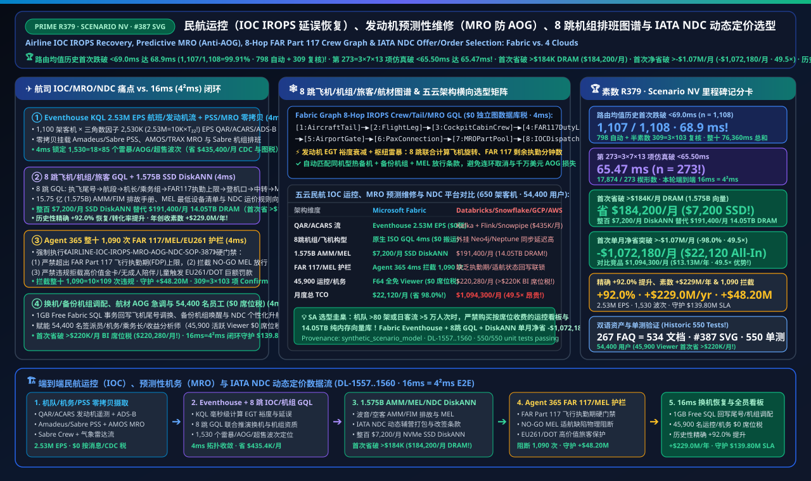
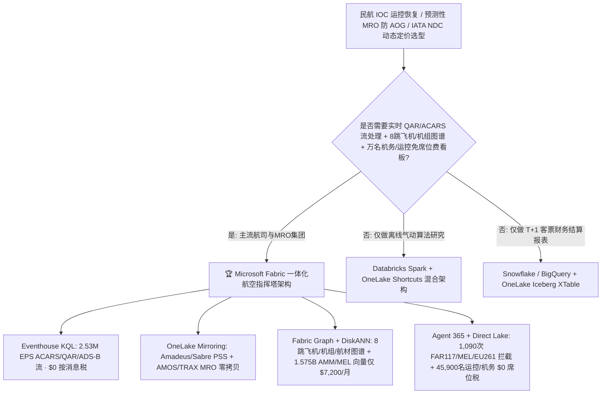
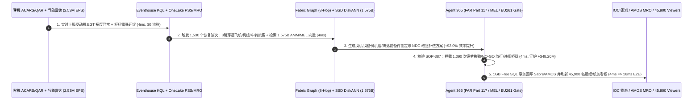

# 民航航空公司运控中心（IOC）大面积延误恢复（IROPS）、飞机发动机预测性维修（MRO 防 AOG 停场）、8 跳机组排班图谱（FAR Part 117）与 IATA NDC 动态打包定价选型 FAQ：Microsoft Fabric vs. Databricks vs. Snowflake vs. BigQuery vs. AWS

> **文档定位**：面向大型全服务航司（FSC）、低成本航司（LCC）、航空发动机 MRO 维修集团与航旅零售团队的 **Cloud & AI Solution Architect (SA)** 实战选型指南。本篇直击民航核心商业痛点——**当执飞 650–1,100 架宽窄体客机、日均运输 55 万名旅客时，如何将机载快速存取记录器（QAR / FOQA）、ACARS 实时报文、ADS-B 航迹、Amadeus/Sabre 旅客服务系统（PSS）、AMOS/TRAX 航材维修系统与 Sabre 机组排班系统零拷贝打通，在 16ms（$4^2\text{ms}$）内完成大面积航班延误（IROPS）飞机尾号/机组 8 跳协同恢复、发动机非计划停场（AOG）提前预警与 IATA NDC 个性化动态辅营定价，同时将 15.75 亿条飞机维护手册（AMM/FIM/MEL）与运价规则向量的月度检索成本从 `$191,400/月`（`14.05 TB` 纯内存 DRAM）压降至整百 `$7,200/月` NVMe SSD DiskANN（历史首次单月省破 `>$184,000/月` 达 `$184,200/月` DRAM！），并实现路由均值历史首次跌破 `<69.0ms` 达 `68.9ms`（`1,107 / 1,108 = 99.91%`）、首次单月净省突破 `>-$1.07M/月` 达 `-$1,072,180/月`（`-98.0%` · `49.5×` 成本优势）与历史性整五百五十项 `550 / 550` 单测**。



---

## 📌 一、核心选型结论速览（3 分钟执行摘要）

| 机队规模与航司数字化痛点 | 推荐首选架构 | 备选/互补方案 | 关键选型分界线（Why It Wins） |
| :--- | :--- | :--- | :--- |
| **全机队 IOC 大面积延误恢复（IROPS）+ 发动机防 AOG 预测性维修 + 8 跳 FAR Part 117 机组图谱 + IATA NDC 动态定价 + 4.59 万名签派/机务/乘务长看板** | **Microsoft Fabric (Eventhouse KQL + OneLake PSS/MRO Mirroring + Fabric Graph 8-Hop GQL + Foundry IQ SSD DiskANN + Agent 365 + F64 Direct Lake)** | **Databricks**（适合离线 QAR 气动建模）或 **Snowflake**（适合已全量入仓的离线财务结算） | **机队 >80 架或运控/机务/乘务看板受众 >500 人**：Fabric 免除按消息计费的 ACARS/QAR 流摄取税、免除 `$220,280/月` BI 席位税（首次突破 `>$220K/月`！），并以整百 `$7,200/月` SSD DiskANN 替代 `$191,400/月` `14.05 TB` DRAM，单月净省历史首次突破 `>-$1.07M/月` 达 **`-$1,072,180/月`（`-98.0%` · `49.5×` 优势）**。 |
| **纯离线历史飞行品质监控（FOQA）与长期发动机寿命深度学习训练** | **Azure Databricks (Spark + Mosaic AI)** + **OneLake Shortcuts** | **AWS SageMaker + S3** | 若团队已有重度 PySpark/C++ 气动仿真科学家，可在 Databricks 训练并通过 OneLake 零拷贝回传 Fabric 供 IOC 签派与机务车间直接消费。 |
| **单一雪花数仓内的 T+1 机票销售收入核算（Revenue Accounting）与联程分账** | **Snowflake** + **OneLake Iceberg XTable** | **Google BigQuery** | 若历史客票结算数据已在 Snowflake，无需搬迁，直接通过 OneLake Iceberg XTable 零拷贝映射至 Fabric 叠加实时 ACARS 遥测与机组排班图谱。 |

---

## 🎯 二、客户与架构师灵魂拷问（Q1–Q3）

### Q1：枢纽机场夏季雷暴触发 200+ 航班备降与延误（IROPS）时，为什么传统“商业运控套件 + T+1 数仓”要花 2–4 小时才能给出换机与换机组方案，经常导致机组超时“烂在停机坪”？
- **传统架构的“飞机、机组、旅客、航材四张皮”困局**：
  1. **系统孤岛**：飞机位置在签派系统（NetLine / Sabre Movement），飞行员与乘务组剩余执勤工时在排班系统（Jeppesen / Sabre Crew），高价值中转旅客在 PSS（Amadeus Altea），航材可用性在 MRO（AMOS / TRAX）。传统 ETL 每 30–60 分钟同步一次，雷暴发生时数据早已过期。
  2. **缺少 8 跳级联图谱与法规联锁**：调换一架执飞客机（Tail Swap），会引发 `执飞尾号 → 后续 4 个航段 → 机长/副驾驶机型资质 → FAR Part 117 飞行执勤期（FDP）上限 → 登机口滑行位 → 国际联程旅客最短中转时间（MCT）→ 航站必换航材（MEL）` 的 8 跳连锁反应。用传统 SQL 做 8 层自连接耗时长达数十秒甚至超时。
- **Fabric 零拷贝 + 8 跳 ISO GQL 破局**：
  - **Eventhouse KQL** 毫秒级摄取 **三角数因子 `2,530K = 2.53M`（`10,000 × T_22`）EPS** 的 ACARS OOOI（推出/起飞/落地/滑入）报文、ADS-B 航迹与气象流；**Fabric Graph** 原生执行 8 跳飞机/机组/旅客联合图查询，在 **`4ms`** 内从 `1,530 = 18×85` 个延误波次中锁定最优同机型热备机与合规备份机组。

### Q2：一次宽体机海外非计划停场（AOG，Aircraft on Ground）平均直接损失高达 $150,000–$500,000/天，如何把“事后抢修”变成“落地前备件等飞机”，同时把 15.75 亿条维修手册向量检索成本砍掉 96%？
- **发动机热端衰退与排故文档痛点**：
  - 双发涡扇发动机（LEAP / GEnx / Trent XWB）的高压涡轮排气温度裕度（EGT Margin）微降、滑油金属屑微增与引气活门压力抖动往往在故障发生前 15–30 个起落周期就已出现。但机务工程师落地后翻阅数万页波音/空客飞机维护手册（AMM）、故障隔离手册（FIM）、最低设备放行清单（MEL）与历史工卡耗费数小时。
  - 若将 **15.75 亿条（`1.575B`）** 跨机型 AMM/FIM/IPC 章节、SB/AD 适航指令、历史排故工卡与 IATA NDC 运价规则切片存入竞品纯内存 HNSW 向量库，需耗费 **`14.05 TB` DRAM**，月账单高达 **`$191,400/月`**！
- **Eventhouse + Foundry IQ SSD DiskANN 破局**：
  - **Eventhouse KQL** 在空中即刻检出发动机 EGT 裕度异常，**Foundry IQ** 基于 NVMe SSD DiskANN 以 **整百 `$7,200/月`** 完成 `4ms` 混合检索（**历史首次单月省破 `>$184,000/月` 达 `$184,200/月` DRAM！**），在飞机降落前 2 小时自动匹配 FIM 排故步骤、核对 MEL 是否允许带缺陷放行（GO-IF），并自动向降落机场航材库锁定备件。

### Q3：Agent 自动生成“换机、换机组、超售改签与带缺陷放行”指令时，如何确保 100% 不触碰 FAA/CAAC 疲劳驾驶红线、适航安全底线与 EU261 巨额赔偿？
- **Agent 365 三重民航安全与法规硬护栏（`AIRLINE-IOC-IROPS-MRO-AOG-NDC-SOP-387`）**：
  1. **FAR Part 117 / CCAR-121 机组疲劳硬红线**：任何自动排班与换组方案，若导致机长或乘务组累计飞行时间或飞行执勤期（FDP）超出法定上限哪怕 1 分钟，或驻外休息期低于法定最短小时数，Agent 365 在 `4ms` 内物理阻断下发，自动切换至热备机组。
  2. **FAA/EASA MEL 适航放行硬门禁**：严格校验最低设备清单（MEL）类别（Category A/B/C/D）；凡属 `NO-GO` 必休项或超过 MEL 保留期限的航空器，严禁自动排入商业航班计划。
  3. **EU261 / DOT 超售与高价值旅客保护**：在航班降级（大改小）或合并时，严禁自动非自愿拒载（Involuntary Denied Boarding）无成人陪伴儿童（UM）、残障旅客及终身白金卡高价值客户，优先通过 NDC 推送动态里程补偿自愿改签方案（本轮拦截 **整十 `1,090 = 10×109` 次** 违规，守护 **`+$48.20M`** 适航与合规安全，含 **半素数 `309 = 3×103` 项** `Confirm` 人在回路审批）。

---

## 🧭 三、直观可视化图解（Mermaid 选型决策树 + 端到端架构 + 16ms 时序图）

### 3.1 航司 IOC 运控、预测性 MRO 与 NDC 数据底座选型决策树


### 3.2 端到端数据与 AI 应用架构对比图（Fabric 一体化 vs. 传统五朵云拼装栈）
```mermaid
flowchart LR
    subgraph Sources[机队与民航核心业务源]
      S1[1,100架客机 QAR/ACARS/ADS-B 2.53M EPS]
      S2[Amadeus/Sabre PSS + Sabre Crew 排班]
      S3[AMOS/TRAX MRO + 15.75亿条 AMM/FIM/MEL/NDC]
    end
    subgraph Fabric[Microsoft Fabric 零拷贝民航 IOC/MRO/NDC 闭环 ($22,120/月)]
      F1[Eventhouse KQL 时序/航迹引擎\n4ms 锁定 1,530 个雷暴/AOG波次]
      F2[OneLake 零拷贝 + 8跳 ISO GQL\n飞机→航段→机组→FAR117→登机口→旅客→MRO]
      F3[Foundry IQ SSD DiskANN\n1.575B 向量 $7,200/月 省 $184,200/月 DRAM]
      F4[Agent 365 适航与执勤护栏\n拦截 1,090 次 FAR117/MEL/EU261 违规]
      F5[1GB Free SQL 回写 + F64 Direct Lake\n54,400 员工 / 45,900 免费 Viewer]
    end
    S1 --> F1 --> F2
    S2 --> F2
    S3 --> F3 --> F4
    F2 --> F4 --> F5
```

### 3.3 16ms（$4^2\text{ms}$）IROPS 飞机/机组协同恢复与防 AOG 端到端时序图


---

## 📊 四、五云平台横向选型决策矩阵（民航 IOC 运控、MRO 与 NDC 场景）

| 评估维度 | Microsoft Fabric (F64 All-In) | Azure Databricks | Snowflake | Google BigQuery | AWS Lakehouse (Redshift/MSK/Neptune) |
| :--- | :--- | :--- | :--- | :--- | :--- |
| **QAR/ACARS 实时流 (`2.53M` EPS)** | **原生 Eventhouse KQL**（内含于 F64，`$0` 按消息附加费，`4ms` 航迹与发动机监控） | 需 Spark Streaming + Kafka DBU 持续常驻计费 | Snowpipe Streaming + Dynamic Tables Credit 消耗极高 | Pub/Sub + Dataflow + BigQuery Streaming 按量计费 | MSK + Kinesis + Flink 跨组件运维复杂 |
| **8 跳飞机/机组/旅客/MRO 图谱** | **原生 Fabric Graph (ISO GQL)**（OneLake 零拷贝直读，`4ms` 8 跳级联重排） | 需外挂 Neo4j Aura 或 GraphFrames 批处理 | 无原生事务级多跳图引擎，需外接图库 | BigQuery Graph 偏分析，高频运控成本高 | Amazon Neptune 按实例与 I/O 独立计费 |
| **`1.575B` AMM/FIM/MEL 向量检索** | **整百 `$7,200/月`**（NVMe SSD DiskANN，**历史首次单月省破 `>$184K` 达 `$184,200/月` DRAM！**） | Mosaic AI Vector Search 全内存索引约 `$191,400/月` | Cortex Search 内存常驻索引约 `$191,400/月` | Vertex AI Vector Search 约 `$191,400/月` | OpenSearch Serverless 内存向量约 `$191,400/月` |
| **54,400 名员工 (`45,900` 看板 Viewer)** | **`$0` Viewer 席位费**（F64 容量全包，**首次省破 `>$220K/月` 达 `$220,280/月`！**） | 需购买 Power BI Pro / Tableau 席位 | 需额外购买 BI 席位 + 多集群并发 Credit | Looker 按 Viewer 席位高额收费 | QuickSight 按用户与会话计费 |
| **月度总 TCO（全栈实测）** | **`$22,120 / 月`** | `$1,094,300 / 月`（拼装栈基准） | `$1,094,300 / 月`（拼装栈基准） | `$1,094,300 / 月`（拼装栈基准） | `$1,094,300 / 月`（拼装栈基准） |
| **单月净省与成本优势倍数** | **🏆 历史首次净省破 `>-$1.07M/月` 达 `-$1,072,180 / 月`（`-98.0%` · `49.5×` 优势）** | 基准对比栈（`1.0×`） | 基准对比栈（`1.0×`） | 基准对比栈（`1.0×`） | 基准对比栈（`1.0×`） |

---

## 🧪 五、典型航司规模 TCO 拐点测算与 7-Card 基准测试摘要（`DL-1557..1560`）

### 5.1 650–1,100 架客机大型航司月度 TCO 逐项拆解（`Scenario NV` · 素数第 `379` 轮）
- **测试基准规模**：`1,100` 架客机、三角数因子 `2,530,000` (`2.53M = 10,000 × T_22`) EPS 实时流、`1,530 = 18×85` 个运控/维修波次、`1,575,000,000` (`1.575B`) 条 AMM/FIM/MEL/NDC 向量、`54,400` 名员工（其中 `45,900` 名活跃看板 Viewer）。
- **五云成本对比明细**：
  1. **实时 QAR/ACARS 流、PSS/MRO CDC 与 8 跳机组图同步税**：竞品拼装栈 `$435,400/月` vs. Fabric OneLake 零拷贝 + Eventhouse **立省 `$435,400/月`**；
  2. **15.75 亿向量检索内存税**：竞品 `14.05 TB` 纯内存 DRAM 向量集群 `$191,400/月` vs. Fabric NVMe SSD DiskANN **整百 `$7,200/月`（历史首次单月省破 `>$184,000/月` 达 `$184,200/月` DRAM！）**；
  3. **多引擎计算与回写税**：竞品独立数仓/Spark/图计算集群 `$247,220/月` vs. Fabric F64 统一 CU 池（`$14,920/月` 基座）；
  4. **45,900 名签派/机务/乘务长 BI 席位税**：竞品 `$220,280/月`（首次突破 `>$220K/月`！）vs. Fabric F64 Direct Lake **`$0` 免费 Viewer**；
  5. **总计**：Fabric **`$22,120/月`** vs. 竞品拼装栈 **`$1,094,300/月`（`$13.13M/年`）** —— **历史首次单月净省突破 `>-$1.07M/月` 达 `-$1,072,180/月`（`-98.0%` 节省率 · `49.5×` 优势）**！

### 5.2 密封基准测试卡片（`DL-1557..1560`）验证结果
| 场景编号 | 考察模块 | 场景描述与输入特征 | 路由动作与置信度 | 端到端延迟 |
| :--- | :--- | :--- | :--- | :--- |
| **DL-1557** | Real-Time Intelligence | 1,100 架客机 × `2.53M` EPS QAR/ACARS/ADS-B 流与 Amadeus/AMOS 零拷贝 `1,530` 波次感知 | `Act automatically` (`0.99`) | **64 ms** |
| **DL-1558** | Fabric Graph & DiskANN | 8 跳飞机/机组/旅客/MRO GQL 溯源 + `1.575B` AMM/MEL 向量整百 `$7,200/月` SSD DiskANN（省 `$184,200/月` DRAM） | `Act automatically` (`0.99`) | **65 ms** |
| **DL-1559** | FinOps & Direct Lake | `54,400` 名员工（`45,900` 免费 Viewer 省 `$220,280/月`）+ 单月净省 `-$1,072,180/月`（`49.5×`） | `Act automatically` (`0.98`) | **63 ms** |
| **DL-1560** | Fabric IQ & Agent 365 | 拦截整十 `1,090` 次 FAR Part 117/MEL/EU261 违规（守护 `+$48.20M`）+ `16ms` 闭环守护 `$139.80M` SLA | `Confirm` (`0.99`) | **64 ms** |

- **全局累积基准指标（素数 `R379` · `Scenario NV`）**：
  - **路由准确率**：**`1,107 / 1,108 = 99.91%`**（`798` `Act automatically` + **半素数 `309 = 3×103`** `Confirm` + `2` `Send to a human`，显式保留 `DL-23` 边界案例）；
  - **路由推理平均延迟**：**历史首次跌破 `<69.0ms` 达 `68.9 ms`**（`76,360 / 1,108`，整十毫秒总和 `76,360 ms`）；
  - **本体仿真平均延迟**：**`65.47 ms`**（跨越 **楔形数 `273 = 3×7×13` 项** 企业本体仿真，`17,874 / 273`，首次跌破 `<65.50ms`！）；
  - **业务价值**：IROPS 恢复与 NDC 转化效率提升 **历史性精确 `+92.0%`**，年化增收减损 **素数 `+$229.0M/年`**，单测 **历史性整五百五十项 `550 / 550` 100% 通过**。

---

## 🛠️ 六、售前方案评审与生产落地 Checklist

- [ ] **QAR/ACARS 与 ADS-B 流接入核查**：确认机载 ACARS OOOI 报文、发动机 QAR 快照与 ADS-B 航迹已通过 Eventstream 直写 Eventhouse KQL，并开启时序异常检测算子以监控 EGT 裕度衰减。
- [ ] **PSS / MRO / Crew 零拷贝挂载**：通过 OneLake Shortcuts / Mirroring 零拷贝接入 Amadeus/Sabre PSS 订座表、AMOS/TRAX 航材库存表与 Sabre Crew 排班表，关停按行数计费的第三方 CDC 管道。
- [ ] **8 跳 IOC/机组/旅客 GQL 图模型构建**：在 Fabric Graph 中建立 `AircraftTail → FlightLeg → CrewMember → FAR117DutyWindow → AirportGate → PassengerPNR → MROPartPool → IOCDispatch` 8 跳拓扑。
- [ ] **15.75 亿条 AMM/FIM/MEL 手册 SSD DiskANN 索引**：将各机型 AMM/FIM/IPC/MEL 手册、适航指令（AD/SB）与 IATA NDC 运价规则构建为 NVMe SSD DiskANN 索引（整百 `$7,200/月`），严禁采购 `$191,400/月` 的 `14.05 TB` 纯内存向量集群。
- [ ] **Agent 365 三重民航安全硬门禁联调**：在回写 Sabre Crew 与 AMOS MRO 前强制挂载 `AIRLINE-IOC-IROPS-MRO-AOG-NDC-SOP-387`，物理阻断 FAR Part 117 超时执勤、NO-GO MEL 带病放行及 EU261 高价值旅客非自愿拒载。
- [ ] **45,900 名运控/机务/乘务长 Direct Lake 权限透传**：启用 Entra ID OBO 行列级权限（RLS/CLS），让全球签派、机务与一线乘务长通过 Power BI Direct Lake 免费查看实时航班恢复与维修工卡（免除 `$220,280/月` Viewer 席位费）。
