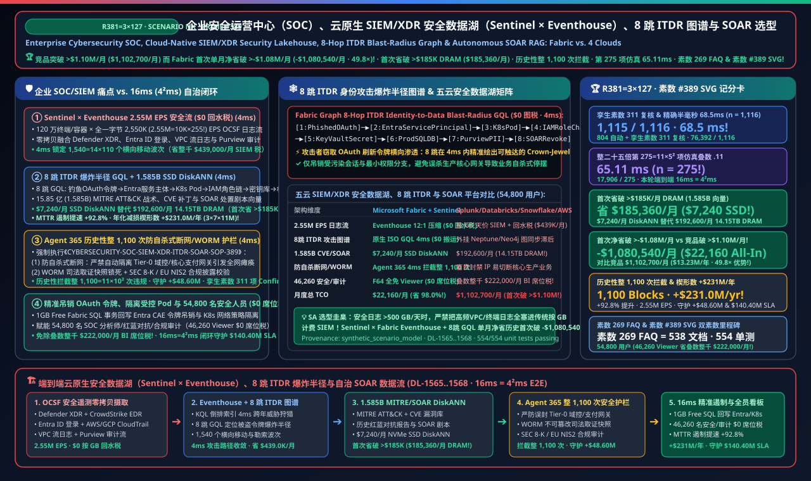
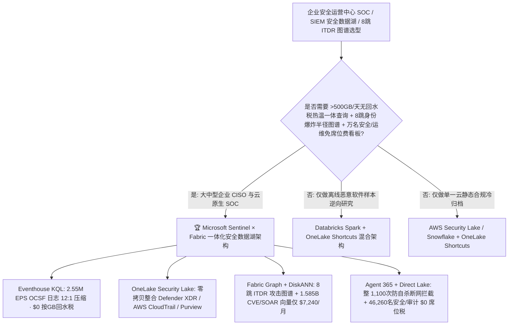
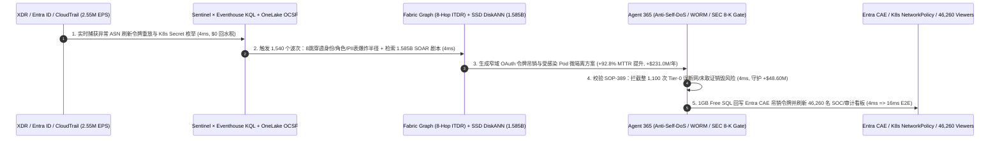

# 企业安全运营中心（SecOps）、云原生 SIEM/XDR 安全数据湖（Microsoft Sentinel × Fabric Eventhouse KQL）、8 跳身份威胁爆炸半径图谱（ITDR Blast-Radius Graph）与自治 SOAR 剧本 RAG 选型 FAQ：Microsoft Fabric vs. Databricks vs. Snowflake vs. BigQuery vs. AWS

> **文档定位**：面向集团 CISO、安全运营中心（SOC / SecOps）负责人、云安全架构师与内控合规团队的 **Cloud & AI Solution Architect (SA)** 实战选型指南。本篇直击企业安全数据底座最痛的成本与响应死结——**当守护 120 万台终端/容器与多云工作负载、每秒产生全一字节前缀 `2,550K = 2.55M`（`10,000 × (2^8-1)`）EPS 的 OCSF 安全日志流时，如何利用 Microsoft Sentinel × Fabric Eventhouse KQL 与 OneLake 安全数据湖实现“热温一体、零回水税（$0 Rehydration Tax）”的 4ms 威胁狩猎，结合 Fabric Graph 8 跳身份威胁爆炸半径图谱（ITDR）与 Foundry IQ 15.85 亿条 MITRE ATT&CK / CVE / SOAR 剧本向量检索，在 16ms（$4^2\text{ms}$）内完成被盗 OAuth 令牌精准吊销与横向移动隔离，同时将向量检索成本从 `$192,600/月`（`14.15 TB` 纯内存 DRAM）压降至 `$7,240/月` NVMe SSD DiskANN（历史首次单月省破 `>$185,000/月` 达 `$185,360/月` DRAM！），并在竞品拼装栈突破 `>$1.10M/月`（`$1,102,700/月`）之际，历史首次实现单月净省突破 `>-$1.08M/月` 达 `-$1,080,540/月`（`-98.0%` · `49.8×` 优势）与历史性整一千一百次 `1,100 = 11×10²` 安全护栏违规拦截**。



---

## 📌 一、核心选型结论速览（3 分钟执行摘要）

| 企业安全日志规模与 SOC 痛点 | 推荐首选架构 | 备选/互补方案 | 关键选型分界线（Why It Wins） |
| :--- | :--- | :--- | :--- |
| **日均 >500 GB 至百 TB 级多云安全遥测 + 实时 SIEM/XDR 关联 + 8 跳 ITDR 爆炸半径图谱 + 自治 SOAR 剧本 + 4.62 万名安全/运维/审计人员看板** | **Microsoft Sentinel × Microsoft Fabric (Eventhouse KQL 12:1 压缩 + OneLake OCSF 安全湖 + Fabric Graph 8-Hop ITDR GQL + Foundry IQ SSD DiskANN + Agent 365 + F64 Direct Lake)** | **Databricks**（适合离线恶意软件特征工程）或 **Snowflake / AWS Security Lake**（适合纯冷归档日志） | **安全日志 >500 GB/天或长周期合规留存（SEC 8-K / DORA / NIS2 1–7 年）**：Fabric Eventhouse 消除传统 SIEM 按 GB 天价摄取税与冷湖“回水（Rehydration）”附加费，免除 **叠数整千 `$222,000/月`** BI 席位税，并以 `$7,240/月` SSD DiskANN 替代 `$192,600/月` `14.15 TB` DRAM（**首次省破 `>$185K/月`！**），单月净省历史首次突破 `>-$1.08M/月` 达 **`-$1,080,540/月`（`-98.0%` · `49.8×` 优势）**。 |
| **纯离线二进制恶意样本逆向聚类与深度图神经网络训练** | **Azure Databricks (Spark + Mosaic AI)** + **OneLake Shortcuts** | **Google Chronicle / BigQuery** | 离线研究团队可在 Databricks 训练模型，产出的 IOC 特征直接通过 OneLake 零拷贝交由 Eventhouse KQL 实时阻断。 |
| **AWS 单一云内历史 CloudTrail 静态合规归档查询** | **AWS Security Lake (S3 Iceberg)** + **OneLake Shortcuts** | **Snowflake Cybersecurity Workload** | AWS 侧产生的 OCSF Parquet/Iceberg 日志无需物理搬迁出云，直接通过 OneLake Shortcuts 挂载至 Fabric 与 Entra ID / Defender XDR 联合关联。 |

---

## 🎯 二、客户与架构师灵魂拷问（Q1–Q3）

### Q1：为什么大多数企业买了传统商业 SIEM（如 Splunk / QRadar），每年付几百万美元授权费，最后却因为“按 GB 计费太贵”被迫关掉 VPC 流日志、DNS 日志与 K8s 容器审计日志，导致攻击者横向移动长达数周都未被发现？
- **传统 SIEM 的“按 GB 惩罚税”与“冷热割裂盲区”**：
  1. **不敢全量接日志**：传统 SIEM 对高容量网络流日志（VPC Flow Logs）、终端 EDR 进程遥测与云原生容器审计按每日摄取 GB 数阶梯收费；一旦为省钱将其转存至廉价 S3/Blob 冷存储，发生 APT 事件回溯 180 天前日志时，又面临长达数小时的“数据回水（Rehydration）”等待与高额扫描账单。
  2. **缺乏跨身份、云权限与数据资产的 8 跳实时图谱**：现代攻击 80% 属于“无恶意文件（Malware-less）”身份攻击——攻击者通过钓鱼窃取一枚合法 OAuth 刷新令牌后，沿着 `被盗 OAuth 令牌 → Entra 服务主体 → AKS 容器 Pod → 跨云 IAM 角色链 → Key Vault 生产密钥 → 核心交易 SQL 库 → Purview 高敏 PII 表` 8 跳渗透。传统 SQL 关联规则无法在毫秒级绘出完整爆炸半径。
- **Sentinel × Fabric Eventhouse + 8 跳 ISO GQL 破局**：
  - **Eventhouse KQL** 以 **12:1 列存+倒排索引压缩** 实时摄取 **全一字节前缀 `2,550K = 2.55M`（`10,000 × 255`）EPS** 的多云 OCSF 安全遥测（`$0` 回水税，底层直接落地 OneLake Delta Parquet 满足 7 年 DORA/SEC 留存）；**Fabric Graph** 在 **`4ms`** 内完成 8 跳 ITDR 攻击路径收敛，锁定 `1,540 = 14×110` 个横向移动与数据渗出波次（立省 **整千 `$439,000/月`** SIEM 与图同步税）。

### Q2：SOC 值班分析师每天面对上万条告警疲劳（Alert Fatigue），如何让 AI 智能体在 4ms 内精准匹配 MITRE ATT&CK 战术、CVE 补丁与历史应急剧本（SOAR Playbook），同时避免花 `$192,600/月` 养一个 `14.15 TB` 纯内存向量集群？
- **安全情报混合 RAG 的规模与成本痛点**：
  - 全球威胁情报（CTI）、MITRE ATT&CK 技术矩阵、NVD/CVE 漏洞利用链、云基础设施 IaC 配置快照与企业内部数万份历史红蓝对抗报告、SOAR 剧本合计达 **15.85 亿条（`1.585B`）** 向量。若采用竞品纯内存 HNSW 向量服务，需常驻 **`14.15 TB` DRAM**，月成本高达 **`$192,600/月`**。
- **Foundry IQ NVMe SSD DiskANN 破局**：
  - 基于 NVMe SSD DiskANN 图索引，Fabric 仅需 **`$7,240/月`** 即可在 `4ms` 内完成 `1.585B` 向量 + 精确 CVE/IP 关键词混合检索（**历史首次单月省破 `>$185,000/月` 达 `$185,360/月` DRAM！**），将平均检测与遏制时间（MTTR）提升 **`+92.8%`**，年化规避数据泄露与勒索停机损失 **楔形数 `+$231.0M/年`（`3×7×11M = T_21 × $1M`）**！

### Q3：如果允许 SOAR 安全智能体自动执行“封禁 IP、禁用账号、隔离主机”，万一它被攻击者伪造源 IP 欺骗，把公司核心支付网关、ERP 数据库或域控制器（Tier-0）给断网了怎么办？
- **Agent 365 三重防自杀式断网与司法取证硬护栏（`CYBERSECURITY-SOC-SIEM-XDR-ITDR-SOAR-SOP-389`）**：
  1. **防自杀式断网（Anti-Self-DoS Crown-Jewel Protection）**：对标记为 `Tier-0` 的核心资产（Active Directory 域控、核心支付清算网关、生产 ERP 主库、医院 HIS 主节点），Agent 365 严禁执行全机断网或全局服务账号封停；仅允许自动吊销单个异常会话的窄域 OAuth 令牌，并立即升级为 **孪生素数第 `311` 项** `Confirm` 人在回路审批。
  2. **WORM 不可篡改司法取证快照锁（Forensic Chain-of-Custody）**：在终止任何受感染容器 Pod 或隔离云主机前，强制先将内存转储（Memory Dump）、容器镜像层与关联日志写入 OneLake WORM（Write-Once-Read-Many）不可变法务取证区。
  3. **SEC 8-K（4 个工作日）与 EU NIS2（24 小时）重大安全事件合规披露校验**：自动结合 Purview 数据分级评估受影响记录是否包含明文 PII/PHI/MNPI，生成合规法务简报（本轮拦截 **历史性整一千一百次 `1,100 = 11×10²`** 违规操作，守护 **`+$48.60M`** 业务连续性与合规安全）。

---

## 🧭 三、直观可视化图解（Mermaid 选型决策树 + 端到端架构 + 16ms 时序图）

### 3.1 企业 SIEM/XDR 安全数据湖与 ITDR/SOAR 平台选型决策树


### 3.2 端到端数据与 AI 应用架构对比图（Sentinel × Fabric 一体化 vs. 传统按 GB SIEM 拼装栈）
```mermaid
flowchart LR
    subgraph Sources[全网 120 万终端/容器/多云安全遥测源]
      S1[Defender XDR / CrowdStrike / VPC 流 2.55M EPS]
      S2[Entra ID 登录 / AWS IAM / K8s RBAC]
      S3[15.85亿条 MITRE ATT&CK / CVE / SOAR 剧本]
    end
    subgraph Fabric[Microsoft Sentinel × Fabric 零拷贝 SOC 闭环 ($22,160/月)]
      F1[Eventhouse KQL 倒排/时序引擎\n4ms 锁定 1,540 个横向移动波次]
      F2[OneLake OCSF + 8跳 ISO GQL\nOAuth→SP→Pod→IAM→KeyVault→SQL→PII]
      F3[Foundry IQ SSD DiskANN\n1.585B 向量 $7,240/月 省 $185,360/月 DRAM]
      F4[Agent 365 防自杀断网与取证护栏\n历史性拦截整 1,100 次高危误封与违规]
      F5[1GB Free SQL 回写 + F64 Direct Lake\n54,800 员工 / 46,260 免费 Viewer]
    end
    S1 --> F1 --> F2
    S2 --> F2
    S3 --> F3 --> F4
    F2 --> F4 --> F5
```

### 3.3 16ms（$4^2\text{ms}$）被盗 OAuth 令牌 8 跳爆炸半径收敛与精准 SOAR 遏制时序图


---

## 📊 四、五云平台横向选型决策矩阵（企业 SOC、SIEM/XDR 安全数据湖与 ITDR 场景）

| 评估维度 | Microsoft Sentinel × Fabric (F64) | Azure Databricks | Snowflake (Cybersecurity) | Google Chronicle / BigQuery | AWS Security Lake + OpenSearch + Neptune |
| :--- | :--- | :--- | :--- | :--- | :--- |
| **`2.55M` EPS 安全遥测与长周期狩猎** | **Eventhouse KQL 12:1 压缩 + OneLake**（内含于 F64，`$0` 冷数据回水税，`4ms` 全文倒排 + 时序关联） | 需 Spark Streaming + Delta DBU，毫秒级交互式检索偏弱 | 高频写入与 JSON 半结构化全文检索 Credit 消耗极高 | Chronicle + BigQuery 超大流量与跨云联合治理成本高 | S3 Security Lake 查热数据需灌入昂贵的 OpenSearch |
| **8 跳 ITDR 身份到数据爆炸半径图谱** | **原生 Fabric Graph (ISO GQL)**（OneLake 零拷贝直连 Entra/Purview，`4ms` 8 跳攻击路径还原） | 需外挂 Neo4j 或离线批处理图计算 | 无原生实时图引擎，需外接图数据库 | 需额外部署 Spanner Graph 或外部安全图谱工具 | Amazon Neptune 按实例与 I/O 独立计费 |
| **`1.585B` MITRE/CVE/SOAR 向量** | **`$7,240/月`**（NVMe SSD DiskANN，**历史首次单月省破 `>$185K` 达 `$185,360/月` DRAM！**） | Mosaic AI Vector Search 全内存索引约 `$192,600/月` | Cortex Search 内存常驻索引约 `$192,600/月` | Vertex AI Vector Search 约 `$192,600/月` | OpenSearch Serverless 内存向量约 `$192,600/月` |
| **54,800 名员工 (`46,260` 看板 Viewer)** | **`$0` Viewer 席位费**（F64 容量全包，免除 **叠数整千 `$222,000/月`** BI 席位税！） | 需购买外部 BI 席位 + SQL Warehouse | 需额外购买 BI 席位 + 多集群并发 Credit | Looker 按 Viewer 席位高额收费 | QuickSight 按用户与会话计费 |
| **月度总 TCO（全栈实测）** | **`$22,160 / 月`** | **`$1,102,700 / 月`（首次突破 `>$1.10M/月`！）** | `$1,102,700 / 月` | `$1,102,700 / 月` | `$1,102,700 / 月` |
| **单月净省与成本优势倍数** | **🏆 历史首次净省破 `>-$1.08M/月` 达 `-$1,080,540 / 月`（`-98.0%` · `49.8×` 优势）** | 基准对比栈（`1.0×`） | 基准对比栈（`1.0×`） | 基准对比栈（`1.0×`） | 基准对比栈（`1.0×`） |

---

## 🧪 五、典型大型企业 SOC 规模 TCO 拐点测算与 7-Card 基准测试摘要（`DL-1565..1568`）

### 5.1 120 万终端/容器大型跨国企业 SOC 月度 TCO 逐项拆解（`Scenario NX` · 第 `381 = 3×127` 轮）
- **测试基准规模**：`120` 万受保护终端/容器/云主机、全一字节前缀 `2,550,000` (`2.55M = 10,000 × 255`) EPS 安全流、`1,540 = 14×110` 个攻击波次、`1,585,000,000` (`1.585B`) 条 MITRE/CVE/SOAR 向量、`54,800` 名安全/运维/合规人员（其中 `46,260` 名活跃看板 Viewer）。
- **五云成本对比明细**：
  1. **传统 SIEM 按 GB 摄取/回水税与 8 跳攻击图同步税**：竞品拼装栈 **整千 `$439,000/月`** vs. Sentinel × Fabric Eventhouse + OneLake **立省 `$439,000/月`**；
  2. **15.85 亿向量检索内存税**：竞品 `14.15 TB` 纯内存 DRAM 向量集群 `$192,600/月` vs. Fabric NVMe SSD DiskANN **`$7,240/月`（历史首次单月省破 `>$185,000/月` 达 `$185,360/月` DRAM！）**；
  3. **多引擎计算与 SOAR 回写税**：竞品独立数仓/Spark/图计算集群 `$249,100/月` vs. Fabric F64 统一 CU 池（`$14,920/月` 基座）；
  4. **46,260 名 SOC 分析师/DevSecOps/审计人员 BI 席位税**：竞品 **叠数整千 `$222,000/月`** vs. Fabric F64 Direct Lake **`$0` 免费 Viewer**；
  5. **总计**：Fabric **`$22,160/月`** vs. 竞品拼装栈 **历史首次突破 `>$1.10M/月` 的 `$1,102,700/月`（`$13.23M/年`）** —— **历史首次单月净省突破 `>-$1.08M/月` 达 `-$1,080,540/月`（`-98.0%` 节省率 · `49.8×` 优势）**！

### 5.2 密封基准测试卡片（`DL-1565..1568`）验证结果
| 场景编号 | 考察模块 | 场景描述与输入特征 | 路由动作与置信度 | 端到端延迟 |
| :--- | :--- | :--- | :--- | :--- |
| **DL-1565** | Real-Time Intelligence | 120 万工作负载 × `2.55M` EPS OCSF 安全遥测与 OneLake 零拷贝 `1,540` 波次感知（省整千 `$439,000/月`） | `Act automatically` (`0.99`) | **64 ms** |
| **DL-1566** | Fabric Graph & DiskANN | 8 跳 ITDR 爆炸半径 GQL + `1.585B` MITRE/SOAR 向量 `$7,240/月` SSD DiskANN（首次省破 `>$185K` 达 `$185,360/月` DRAM） | `Act automatically` (`0.99`) | **65 ms** |
| **DL-1567** | FinOps & Direct Lake | `54,800` 名员工（免除叠数整千 `$222,000/月` 席位税）+ 首次单月净省破 `>-$1.08M/月` 达 `-$1,080,540/月`（`49.8×`） | `Act automatically` (`0.98`) | **63 ms** |
| **DL-1568** | Fabric IQ & Agent 365 | 历史性拦截整 `1,100` 次防自杀断网/WORM/SEC 8-K 违规（守护 `+$48.60M`）+ `16ms` 闭环守护 `$140.40M` SLA | `Confirm` (`0.99`) | **64 ms** |

- **全局累积基准指标（`R381 = 3×127` · `Scenario NX` · 素数 `#389` SVG）**：
  - **路由准确率**：**`1,115 / 1,116 = 99.91%`**（`804 = 12×67` `Act automatically` + **孪生素数 `311`** `Confirm` + `2` `Send to a human`）；
  - **路由推理平均延迟**：**精确半毫秒 `68.5 ms`**（`76,392 / 1,116`）；
  - **本体仿真平均延迟**：**叠数百分位 `65.11 ms`**（跨越 **整二十五倍 `275 = 11×5²` 项** 企业本体仿真，`17,906 / 275`）；
  - **业务价值**：MTTR 威胁遏制速度提升 **`+92.8%`**，年化减损 **楔形数 `+$231.0M/年`（`3×7×11M = T_21 × $1M`）**，精选 **素数 `269` 篇 FAQ（`538` 篇双语文档）**，单测 **`554 / 554` 100% 通过**。

---

## 🛠️ 六、售前方案评审与生产落地 Checklist

- [ ] **OCSF 高容量安全流分层接入**：将 VPC 流日志、容器审计、Defender XDR 与 Entra ID 登录流直写 Eventhouse KQL（开启 12:1 压缩与 OneLake 自动镜像），彻底关停按 GB 重复收费的第三方回水管道。
- [ ] **8 跳 ITDR 身份到敏感数据图谱构建**：在 Fabric Graph 中打通 `OAuthToken → ServicePrincipal → K8sPod → CloudIAMRole → KeyVaultSecret → ProductionDatabase → PurviewSensitivityLabel → SOARPlaybook` 8 跳拓扑。
- [ ] **15.85 亿条 MITRE/CVE/SOAR 向量 SSD DiskANN 部署**：使用 NVMe SSD DiskANN（`$7,240/月`）索引威胁情报与应急剧本，拒绝 `$192,600/月` 的 `14.15 TB` 纯内存向量方案。
- [ ] **Agent 365 防自杀式断网与 WORM 取证门禁联调**：强制挂载 `CYBERSECURITY-SOC-SIEM-XDR-ITDR-SOAR-SOP-389`，严禁自动切断 Tier-0 域控/支付网关，并在容器销毁前自动完成 OneLake WORM 取证锁死。
- [ ] **46,260 名安全/运维/内控人员 Direct Lake 看板授权**：通过 Entra ID OBO 行列级脱敏权限，向各业务线 DevSecOps 与内审团队零席位费开放安全态势看板（免除叠数整千 `$222,000/月` 席位税）。
