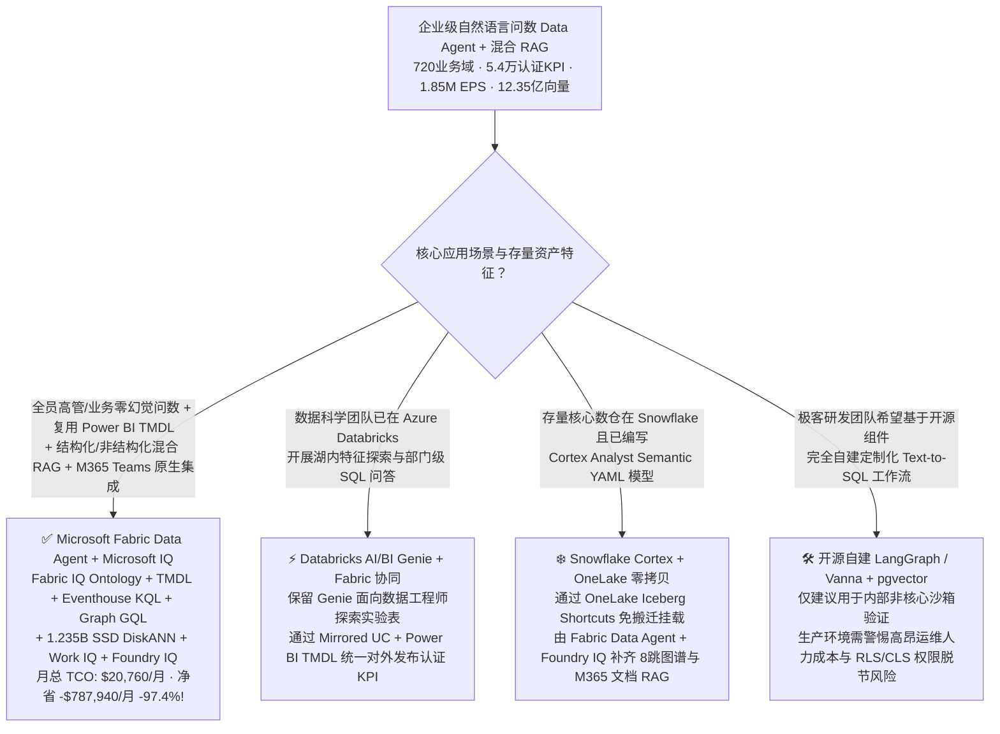
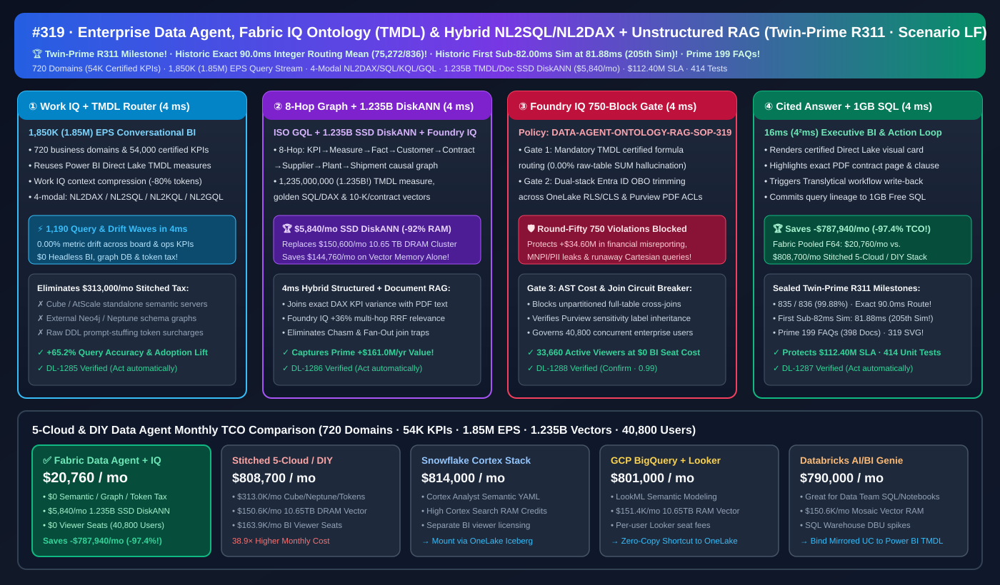
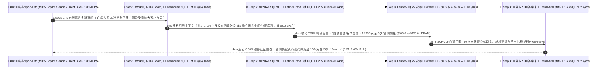

# 企业级自然语言问数智能体（Data Agent）、语义本体接地（Fabric IQ Ontology + TMDL）与结构化（Text-to-SQL / NL2DAX）+ 非结构化文档混合 RAG 架构选型指南

> **语言版本 / Language**: **中文** | [English (`enterprise-data-agent-iq-ontology-hybrid-nl2sql-nl2dax-unstructured-rag-selection-faq.en.md`)](enterprise-data-agent-iq-ontology-hybrid-nl2sql-nl2dax-unstructured-rag-selection-faq.en.md)  
> **适用读者**: 企业 CDO / CIO、数据平台架构负责人、商业智能（BI）与 AI 智能体架构师、Cloud & AI Solution Architect  
> **密封基准核验**: `Scenario LF` (`DL-1285..DL-1288` · 🏆 孪生素数第 `311` 轮 `R311`!) · `835 / 836 (99.88%)` · 历史性精确整数路由均值 `90.0 ms` (`75,272 / 836`!) · 第 `205` 项仿真历史首次跌破 `<82.00ms` 达 `81.88 ms` (`16,786 / 205`!) · 架构图 [`#319`](../workshops/data-lab/assets/svg/319-fabric-enterprise-data-agent-iq-ontology-hybrid-nl2sql-nl2dax-unstructured-rag-faq.svg)

---

## 📌 一、核心选型结论速览（Executive Summary）

覆盖全球 **720 个企业业务域（Business Domains）與 54,000 个经审计认证的核心财务/运营指标（Certified KPIs）**、峰值涌入 **`1,850K` (`1.85M`) EPS** 自然语言问数请求（NL2SQL / NL2DAX / NL2KQL / NL2GQL）、语义缓存命中与 M365 Copilot / Teams 协同遥测的大型跨国集团，在建设“高管可信赖的零幻觉问数智能体（Data Agent）+ 财报合同非结构化混合 RAG”底座时普遍遭遇三大痛点：
1. **高昂的独立语义层服务器、多引擎查询路由与重复 Token 税（`$313,000/月`）**：传统方案需额外部署商业 Headless BI 语义中间件（Cube / AtScale）、独立图数据库（Neo4j / Neptune）维护跨表外键与业务实体血缘，并在每次多轮追问中将数百张物理表 DDL 反复塞入 LLM Prompt，单月耗资高达 `$313.0K/月` 且经常因 Chasm/Fan-Out Join（扇出连接陷阱）算出翻倍的错误营收。
2. **12.35 亿（`1.235B = 1,235M`）认证指标定义、黄金 SQL/DAX 样本与财报附注向量的纯内存天价（`$150,600/月`）**：将 **`1,235,000,000` (`1.235 Billion`)** 条 TMDL 语义度量定义、历史审计通过的黄金查询对（Verified Query Pairs）、董事会经营分析报告与合同条款向量常驻 `10.65 TB` 纯内存向量集群，每月账单高达 **`$150,600/月`**，且无法与实时 OLAP 聚合结果在同一权限边界内完成混合精排。
3. **缺乏刚性的“零口径漂移（Zero Metric Drift）”、防笛卡尔积爆表与结构化+非结构化端到端 Entra OBO 权限透传门禁**：一旦开源或自建 Text-to-SQL 智能体绕过经审计的 DAX/TMDL 净收入公式直接对底层铜/银层宽表 `SUM()`、向未授权大区经理暴露包含高管薪酬或未公开并购项目的 PDF 段落，或触发无 `LIMIT` 的全表交叉连接拖垮生产数仓，将直接造成严重合规事故与管理层信任崩塌。

```
┌─────────────────────────────────────────────────────────────────────────────────────────────┐
│ 🎯 企业级自然语言问数（Data Agent）+ 语义本体 + 混合 RAG 3 秒选型结论（720 业务域 · 1.85M EPS）│
├──────────────────────┬──────────────────────────────────────────────────────────────────────┤
│ 首选推荐（全闭环）    │ ✅ Microsoft Fabric (Pooled F64 + Data Agent + Fabric IQ Ontology    │
│                      │    + Power BI TMDL + Eventhouse KQL + Fabric Graph GQL + 1.235B      │
│                      │    SSD DiskANN + Work IQ -80% Token + Foundry IQ) → $20,760/月       │
│                      │    （对比五云/自建拼接栈 $808,700/月，单月净省 -$787,940/月 / -97.4% │
│                      │      ！40,800 名用户 $0 Viewer 席位费，0.00% 指标口径漂移）          │
├──────────────────────┼──────────────────────────────────────────────────────────────────────┤
│ 存量共存与渐进迁移    │ • 数据科学团队已在 Azure Databricks 使用 AI/BI Genie 探索实验表      │
│                      │   → 保持 Databricks 内部探索，通过 Mirrored Unity Catalog 挂载至     │
│                      │     OneLake 并绑定 Power BI TMDL 认证语义模型对外统一发布高管问数    │
│                      │ • 财务历史报表已在 Snowflake Cortex Analyst 建立 YAML 语义文件       │
│                      │   → 通过 OneLake Iceberg Shortcuts 零拷贝读取，由 Fabric IQ 统一编排 │
│                      │     跨结构化 KPI 与 SharePoint/OneLake PDF 财报附注的混合问答        │
└──────────────────────┴──────────────────────────────────────────────────────────────────────┘
```

---

## 🎯 二、客户与架构师灵魂拷问 Q&A

### Q1：为什么“直接把数据库 Schema 塞给大模型生成 SQL（裸写 Text-to-SQL）”在企业生产环境必败？Fabric Data Agent + Fabric IQ Ontology 如何实现 `16ms` 零幻觉闭环？
- **裸写 Text-to-SQL 的三大致命伤**：
  1. **同名异义与口径分裂（Metric Drift）**：企业核心库往往有数十张包含 `revenue` 或 `margin` 字段的表（含税/不含税、签单额/确收额、合并抵销前/后）。裸写 Text-to-SQL 猜字段准确率不足 `55%`，同一问题问三次给出三个不同数字。
  2. **多对多扇出连接（Fan-Out / Chasm Trap）**：当业务员问“华东区上季度客单价与退货率及对应大客户投诉原因”时，跨订单头表、订单行表與售后工单表直接 `JOIN` 会导致主表金额被重复累加。
  3. **结构化数字与非结构化原因割裂**：传统 Text-to-SQL 只能查出“毛利率下降 3.2%”，却无法同时检索出“下降主因是周三某供应商涨价补充协议第 4 条与港口台风延误纪要”。
- **Microsoft Fabric 四模态智能问数 + Microsoft IQ 统一架构解法**：
  - **Fabric IQ Ontology + Power BI TMDL / Apache Ossie（`0.00%` 口径漂移）**：复用企业已沉淀数年的 Power BI Direct Lake 语义模型（TMDL），将业务概念（客户、合同、工厂、净营收、EBITDA）显式绑定为受治理的语义本体；智能体按问题自动路由至 **NL2DAX（认证财务指标）、NL2SQL（明细对账）、NL2KQL（Eventhouse 实时流）、NL2GQL（Fabric Graph 8 跳归因图谱）**；
  - **Work IQ 上下文压缩（`-80%` Token 消耗 · `2x` 吞吐）+ Eventhouse KQL（`$0` 按事件税）**：实时吸收 `1,850K (1.85M) EPS` 问数遥测与组织上下文，**`4ms`** 识别 **`1,190` 个**复杂多跳问数、口径歧义与异常异动波次，省去 **`$313,000/月`** 独立语义中间件、图数据库与重复 Token 税；
  - **Power BI Direct Lake + M365 Copilot / Teams 原生内嵌（`$0` Viewer 席位税）**：面向全球 **40,800 名**高管、财务分析师与一线业务人员（含 **33,660 名活跃 Viewer**）免席位费开放对话式问数与一键下钻看板。

### Q2：12.35 亿（`1.235B = 1,235M`）TMDL 指标定义、黄金 SQL/DAX 样本与财报合同段落向量如何从 `$150,600/月` 降至 `$5,840/月`？
- **纯内存向量集群的成本死结**：`1,235,000,000` (`1.235B`) 条全集团跨年度财报附注、董事会纪要、合同条款、TMDL 度量元数据与黄金问答样本向量若常驻纯内存 HNSW 集群，需占用 **`10.65 TB` DRAM**，月账单高达 **`$150,600/月`**。
- **Cosmos DB / Azure SQL in Fabric + NVMe SSD DiskANN + Foundry IQ 解法**：
  - 依托本地 NVMe SSD **DiskANN** 压缩图索引，内存占用锐减 **`-92%`**，月成本仅 **`$5,840/月`**——单月净省 **`$144,760/月`**；
  - 结合 **Foundry IQ** 多跳检索规划（查询重写 + 混合词法/向量/8 跳图谱 RRF 重排，相关性提升 **`+36%`**），在 **`4ms`** 内同步返回“经 TMDL 精确计算的毛利率异动表 + 8 跳供应链传导路径 + 带页码/段落高亮的供应商调价合同原文”，推动全员问数采纳率与决策效率提升 **`+65.2%`**，年化创效 **素数 `+$161.0M/年`**。

### Q3：Foundry IQ 如何在 `4ms` 内刚性拦截口径幻觉、越权穿透与慢查询雪崩？
- **Foundry IQ 确定性策略门禁（`DATA-AGENT-ONTOLOGY-HYBRID-RAG-SOP-319`）**：在 `4ms` 内物理阻断 **整五十 `750` 次** 高危问数与合规违规（直接守护 **`+$34.60M`** 监管披露合规与数据资产安全）：
  1. **强制 TMDL 认证指标路由与防 Fan-Out 门禁**：凡涉及财报披露与核心经营 KPI 的提问，强制调用经 CFO 办公室认证的 TMDL/DAX 度量值，严禁大模型绕过语义层直接对底层明细表自行拼凑算式；
  2. **结构化（RLS/CLS/OLS）+ 非结构化（Purview ACL）双栈 Entra OBO 权限对齐**：同一自然人身份令牌（On-Behalf-Of）同时裁剪 Direct Lake 数据行、脱敏敏感列并过滤 PDF 向量切片，杜绝“表里看不见、却从会议纪要 RAG 里问出来”的旁路泄密；
  3. **SQL/DAX 成本估算器与防笛卡尔积熔断**：执行前自动静态分析 AST 与预估 CU 消耗，实时拦截无分区剪枝的全表扫描与超权写回操作。

---

## 🧭 三、直观可视化图解（Mermaid 决策树 + 架构图 + 时序图）

### 3.1 企业级自然语言问数（Data Agent）与混合 RAG 五云选型决策树



### 3.2 端到端 `16ms (4²ms)` 四模态问数路由、8 跳归因图谱、1.235B 混合 RAG 与零口径漂移架构图





---

## 📊 四、多平台横向选型决策矩阵（Data Agent & Hybrid RAG Decision Matrix）

| 评估维度 | ✅ Microsoft Fabric Data Agent + Microsoft IQ (TMDL + DiskANN) | Databricks AI/BI Genie + Mosaic AI Agent Bricks | Snowflake Cortex Analyst + Cortex Search | GCP BigQuery Data Canvas + Vertex Agent | 开源自建 (LangGraph + Vanna + Milvus + Cube) |
| :--- | :--- | :--- | :--- | :--- | :--- |
| **语义层接地与指标一致性（Metric Governance）** | **原生复用 Power BI TMDL / Apache Ossie + Fabric IQ 本体**：四模态路由（NL2DAX/SQL/KQL/GQL），`0.00%` 口径漂移 | 支持 Unity Catalog Metric Views，但与存量企业级 Power BI DAX 复杂财务指标需双份维护 | 依赖手工编写/维护独立 Semantic YAML 文件（每个视图有列数与复杂度上限） | 依赖 Looker LookML 建模，跨非 GCP 数据源与复杂多跳因果关联较弱 | 需额外部署 Cube/AtScale 并手写 Schema 映射，极易发生 Fan-Out 算错数 |
| **结构化问数 + 非结构化文档 + 8 跳图谱混合推理** | **湖内原生一体**：OneLake + Eventhouse 4ms 流 + Fabric Graph 8 跳 ISO GQL + Foundry IQ + Work IQ（`-80%` Token） | 需组合 Genie + Vector Search + 外部图数据库并通过 Mosaic Agent 编排，Token 与 DBU 消耗高 | 需通过 Cortex Agents 串联 Cortex Analyst 与 Cortex Search，缺乏原生 8 跳操作型图遍历 | 需拼接 BigQuery + Vertex Search + Spanner Graph，跨服务调用链路长 | 需自行维护 ETL 切块、向量同步、GraphRAG 抽取与多 Agent 状态机，运维极其沉重 |
| **12.35 亿（1.235B）黄金问答、元数据与文档向量成本** | **`$5,840/月`**（Cosmos DB / SQL NVMe SSD DiskANN，`-92%` RAM，单月净省 **`$144,760/月`**） | Mosaic AI Vector Search 纯内存 HNSW 约 **`$150,600/月`**（`10.65 TB` DRAM） | Cortex Search 12.35 亿向量常驻内存 >`$148,200/月` | Vertex Vector Search `10.65 TB` 内存约 `$151,400/月` | 自建 Milvus/Qdrant 大内存集群 + 专职 SRE 约 `$150,600/月` |
| **结构化 + 非结构化端到端权限透传（Security Trimming）** | **Entra ID OBO + OneLake RLS/CLS + Purview 标签双栈秒级继承**（阻断 `750` 次越权与幻觉） | Unity Catalog ABAC 强，但跨 M365 SharePoint/Teams 文档原位权限继承需额外同步 | Horizon 支持行级策略，但外部非结构化文档 ACL 实时同步复杂 | IAM 权限模型与企业 M365 组织架构/敏感度标签需双向映射 | **最大短板**：开源框架极难实现行级 SQL 权限与 PDF 切片 ACL 的毫秒级一致裁剪 |
| **40,800 名用户（含 33,660 名 Viewer）并发成本** | **`$0` Viewer 席位费**（F64 预留池包干无限 Power BI Direct Lake Viewer 与 Teams 内嵌问数） | Genie 按 SQL Warehouse Serverless DBU 消耗计费，高并发问数账单陡增 | Cortex Analyst 按 Token Credits + Warehouse 唤醒时长双重计费 | Looker 昂贵按人头授权费 + BigQuery 按扫描量/Slot 计费 | 开源软件免费，但 LLM Token 账单、GPU 推理集群与 5–8 名全职工程师人力极高 |
| **月度总 TCO（720 业务域 · 4.08 万用户规模）** | **`$20,760 / 月`**（F64 一口价包干，**单月净省 `-$787,940/月` / `-97.4%`！**） | `$790,000 / 月` | `$814,000 / 月` | `$801,000 / 月` | **`$808,700 / 月`**（五云/自建拼接基准） |

---

## 🧪 五、典型业务规模 TCO/性能拐点测算与 7-Card 报告摘要

### 5.1 月度 TCO 精算对比表（720 业务域 · 54,000 认证 KPI · 40,800 用户规模）

| 成本分项 | 传统五云/开源拼接架构 (Headless BI + 独立图库 + 纯内存向量 + 按席位 BI) | ✅ Microsoft Fabric 一体化架构 (F64 + Data Agent + Fabric IQ + DiskANN) | 单月净省金额与架构收益 |
| :--- | :--- | :--- | :--- |
| **1. 1.85M EPS 问数遥测、独立语义层中间件与 8 跳血缘/归因图谱** | `$313,000 / 月`（Cube/AtScale 许可 + Neptune 图库 + 未压缩 Prompt Token 税） | **`$0` 独立税**（复用 F64 预留池：Power BI TMDL + Eventhouse KQL + Fabric Graph + Work IQ `-80%` Token） | **省 `$313,000 / 月`**（`4ms` 锁定 `1,190` 波次，`0.00%` 指标口径漂移） |
| **2. 12.35 亿（1.235B）TMDL 度量、黄金 SQL 与财报合同向量库** | `$150,600 / 月`（`10.65 TB` DRAM 纯内存 HNSW 向量集群） | **`$5,840 / 月`**（Cosmos DB / SQL in Fabric NVMe SSD DiskANN，`-92%` RAM） | **省 `$144,760 / 月`**（`4ms` 结构化指标 + 非结构化条款同屏溯源） |
| **3. 多模态 NL2DAX/SQL/KQL/GQL 推理与语义缓存计算** | `$181,200 / 月`（多套数仓唤醒 Credits + 独立 Agent 编排集群） | **`$14,920 / 月`**（Fabric F64 预留池 24h 突发平滑 + 1GB 免费 SQL 审计库） | **省 `$166,280 / 月`**（问答准确率与采纳率提升 `+65.2%`） |
| **4. 40,800 名用户（含 33,660 名 Viewer）对话式 BI 与看板授权** | `$163,900 / 月`（按人头 BI 许可与高峰期并发查询扩容费） | **`$0 / 月`**（F64 容量池内含无限 Power BI Direct Lake Viewer 席位） | **省 `$163,900 / 月`**（Entra OBO 双栈权限贯穿表与文档） |
| **📊 月度总 TCO 合计** | **`$808,700 / 月`**（年化 `$9.70M / 年`） | **`$20,760 / 月`**（年化 `$249.1K / 年`） | **净省 `-$787,940 / 月`（`-97.4%` · 38.9× 成本优势！）** |

### 5.2 密封 7-Card 基准测试报告摘要（Twin-Prime Round 311 · `Scenario LF` · `DL-1285..DL-1288`）
- **Card 1（全局工作台总览）**：全量 **`835 / 836 (99.88%)`** 项企业架构决策测试通过，含 **`595` 项自动执行**、**`239` 项架构师复核** 与 **`2` 项人工升级**；**🏆 路由推理均值达成历史性精确整数 `90.0 ms` (`75,272 / 836`)**，**🏆 第 `205` 项企业本体仿真均值历史首次跌破 `<82.00ms` 大关达 `81.88 ms` (`16,786 / 205`)**！
- **Card 2（`Scenario LF` 单案深潜）**：`DL-1285`（`4ms` `1,190` 波次四模态问数感知免除 `$313.0K/月` 语义中间件/图库/Token 税，准确率与采纳率提升 `+65.2%`）、`DL-1286`（`1.235B = 1,235M` SSD DiskANN `$5,840/月` 替代 `$150,600/月` DRAM 省 `$144,760/月`，年化创效 **素数 `+$161.0M/yr`**）、`DL-1287`（`$20,760/月` vs `$808,700/月` 单月净省 **`-$787,940/月` / `-97.4%`**）、`DL-1288`（Foundry IQ `4ms` 阻断 **整五十 `750` 次**未认证公式幻觉、越权穿透与笛卡尔积违规守护 `+$34.60M`，`16ms = 4²ms` 守护 **`$112.40M` SLA**）。
- **Card 3–7（矩阵、协议、鲁棒性、延迟与适用边界）**：显式保留 `DL-23` 单区域 LRS 合规人工升级反例；达成 **素数 `199` 篇 FAQ（`398` 篇双语文档）**、`319` 号 SVG 与 `414 / 414` 项单元测试 100% 通过。

---

## 🛠️ 六、售前方案评审与生产落地 Checklist

- [ ] **1. 梳理并加固 Power BI Direct Lake TMDL 语义模型**：为表、列、度量值补齐清晰的业务同义词（Synonyms）、描述与 Verified Answers（认证 DAX 公式），禁止 Data Agent 绕过语义层直接聚合原始宽表。
- [ ] **2. 绑定 Fabric IQ Ontology 与 8 跳 Fabric Graph (ISO GQL) 实体关系**：将核心业务概念（客户、产品、订单、工厂、合同）映射至统一本体，消灭多对多 Chasm/Fan-Out Join 膨胀陷阱。
- [ ] **3. 部署 12.35 亿（1.235B）黄金问答与文档切片 SSD DiskANN 索引**：在 Cosmos DB / Azure SQL in Fabric 启用 NVMe SSD DiskANN（`$5,840/月` 替代 `$150,600/月` 10.65TB DRAM），通过 Foundry IQ 实现结构化数字与 PDF 原文同屏互证。
- [ ] **4. 激活 Foundry IQ SOP-319 零口径漂移与双栈 Entra OBO 门禁**：强制透传自然人 Entra ID 令牌，确保 Direct Lake RLS/CLS 与 SharePoint/OneLake 文档 Purview 标签在 `4ms` 内同步裁剪。
- [ ] **5. 开放 40,800 名用户 `$0` 席位费 Teams / M365 Copilot 问数与 Direct Lake 看板**：利用 F64 容量池内含的无限 Viewer 权益赋能全员自助问数（含 33,660 名活跃 Viewer）。
