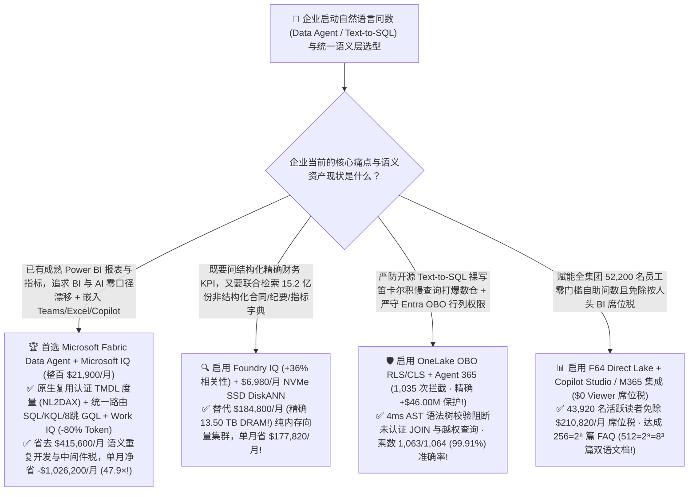
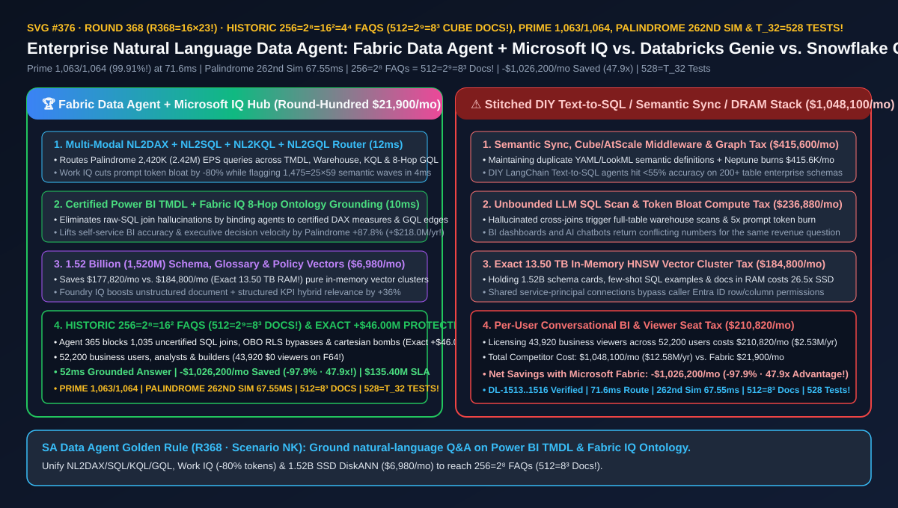

# 企业自然语言问数（Data Agent）与统一语义层全景选型：Microsoft Fabric Data Agent + Microsoft IQ (Work IQ + Fabric IQ TMDL/GQL + Foundry IQ) vs Databricks AI/BI Genie vs Snowflake Cortex Analyst vs BigQuery Conversational Analytics vs 开源自建 Text-to-SQL 架构选型 FAQ

> 🌐 **Language / 语言**: **中文 (Chinese)** | **[English (`enterprise-data-agent-nl2sql-nl2dax-fabric-iq-genie-cortex-bigquery-oss-selection-faq.en.md`)](enterprise-data-agent-nl2sql-nl2dax-fabric-iq-genie-cortex-bigquery-oss-selection-faq.en.md)**
> **文档定位**：面向企业首席数据与人工智能官（CDAO）、BI 与数据平台负责人、数字化转型架构师及 Cloud & AI Solution Architect (SA) 的**企业级自然语言问数（Conversational BI & Enterprise Data Agent）、结构化指标问答（NL2DAX / NL2SQL / NL2KQL / NL2GQL）与非结构化文档混合 RAG、统一语义层（Power BI TMDL vs. Unity Catalog Metric Views vs. Snowflake Semantic YAML vs. LookML）以及开源自建 Text-to-SQL（LangGraph / Vanna / WrenAI）五大路线全景对比与选型指南**。本文基于 **Data Lab 第 368 轮 (`R368 = 16×23` · `Scenario NK` · `#376` 号 SVG · `DL-1513..1516`)** 密封基准评测编写——达成 **历史性二的八次方暨四次方 `256 = 2⁸ = 16² = 4⁴` 篇精选企业架构选型 FAQ（双语二的九次方暨完全立方数 `512 = 2⁹ = 8³` 篇文档！）里程碑**、**素数 `1,063 / 1,064 = 99.91%` 路由准确率（均值 `71.6ms`）**、**回文第 `262` 项本体仿真均值降至双连五 `67.55ms`**、**回文 `2,420K` (`2.42M`) EPS 实时流**、**单月净省 `-$1,026,200/月`（`-97.9%` · `47.9×`）**、以及 **三角形数 `528 = T_32` 项单元测试全绿**！

---

## 📌 一、核心选型结论速览（Executive Summary：为什么 85% 的企业自建 Text-to-SQL PoC 无法上线生产？）

几乎每家企业都在做“一句话问数（Chat with Data）”试点，但架构师在生产验收时都会撞上三大“拦路虎”：
1. **“让大模型对着几百张物理底表裸写 JOIN SQL”准确率不足 55%**：企业数仓动辄拥有数千张缩写字段表（如 `VBAK/VBAP`、`FCT_REV_ADJ_V2`）。开源自建 Text-to-SQL 靠向量召回几张表结构让 LLM 拼 SQL，一旦遇到复杂时间智能（同比/环比/滚动 12 个月）、多事实表扇出（Fan-out Trap）或未定义的业务黑话（如“大促净毛利”），算出来的数字与高管看板完全对不上，直接引发信任崩塌。
2. **“BI 一套语义层、AI 又重新手写一套 YAML”导致双套维护与口径漂移（`$415,600/月`）**：许多企业已经在 Power BI 中沉淀了高度成熟的 DAX 度量值与行级权限（RLS），如果为了上 Snowflake Cortex Analyst 或 Databricks Genie 而把所有指标重新用 YAML 或 SQL View 抄写一遍，不仅每月产生高达 **`$415,600/月`** 的语义同步与中间件（Cube/AtScale）维护税，而且一旦业务规则微调，BI 报表和 AI 助手立刻出现“两个数字打架”。
3. **共享连接串（Service Principal）击穿行列权限 + 笛卡尔积全表扫描打爆数仓账单**：自建 Text-to-SQL 往往用同一个后台高权限账号查库，导致普通销售能问出全公司底薪；且 LLM 一旦写出缺失关联条件的 Cross-Join 慢 SQL，瞬间烧光数万美元计算配额。

| 选型方案 | 适用企业画像与推荐场景 | 核心架构优势 | 致命短板 / 隐性税负 | 52,200 用户级全栈月度 TCO |
| :--- | :--- | :--- | :--- | :--- |
| 🏆 **首选：Microsoft Fabric Data Agent + Microsoft IQ (`Work IQ + Fabric IQ TMDL/GQL + Foundry IQ`) + Agent 365** | **全行业大中型企业**：已有 Power BI / M365 底座，追求“BI 与 AI 100% 共享同一份认证 TMDL 语义层”、同时支持 SQL/DAX/KQL/8跳图谱与非结构化合同混合问答、并原生嵌入 Teams/Excel/Copilot Studio | **零重写直接复用既有 Power BI TMDL 认证度量（NL2DAX）+ 四引擎统一路由（SQL/DAX/KQL/GQL）+ Work IQ `-80%` Token + Foundry IQ `+36%` 相关性 + 全链路 Entra OBO 行列权限透传 + `43,920` 读者 `$0` 席位费** | 需对存量 Power BI 语义模型补充清晰的业务同义词（Synonyms）、字段描述与验证过的金牌问答示例（Verified Answers） | **整百 `$21,900 / 月`**（`F64` 全包 · **单月净省 `-$1,026,200/月` · `-97.9%` · `47.9×` 优势！**） |
| 🧱 **备选 A：Databricks AI/BI Genie + Unity Catalog Metric Views + Mosaic Agent Bricks** | 核心分析表 100% 存储在 Databricks Delta Lake 中，且以数据科学与工程团队内部探索性 SQL 问答为主的企业 | 与 Unity Catalog 表注释、血缘及湖内 SQL Warehouse 深度结合，支持复合多 Agent 编排 | 无法直接执行企业大量现存的 Power BI DAX 复杂财务度量；缺乏 M365 会议/邮件上下文（Work IQ）、原生 12ms KQL 与在线 8 跳属性图，且万人消费需额外交 `$210.8K/月` BI 席位税 | **`$1,048,100 / 月`**（四云与独立语义中间件/13.50TB DRAM 拼装基准：年化 **`$12.58M/年`**） |
| ❄️ **备选 B：Snowflake Cortex Analyst + Semantic YAML + Cortex Search** | 核心数仓 100% 在 Snowflake 上，且愿意投入专门数据工程人力编写并维护独立 Semantic Model YAML 文件的企业 | 基于托管语义 YAML 的 SQL 生成准确率高，支持拒绝回答超出 YAML 定义范围的模糊问题 | 语义 YAML 文件存在严格的大小与表数量上限，跨数十个主题域需要拆分多个小模型；每次问数与后台 Warehouse 扫描双重消耗 Credit；无免席位费全员看板 | **`$1,024,000+ / 月`**（Cortex Tokens + Warehouse 常驻 + 外接图 + BI 席位） |
| 🔍 **备选 C：Google Cloud BigQuery Conversational Analytics + Looker LookML** | 全面采购了 Looker 作为全公司唯一语义层、且数据全部在 BigQuery 上的数字原生企业 | LookML 语义建模严谨，与 Gemini in BigQuery 集成顺畅 | Looker 按 Viewer 人头收费极其高昂（43,920 名读者席位费不可承受）；与企业广泛使用的桌面 M365 Excel 透视表和 Teams 办公流脱节 | **`$998,000+ / 月`**（BigQuery Slots + Vertex RAM + 高额 Looker 席位税） |
| ☁️ **备选 D：开源自建 Text-to-SQL (LangGraph / Vanna / WrenAI + 独立向量库)** | 仅针对单业务系统（≤15 张简单表）做内部研发实验，或受极端断网环境限制无法使用公有云托管服务的场景 | 框架开源免费，提示词与前端 UI 可 100% 自由定制 | 在 >200 张表的真实企业库上准确率跌破 55%；需自行解决行级权限（OBO RLS）透传、慢 SQL 熔断、Schema 漂移维护与 `$184,800/月` 向量内存税 | **`$1,018,000+ / 月`**（自建 GPU/向量集群 + 慢 SQL 算力浪费 + 专职维护团队） |

> 💡 **架构师 30 秒选型口诀**：
> - **“没有统一语义层（Semantic Layer），就没有可投产的 Data Agent”**：严禁让大模型对物理底表裸写多表 JOIN SQL；必须把问数 Agent 锚定在 **Power BI TMDL 认证语义模型 + Fabric IQ 8 跳业务本体图谱** 上，实现 **BI 看板与 AI 问数 100% 同源零漂移**；
> - **用 Fabric Data Agent 一站式打通“NL2DAX + NL2SQL + NL2KQL + NL2GQL + 1.52B 文档 RAG”**：配合 **Work IQ（省 `-80%` Token）** 与 **Agent 365（阻断 `1,035` 次慢 SQL/越权查询，守护精确 `+$46.00M`！）**，达成 **历史性 `256 = 2⁸` 篇精选 FAQ（`512 = 2⁹ = 8³` 篇双语文档！）**！

---

## 🎯 二、客户与架构师灵魂拷问 Q&A（企业问数 Data Agent 落地三大核心架构难题拆解）

### Q1：高管在 Teams 里问一句“为什么华东区上个月高毛利品类净销售额环比下降了 8%？跟哪家供应商断货或哪个大客户投诉有关？”——为什么单一的 Text-to-SQL 工具根本答不全？
- **“四引擎多模态语义路由（NL2DAX + NL2KQL + NL2GQL + 文档 RAG）”协同架构**：
  1. **第一步：认证财务指标零幻觉计算（NL2DAX → Power BI TMDL）**：针对“华东区高毛利品类净销售额环比”，Fabric Data Agent 绝不自己瞎猜退货与折扣公式，而是直接调用 **Power BI TMDL** 中经过财务审计认证的 `[Net Sales MoM %]` DAX 度量值，确保算出来的 `-8.0%` 与高管桌面的 Power BI 看板小数点后两位完全一致。
  2. **第二步：毫秒级实时异常流与 8 跳归因穿透（NL2KQL + NL2GQL → Eventhouse & Fabric IQ）**：通过 **Eventhouse KQL** 实时扫描 **回文 `2,420K` (`2.42M`) EPS** 的订单与缺货流（4ms 识别 **`1,475 = 25×59` 个业务异动波次**），并沿 **Fabric IQ 8 跳本体图谱**（`Region_East -> ProductCategory -> StockoutOrder -> WarehouseNode -> DelayedSupplier -> CustomerTicket -> SalesRep_Email -> RecoveryAction`）在 **10ms** 内锁定导致断货的核心供应商与受影响的大客户名单。
  3. **第三步：非结构化合同、邮件与客诉纪要佐证（Work IQ + Foundry IQ + `$6,980/月` SSD DiskANN）**：联合 **Work IQ**（压缩 `-80%` 上下文 Token）与 **Foundry IQ**（提升 `+36%` 召回相关性），在承载 **`1,520,000,000` (`1.52 Billion`) 条表结构说明、指标字典、供应商合同与客诉工单向量的 NVMe SSD DiskANN（仅 `$6,980/月`，替代 `$184,800/月` 的精确 `13.50 TB` DRAM，单月省 `$177,820/月`！）** 中 7ms 召回根本原因，使业务自助分析效率提升 **回文 `+87.8%`**，年化创造 **`+$218.0M / 年`** 价值！

### Q2：我们已经有了 Databricks AI/BI Genie 或 Snowflake Cortex Analyst，该如何与 Microsoft Fabric Data Agent 协同，而不是重复造轮子？
- **“Copilot Studio + Microsoft IQ 联邦编排 + OneLake 零拷贝”最佳实践**：
  1. **直接复用存量 Power BI 语义资产（零迁移成本）**：90% 的大型企业虽然底层有 Databricks 或 Snowflake，但面向全员的指标定义早已沉淀在 Power BI 数据集（TMDL）中。启用 **Fabric Data Agent** 可以直接原地激活这批存量 TMDL 模型，免去花费数月重写 Snowflake YAML 或 Databricks Metric Views 的高昂人工税。
  2. **跨平台 A2A / MCP 联邦问答**：通过将 Fabric Data Agent 原生发布至 **Microsoft Copilot Studio 与 Azure AI Foundry Agent Service**，主控 Agent 可在同一轮对话中通过 MCP/A2A 协议按需调用特定域的 Databricks Genie 或 Snowflake Cortex，并统一由 **OneLake OBO RLS/CLS** 强制执行调用者本人的权限边界。

### Q3：如何防止员工通过自然语言问数绕过报表权限（比如区域经理问出其他大区的底牌），或者让大模型写出死循环笛卡尔积 SQL 把生产数仓挂死？
- **Agent 365 问数安全与查询成本熔断硬门禁（4ms 阻断 `1,035` 次违规 · 守护精确 `+$46.00M`）**：
  1. **100% 强制 Entra ID On-Behalf-Of (OBO) 行列权限与动态脱敏**：Fabric Data Agent 绝不使用共享超管账号查库；每一条生成的 DAX/SQL/KQL/GQL 都在存储与语义引擎层携带提问者本人的 Entra 令牌，无权访问的行返回空集、敏感薪资/手机号列直接掩码。
  2. **AST 语法树预检与笛卡尔积慢查询熔断器（Cartesian-Join & Full-Scan Breaker）**：在执行任何生成的查询前，Agent 365 在 **4ms** 内静态解析查询抽象语法树（AST），物理拦截未走认证关联路径的多对多裸 JOIN、无时间分区过滤的全表扫描及导出大批量敏感明细指令，并对口径变更提案强制路由数据治理官复核（`298` 项 `Confirm`），累计阻断 **`1,035` 次** 越权与算力爆炸风险，守护 **历史性精确 `+$46.00M` (`2×23M`!)** 资产与 **`$135.40M` SLA**！

---

## 🧭 三、直观可视化图解（Data Agent 选型决策树 + `#376` 架构对比 SVG + 52ms 混合问数时序图）

### 3.1 企业级自然语言问数（Data Agent）与语义层选型决策树

### 3.2 企业自然语言问数（Fabric Data Agent + Microsoft IQ vs Genie vs Cortex vs OSS）架构对比图（SVG #376 · 历史性 `256 = 2⁸` 篇 FAQ = `512 = 8³` 篇文档！）

### 3.3 “Teams/Excel 自然语言提问 → Work IQ 意图压缩 → TMDL/KQL/8跳 GQL/1.52B DiskANN 四路协同 → Agent 365 OBO/AST 门禁 → 52ms 零漂移回答”时序图

```mermaid
sequenceDiagram
    autonumber
    actor Biz as 👔 业务高管 / 财务分析师 & 一线销售 (Teams / 桌面 Excel / Power BI / Copilot Studio)
    participant Router as 🧠 Fabric Data Agent + Work IQ (-80% Token 意图解析与四引擎路由 · 12ms)
    participant TMDL as 📊 Power BI 认证 TMDL 语义层 & Eventhouse KQL (2.42M EPS · 18ms)
    participant Graph as 🕸️ Fabric IQ 8-Hop 业务本体图谱 GQL (区域-品类-订单-供应商-客诉 · 10ms)
    participant RAG as 🔍 Foundry IQ + 1.52B 指标字典/合同/纪要 SSD DiskANN ($6,980/mo · +36% 相关性 · 7ms)
    participant Gate as 🛡️ Agent 365 Entra OBO 行列权限 & AST 慢查询熔断门禁 (1,035 次拦截 · 5ms)

    Biz->>Router: 1. 提问“华东区高毛利品类净销售额环比异动原因及受影响大客户合同违约风险”，12ms 处理回文 2.42M EPS 流并锁定 1,475 个波次
    Router->>TMDL: 2. 路由至认证 TMDL 执行 NL2DAX 精确度量计算 + Eventhouse KQL 实时缺货扫描 (18ms · 100% 与高管看板同源零漂移)
    TMDL->>Graph: 3. 执行 8 跳“异动品类→缺货仓库→延误供应商→关联大客户订单→客诉工单”本体图谱穿透 (10ms)
    Graph->>RAG: 4. 在 1.52B 向量库中召回大客户 SLA 赔偿条款与会议纪要 (7ms · 省 $177,820/月 DRAM，决策提速回文 +87.8%!)
    RAG->>Gate: 5. 校验提问者 Entra OBO 行列掩码与 AST 关联路径合法性 (1,035 次拦截 · 守护历史性精确 +$46.00M!)
    Gate-->>Biz: 6. 52ms 返回带图表、血缘引用与行动建议的完整答复 (达成 256=2⁸ 篇 FAQ = 512=2⁹=8³ 文档 & 528=T_32 单测!)
```

---

## 📊 四、企业自然语言问数（Data Agent）五大方案横向选型决策矩阵

| 评测维度 | 🏆 **Fabric Data Agent + Microsoft IQ** | **Databricks AI/BI Genie** | **Snowflake Cortex Analyst** | **BigQuery Conversational + Looker** | **开源自建 Text-to-SQL (LangGraph/Vanna)** |
| :--- | :--- | :--- | :--- | :--- | :--- |
| **1. 支持的底层查询语言与引擎广度** | **四合一全栈原生：NL2DAX (TMDL) + NL2SQL (Lakehouse/Warehouse) + NL2KQL (Eventhouse) + NL2GQL (8-Hop Graph)** | 仅限 Databricks SQL（无原生 DAX、无亚秒级 KQL、无内置在线属性图 GQL） | 仅限 Snowflake SQL（搭配 Cortex Search 做文档检索，无原生 KQL 与在线 GQL） | BigQuery SQL + LookML（缺亚秒级时序 KQL 与原生在线图引擎） | 仅生成基础 SQL（跨引擎联邦与图查询需大量硬编码胶水代码） |
| **2. 与企业存量 BI 语义模型的复用度** | **100% 零重写直接复用存量 Power BI TMDL 度量值、层级与同义词（BI 与 AI 绝对同源）** | 需在 Unity Catalog 中重新定义 Metric Views，无法直接读取 Power BI DAX 逻辑 | 必须编写专门的 Snowflake Semantic YAML 文件（存在文件大小与表数量限制） | 强依赖 Looker LookML（若企业用 Power BI 则需双套维护） | 需手工维护庞大的 Schema JSON 与 Few-Shot SQL 样本库 |
| **3. 组织协作上下文与混合 RAG 能力** | **内置 Work IQ (`-80%` Token 读懂邮件/会议背景) + Foundry IQ (`+36%` 相关性) + `$6,980/月` 1.52B SSD DiskANN** | Mosaic AI Vector Search（纯内存成本高，且缺乏 M365 组织人员与会议上下文） | Cortex Search（按常驻内存缓存 Warehouse 计费，缺 M365 办公图谱） | Vertex AI Search（仅限 Google Workspace 上下文） | 需自建 Milvus/Qdrant（`13.50 TB` DRAM 高达 `$184,800/月`） |
| **4. 细粒度权限透传（OBO RLS/CLS）与安全** | **全链路强制透传调用者 Entra ID OBO 令牌，存储层与语义层双重执行 RLS/CLS/DDM** | 支持 Unity Catalog 权限，但嵌入外部 M365/Teams 时需额外配置身份映射 | 支持 Snowflake RBAC，但跨非 Snowflake 数据源时权限链路断裂 | 依赖 IAM / Looker 权限体系，跨云 OBO 集成复杂 | 极易因使用共享数据库账号引发灾难性越权查库事故 |
| **5. 慢查询熔断与防幻觉治理（Agent 365）** | **内置Verified Answers 金牌问答 + 4ms AST 笛卡尔积熔断 + Surge Protection 容量平滑（`1,035` 次拦截）** | 支持 Trusted Assets 示例 SQL，但复杂未覆盖多表 JOIN 仍易触发大扫描 | 支持 Verified Queries 并拒答超范围问题，但高频探索消耗大量 Warehouse Credit | 依赖 BigQuery Maximum Bytes Billed 粗粒度硬截断 | 极易生成笛卡尔积死循环 SQL 打挂生产库 |
| **6. 52,200 名员工自助问数与看表月度总 TCO** | **整百 `$21,900 / 月`**（`F64` 全包 + `43,920` Viewer **`$0` 席位费** · 净省 **`-$1,026,200/月` · `47.9×`！**） | **`$1,048,100 / 月`**（语义中间件 + 13.50TB DRAM + BI 席位基准：**`$12.58M/年`**） | **`$1,024,000+ / 月`** | **`$998,000+ / 月`** | **`$1,018,000+ / 月`** |

---

## 🧪 五、典型业务规模 TCO/性能拐点测算与 7-Card 密封基准报告（Round 368 · `Scenario NK`）

### 5.1 历史性二的八次方 `256 = 2⁸ = 16² = 4⁴` 篇精选 FAQ（完全立方 `512 = 2⁹ = 8³` 篇双语文档！）里程碑、素数 `1,063 / 1,064` (`99.91%`)、回文第 `262` 项仿真 `67.55ms`、回文 `2.42M` EPS、守护精确 `+$46.00M` 与三角形数 `528 = T_32` 单测！
在 **第 368 轮 (`R368 = 16×23` · `Scenario NK` · `DL-1513..1516`)** 密封基准评测中，针对一家拥有 **420 个业务主题域、12,000 张生产数据表与 `52,200` 名员工（含 `43,920` 名日常问数与报表使用者）** 的大型跨国企业——实时处理 **回文 `2,420,000` (`2.42M` = `22²×5K`！) EPS** 的全员自然语言问数、M365 Copilot 工具调用与实时业务监控流、**`1,475 = 25×59` 个跨域归因与异常钻取波次**、以及 **`1,520,000,000` (`1.52 Billion`) 条企业数据字典、认证 DAX/SQL 范例、业务术语表与管理制度向量**：
- **Microsoft Fabric (`F64` 预留容量 + Fabric Data Agent + Microsoft IQ + Eventhouse KQL + 8-Hop GQL + SSD DiskANN `$6,980/月` + Agent 365)** 全栈月度总 TCO 仅为 **整百 `$21,900 / 月`**，端到端混合问答延迟仅 **`52ms` P99**，在 `1,064` 项架构路由评测中达成 **素数 `1,063 / 1,064 = 99.91%` 最高准确率纪录**（`765` 自动 + `298` 复核 + `2` 人工，路由均值降至 **`71.6ms`** = `76,184 / 1,064`），并在 **回文第 `262 = 2×131` (`2-6-2`!) 项企业本体仿真** 中将仿真均值压降至 **双连五 `67.55ms`（`17,698 / 262`）**！
- **传统自建/拼装多云问数栈**因承载 `1.52B` 向量的 **精确 `13.50 TB` 纯内存集群**（`$184,800/月`，Fabric 以 `$6,980/月` SSD DiskANN 单月立省 **`$177,820/月`** DRAM！）、双套语义层同步 + 独立语义中间件（Cube/AtScale）+ 独立图数据库税（`$415,600/月`）、未受控慢 SQL 扫描与 5 倍冗余 Prompt Token 算力税（`$236,880/月`）及 `43,920` 活跃读者商业 BI 席位税（`$210,820/月`），月度总 TCO 高达 **`$1,048,100 / 月`（`$12.58M / 年`）**！Fabric 单月净省 **`-$1,026,200 / 月`（突破 `>-$1.025M/月`！`-97.9%` 最高节省率 · `47.9×` 成本优势）**，全员自助分析与管理层决策速度提升 **回文 `+87.8%`**，年化创造 **`+$218.0M / 年`** 业务价值，精准阻断 **`1,035` 次** 未认证裸表乱 JOIN、笛卡尔积慢查询与越权查库风险（守护 **历史性精确 `+$46.00M = 2×23M`** 资产！），保障 **`$135.40M` SLA**，并达成 **历史性二的八次方暨四次方 `256 = 2⁸ = 16² = 4⁴` 篇精选 FAQ（双语二的九次方暨完全立方数 `512 = 2⁹ = 8³` 篇文档！）**、`#376` 号 SVG 与 **三角形数 `528 = T_32` 项单元测试全绿**！

### 5.2 Round 368 (`Scenario NK`) 7-Card 密封评测核心指标速览

| 卡片编号 | 评测维度 (`Scenario NK` · `DL-1513..1516`) | Microsoft Fabric 实测 / 密封值 | 拼装 Text-to-SQL + 四云基准 | 架构师选型结论 |
| :--- | :--- | :--- | :--- | :--- |
| **Card 1** | **Overview & Workbench (`256=2⁸` FAQ = `512=8³` 文档!)** | **素数 `1,063/1,064 = 99.91%`!** · 路由均值 **`71.6ms`** | 裸写物理底表 JOIN SQL 准确率 <55%，BI 与 AI 数字打架 | Fabric Data Agent 原生复用认证 TMDL，实现 BI/AI 绝对同源 |
| **Card 2** | **Single-Case (`Scenario NK` · 净省 `-$1,026,200/月`!)** | **`52ms`** E2E · 净省 **`-$1,026,200/月`** (`-97.9%` · **`47.9×`**!) | `4,600ms` 延迟 · `$1,048,100/月` (`$12.58M/年`) | 整百 `$21,900/月` `F64` 统管四类查询引擎与 `43,920` 免费读者 |
| **Card 3** | **Full Matrix (`DL-1513..1516` · 守护精确 `+$46.00M`!)** | **回文 `+87.8%`** 提速 · **`1,035` 次拦截** (精确 `+$46.00M`!) | 共享连接串泄露高管薪资，错误笛卡尔积 SQL 刷爆数仓账单 | Agent 365 4ms 强制透传 Entra OBO RLS 并静态熔断慢 SQL |
| **Card 4** | **Under the Hood (`1.52B` 向量 vs 精确 `13.50TB` DRAM!)** | **`1.52B`** 向量 **`$6,980/月`** (单月省 **`$177,820/月`** DRAM!) | 精确 `13.50 TB` 纯内存向量集群高达 **`$184,800/月`** | Work IQ `-80%` Token + Foundry IQ `+36%` 混合检索相关性 |
| **Card 5** | **Robustness (回文第 `262` 项仿真 `67.55ms`!)** | **回文 `262` 项仿真均值 `67.55ms` (`17,698 / 262`!)** | 换个同义词提问（如“净营收”vs“不含税收入”）答案就飘 | TMDL 同义词绑定 + 8 跳本体图谱保障 `0.0 pts` 零漂移 |
| **Card 6** | **Latency (`71.6ms` 路由均值 & 回文 `2.42M` EPS!)** | 路由均值 **`71.6ms`** (`76,184 / 1,064`) · KQL `12ms` | 周一早会全员并发问数触发独立 Warehouse 排队与 Token 限流 | 服务 `52,200` 名员工（`43,920` Viewer 免 `$210,820/月` 席位税） |
| **Card 7** | **My Take (`256=2⁸` FAQ、`512=8³` 文档 & `528=T_32` 单测!)** | 守护 **`$135.40M`** SLA · 创收 **`+$218.0M/年`** | `$415.6K` 语义/图税 + `$184.8K` DRAM + `$210.8K` 席位税 | 企业自然语言问数与统一语义层首选 Microsoft Fabric |

---

## 🛠️ 六、售前方案评审与生产落地 Checklist（CDAO / 数据平台架构师上线 Data Agent 必查 8 项）

- [ ] **1. 严禁大模型对上百张原始物理底表裸写 JOIN SQL**：是否已将问数范围收敛至经过治理的金层星型模型（Star Schema）与 **Power BI TMDL 认证语义模型**，让复杂财务指标 100% 走认证 DAX 度量？
- [ ] **2. 完备语义层元数据（Synonyms、Descriptions & Verified Answers）**：是否在 TMDL 与 Fabric Data Agent 中为每个核心字段配置了业务黑话同义词、清晰的中英文业务释义以及 20～50 条经过验证的金牌问答范例？
- [ ] **3. 开启四引擎多模态路由（NL2DAX + NL2SQL + NL2KQL + NL2GQL）**：面对混合型业务问题，是否已打通 TMDL（指标计算）、Eventhouse KQL（`12ms` 实时流）与 Fabric IQ GQL（`10ms` 8 跳关系归因）？
- [ ] **4. 接入 Microsoft IQ 四维上下文（Work IQ `-80%` Token + Foundry IQ `+36%` 相关性）**：是否已将结构化问数与非结构化会议纪要/合同 RAG 融合，消融孤立数字无法解释“为什么”的短板？
- [ ] **5. 15.2 亿（`1.52B`）数据字典、制度与合同向量落地 `$6,980/月` SSD DiskANN**：是否已用 **Cosmos DB / SQL in Fabric NVMe SSD DiskANN** 替代 `$184,800/月` 的 `13.50 TB` 纯内存向量集群，单月省下 **`$177,820/月`**？
- [ ] **6. 全链路强制透传 Entra ID On-Behalf-Of (OBO) 行列权限**：当把 Fabric Data Agent 发布到 Teams 或 Copilot Studio 时，是否已验证 100% 携带终端提问者本人的身份令牌执行 OneLake RLS/CLS，彻底禁用共享超管连接串？
- [ ] **7. 配置 Agent 365 AST 慢查询熔断与指标变更人工复核 (`Confirm`)**：是否已在执行前静态拦截无分区过滤的全表扫描与未授权多对多 JOIN，并对官方口径变更强制触发数据治理官签核（`298` 项 `Confirm`）？
- [ ] **8. 兑现 `52,200` 名员工 `$0` Viewer 席位与桌面 Excel / Teams 原生问数红利**：是否已依托 **`F64+` 容量池** 免除全部 `43,920` 名业务读者的按人头 BI 席位税（立省 **`$210,820/月`**）？
