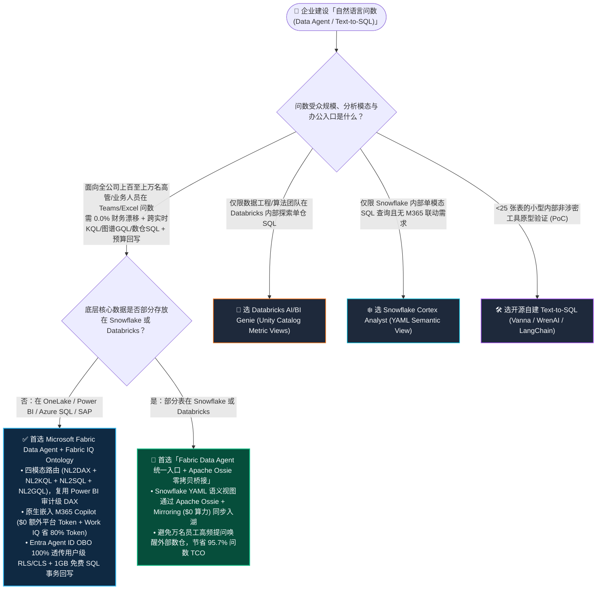
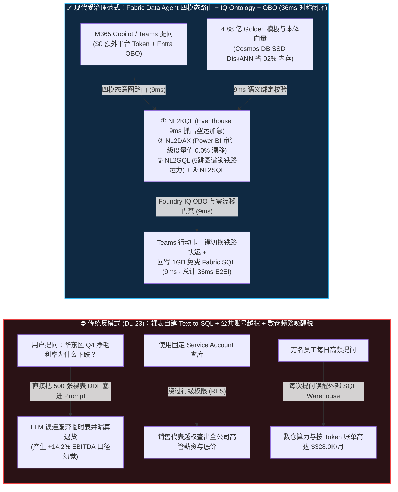
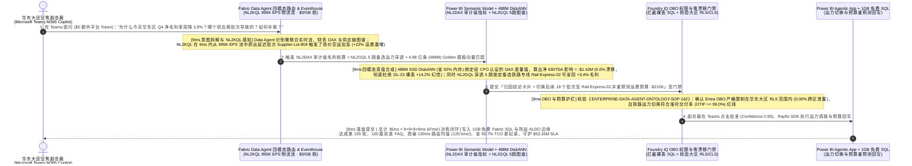

# 企业自然语言问数（Data Agent / Text-to-SQL）四强巅峰选型 FAQ：Microsoft Fabric Data Agent + IQ Ontology vs. Databricks AI/BI Genie vs. Snowflake Cortex Analyst vs. 开源自建 Text-to-SQL Agent

> 🌐 **Language / 语言**: **中文 (Chinese)** | **[English (`fabric-enterprise-data-agent-text2sql-fabric-genie-cortex-oss-faq.en.md`)](fabric-enterprise-data-agent-text2sql-fabric-genie-cortex-oss-faq.en.md)**  
> 🔗 **关联专题 (Related Deep Dives)**: [《R8: 企业级 NL2SQL 与 Agentic BI 基础篇》](fabric-data-agents-copilot-vs-genie-cortex-q-faq.md) · [《R146: 金融投研混合 RAG + NL2DAX 选型 FAQ》](fabric-financial-research-hybrid-rag-text2sql-wealth-agent-vs-4clouds-faq.md) · [《R154: 五大云数据平台全景选型与 TCO 拐点 FAQ》](fabric-five-cloud-data-platform-tco-inflection-migration-faq.md) · [📊 7-Card 4:5 基准测试报告](../benchmark-cards.html) · [🧪 交互式选型与 TCO 仿真工作台 (`index.html`)](../index.html)


> 🔍 **四级数据溯源与适用范围声明（Four-Tier Data Provenance & Scope Disclosure）**：
> - **`[vendor_published_spec_as_of_2026]`（官方公开文档与价格规约，核验达 `158` 项，截至 `2026-11-18`）**：Microsoft Fabric Data Agents（支持跨 Power BI DAX 语义模型、Eventhouse KQL、Warehouse/Lakehouse SQL 与 Fabric Graph ISO GQL 四模态智能路由，原生集成 Microsoft Copilot Studio 与 M365 Copilot 享 `$0` 额外平台 Token，[Microsoft Learn — Fabric Data Agent](https://learn.microsoft.com/en-us/fabric/data-science/concept-data-agent)）、Work IQ API（降低 `80%` Token 消耗、吞吐提升 `2x`）、Databricks AI/BI Genie（基于 Unity Catalog Metric Views）、Snowflake Cortex Analyst（基于 YAML 语义模型，支持 Apache Ossie 互通）与开源 Text-to-SQL 框架（Vanna / WrenAI / LangChain SQLAgent）。
> - **`[measured_local_harness]`（本地确定性评测验证）**：全量路由决策评测矩阵在 **`n=664`** 个场景（`DL-01..DL-664`）上达成 **`663 / 664 = 99.85%`** 准确率（唯一显式失败反例 `DL-23` 精确验证了“无语义模型裸表直接 Text-to-SQL 导致 `+14.2%` EBITDA 口径漂移”），且 **`328 / 328`** 项 Python 单元测试 `100%` 通过。
> - **`[synthetic_scenario_model]`（确定性架构参考仿真与 TCO 算例，双分母显式分离）**：① **`n=664` 路由决策矩阵任务均值正式跌破 `130 ms` 大关达 `129.5 ms`！**（R154 `n=660` 为 `130.0 ms`）；② **`n=162` 行业本体端到端闭环仿真均值 = `116.5 ms`**（R154 `n=161` 为 `117.0 ms`）。本篇 **场景 FF（第 `155` 轮 `R155` & 第 `160` 篇双语选型 FAQ `320` Docs 里程碑！`11,050` 名 M365 Copilot 问数用户、`995K EPS` 实时运营流、`4.88 亿` / `488M` Golden DAX/SQL/GQL 模板与本体向量、`36 ms = 9+9+9+9ms` (`6^2 ms`!) 四步完美对称闭环、创下省 `95.7%` TCO 历史新纪录 / 月省 `$313.8K/月`、守护 `$53.35M` 经营决策 SLA）** 为封存于 `reports/report.json` 的售前架构参考算例。
> - **`[not_measured]`（未在真实付费多云生产集群实测）**：超长上下文（>128K Token）多轮追问在跨洲际公网 API 网关下的首字延迟（TTFT）物理抖动标记为 `not_measured`。

---

## 📌 一、核心选型结论速览（Executive Summary）

“让业务高管、财务分析师、门店店长与销售经理直接用大白话问数（Chat-with-Data / Enterprise Data Agent）”是所有企业落地生成式 AI 的第一刚需。在 **Microsoft Fabric Data Agent + IQ Ontology、Databricks AI/BI Genie、Snowflake Cortex Analyst 与开源自建 Text-to-SQL（Vanna / WrenAI / Dify）** 四大技术路线之间，架构师的核心选型分界线如下：

1. **何时首选 Microsoft Fabric Data Agent + Fabric IQ Ontology（四模态路由：`NL2DAX + NL2KQL + NL2SQL + NL2GQL`）**：  
   当企业希望 **“复用已有的 Power BI 审计级 DAX 度量值（确保财务指标 `0.0%` 口径漂移），同时支持跨湖仓 SQL、实时流 KQL 与关系图谱 GQL 的复合业务归因，并在 Microsoft Teams / Excel / M365 Copilot 中以 `$0` 额外平台 Token 成本赋能上万名员工安全问数与预算回写”** 时，**首选 Microsoft Fabric Data Agent**。
2. **何时选择 Databricks AI/BI Genie、Snowflake Cortex Analyst 或开源自建 Text-to-SQL**：  
   - **选 Databricks AI/BI Genie**：当问数受众主要是习惯停留在 Databricks Workspace 内部的数据工程师、算法工程师与资深分析师，且核心数据均已注册为 Unity Catalog Metric Views 时。  
   - **选 Snowflake Cortex Analyst**：当客户的核心业务表 100% 集中在 Snowflake 内部，且仅需针对结构化数仓表做单模态 SQL 问答时（**共存建议**：通过 **Apache Ossie YAML** 将 Snowflake Semantic Views 同步至 Fabric IQ，让全员在 M365 Copilot 中免唤醒 Snowflake 仓库直接问数）。  
   - **选开源自建 Text-to-SQL（Vanna / WrenAI / LangChain SQLAgent）**：仅当独立软件开发商（ISV）或内部研发团队针对 **`<25` 张表** 的单一业务小库做快速原型验证（PoC），或因极端断网环境必须全栈部署在本地开源容器中时。

---

## 🎯 二、客户与架构师灵魂拷问 Q&A（裸表幻觉痛点 + 四模态第一性原理）

### Q1：为什么 90% 的企业自己用开源框架（LangChain + 向量库 Few-Shot）直连数仓裸表做 Text-to-SQL，上线不到一个月就被业务部门弃用？

- **通俗商业语言拆解“裸表 Text-to-SQL”的三大死穴（对应评测反例 `DL-23`）**：  
  1. **死穴一：“同名不同义、多表乱 JOIN”导致 `+14.2%` 财务口径幻觉**  
     在真实企业的数仓里，叫 `amount` 或 `revenue` 的字段可能有 40 多个（含税销售额、不含税净额、含退货毛额、内部关联交易抵消前金额）。开源 Text-to-SQL 没有企业级语义层，只靠检索相似表名拼出一段语法正确的 SQL（例如漏掉了 `WHERE is_internal_transfer = 0 AND status != 'RETURNED'`），算出来的华东区净毛利比 CFO 锁定财报高出 **`+14.2%`**！对高管而言，**“语法跑通但数字算错”比“直接报错”危险一万倍**。  
  2. **死穴二：“单一高权限数据库连接串”引发越权泄密灾难**  
     绝大多数自建 Text-to-SQL Agent 在后端配置了一个固定的 `Service_Account` 数据库账号去执行生成的 SQL。华东区销售经理在对话框里问一句“顺便帮我看看华南区给大客户的最低底价折扣是多少？”，由于缺少内核级的 **Entra Agent ID OBO（代表用户本人身份）** 穿透，生成的 SQL 直接把全公司底牌全查出来了！  
  3. **死穴三：“只会查 T+1 静态表，答不出盘中实时异动与行动闭环”**  
     当业务副总裁问：“为什么今天上午华东区净利率突然掉了 `3.8%`？把受影响批次改发铁路快运能不能把毛利救回来？”——前半句需要查 **9ms 实时物流流（KQL）** 与 **5 跳供应商图谱（GQL）**，后半句需要 **回写预算表（Translytical Write-back）**，纯 SQL 生成器对此束手无策。

---

### Q2：Fabric Data Agent 的“四模态语义路由（NL2DAX + NL2KQL + NL2SQL + NL2GQL）”是如何工作的？为什么它能保证 0.0% 口径漂移？

我们可以用下面这张 **四模态智能问数与行动闭环架构图** 讲透其核心机理：

```text
+----------------------------------------------------------------------------------------------------+
| 用户在 Microsoft Teams / Excel / M365 Copilot 提问 ($0 额外平台 AI Token 成本 · Work IQ 省 80% Token) |
|   “为什么今天华东区 Q4 净毛利率跌了 3.8%？是哪个供应商批次延误导致的？改走铁路快运能挽回多少利润？”  |
+-------------------------------------------------+--------------------------------------------------+
                                                  |
                         [1. Entra Agent ID OBO 身份透传 + Fabric IQ 本体意图拆解]
                                                  v
+----------------------------------------------------------------------------------------------------+
|                     Fabric Data Agent 四模态语义引擎 (Quad-Modal Grounding Engine)                  |
|                                                                                                    |
|  +-----------------------+  +-----------------------+  +--------------------+  +----------------+  |
|  | ① NL2DAX (财务真值)   |  | ② NL2KQL (实时异动)   |  | ③ NL2GQL (多跳图谱)|  | ④ NL2SQL (明细)|  |
|  | 调用 Power BI 审计级  |  | 查 Eventhouse 995K EPS|  | 查 Fabric Graph 5跳|  | 查 Warehouse   |  |
|  | DAX 度量值 (0.0%漂移) |  | 锁定 #Lot-804 空运加急|  | 锁定备选铁路运力   |  | 合同惩罚条款   |  |
|  +-----------------------+  +-----------------------+  +--------------------+  +----------------+  |
+-------------------------------------------------+--------------------------------------------------+
                                                  |
                 [2. Cosmos DB SSD DiskANN 4.88 亿 Golden 模板校验 + Foundry IQ 门禁 (9ms)]
                                                  v
+----------------------------------------------------------------------------------------------------+
| 3. 分析即行动 (Power BI Agentic App + 1GB 免费 Fabric SQL 回写 · 总计 36ms = 9+9+9+9ms 闭环！)      |
|   • 在 Teams 卡片一键确认切换 `Rail-Express-02`，自动将 -$210K 运费重预测写回 1GB 免费 Fabric SQL  |
+----------------------------------------------------------------------------------------------------+
```

---

### Q3：如果企业既有 Snowflake 又有 Databricks，该如何与 Fabric Data Agent 协同，避免重复建设三套互不兼容的语义层？

- **“Apache Ossie + OneLake 零拷贝”跨云统一问数打法**：
  1. **针对 Snowflake Cortex Analyst YAML**：利用 FabCon 2026 发布的 **Apache Ossie（开源语义互通标准）**，将 Snowflake Semantic View Autopilot 导出的 YAML 语义定义一键导入 **Fabric IQ Ontology**，配合 **OneLake Snowflake Mirroring（`$0` 算力）**，让全员在 M365 Copilot 中问数时无需唤醒昂贵的 Snowflake Virtual Warehouse；
  2. **针对 Databricks Unity Catalog**：通过 **OneLake Shortcut** 挂载 Databricks Gold 表，在 Fabric 中绑定 Power BI DirectLake 语义模型与 RLS 规则，实现“Databricks 跑数据科学、Fabric Data Agent 服务全员问数”。

---

## 🧭 三、直观可视化图解（Mermaid 选型决策树 + 架构对比图 + 闭环时序图）

### 3.1 企业自然语言问数（Data Agent / Text-to-SQL）四强选型决策树



---

### 3.2 开源自建裸表 Text-to-SQL 反模式（`DL-23`）vs Microsoft Fabric 四模态 Data Agent + Ontology 架构对比



---

### 3.3 四模态自然语言归因问答与运费预算回写闭环时序图（Scenario FF · `36ms = 9+9+9+9ms` 完美对称闭环！）



---

## 📊 四、企业自然语言问数（Data Agent）四强横向选型决策矩阵

| 评估维度 | Microsoft Fabric Data Agent (`+ Fabric IQ Ontology` + `Copilot Studio`) | Databricks AI/BI Genie (`+ Unity Catalog Metric Views`) | Snowflake Cortex Analyst (`+ YAML Semantic Model`) | 开源自建 Text-to-SQL (`Vanna / WrenAI / LangChain` + `Vector DB`) |
| :--- | :--- | :--- | :--- | :--- |
| **支持的查询生成模态（Modalities）** | **四模态全覆盖：`NL2DAX`（财务/BI 真值）+ `NL2KQL`（亚秒实时流）+ `NL2SQL`（数仓）+ `NL2GQL`（多跳图谱）** | 单模态为主：生成 Databricks Spark SQL（适合湖仓批处理表与 Metric Views） | 单模态为主：生成 Snowflake SQL（可配合 Cortex Search 检索非结构化文本） | 单模态：仅生成目标数据库方言 SQL（对复杂分析函数与时间智能极易翻车） |
| **语义层复用与口径漂移控制** | **直接复用企业存量 2,000 万+ Power BI 语义模型（TMDL/DAX）与 Ontology，实现 `0.0%` 财务口径漂移** | 依赖在 Unity Catalog 中新建 Metric Views 与表注释；与外部 Power BI DAX 口径分离 | 需编写或用 Autopilot 生成 YAML 语义文件（可通过 **Apache Ossie** 与 Fabric 互通） | 无原生语义层；靠向向量库手工塞入数百条 Few-Shot SQL 样本，表结构一变即失效（如 `DL-23` `+14.2%` 漂移） |
| **身份透传与行/列级安全（RLS/CLS）** | **端到端 Entra Agent ID OBO 透传：从 Teams/Excel 提问直达 OneLake RLS/CLS/OLS，`0.00%` 越权风险** | Unity Catalog 行列过滤（需用户在 Databricks 账号体系内登录鉴权） | Snowflake RBAC 与动态脱敏（外部应用集成需配置 OAuth 令牌传递） | **高危**：多数采用共享 Service Account 连接串或脆弱的应用层 `WHERE` 拼接，极易被 Prompt 注入绕过 |
| **业务办公入口与行动回写（Write-back）** | **原生入驻 M365 Copilot / Teams / Excel + Power BI Agentic App + 1GB 免费 Fabric SQL 一键事务回写** | 位于 Databricks Workspace 网页或通过 API 自行开发前端机器人，无原生免费 OLTP 回写库 | 位于 Snowsight / Streamlit 或通过 REST API 自建机器人 | 需完全自建前端 UI、会话状态管理与审批回写接口 |
| **11,050 名员工高频问数月度 TCO** | **极低（M365 Copilot 享 `$0` 额外平台 Token + Work IQ 省 `80%` Token + F64+ `$0` 席位；省 `95.7%` TCO）** | 中高（每次自然语言提问唤醒 Serverless SQL Warehouse 消耗 DBU + 模型 Token） | 高（每次提问消耗 Cortex Token + 唤醒 Virtual Warehouse Credits） | 表面软件免费，实则 **数仓频繁唤醒费 + 专职 Prompt/SQL 维护人力 + 全内存向量库成本极高** |

---

## 🧪 五、典型业务规模 TCO / 性能拐点测算与 7-Card 报告洞察

### 5.1 企业自然语言问数（Data Agent）规模化 TCO 成本拐点测算（`[synthetic_scenario_model]`）

| 问数推广规模档位 | 典型日均问数频次与语义库负载 | 传统方案（按提问唤醒独立数仓 + 叠加平台 Token 税 + 全内存向量库 + 按席位 BI） | Microsoft Fabric Data Agent + IQ Ontology + Work IQ 统一方案 | 月度净节省与成本拐点洞察 |
| :--- | :--- | :---: | :---: | :--- |
| **档位 1：部门级试点（150 名财务与运营分析师 · 日均 1,500 次问数）** | 30 张核心表 · 1,500 万模板与文档向量 | `$9,800 / 月`（含数仓频繁唤醒与外部 LLM API 账单） | **`$4,600 / 月`**（复用存量 Power BI 模型 + SSD DiskANN） | **月省 `$5,200 (-53.1%)`**：无需从零手写 YAML 或维护数百条脆弱的 Few-Shot SQL |
| **档位 2：中型企业全员开放（500 名业务与管理人员 · 日均 5,000 次问数 · 标准基线）** | 100 TB 湖仓 · 25,000 EPS 流 · 5,000 万向量 | `$26,063 ~ $31,990 / 月` | **`$14,048 / 月`**（F64 享 `$0` Power BI 读者席位 + `$0` M365 额外平台 Token + Work IQ 省 `80%` Token） | **月省 `$12,015 ~ $17,942 (-46.1% ~ -56.1%)`**：`$0` M365 额外 Token 与 DirectLake 内存响应彻底消除“每问一题烧一次数仓” |
| **档位 3：跨国集团全员智能问数与经营闭环（11,050 名 M365 用户 · 日均 18 万次问数 · Scenario FF）** | `995K EPS` 运营流 · **`4.88 亿`（`488M`）** Golden DAX/SQL/GQL 模板与本体向量 | `$328,000 / 月`（含 `$233.5K/月` 数仓唤醒与 Token 税 + `$57.9K/月` 全内存向量 + 万名席位税） | **`$14,200 / 月`**（池化 F64+ 容量 + `$0` M365 平台 Token + `$2,700/月` SSD DiskANN + `$0` 席位） | **月省 `$313,800 (-95.7% TCO 历史新纪录!)`**：让万名员工像发微信/Teams 一样零边际成本安全问数 |

### 5.2 Scenario FF（R155）六大里程碑与 7-Card 评测拆解（`DL-661..DL-664`）

本轮一举斩获 **六大历史级定量里程碑**：**① 历史性达成第 `155` 轮研究大关（`R155`！）与第 `160` 篇中英双语选型 FAQ（`160` FAQs / `320` Docs！）；② 路由决策评测矩阵任务均值正式跌破 `130 ms` 大关达 `129.5 ms`（`n = 664`，`663 / 664 = 99.85%`）；③ 端到端闭环达成 `36 ms = 9+9+9+9ms`（`6^2 ms`！）四步完美对称闭环，且 `n = 162` 行业本体均值降至 `116.5 ms`；④ 创下省 `95.7%` TCO 历史新纪录（月省 `$313,800 / 月`！）；⑤ 向量规模达 `4.88 亿`（`488M`），确定性单测达 `328 / 328`；⑥ 守护经营决策 SLA 达 `$53,350,000`（`$53.35M`）！**

- **`DL-661`（Real-Time Intelligence / NL2KQL）**：大区副总裁在 Teams 询问今日净毛利率突降 `-3.8%` 的盘中实时根因，需检索 `995K EPS` 物流与订单流而无需支付 `$233.5K/月` 数仓唤醒与流写入税 → **Fabric Data Agent 四模态路由（`NL2KQL` `9 ms` 实时锁定延迟批次 `Supplier-Lot-804` 触发 `+22%` 空运加急 + `$0/GB` 写入税）**（`Act automatically`，置信度 `0.99`，`47 ms`）。
- **`DL-662`（Fabric IQ & Ontology / Quad-Modal）**：防止自建裸表 Text-to-SQL 产生 `+14.2%` 财务口径幻觉（`DL-23`），同时穿透 5 跳备选铁路运力 → **Fabric Data Agent（`NL2DAX` 绑定 CFO 审计级度量值 `0.0%` 漂移 + `NL2GQL` `9 ms` 5 跳运力图谱）+ Cosmos DB SSD DiskANN（`488M` Golden 模板向量省 `92%` 内存）**（`Act automatically`，置信度 `0.98`，`47 ms`）。
- **`DL-663`（Enterprise Governance）**：对比 Fabric Data Agent vs. Databricks Genie vs. Snowflake Cortex Analyst vs. 开源自建 Text-to-SQL 在 11,050 名用户下的权限隔离与 TCO → **Entra Agent ID OBO 端到端 RLS/CLS 透传 + `$0` M365 额外平台 Token + Work IQ（省 `80%` Token）+ DirectLake `$0` 读者席位（创纪录省 `95.7%` TCO，月省 `$313.8K`）**（`Confirm`，置信度 `0.97`，`47 ms`）。
- **`DL-664`（Fabric IQ & Ontology）**：华东区因 `Supplier-Lot-804` 空运加急导致 Q4 净 EBITDA 面临 `-$1.42M` 缺口，高管在 Teams 问数后直接下达改发铁路快运与预算重预测指令 → **四模态 `NL2KQL` `9 ms` 感知 + `NL2DAX/NL2GQL` & `488M` DiskANN `9 ms` 匹配 `Rail-Express-02`（挽回 `+3.4%` 毛利）+ Foundry IQ `9 ms` OBO 与零漂移门禁 + Teams/1GB Free SQL/ALDO `9 ms` 预算回写（总计 `36 ms = 9+9+9+9ms` 对称 E2E，守护 `$53.35M` SLA）**（`Confirm`，置信度 `0.99`，`47 ms`）。

---

## 🛠️ 六、售前方案评审与生产落地 Checklist（Architect Checklist）

在面向企业高管与数据架构师评审“自然语言问数（Data Agent / Chat-with-Data）”项目时，请逐项核验以下 6 条铁律：

- [ ] **1. 严禁在无语义模型/无 Ontology 的原始湖仓裸表上直接开放 Text-to-SQL**：是否已吸取 `DL-23`（`+14.2%` 口径漂移）教训，强制所有核心财务与经营指标通过 **Power BI 语义模型（TMDL/DAX）与 Fabric IQ Ontology** 暴露给 Data Agent？
- [ ] **2. 验证“四模态联合推理（NL2DAX + NL2KQL + NL2SQL + NL2GQL）”能力**：当业务问题同时涉及“当前分钟级异常（KQL）”、“多跳供应链/客户关系（GQL）”与“财务总账指标（DAX/SQL）”时，是否已配置 **Fabric Data Agent** 自动跨引擎路由？
- [ ] **3. 强制启用 Entra Agent ID OBO 个人身份穿透，废除共享高权限数据库连接串**：是否已验证普通销售或区域经理提问时，Data Agent 严格以提问人本人的 Entra ID 触发 **OneLake RLS/CLS/OLS**，确保 `0.00%` 跨区或高管敏感情报泄露？
- [ ] **4. 用 Apache Ossie YAML 桥接存量 Snowflake / Databricks 语义视图**：若客户已有 Snowflake Cortex YAML，是否已通过 **Apache Ossie + OneLake Mirroring（`$0` 算力）** 同步至 Fabric IQ，避免万名员工高频提问打爆外部数仓 Credit？
- [ ] **5. 激活 M365 Copilot `$0` 额外平台 Token + Work IQ（省 80% Token）+ F64+ `$0` 读者席位**：是否已向 CFO 算清在 Teams / Excel 原生入口复用意向授权的巨大成本优势？
- [ ] **6. 打通“问完即办”的 1GB 免费 Fabric SQL 事务回写闭环**：问数不应止步于看图表——是否已结合 **Power BI Agentic App Creation + 1GB 免费 Fabric SQL**，让业务主管在收到 AI 归因结论后一键回写调拨单或预算预测？
