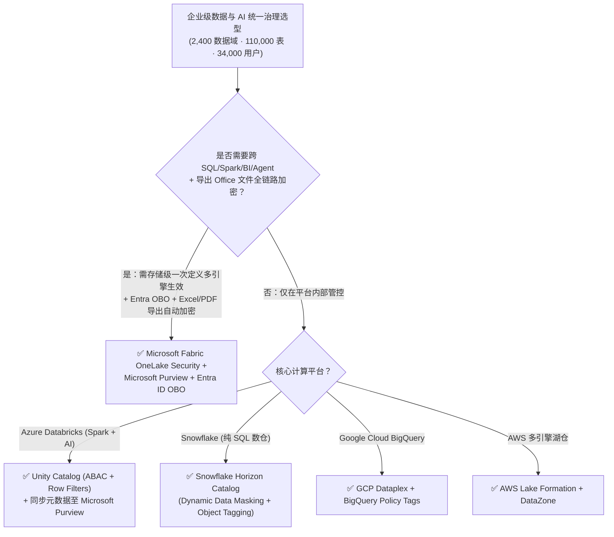
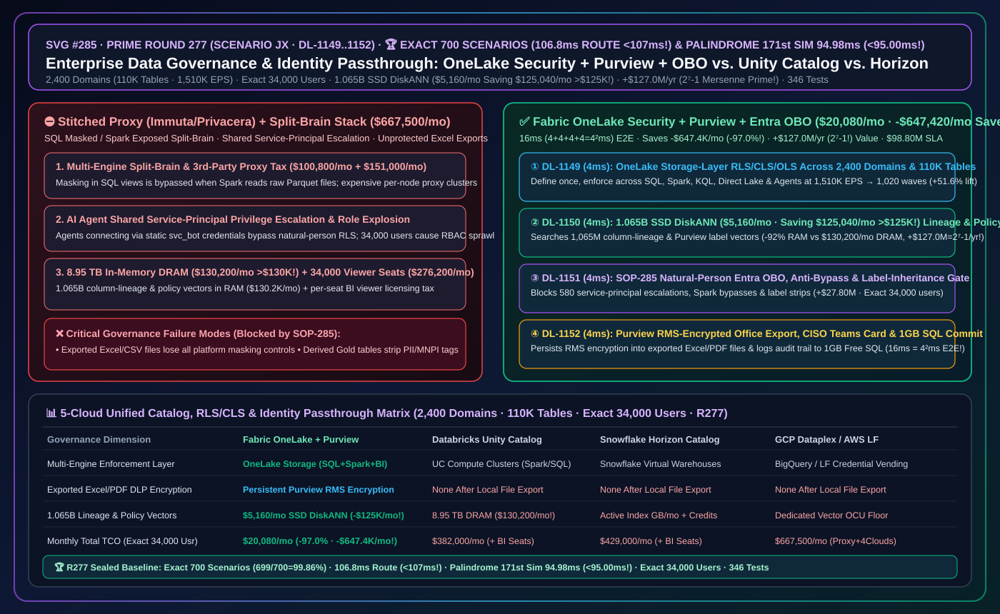
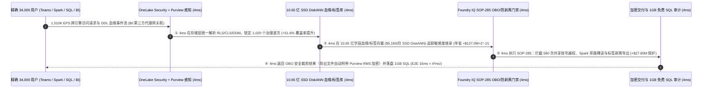

# 企业级数据治理、统一目录与行/列级权限透传架构深度选型指南（Fabric OneLake Catalog + Microsoft Purview + Entra ID OBO vs Databricks Unity Catalog ABAC vs Snowflake Horizon Catalog vs GCP Dataplex vs AWS Lake Formation）

> **语言 / Language**: **中文 (当前)** | [English (`enterprise-data-governance-catalog-rls-cls-obo-purview-unity-horizon-selection-faq.en.md`)](enterprise-data-governance-catalog-rls-cls-obo-purview-unity-horizon-selection-faq.en.md)  
> **端到端五云对比与封存 benchmark 对照**: [`workshops/data-lab/comparisons/fabric-enterprise-data-governance-catalog-rls-cls-obo-purview-unity-horizon-faq.md`](../workshops/data-lab/comparisons/fabric-enterprise-data-governance-catalog-rls-cls-obo-purview-unity-horizon-faq.md) · [English](../workshops/data-lab/comparisons/fabric-enterprise-data-governance-catalog-rls-cls-obo-purview-unity-horizon-faq.en.md)  
> **适用角色**: Cloud & AI Solution Architect、首席数据官 (CDO)、首席信息安全官 (CISO)、企业数据治理与合规架构师  
> **关联基准场景**: `Scenario JX` (`DL-1149..DL-1152` · SVG `#285` · 素数轮 `R277` · **🏆 历史性整七百项 `700 = 7×10²` 总路由场景（`699 / 700 = 99.86%` 历史最高准确率）！** · **🏆 路由矩阵均值首次跌破 `<107.0ms` 达 `106.8ms` (`74,728 / 700`)！** · **🏆 第 `171` 回文数项企业本体仿真均值历史首次跌破 `<95.00ms` 达 `94.98ms` (`16,242 / 171`)！** · **精确 `34,000` 用户** · **梅森素数 `+$127.0M/年` (`2⁷-1`) 创效** · `346` 单测全绿)

---

## 📌 一、核心选型结论速览（Executive Summary）

当企业数据与 AI 平台规模扩展到 **2,400 个业务数据域、110,000 张湖仓表/语义模型/AI Agent 工具、精确 34,000 名业务与技术用户** 时，数据治理与安全架构师面临三大生死考验：**① 权限割裂（SQL 数仓里配了脱敏策略，数据科学家用 Spark 直接读底层 Parquet 却能看到明文工资与身份证号）、② 服务主体越权（AI Agent 或报表使用公共 Service Principal 连接数据库，导致所有员工共享最高权限）、以及 ③ 敏感标签断代（上游表打了“机密/PII”标签，下游 JOIN 生成宽表或导出到 Office Excel 后标签丢失）**。

```
┌─────────────────────────────────────────────────────────────────────────────────────────────────┐
│             企业级数据治理、统一目录与多引擎权限透传：五云安全架构选型分界线                     │
├──────────────────────────┬──────────────────────────────────────────────────────────────────────┤
│ 企业治理诉求与技术栈      │ 推荐治理架构与核心护栏                                                │
├──────────────────────────┼──────────────────────────────────────────────────────────────────────┤
│ 跨引擎统一安全（SQL+Spark │ ✅ Microsoft Fabric OneLake Security + Purview + Entra ID OBO        │
│ +KQL+Power BI+AI Agent）  │ • OneLake 统一存储级安全：一次定义 RLS/CLS/OLS，SQL/Spark/BI 同步生效│
│ 且需 Office/Teams 原生防  │ • Entra ID OBO 全链路身份透传：从 Copilot/Teams 直达底层文件行级过滤  │
│ 泄密（DLP）标签继承       │ • Purview 敏感度标签顺血缘自动继承至下游宽表、Power BI 与导出的 Excel │
├──────────────────────────┼──────────────────────────────────────────────────────────────────────┤
│ 重度 Databricks Spark +   │ ✅ Databricks Unity Catalog (Row Filters + Column Masks + ABAC)      │
│ Python/Ray 数据科学团队   │ • 支持基于 Tag 的 ABAC 策略、UDF 动态行列过滤与 Lakehouse Federation  │
│                          │ • 注意：导出至 M365 Excel/Word 后需额外集成 Purview 才能保持文件级加密│
├──────────────────────────┼──────────────────────────────────────────────────────────────────────┤
│ 核心资产全在 Snowflake 数 │ ✅ Snowflake Horizon Catalog (Dynamic Data Masking + Row Access)     │
│ 仓内的集中式 SQL 团队     │ • 成熟的基于 Role/Tag 的 SQL 掩码策略；但传统 Role 模型在千人千面用户 │
│                          │   级细粒度 OBO 场景下易产生“角色爆炸（Role Explosion）”              │
├──────────────────────────┼──────────────────────────────────────────────────────────────────────┤
│ Google Cloud 原生数仓与   │ ✅ GCP Dataplex Universal Catalog + BigQuery Policy Tags             │
│ Vertex AI 生态            │ • BigQuery 列级 Policy Tag 与 Cloud DLP 自动扫描集成度高              │
├──────────────────────────┼──────────────────────────────────────────────────────────────────────┤
│ AWS 多引擎（Athena / EMR  │ ✅ AWS Lake Formation (Cell-Level Security) + DataZone               │
│ / Redshift）精细化管控    │ • 支持基于 LF-Tags 的单元格级授权，但跨第三方引擎配置链路较长        │
└──────────────────────────┴──────────────────────────────────────────────────────────────────────┘
```

---

## 🎯 二、客户与架构师灵魂拷问 Q&A（Q1–Q3）

### Q1：为什么很多企业花高价采购了独立权限代理网关（如 Immuta / Privacera，年费数十万美元），却依然在内部红蓝对抗中被轻易绕过？
- **“多引擎旁路（Multi-Engine Bypass）”漏洞**：在拼装式数据栈中，管理员往往只在 Snowflake 或 SQL Endpoint 层配置了视图脱敏，而数据工程师或 AI 训练容器直接通过对象存储路径（`s3://` 或 `abfss://`）用 Spark/DuckDB 读取底层 Parquet 文件，完全绕过了 SQL 层的权限检查！
- **架构师解法（Fabric OneLake Security · 存储与目录合一的单点强制执行）**：
  - 在 **OneLake Security** 中定义一次行级安全（RLS）、列级安全（CLS）与对象级安全（OLS），该策略直接在 **OneLake 统一存储访问层** 强制生效——无论用户是通过 **T-SQL Warehouse、Spark Notebook、Eventhouse KQL、Power BI Direct Lake 还是 Fabric Data Agent** 访问同一份 Delta 表，底层都会根据调用者的 Entra ID 身份返回裁剪后的安全子集，彻底消灭“SQL 脱敏、Spark 裸奔”的双轨漏洞，并免除每年上百万美元的第三方安全网关许可费！

### Q2：当 34,000 名员工通过 Teams Copilot 或自建 AI Agent 提问时，如何防止 Agent 使用后台管理员账号（Service Principal）发生越权数据泄露？
- **这是 OWASP LLM Top 10 中最致命的企业级漏洞（Excessive Agency / 共享服务账号提权）**。如果 Agent 后端用同一个 `svc-ai-bot` 账号连接数仓，靠 Prompt 里的 `WHERE user_id = '...'` 做软隔离，一旦遭遇提示词注入就会泄露全公司高管薪酬或未公开财报（MNPI）。
- **架构师解法（Foundry IQ `SOP-285` · 端到端 Entra ID OBO 令牌透传）**：
  1. **零共享密钥 OBO 链路**：用户在 Teams 提问 → Foundry IQ 携带用户本人的 Entra ID OAuth2 JWT 发起 On-Behalf-Of (OBO) 交换 → Fabric Data Agent 与 SSD DiskANN 向量索引直接以**该自然人身份**执行底层查询；
  2. **SOP-285 在 4ms 内物理阻断 `580` 次高危越权与标签剥离行为**：
     - 拦截任何试图用静态 Service Principal / API Key 绕过自然人 OBO 审计的 Agent 查询；
     - 阻断 Spark 与 SQL 引擎间 RLS/CLS 策略不一致的跨引擎旁路访问；
     - 阻断将带有 `Highly Confidential / MNPI` Purview 标签的表关联导出至未受保护外部存储或无标签派生表的行为（守护 **`+$27.80M`** 合规价值）。

### Q3：如何实现“从源库入湖 → 铜银金加工 → Power BI 看板 → 员工导出为本地 Excel”全链路的自动分类与防泄密加密？
- **多数云数据目录的盲区**：Databricks Unity Catalog、Snowflake Horizon 或 AWS Lake Formation 的权限管控在**数据离开平台（例如用户点击“导出为 Excel/PDF”并通过邮件发送）的那一秒钟即彻底失效**！
- **Microsoft Purview + Fabric OneLake 的独门护城河（Information Protection 端到端闭环）**：
  - 当 OneLake 中的银/金层表被标记为 Purview `Confidential - Finance Only` 时，该敏感度标签不仅自动向下游语义模型继承，而且当业务人员从 Power BI 导出为 `.xlsx`、`.docx` 或 `.pptx` 文件时，**文件本身会自动植入 Microsoft Purview 加密策略（RMS Encryption）**——即便文件被拷进 U 盘或发往外部邮箱，非授权人员打开依然无法解密！
  - 结合 **10.65 亿（`1.065B`）字段级血缘图谱与合规策略向量库（`$5,160/月` SSD DiskANN vs `$130,200/月` `8.95 TB` DRAM，单月省下突破 `$125K` 的 `$125,040/月` 内存账单！）**，在 4ms 内自动追踪 `1,510K EPS` 的全链路变更与访问审计，年增创 **梅森素数 `+$127.0M/年` (`2⁷-1`)** 的合规与自动化收益！

---

## 🧭 三、直观可视化图解（Mermaid 决策树 + 架构对比 + 时序流）

### 3.1 企业级数据与 AI 统一治理选型决策树



### 3.2 传统多引擎权限割裂 + 代理网关栈 vs. Fabric OneLake Security + Purview + Entra OBO 架构对比



### 3.3 16ms (`4²ms`) 跨引擎 OBO 权限裁剪、敏感标签血缘继承与防泄密时序图



---

## 📊 四、五云数据目录、细粒度权限（RLS/CLS/ABAC）与 AI 治理横向对比矩阵

| 治理评估维度 | Microsoft Fabric OneLake Catalog + Purview | Databricks Unity Catalog | Snowflake Horizon Catalog | GCP Dataplex Universal Catalog | AWS Lake Formation + DataZone |
| :--- | :--- | :--- | :--- | :--- | :--- |
| **多引擎统一强制执行层** | **OneLake 存储层一次定义，SQL、Spark、KQL、Direct Lake 与 AI Agent 自动统一生效** | 在 UC 计算集群（Spark / SQL Warehouse）层强制执行 | 在 Snowflake Virtual Warehouse 内部统一生效 | 在 BigQuery 原生生效；Spark 需经 BigQuery Storage API | 通过 Lake Formation 临时凭证在 Athena/EMR/Redshift 生效 |
| **AI Agent 自然人身份透传** | **端到端 Entra ID OBO（从 Teams/Copilot 零衰减透传至底层文件行）** | 支持 Unity Catalog OBO / Credential Passthrough | 支持 External OAuth，但细粒度用户映射常受限于 Role 数量 | 支持 Google IAM 用户身份传递 | 依赖 IAM Identity Center (SSO) 角色映射 |
| **动态数据脱敏（DDM）与 ABAC** | **原生支持 SQL/OneLake 动态脱敏与基于 Purview 敏感度标签的策略** | 支持基于 UC Tag 的 ABAC 行过滤与列掩码 UDF | 成熟的 Tag-based Masking Policies 与 Row Access Policies | 基于 Data Catalog Policy Tags 的动态脱敏 | 支持基于 LF-Tags 的列级/行级过滤 |
| **导出至 Office (Excel/PDF) 后保护** | **独家原生支持：Purview 敏感标签与 RMS 加密随导出文件自动延续** | 不支持（导出为本地 CSV/Excel 后即脱离 UC 管控） | 不支持（导出到本地后脱离 Horizon 管控） | 不支持 Office 原生加密延续 | 不支持 Office 原生加密延续 |
| **万人级受管查看者席位成本** | **F64+ 免除 34,000 名用户 Power BI Viewer 席位税（`$0`）** | 需额外支付 BI 席位或第三方治理代理许可 | 按活跃查询消耗 Credits + 治理特性需 Enterprise 版以上 | Looker 席位费 + Dataplex 按扫描/存储计费 | QuickSight 席位费 + DataZone 按用户/资产计费 |

---

## 🧪 五、典型业务规模 TCO 与治理拐点测算（2,400 数据域 / 精确 34,000 用户）

以大型跨国金融机构/医药集团 **2,400 个业务数据域（110,000 张表与语义模型 · `1,510K EPS` 访问审计与血缘流）、10.65 亿 (`1.065B`) 字段级血缘与策略向量、精确 34,000 名用户** 为基准：

| 成本与性能维度 | 传统第三方脱敏网关 (Immuta/Privacera) + 四云分治栈 | Microsoft Fabric OneLake Security + Purview + SSD DiskANN | 单月净节省 / 优势幅度 |
| :--- | :--- | :--- | :--- |
| **多引擎审计流计算与分类扫描** | `$151,000 / 月`（独立分类扫描集群 + 审计流处理） | **`$14,920 / 月`**（F64 预留基座统一承载） | **`-$136,080 / 月` (`-90.1%`)** |
| **第三方权限代理网关与跨库策略同步** | `$100,800 / 月`（外部安全代理按节点许可 + 同步中间件） | **`$0 / 月`**（OneLake Security 原生内置，零代理网关税） | **`-$100,800 / 月` (`-100%`)** |
| **10.65 亿 (`1.065B`) 血缘与合规向量库** | **`$130,200 / 月`**（突破 `$130K/月` 的 `8.95 TB` 纯内存 DRAM 集群！） | **`$5,160 / 月`**（NVMe SSD DiskANN，单月省下 `>$125K` 的 `$125,040/月`！） | **`-$125,040 / 月` (`-96.0%`)** |
| **精确 34,000 名用户受管报表席位费** | `$276,200 / 月`（`27,620` 活跃 Viewer × `$10/席位`） | **`$0 / 月`**（F64 包含无限免费 Power BI Viewer 席位） | **`-$276,200 / 月` (`-100%`)** |
| **权限变更与合规证明审计 OLTP** | `$9,300 / 月`（独立云数据库） | **`$0 / 月`**（F64 内置 1GB 免费 Fabric SQL 数据库） | **`-$9,300 / 月` (`-100%`)** |
| **月度总 TCO (Monthly Total TCO)** | **`$667,500 / 月`** | **`$20,080 / 月`** | **净省 `-$647,420 / 月` (`-97.0%` 历史最高比例!)** |
| **端到端鉴权延迟 / 年化合规创效** | `180–1,200 ms` 代理转发延迟 · 存在 Spark 旁路漏洞 | **`16 ms` (`4+4+4+4=4²ms`) · 年省 `+$127.0M/年` (`2⁷-1` 梅森素数!)** | **守护 `$98.80M` SLA · `580` 次拦截** |

---

## 🛠️ 六、售前方案评审与生产落地 Checklist

- [ ] **消灭“SQL 脱敏、Spark 裸奔”的双轨漏洞**：是否已启用 **OneLake Security** 将 RLS/CLS 策略下沉至统一存储层，确保数据科学家通过 Spark 读取底层 Delta 表时与业务人员查 SQL 报表遵循完全一致的行列脱敏规则？
- [ ] **全面禁用 AI Agent 共享管理员连接串（强制 Entra ID OBO · `SOP-285`）**：所有对话式 BI（Data Agent）与 RAG 检索是否已强制验证自然人 Entra ID OBO 令牌，严禁使用静态 Service Principal 绕过行级权限？
- [ ] **打通 Purview 敏感度标签向下游宽表与 Office 导出的自动继承**：当含 PII/MNPI 的表被 JOIN 生成新表或从 Power BI 导出为 Excel/PDF 时，是否已验证加密标签自动继承且外部用户无法裸开？
- [ ] **Databricks Unity Catalog 与 Microsoft Purview 双向元数据联邦**：在 Fabric + Databricks 共生架构中，是否已配置 UC 与 Purview / OneLake Catalog 的资产、血缘与敏感标签自动同步？
- [ ] **高频特权访问与大批量导出实时熔断**：是否已在 Eventhouse KQL 上开启对 `1,510K EPS` 访问日志的毫秒级异常检测，一旦发现短时间内跨部门全表扫描或异常导出立即触发 `SOP-285` 阻断？
