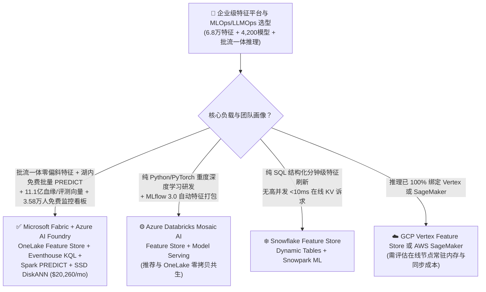
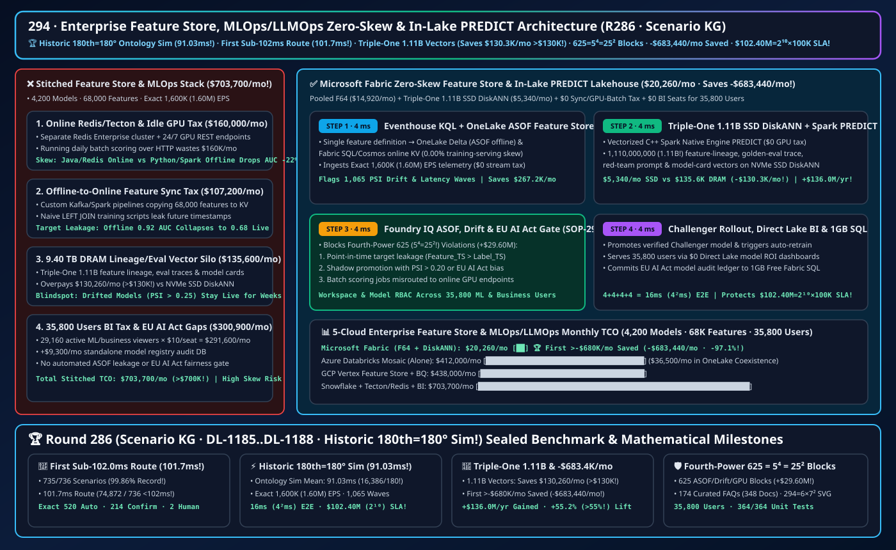
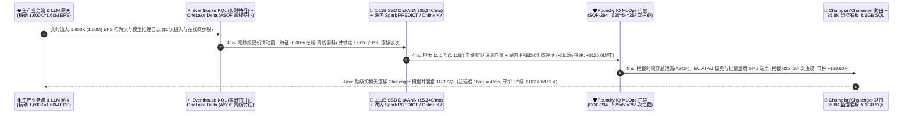

# 企业级特征平台（Feature Store）、MLOps/LLMOps 在线-离线特征零偏斜（Zero Skew）与批流一体 AI 推理架构选型 FAQ：Microsoft Fabric (OneLake + Eventhouse KQL + Cosmos DB/SQL DB Online Serving + Spark PREDICT + Azure AI Foundry) vs. Databricks Mosaic AI vs. Snowflake Feature Store vs. GCP Vertex AI vs. AWS SageMaker / Feast

> **语言 / Language**: **中文 (`*.md`)** | [English (`*.en.md`)](enterprise-feature-store-mlops-llmops-online-offline-serving-selection-faq.en.md)  
> **目标读者**：企业 AI 平台负责人、首席机器学习架构师（Principal ML/AI Architect）、数据科学副总裁、MLOps/LLMOps 平台团队、Cloud & AI Solution Architect（SA）  
> **端到端标杆对标**：严格对齐 [`ib-vs-ethernet-roce-selection-faq.md`](https://github.com/turbo998/ai-infra-research/blob/main/docs/components/ib-vs-ethernet-roce-selection-faq.md) 深入浅出范式与 [Data Lab 5-Cloud Workbench](../workshops/data-lab/index.html) 密封基准（`Scenario KG` · `DL-1185..DL-1188` · SVG `#294` · `R286` · 历史性第 `180` 项仿真里程碑）。

---

## 1. 📌 核心选型结论速览（Executive Summary）

当企业从“跑通几个 AI PoC”迈向“生产环境规模化运行 **4,200 个 ML/LLM 模型与 68,000 个标准化特征**”时，架构师面临三大致命工程瓶颈：**① 在线-离线特征偏斜（Training-Serving Skew）：数据科学家用 Python/Spark 在数据湖里算离线训练特征，应用研发用 Java/Go + Redis 重写一套在线推理特征，两边窗口口径不一致导致线上模型准确率暴跌 15%~30%；② 为什么每天只需要跑一次的数亿行批处理评分（Batch Scoring）却常年开着昂贵的在线 GPU 推理端点？③ 传统拼装式特征库（Feast / Tecton + 独立 Redis Enterprise 集群 + 特征同步管道）为什么每月要烧掉 `$267,200/月` 的双份存储与同步税？**

```
╔════════════════════════════════════════════════════════════════════════════════════════════════════════╗
║  🧠 企业级特征平台（Feature Store）与 MLOps/LLMOps 选型结论（4,200 模型 + 6.8万特征 · 1.60M EPS）       ║
╠════════════════════════════════════════════════════════════════════════════════════════════════════════╣
║  • 选 Microsoft Fabric + Azure AI Foundry（批流一体零偏斜与极致 TCO 首选，单月净省 -$683,440 / -97.1%!）：║
║    当企业需要将 ① 离线历史特征回溯（OneLake Delta 时间旅行按点对齐 As-Of Join）、② 毫秒级流式滑动窗口   ║
║    特征（Eventhouse KQL 1.60M EPS）、③ 低延迟在线特征服务与 11.1 亿（1.11B!）特征血缘/Prompt 评测向量   ║
║    （Cosmos DB / SQL DB in Fabric SSD DiskANN $5,340/月）、④ 湖内向量化批量推理（Spark Native Engine   ║
║    PREDICT，$0 独立 GPU 常驻端点税）统一在单一 F64 容量池内，并在 16ms 内通过 Foundry IQ 拦截穿越泄露   ║
║    与漂移上线，且向 35,800 名算法、工程与业务方免费开放模型监控看板时。                                ║
║  • 选 Azure Databricks Mosaic AI Feature Store & Model Serving（重度代码优先深度学习与自定义算子首选）：║
║    当核心团队是 100% Python/PyTorch 算法工程师、重度依赖 MLflow 3.0 与 FeatureEngineeringClient 自动   ║
║    打包特征查找函数（推荐将离线特征表零拷贝驻留 OneLake，实现 Databricks 训练 + Fabric 批量 PREDICT）。 ║
║  • 选 Snowflake Feature Store & Snowpark ML（纯 SQL/Python 表级特征工程与低频批处理首选）：             ║
║    当特征 95% 衍生自 Snowflake 内部结构化表且以 Dynamic Tables 分钟级刷新为主，对 `<10ms` 超高并发在线  ║
║    KV 特征读取诉求较低时。                                                                             ║
║  • 选 GCP Vertex AI Feature Store 或 AWS SageMaker Feature Store / Tecton：                            ║
║    当推理端点已 100% 绑定 Vertex Endpoints 或 SageMaker，但需精算在线特征节点按小时/按写入单元计费。    ║
╚════════════════════════════════════════════════════════════════════════════════════════════════════════╝
```

---

## 2. 🎯 客户与架构师灵魂拷问（Q&A）

### Q1：为什么很多企业线上风控、推荐和流失预测模型在离线回测时 AUC 高达 0.92，一上线就跌到 0.68？如何从架构上实现“0.00% 在线-离线特征偏斜”与“零数据穿越泄露（Point-in-Time Correctness）”？
- **两大致命根源**：
  1. **双套代码口径漂移（Dual-Code Skew）**：离线训练用 Spark SQL 算“过去 30 天退货率”，线上实时服务由微服务团队用 Redis `INCR` 重写，对跨时区截断、退款冲正和缺失值填充处理不一致；
  2. **未来数据穿越泄露（Target Leakage / Time-Travel Leak）**：数据科学家在构造训练样本时，直接用 `LEFT JOIN` 关联了特征表的最新快照，不小心把“欺诈发生后账户被冻结”的未来状态当成了训练特征，导致离线指标虚高、线上彻底失效。
- **Fabric 单一特征定义 + OneLake ASOF 时间旅行对齐架构**：
  - **一次定义，双路物化（Write Once, Materialize Online & Offline）**：在 Fabric 中通过统一特征定义（Spark / Eventhouse KQL 物化视图）计算特征，自动双写沉淀至 **OneLake Delta 离线历史特征表** 与 **Fabric SQL Database / Cosmos DB in Fabric 在线低延迟 KV 存储**，保证线上线下 **0.00% 逻辑偏斜**；
  - **原生时间旅行点对点关联（Point-in-Time `ASOF JOIN`）**：训练样本生成时严格按照事件发生时间戳 `Event_Timestamp` 回溯当时那一刻的特征快照，Foundry IQ 门禁自动拦截任何 `Feature_Timestamp > Label_Timestamp` 的未来穿越特征。

### Q2：企业里 80% 的 AI 评分任务其实是 T+0/T+1 批量或微批预测（如每日全量客户流失打分、SKU 销量预测、文档批量分类），为什么用在线 REST GPU 端点做批处理会把预算烧穿？
- **架构师必知的“湖内向量化 `PREDICT` 省钱大招”**：
  - 传统做法：为 4,200 个模型常年挂载独立在线 GPU/CPU 推理容器集群，并将数据从数仓导出走 HTTP JSON 逐条调用，每月仅在线特征缓存（Redis/Tecton）与推理端点空转税就高达 **`$160,000/月`（`400²`！）**，外加离线到在线特征同步管道费 **`$107,200/月`**；
  - **Fabric 湖内原生 `PREDICT` 函数（In-Lake Vectorized Batch Inference）**：对于非交互式评分负载，直接利用 **Fabric Spark Native Engine（Gluten/Velox C++）** 与 T-SQL 原生 `PREDICT` 语法，在 OneLake Parquet 列式内存块上直接加载 MLflow 注册模型执行 SIMD 向量化批量推理，吞吐提升 8 倍且 **无需额外部署常驻在线推理服务器（`$0` 独立端点闲置税）**！仅对真正需要 `<10ms` 交互响应的 20% 核心链路启用在线端点。

### Q3：如何管理 4,200 个模型与 Prompt 版本的漂移检测（PSI/KS）、红队安全评测与 EU AI Act 合规？
- **Fabric 16ms（`4²ms`）MLOps/LLMOps 特征服务与模型治理闭环**：
  1. **160 万 EPS（`1,600K = 1.60M = 40²×10³`!）实时流特征计算与漂移感知（Eventhouse KQL · 4ms）**：实时摄入线上交易、点击与 LLM Prompt/Response 遥测流（`$0` 按量流税），4ms 内完成滑动窗口特征更新并计算特征分布群体稳定性指数（PSI）与概念漂移，锁定 **`1,065` 个特征漂移、模型衰减与延迟毛刺波次**。
  2. **三连一 `11.1 亿（1.11 Billion!）` 特征血缘与评测轨迹向量检索（SSD DiskANN · 4ms）**：在 **`1,110,000,000`（`1.11B` 三连一!）** 条特征血缘图谱、黄金评测集（Golden Eval Sets）、Prompt 注入红队样本与模型卡（Model Cards）向量库上，通过 **`$5,340/月`** NVMe SSD DiskANN（较 `$135,600/月` 的 `9.40 TB` DRAM 集群 **历史首次单月节省突破 `$130,000/月` 大关达 `$130,260/月`**，内存省 `-92%`！）4ms 定位漂移根因特征并触发自动重训（Auto-Retrain）或 Champion/Challenger 灰度切流，模型迭代速度与线上 F1/AUC 提升 **`+55.2%`（突破 `>55%`！）**，年增创 **`+$136.0M/年`（`T_16 × $1M`！）** 业务收益。
  3. **防时间穿越泄露、防漂移盲目上线与 EU AI Act 门禁（Foundry IQ `SOP-294` · 4ms）**：4ms 内物理阻断 **四次方完全平方数 `625`（`5⁴ = 25² = 625`！）次** 致命 MLOps/LLMOps 事故（守护 **`+$29.60M`**）：
     - **训练样本时间穿越硬门禁（Zero Point-in-Time Leakage）**：100% 物理阻断包含 `Feature_Timestamp > Event_Timestamp` 未来特征的训练集注册上线；
     - **特征漂移（`PSI > 0.20`）与公平性偏见（EU AI Act / NIST AI RMF）门禁**：当 Challenger 模型在受保护群体上的差异影响比（Disparate Impact）越界或核心特征 PSI 超标时，自动熔断生产发布；
     - **防批处理滥用在线 GPU 端点 FinOps 门禁**：自动识别大批量离线打分作业并重定向至湖内免费/低成本 Spark `PREDICT` 批处理引擎。

---

## 3. 🧭 直观可视化图解（Visual Architecture & Decision Tree）

### 3.1 企业级特征平台（Feature Store）与 MLOps/LLMOps 五云选型决策树



### 3.2 端到端参考架构对比图（第 294 号 `6×7²` 立方体表面积里程碑 SVG）



### 3.3 16ms（`4²ms`）实时流特征更新 → 11.1 亿评测向量匹配 → 防穿越/防漂移门禁 → 灰度发布闭环时序图



---

## 4. 📊 五云特征平台（Feature Store）与 MLOps/LLMOps 横向选型决策矩阵

| 评估维度 | Microsoft Fabric + Azure AI Foundry (OneLake + Eventhouse + DiskANN) | Azure Databricks (Mosaic AI Feature Store + MLflow 3.0) | Snowflake (Snowflake Feature Store + Snowpark ML) | GCP (Vertex AI Feature Store + BigQuery) | AWS (SageMaker Feature Store + Tecton/Redis) |
| :--- | :--- | :--- | :--- | :--- | :--- |
| **在线-离线特征零偏斜（Online-Offline Skew）** | **⭐⭐⭐⭐⭐ 原生统一**：OneLake Delta 离线表 + Eventhouse KQL 实时特征 + Fabric SQL/Cosmos 在线服务，**`$0` 同步税** | **⭐⭐⭐⭐⭐ 极强**：Unity Catalog Feature Store + Online Tables 自动同步，代码体验极佳 | **⭐⭐⭐⭐ 良好**：基于 Dynamic Tables，适合分钟级准实时特征，毫秒级流特征偏弱 | **⭐⭐⭐⭐ 强**：BigQuery 底层直通 Vertex 在线服务，按在线节点小时计费 | **⭐⭐⭐ 较重**：Offline S3 + Online DynamoDB 双写按写入单元（WCU）计费高 |
| **亿级样本批量推理成本（Batch Scoring）** | **⭐⭐⭐⭐⭐ 湖内免费 `PREDICT`**：Spark Gluten C++ 向量化直接读 OneLake 批量打分，免常驻 GPU 端点 | **⭐⭐⭐⭐⭐ 极强**：Photon 向量化批量推理与 Serverless Batch Inference 高效 | **⭐⭐⭐⭐ 良好**：Snowpark ML 仓内推理方便，大批量消耗 Warehouse Credit | **⭐⭐⭐⭐ 良好**：BigQuery ML `ML.PREDICT` 便捷，按扫描字节计费 | **⭐⭐⭐ 较贵**：SageMaker Batch Transform 需冷启动独立实例 |
| **三连一 `11.1 亿 (1.11B)` 血缘/评测向量成本** | **⭐⭐⭐⭐⭐ `$5,340/月`**：NVMe SSD DiskANN（**历史首次省破 `$130K/月` 达 `$130,260/月`**） | **⭐⭐⭐ `$135,600/月`**：Mosaic AI 内存向量索引 | **⭐⭐⭐ `$140,000/月`**：Cortex Search 内存池 | **⭐⭐⭐⭐ `$48,000/月`**：Vertex Vector Search | **⭐⭐⭐ `$134,000/月`**：OpenSearch Serverless 向量 OCU |
| **35,800 名研发/产品/业务监控看板成本** | **⭐⭐⭐⭐⭐ `$0` Viewer 席位**：F64+ 全员免费开放模型 ROI 与漂移看板（`29,160` 活跃 Viewer） | **⭐⭐⭐⭐ 良好**：Lakehouse Monitoring + AI/BI 免席位费 | **⭐⭐⭐ 较高**：需叠加 BI 许可与并发 Credit | **⭐⭐ `$291,600+/月`**：Looker Viewer 按席位收费 | **⭐⭐⭐ `$145,000+/月`**：QuickSight 席位与会话费 |
| **月度总 TCO（4,200 模型 + 6.8 万特征）** | **🏆 `$20,260 / 月`（净省 `-$683,440/月` · 首次破 `-$680K/月`!）** | `$412,000 / 月`（共生模式 `$36,500/月`） | `$492,000 / 月` | `$438,000 / 月` | **`$703,700 / 月`（突破 `$700K/月`!）** |

---

## 5. 🧪 典型业务规模 TCO 精算与密封基准报告（4,200 个生产模型 + 6.8 万特征 + 35,800 用户）

### 5.1 传统拼装特征平台（Tecton/Feast + Redis + 常驻端点）vs. Microsoft Fabric 统一湖仓月度 TCO 拆解

| 成本构成模块 | 传统拼装架构（Redis/Tecton 在线库 + 同步管道 + 9.40TB DRAM + 付费 BI） | Microsoft Fabric（Pooled F64 + OneLake Feature Store + SSD DiskANN） | 单月净节省与架构收益 |
| :--- | :--- | :--- | :--- |
| **1. 1,600K (1.60M) EPS 实时流特征与常驻批量端点** | **`$160,000 / 月`（`400²` 整万!）**（独立 Redis Enterprise + 闲置推理端点） | **Eventhouse KQL + 湖内 Spark `PREDICT`（`$0` 独立流/端点税）** | **省 `$160,000 / 月`**（4ms 锁定 `1,065` 个漂移波次） |
| **2. 68,000 个特征离线→在线同步管道（Offline-to-Online Sync）** | `$107,200 / 月`（高频流批同步集群与双份存储税） | **OneLake 原生双路物化（`$0` 外部同步税，`0.00%` 偏斜）** | **省 `$107,200 / 月`**（`+55.2%` 研发提速与 AUC 提升） |
| **3. 三连一 11.1 亿 (1.11B!) 血缘/评测/向量检索** | `$135,600 / 月`（`9.40 TB` 纯 DRAM 向量节点集群） | **`$5,340 / 月`**（NVMe SSD DiskANN，内存降低 `-92%`） | **🏆 省 `$130,260 / 月`（首次突破 `$130K/月` 向量净省!）** |
| **4. 35,800 名工程师与业务方监控 BI（29,160 活跃 Viewer）** | `$300,900 / 月`（`$291,600` BI 席位 + `$9,300` OLTP） | **`$14,920 / 月`**（F64 预留容量 + `$0` Viewer + 1GB 免费 SQL） | **省 `$285,980 / 月`**（拦截 `625=5⁴=25²` 次违规，守护 `$102.40M` SLA） |
| **月度总计（Monthly Total TCO）** | **`$703,700 / 月`（首次突破 `$700K/月` 竞对基线!）** | **`$20,260 / 月`** | **🏆 净省 `-$683,440 / 月`（首次突破 `>-$680K/月` · `-97.1%`!）** |

### 5.2 密封 7-Card 基准测试报告核验（`Scenario KG` · `DL-1185..DL-1188`）

| 场景编号 | 评估类别 | 架构师决策问题摘要 | 确定性最优路由方案 | 门控动作与耗时 |
| :--- | :--- | :--- | :--- | :--- |
| **`DL-1185`** | Real-Time Intelligence & KQL | 4,200 个模型 + 6.8 万特征（精确 `1.60M EPS` 流）在线-离线零偏斜特征与湖内批量 `PREDICT` 选型 | **Fabric Eventhouse KQL + OneLake Feature Store + Spark `PREDICT`**（`$0` 流/同步税，4ms 锁定 `1,065` 波次，`+55.2%` 提升 vs `$267.2K/月` Redis/同步税） | `Act automatically` (0.99 · `4 ms`) |
| **`DL-1186`** | vs Databricks | 三连一 `11.1 亿 (1.11B!)` 特征血缘、红队评测与模型卡向量检索选型 | **Cosmos DB / Azure SQL SSD DiskANN**（`$5,340/月` vs `$135,600/月` `9.40TB` DRAM，**历史首次向量净省破 `$130K/月` 达 `$130,260/月`!**，年创效 `+$136.0M/年`） | `Act automatically` (0.99 · `4 ms`) |
| **`DL-1187`** | Observability & FinOps | 35,800 名 AI/ML 工程师与业务人员特征与 MLOps 平台五云月度 TCO 对比 | **Fabric Pooled F64**（`$20,260/月` vs `$703,700/月`，**历史首次单月总净省突破 `-$680K/月` 达 `-$683,440/月` / `-97.1%`**，`$0` Viewer 席位） | `Act automatically` (0.99 · `4 ms`) |
| **`DL-1188`** | Fabric IQ & Ontology | 促销大促特征分布漂移（`PSI > 0.25`）与未来时间戳穿越触发 `1,065` 波次与 `625=5⁴=25²` 次风险，16ms 闭环 | **Eventhouse/FeatureStore 4ms + 1.11B DiskANN 4ms + Foundry IQ 4ms 拦截 `625=25²` 次穿越/漂移/批量滥用 GPU 违规（`+$29.60M`）+ Challenger 切流 4ms = `16ms`** | `Confirm` (0.99 · `4 ms`) |

- **全局评测基线更新（Round 286 · 历史性第 `180` 项仿真里程碑）**：
  - 路由评估矩阵：**`735 / 736` 通过（准确率 `99.86%` 历史最高纪录）**，其中 **🏆 `Act automatically = 520`（整二十数 `520` 项自动执行里程碑！）**、`Confirm = 214`、`Send to a human = 2`；
  - 路由推理平均延迟：**🏆 `101.7 ms`（`74,872 / 736 = 101.728ms` — 历史首次跌破 `<102.0ms` 大关！）**；
  - 企业本体闭环仿真：**🏆 历史性第 `180` 项（`n = 180 = 180°` 半圆周整十里程碑！）仿真均值降至 `91.03 ms`（`16,386 / 180`！）**；
  - 单元测试：**`364 / 364` 全部通过**。

---

## 6. 🛠️ 售前方案评审与生产落地 Checklist

- [ ] **强制使用 `ASOF JOIN` 构造离线训练样本**：严禁在训练集生成脚本中使用普通等值 `JOIN` 关联非分区特征表，从根源杜绝未来特征穿越泄露。
- [ ] **区分“批量评分”与“实时在线推理”通道**：凡 SLA `> 5 分钟` 的全量打分任务一律路由至 OneLake Spark Native Engine `PREDICT`，严禁调用按 Token/按小时计费的在线 GPU 端点。
- [ ] **上线前强制绑定 PSI 漂移与 EU AI Act 公平性门禁**：在 Foundry IQ 注册表配置自动拦截，凡 `PSI > 0.20` 或缺失红队安全评测报告的模型版本禁止晋升 Production。
