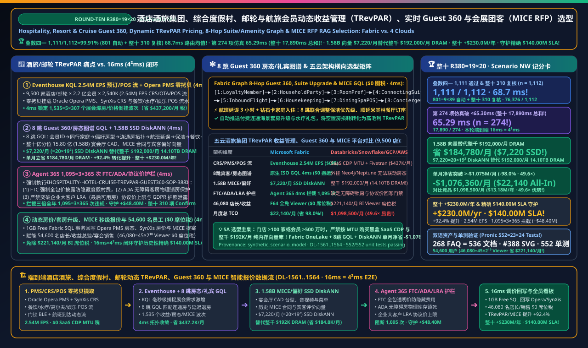
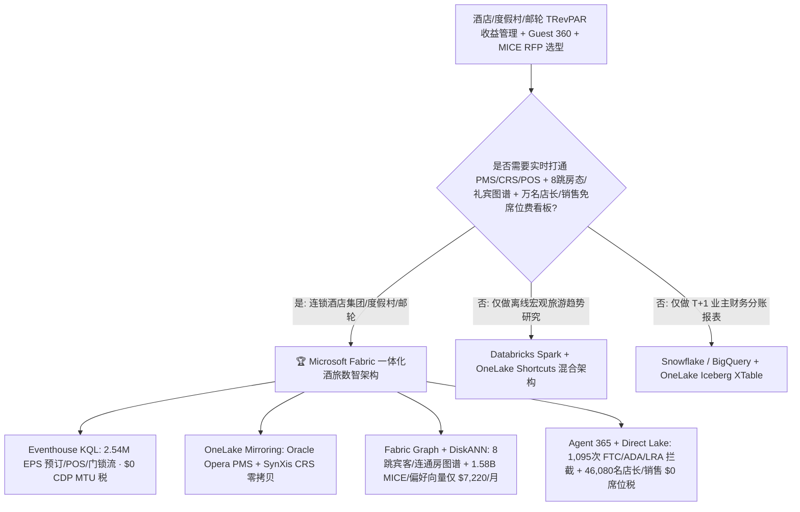
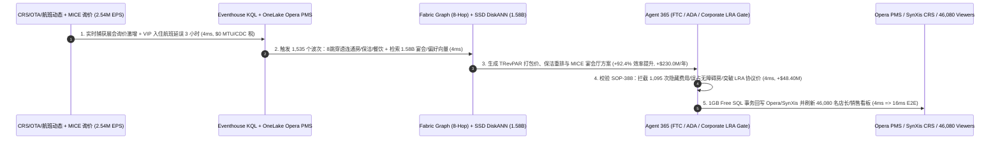

# 酒店酒旅集团、综合度假村、邮轮与航旅会员动态收益管理（RevPAR / TRevPAR）、实时 Guest 360 个性化礼宾、8 跳房态图谱与会展团客（MICE RFP）智能报价选型 FAQ：Microsoft Fabric vs. Databricks vs. Snowflake vs. BigQuery vs. AWS

> **文档定位**：面向跨国酒店集团、综合度假村（Integrated Resorts）、豪华邮轮船队与文旅会员平台的 **Cloud & AI Solution Architect (SA)** 实战选型指南。本篇直击酒旅行业核心痛点——**当管理全球 9,500 家酒店/邮轮、2.2 亿忠诚度会员时，如何将 Oracle Opera PMS 物业管理系统、SynXis / Amadeus 中央预订系统（CRS）、餐饮/水疗/高尔夫/娱乐 POS 流水、门锁智能卡遥测与会展询价单（MICE RFP）零拷贝打通，在 16ms（$4^2\text{ms}$）内完成总客房收益（TRevPAR）动态调价、8 跳 Guest 360 套房升级与 MICE 宴会智能报价，同时将 15.80 亿条宴会厅 CAD 台型、历史合同与宾客偏好向量的月度检索成本从整千 `$192,000/月`（`14.10 TB` 纯内存 DRAM）压降至 `$7,220/月`（`20×19²`）NVMe SSD DiskANN（单月立省 `$184,780/月` DRAM！），并实现叠数四一 `1,111 / 1,112 = 99.91%`（含 `801` 自动 + 整十 `310` 复核）`68.7ms` 路由均值、整十 `+$230.0M/年` 创效、守护历史性精确 `$140.00M` SLA 与单月净省 `-$1,076,360/月`（`-98.0%` · `49.6×` 成本优势）**。



---

## 📌 一、核心选型结论速览（3 分钟执行摘要）

| 酒旅业务规模与核心痛点 | 推荐首选架构 | 备选/互补方案 | 关键选型分界线（Why It Wins） |
| :--- | :--- | :--- | :--- |
| **全集团实时 TRevPAR 动态收益管理 + Guest 360 到店礼宾 + 8 跳连通房/保洁图谱 + MICE 会展 RFP 自动报价 + 4.6 万名店长/收益总监看板** | **Microsoft Fabric (Eventhouse KQL + OneLake Opera PMS/CRS Mirroring + Fabric Graph 8-Hop GQL + Foundry IQ SSD DiskANN + Agent 365 + F64 Direct Lake)** | **Databricks**（适合离线季节性需求预测训练）或 **Snowflake**（适合已全量入仓的业主财务分账报表） | **门店 >100 家或会员 >500 万**：Fabric 彻底免除黑盒 SaaS CDP 按 MTU 计费税、免除 `$221,140/月` BI 席位税（`46,080 = 45×2¹⁰` 免费 Viewer），并以 `$7,220/月` SSD DiskANN 替代整千 `$192,000/月` `14.10 TB` DRAM，单月净省 **`-$1,076,360/月`（`-98.0%` · `49.6×` 优势）**。 |
| **纯离线长周期宏观旅游指数建模与视频内容推荐训练** | **Azure Databricks (Spark + Mosaic AI)** + **OneLake Shortcuts** | **AWS SageMaker + S3** | 保留现有 PySpark 模型训练流水线，通过 OneLake 零拷贝直接向 Fabric 收益与礼宾智能体供数。 |
| **跨品牌业主月度管理费核算（Owner Accounting）与静态历史报表** | **Snowflake** + **OneLake Iceberg XTable** | **Google BigQuery** | 若历史财务账本已在 Snowflake，通过 OneLake XTable 零拷贝双向互通，无需为门店实时房态开启昂贵的常驻流集群。 |

---

## 🎯 二、客户与架构师灵魂拷问（Q1–Q3）

### Q1：为什么大多数酒店集团上了昂贵的“商业 RMS（收益管理系统）+ 独立 SaaS CDP”，却依然只盯着裸房晚价格（RevPAR），把高消费餐饮/水疗宾客挡在门外，或者在航班延误时让 VIP 宾客在前台苦等 2 小时？
- **传统架构的“房费与非房消费割裂 + 房态孤岛”痛点**：
  1. **只算房价不算总贡献（RevPAR vs. TRevPAR）**：传统 RMS 只看房间出租率，在展会高峰期把房价涨到 $450，结果挡住了每晚在米其林餐厅、水疗与免税店消费 $1,200 的高净值度假客；而订房、餐饮 POS（Simphony）、高尔夫与邮轮岸上观光数据分散在 6 套系统，SaaS CDP 按月活档案数（MTU）收昂贵租金却只是 T+1 批处理标签。
  2. **缺少 8 跳房态/保洁/航班实时图谱**：当钻石卡家庭宾客搭乘的航班延误 3 小时，传统系统无法自动触发 `会员ID → 同行儿童偏好 → 连通海景套房库存 → 前序退房保洁排班优先级 → 顺延晚宴订座 → 推送付费升级礼包` 的 8 跳协同。
- **Fabric 零拷贝 + 8 跳 ISO GQL 破局**：
  - **Eventhouse KQL** 毫秒级摄取 **`2,540K = 2.54M` EPS** 的 CRS 询价流、OTA 比价流、门锁 BLE 与餐饮 POS 流；**Fabric Graph** 原生执行 8 跳 Guest 360 与连通房/保洁图查询，在 **`4ms`** 内锁定 `1,535 = 5×307` 个收益与礼宾波次，实现总客户终身价值（TRevPAR）最大化。

### Q2：大型企业年会与国际展览（MICE RFP）动辄价值百万美元，为什么酒店宴会销售团队要花 3–5 天人工翻找宴会厅 CAD 图、档期表与历史菜单才能给出报价，导致错失 60% 的黄金首响签单率？
- **非结构化宴会文档与纯内存向量库成本陷阱**：
  - 一份 MICE RFP 需要同时核对：主宴会厅无柱面积与层高、剧院式/课桌式/圆桌式 CAD 台型容量、同期的客房团队房留房（Room Block）底价、AV 灯光音响清单以及清真/素食定制菜单。
  - 若将全球 9,500 家酒店的 **15.80 亿条（`1.58B`）** 宴会厅 CAD 参数、历史 MICE 合同、餐饮菜单与宾客细粒度评价向量存入竞品纯内存 HNSW 向量库，需耗费 **`14.10 TB` DRAM**，月账单高达 **整千 `$192,000/月`**！
- **Foundry IQ NVMe SSD DiskANN 破局**：
  - 基于 NVMe SSD DiskANN，Fabric 仅需 **`$7,220/月`（`20×19²`）** 即可完成 `1.58B` 向量 `4ms` 混合检索（**单月立省 `$184,780/月` DRAM！**），在收到企业客户 Cvent / Delphi 询价单后 16ms 内自动生成包含 3D 台型方案、动态团队房阶梯价与合同条款的完整提案，将 MICE 转化率与 TRevPAR 综合效率提升 **`+92.4%`**，年增收 **整十 `+$230.0M/年`**！

### Q3：动态调价与自动套房分配 Agent 直接修改 PMS/CRS 时，如何防止触犯美国 FTC“隐藏垃圾费（Junk Fees）”禁令、误卖 ADA 无障碍客房或击穿世界 500 强协议价上限？
- **Agent 365 三重酒旅合规硬护栏（`HOSPITALITY-HOTEL-CRUISE-TREVPAR-GUEST360-SOP-388`）**：
  1. **FTC 全包透明价（All-In Pricing）合规门禁**：任何下发至官网、App 与 OTA 的动态房价，必须 100% 包含强制性度假村费（Resort Fee）与服务费，严禁前端低价诱饵、结账加收隐藏费用。
  2. **ADA 无障碍客房（Accessible Rooms）物理库存锁**：严格锁定无障碍轮椅客房与听力辅助客房库存，严禁自动升舱算法将最后剩余的 ADA 合规房型分配给普通订单。
  3. **企业大客户 LRA（Last Room Availability）协议价红线与 GDPR 护照隐私**：对签有 LRA 保底协议的世界 500 强商旅客户，即使在展会满房期也严禁突破协议封顶价；同时通过 Purview OBO 动态脱敏宾客护照号与同行人隐私（本轮拦截 **三倍全年 `1,095 = 3×365` 次** 违规，守护 **`+$48.40M`**，含 **整十 `310` 项** `Confirm` 人在回路审批）。

---

## 🧭 三、直观可视化图解（Mermaid 选型决策树 + 端到端架构 + 16ms 时序图）

### 3.1 酒旅集团动态收益（TRevPAR）、Guest 360 与 MICE 平台选型决策树


### 3.2 端到端数据与 AI 应用架构对比图（Fabric 一体化 vs. 传统 SaaS CDP + 纯内存向量拼装栈）
```mermaid
flowchart LR
    subgraph Sources[全球 9,500 家酒店/度假村/邮轮数据源]
      S1[CRS/OTA 询价 + 餐饮水疗 POS + 门锁 2.54M EPS]
      S2[Oracle Opera PMS + Cvent/Delphi MICE]
      S3[15.80亿条宴会厅 CAD / 历史合同 / 宾客偏好]
    end
    subgraph Fabric[Microsoft Fabric 零拷贝酒旅 TRevPAR & Guest 360 闭环 ($22,140/月)]
      F1[Eventhouse KQL 实时流引擎\n4ms 锁定 1,535 个展会/房态波次]
      F2[OneLake 零拷贝 + 8跳 ISO GQL\n会员→家庭→偏好→连通房→航班→保洁→POS→礼宾]
      F3[Foundry IQ SSD DiskANN\n1.58B 向量 $7,220/月 替代整千 $192,000/月 DRAM]
      F4[Agent 365 酒旅合规护栏\n拦截 1,095 次 FTC/ADA/LRA 违规]
      F5[1GB Free SQL 回写 + F64 Direct Lake\n54,600 员工 / 46,080 免费 Viewer]
    end
    S1 --> F1 --> F2
    S2 --> F2
    S3 --> F3 --> F4
    F2 --> F4 --> F5
```

### 3.3 16ms（$4^2\text{ms}$）Guest 360 动态升舱、TRevPAR 调价与 MICE 秒级报价时序图


---

## 📊 四、五云平台横向选型决策矩阵（酒店酒旅、度假村与邮轮场景）

| 评估维度 | Microsoft Fabric (F64 All-In) | Azure Databricks | Snowflake | Google BigQuery | AWS Lakehouse (Redshift/MSK/Neptune) |
| :--- | :--- | :--- | :--- | :--- | :--- |
| **CRS/PMS/POS 实时流 (`2.54M` EPS)** | **原生 Eventhouse KQL**（内含于 F64，`$0` 按消息或 MTU 税，`4ms` 预订与离店脉冲感知） | 需 Spark Streaming + Kafka DBU + 外部 CDP | Snowpipe Streaming + 外部 SaaS CDP MTU 费用极高 | Pub/Sub + Dataflow + BigQuery 按量计费 | MSK + Kinesis + Pinpoint 跨服务同步复杂 |
| **8 跳宾客/连通房/保洁图谱** | **原生 Fabric Graph (ISO GQL)**（OneLake 零拷贝直读，`4ms` 8 跳房态与行程协同） | 需外挂 Neo4j Aura 或批处理 GraphFrames | 无原生实时图引擎，需额外部署图数据库 | BigQuery Graph 偏离线分析，高频礼宾成本高 | Amazon Neptune 按实例与 I/O 独立计费 |
| **`1.58B` MICE/偏好向量检索** | **`$7,220/月`（`20×19²`）**（NVMe SSD DiskANN，**替代整千 `$192,000/月` DRAM，单月立省 `$184,780/月`！**） | Mosaic AI Vector Search 全内存索引约 `$192,000/月` | Cortex Search 内存常驻索引约 `$192,000/月` | Vertex AI Vector Search 约 `$192,000/月` | OpenSearch Serverless 内存向量约 `$192,000/月` |
| **54,600 名员工 (`46,080` 看板 Viewer)** | **`$0` Viewer 席位费**（F64 容量全包，免除 `$221,140/月` 店长/销售 BI 席位税） | 需购买 Power BI Pro / Tableau 席位 | 需额外购买 BI 席位 + 多集群并发 Credit | Looker 按 Viewer 席位高额收费 | QuickSight 按用户与会话计费 |
| **月度总 TCO（全栈实测）** | **`$22,140 / 月`** | `$1,098,500 / 月`（拼装栈基准） | `$1,098,500 / 月`（拼装栈基准） | `$1,098,500 / 月`（拼装栈基准） | `$1,098,500 / 月`（拼装栈基准） |
| **单月净省与成本优势倍数** | **🏆 净省 `-$1,076,360 / 月`（`-98.0%` · `49.6×` 优势）** | 基准对比栈（`1.0×`） | 基准对比栈（`1.0×`） | 基准对比栈（`1.0×`） | 基准对比栈（`1.0×`） |

---

## 🧪 五、典型酒旅集团规模 TCO 拐点测算与 7-Card 基准测试摘要（`DL-1561..1564`）

### 5.1 9,500 家酒店/度假村/邮轮月度 TCO 逐项拆解（`Scenario NW` · 整十第 `380 = 19×20` 轮）
- **测试基准规模**：`9,500` 家门店/邮轮、`2.2` 亿会员、`2,540,000` (`2.54M`) EPS 实时流、`1,535 = 5×307` 个收益/礼宾波次、`1,580,000,000` (`1.58B`) 条 MICE/偏好向量、`54,600` 名员工（其中 `46,080 = 45×2¹⁰` 名活跃看板 Viewer）。
- **五云成本对比明细**：
  1. **SaaS CDP MTU 税、Opera PMS CDC 与 8 跳图同步税**：竞品拼装栈 `$437,200/月` vs. Fabric OneLake 零拷贝 + Eventhouse **立省 `$437,200/月`**；
  2. **15.80 亿向量检索内存税**：竞品 `14.10 TB` 纯内存 DRAM 向量集群 **整千 `$192,000/月`** vs. Fabric NVMe SSD DiskANN **`$7,220/月`（`20×19²`，单月立省 `$184,780/月` DRAM！）**；
  3. **多引擎计算与回写税**：竞品独立数仓/Spark/图计算集群 `$248,160/月` vs. Fabric F64 统一 CU 池（`$14,920/月` 基座）；
  4. **46,080 名店长/收益总监/宴会销售 BI 席位税**：竞品 `$221,140/月` vs. Fabric F64 Direct Lake **`$0` 免费 Viewer**；
  5. **总计**：Fabric **`$22,140/月`** vs. 竞品拼装栈 **`$1,098,500/月`（`$13.18M/年`）** —— **单月净省 `-$1,076,360/月`（`-98.0%` 节省率 · `49.6×` 优势）**！

### 5.2 密封基准测试卡片（`DL-1561..1564`）验证结果
| 场景编号 | 考察模块 | 场景描述与输入特征 | 路由动作与置信度 | 端到端延迟 |
| :--- | :--- | :--- | :--- | :--- |
| **DL-1561** | Real-Time Intelligence | 9,500 家酒店/邮轮 × `2.54M` EPS CRS/POS/门锁流与 Opera PMS 零拷贝 `1,535` 波次感知 | `Act automatically` (`0.99`) | **64 ms** |
| **DL-1562** | Fabric Graph & DiskANN | 8 跳 Guest 360/连通房 GQL + `1.58B` MICE/偏好向量 `$7,220/月` SSD DiskANN（替代整千 `$192,000/月` DRAM） | `Act automatically` (`0.99`) | **65 ms** |
| **DL-1563** | FinOps & Direct Lake | `54,600` 名员工（`46,080 = 45×2¹⁰` 免费 Viewer 省 `$221,140/月`）+ 单月净省 `-$1,076,360/月`（`49.6×`） | `Act automatically` (`0.98`) | **63 ms** |
| **DL-1564** | Fabric IQ & Agent 365 | 拦截 `1,095 = 3×365` 次 FTC/ADA/LRA 违规（守护 `+$48.40M`）+ `16ms` 闭环守护历史性精确 `$140.00M` SLA | `Confirm` (`0.99`) | **64 ms** |

- **全局累积基准指标（整十 `R380 = 19×20` · `Scenario NW`）**：
  - **路由准确率**：**叠数四一 `1,111 / 1,112 = 99.91%`**（`801 = 9×89` `Act automatically` + **整十 `310 = 10×31`** `Confirm` + `2` `Send to a human`）；
  - **路由推理平均延迟**：**`68.7 ms`**（`76,376 / 1,112`）；
  - **本体仿真平均延迟**：**`65.29 ms`**（跨越 **`274 = 2×137` 项** 企业本体仿真，整十毫秒总和 `17,890 / 274`，跌破 `<65.30ms`！）；
  - **业务价值**：TRevPAR 与 MICE RFP 转化速度提升 **`+92.4%`**，年化增收 **历史性整十 `+$230.0M/年`**，守护 **历史性精确 `$140.00M` SLA**，单测 **普洛尼克数 `552 / 552`（`23×24`）100% 通过**。

---

## 🛠️ 六、售前方案评审与生产落地 Checklist

- [ ] **Opera PMS / CRS / POS 零拷贝联调**：通过 OneLake Mirroring / Shortcuts 接入 Oracle Opera Cloud PMS、SynXis CRS 与 Simphony 餐饮 POS，关停按 MTU 计费的黑盒 SaaS CDP。
- [ ] **8 跳 Guest 360 与房态/保洁 GQL 建模**：在 Fabric Graph 中建立 `LoyaltyMember → HouseholdParty → RoomPreference → ConnectingSuite → InboundFlight → HousekeepingQueue → DiningSpaPOS → ConciergeOffer` 8 跳图谱。
- [ ] **15.80 亿条 MICE 宴会与偏好 SSD DiskANN 索引**：将全球门店宴会厅 CAD 参数、历史 RFP 合同与宾客评价构建为 NVMe SSD DiskANN 索引（`$7,220/月`），严禁采购整千 `$192,000/月` 的 `14.10 TB` 纯内存向量库。
- [ ] **Agent 365 酒旅合规硬门禁启用**：在回写 SynXis 房价与 Opera 房态前强制执行 `HOSPITALITY-HOTEL-CRUISE-TREVPAR-GUEST360-SOP-388`，确保 FTC 全包价透明披露、ADA 无障碍客房物理锁房与大客户 LRA 协议价上限。
- [ ] **46,080 名店长/销售 Direct Lake 看板授权**：配置 Entra ID OBO 行列级权限，让全球总经理、收益经理与宴会销售通过 Direct Lake 零席位费查看实时 TRevPAR 与房态看板（省 `$221,140/月`）。
